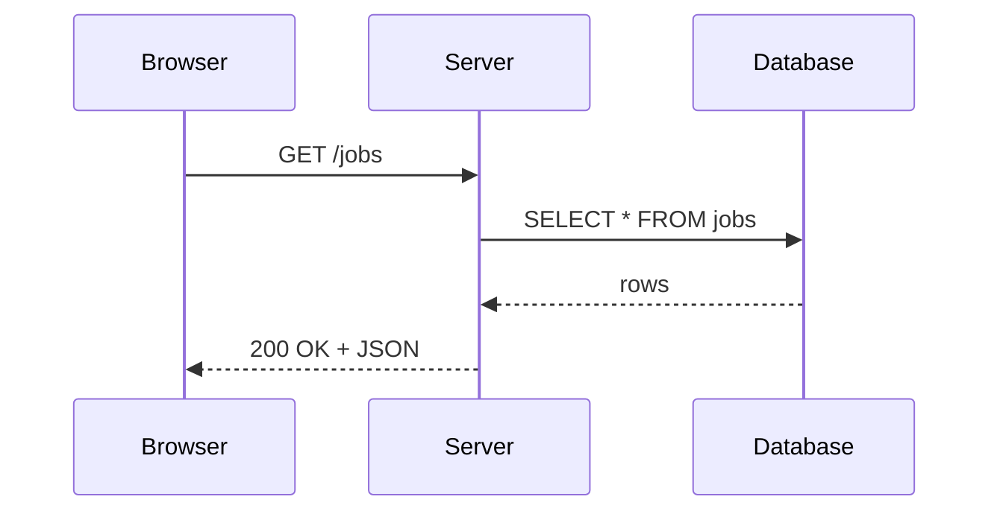

This page shows how each block **looks** and how to **write** it. See `docs/ADDING_CONTENT.md` for the full guide.

::part[Learn the Concept]{n="1"}

## Headings, text and lists

Normal Markdown works: **bold**, *italic*, `inline code`, [external link](https://react.dev), and [internal link](/settings).

1. Ordered lists
2. Work too

| Syntax | Renders as |
|---|---|
| `**bold**` | **bold** |
| `` `code` `` | `code` |

## Key terms in Bahasa

A :term[REST API]{bahasa="antarmuka yang aturannya memakai HTTP — URL untuk data, method (GET/POST) untuk aksi"} lets two programs talk over HTTP. Hover or tab to the underlined word.

## Callouts

:::tip
Short, practical advice.
:::

:::warning[Watch out]
Something that commonly goes wrong. The text in `[brackets]` becomes the title.
:::

:::danger
Something that can break production or cost money.
:::

:::revoshop
Open `app/services/` in your RevoShop repo. Which function checks that a product has enough stock?
:::

:::fastapi
In FastAPI the same route uses a decorator like `@app.get("/items/{item_id}")`, and the type hint `item_id: int` validates the input for you.
:::

:::bahasa
**Idempotent** artinya: dijalankan sekali atau berkali-kali, hasil akhirnya sama.
:::

## Code

```python
def count_words(text: str) -> dict[str, int]:
    """Count how often each word appears."""
    counts: dict[str, int] = {}
    for word in text.lower().split():
        counts[word] = counts.get(word, 0) + 1
    return counts
```

```tsx
type Props = { name: string }

export function Hello({ name }: Props) {
  return <p>Hello, {name}!</p>
}
```

## Diagrams



::part[Explain & Design]{n="2"}

## Quick check

:::quiz
Why do we put a callout in a separate block instead of just bold text?

Because a block has a clear visual boundary, an icon and a title, so readers can scan for tips and warnings without reading every paragraph.
:::

::part[Toy Exercise]{n="3"}

## Hints

:::hints
- Start by reading the error message from the bottom up.
- Print the value right before the line that fails.
- Check the type: is it a `str` when you expected an `int`?
:::

## Self-review and AI review slot

**📝 Self-review checklist**

- [ ] I explained it without jargon
- [ ] I gave a real-life example

::ai-review{task="explain"}

## Local exercise

:::exercise{path="exercises/_example/01-word-count" ai="no-ai" title="Count the words"}
Implement `count_words(text)` in `word_count.py` so it returns how often each word appears.
:::

## DSA problem (joins the review queue)

:::problem{id="example-word-count" title="Word Frequency" difficulty="easy" path="exercises/_example/01-word-count"}
Given a sentence, return how many times each word appears, ignoring case.
:::

## In-browser editor with tests

:::sandpack{template="test-ts" title="Sum an array"}
```ts sum.ts
export function sum(values: number[]): number {
  // TODO: return the total of all values
  return 0
}
```

```ts sum.test.ts
import { sum } from './sum'

test('adds all numbers', () => {
  expect(sum([1, 2, 3])).toBe(6)
})

test('empty array is 0', () => {
  expect(sum([])).toBe(0)
})
```
:::

## Placement check

::::placement{id="guides/showcase"}
Answer these from memory.

:::quiz
What is the difference between a variable and a value?

A value is the data itself (`42`); a variable is a name that points to a value (`age = 42`).
:::
::::

## LinkedIn template

:::linkedin{type="weekly"}
🧠 One thing that surprised me this week: [your insight].

This week in my AI full-stack journey:
- [Concept 1 in one line]
- [Something I built]
- [A bug I fixed and what it taught me]

Next week: [what's next]. What helped you most when you learned this?

#LearningInPublic #FullStack #Python
:::

## Unknown directives stay as text

Writing "Ratio:Value" or "Note:done" does not break anything.
