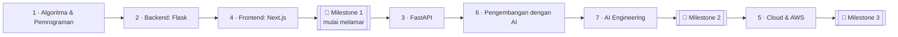

Handbook ini punya satu tujuan: **kamu jadi AI full-stack engineer siap kerja yang benar-benar paham apa yang kamu buat** — bukan hanya orang yang bisa copy-paste kode atau suruh AI.

Setiap materi ditulis dalam bahasa sederhana, menjelaskan istilahnya dengan kata-kata mudah, dan pakai analogi sehari-hari sebelum menunjukkan kode asli. Baca analoginya dulu; itu membuat kodenya jadi jelas.

## 🧭 Gambaran besarnya

Seiring modul berjalan ada dua **jalur paralel** — 🧩 DSA untuk interview dan 🏛️ Arsitektur — dan satu proyek, ⭐ **CareerPilot**, yang berkembang setiap modul. Buka **This Week** di sidebar untuk lihat apa yang harus dilakukan selanjutnya.

## 📖 Cara setiap materi bekerja

Setiap materi punya tiga bagian yang sama:

| Bagian | Yang kamu lakukan | Kenapa |
|---|---|---|
| **1 · Pelajari Konsepnya** | Baca: kenapa ini ada, apa yang rusak tanpanya, trade-off, kapan (jangan) memakainya | Paham itu lebih baik dari menghafal |
| **2 · Jelaskan & Rancang** | Jelaskan dengan kata-katamu sendiri; rancang solusi kecil di atas kertas | Kalau tidak bisa dijelaskan, berarti belum paham |
| **3 · Latihan Kecil** | Buat sesuatu yang kecil dengan cek otomatis | Tanganmu juga harus belajar |

Istilah penting ada garis bawah — arahkan kursor ke atasnya untuk lihat penjelasan Bahasa Indonesia, seperti :term[algorithm]{bahasa="algoritma — langkah-langkah jelas untuk menyelesaikan masalah"}.

## 🏷️ Label yang akan kamu lihat

Label memberitahu apa yang penting untuk **peran kamu** dan apa yang bisa dilewati untuk sekarang. Melewatkan dengan sengaja adalah bagian dari rencana, bukan curang.

**Tingkat penting untuk peranmu** (atur peran target di Settings):

- 🟢 **Core** — dibutuhkan untuk interview junior di peran itu
- 🔵 **Recommended** — keuntungan besar
- ⚪ **Optional** — pelajari lebih dalam saat punya waktu
- ➖ **Not needed** — aman dilewatkan untuk peran itu

**Kebijakan AI untuk latihan:**

- 🚫🤖 **No-AI** — selesaikan dengan otak sendiri. Pakai AI hanya *setelahnya* untuk review jawabanmu.
- 🤖✅ **AI-allowed** — pakai AI kalau mau, tapi kamu harus bisa jelaskan setiap baris.

:::warning[Kenapa "otak duluan"?]
Kalau AI menulis kode yang tidak kamu paham, kamu tidak belajar apa-apa — dan interview akan ketahuan. Berjuang 20 menit dengan bug mengajarkan lebih banyak dari 20 detik copy-paste. AI adalah **reviewer** dan **teman kerja** yang bagus, tapi **pengganti** pemikiran yang buruk.
:::

## ✅ Cek penempatan: lewatkan apa yang sudah kamu tahu

Setiap minggu dimulai dengan **cek penempatan**: beberapa pertanyaan yang dijawab dari ingatan.

- **Lulus?** Loncat ke latihan kecil dan skim materinya.
- **Belum?** Pelajari minggu normalnya. Jawaban jujur menghemat waktu kamu.

## 🔁 Spaced review (DSA)

Saat kamu selesaikan soal DSA, klik **"I solved it"**. Aplikasi menjadwalkannya lagi setelah 1, 3, 7, 14, dan 30 hari. Selesaikan dari awal di saat-saat itu itu yang memindahkan pola ke memori jangka panjang.

## 🗓️ Satu minggu yang dapat dikelola (~18 jam)

| Hari | Rencana |
|---|---|
| Sen–Jum | 2 jam materi modul + 1 jam DSA |
| Sabtu | 1,5 jam Arsitektur + 1,5 jam CareerPilot |
| Minggu | Ringan: review queue + post LinkedIn mingguan, atau istirahat |

:::tip
Kehilangan satu hari itu normal. Kehilangan satu minggu adalah tempat kebiasaan mati. Kalau capek, lakuin **15 menit** — menjaga rantai tetap hidup lebih penting dari jumlahnya.
:::

## 🎯 Milestone: kamu tidak butuh semuanya untuk dapat kerja

Kamu mulai melamar di Milestone 1, bukan di akhir. Melamar awal mengajari kamu apa yang pasar benar-benar minta — dan interview adalah feedback tercepat yang bisa kamu dapat.

| Milestone | Kamu bisa melamar ke | Kurang lebih |
|---|---|---|
| 🎯 1 · Junior Full-Stack | Junior backend / frontend / full-stack | ~4–5 bulan |
| 🎯 2 · Full-Stack dengan AI | Full-stack dengan AI, junior AI engineer | ~7–8 bulan |
| 🎯 3 · Kandidat yang Lebih Kuat | AI engineer, tim yang berat cloud | ~11–13 bulan |

**Mulai melamar di Milestone 1** dan terus belajar saat hunting kerja.

## 💾 Datamu

Progress, catatan, dan pengaturan hanya hidup di browser ini. Export backup dari **Settings** setiap minggu atau dua minggu.

## 🚀 Mulai sekarang

1. Buka **Settings** dan pastikan peran 🎯 target-mu.
2. Buka [Module 1](/modules/m1) dan kerjakan cek penempatan Week 0.
3. Tandai panduan ini sebagai selesai di bawah. ✅
