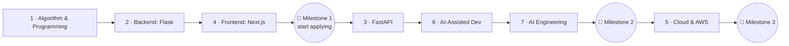

This handbook is built for one goal: **you become a job-ready AI full-stack engineer who truly understands what you build** — not someone who can only copy code or prompt an AI.

## 🧭 The big picture

Alongside the modules run two **parallel tracks** — 🧩 DSA for interviews and 🏛️ Architecture — and one project, ⭐ **CareerPilot**, that grows with every module. Open **This Week** in the sidebar to see what to do next.

## 📖 How every lesson works

Every lesson has the same three parts:

| Part | What you do | Why |
|---|---|---|
| **1 · Learn the Concept** | Read: why it exists, what breaks without it, trade-offs, when (not) to use it | Understanding beats memorizing |
| **2 · Explain & Design** | Explain it in your own words; design a small solution on paper | If you can't explain it, you don't know it yet |
| **3 · Toy Exercise** | Build something small with automatic checks | Your hands have to learn too |

Key terms are underlined — hover them for a Bahasa Indonesia explanation, like :term[algorithm]{bahasa="algoritma — langkah-langkah jelas untuk menyelesaikan masalah"}.

## 🏷️ Labels you'll see

**Importance for your role** (set your target role in Settings):

- 🟢 **Core** — needed for junior interviews in that role
- 🔵 **Recommended** — a strong advantage
- ⚪ **Optional** — deep dive when you have time
- ➖ **Not needed** — safe to skip for that role

**Exercise AI policy:**

- 🚫🤖 **No-AI** — solve it with your own brain. Use AI only *afterwards* to review your solution.
- 🤖✅ **AI-allowed** — use AI if you like, but you must be able to explain every line.

:::warning[Why "brain-first"?]
If AI writes code you don't understand, you learn nothing — and interviews will expose it. Struggling for 20 minutes on a bug teaches more than 20 seconds of copy-paste. AI is a great **reviewer** and **pair**, a bad **replacement** for thinking.
:::

## ✅ Placement checks: skip what you already know

Each week starts with a **placement check**: a few questions answered from memory.

- **Passed?** Jump to the toy exercises and skim the lessons.
- **Not yet?** Study the week normally. Honest answers save you time.

## 🔁 Spaced review (DSA)

When you solve a DSA problem, click **"I solved it"**. The app schedules it again after 1, 3, 7, 14 and 30 days. Re-solving from scratch at those moments is what moves patterns into long-term memory.

## 🗓️ A sustainable week (~18 hours)

| Day | Plan |
|---|---|
| Mon–Fri | 2 h module lesson + 1 h DSA |
| Saturday | 1.5 h Architecture + 1.5 h CareerPilot |
| Sunday | Light: review queue + weekly LinkedIn post, or rest |

:::tip
Missing a day is normal. Missing a week is where habits die. If you're tired, do **15 minutes** — keeping the chain alive matters more than the amount.
:::

## 🎯 Milestones: you don't need everything to get hired

| Milestone | You can apply for | Roughly |
|---|---|---|
| 🎯 1 · Junior Full-Stack | Junior backend / frontend / full-stack | ~4–5 months |
| 🎯 2 · AI-Integrated Full-Stack | Full-stack with AI, junior AI engineer | ~7–8 months |
| 🎯 3 · Stronger Candidate | AI engineer, cloud-heavy teams | ~11–13 months |

**Start applying at Milestone 1** and keep learning while you job-hunt.

## 💾 Your data

Progress, notes and settings live only in this browser. Export a backup from **Settings** every week or two.

## 🚀 Start now

1. Open **Settings** and confirm your 🎯 target role.
2. Open [Module 1](/modules/m1) and take the Week 0 placement check.
3. Mark this guide as done below. ✅
