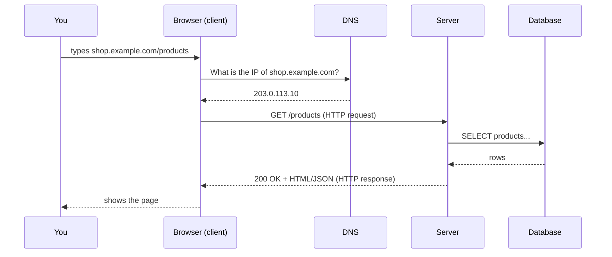
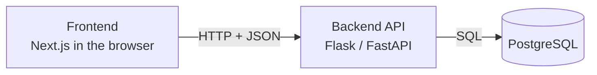

::part[Pelajari Konsepnya]{n="1"}

## 🎯 Yang akan kamu pelajari

- Peran **client**, **server**, dan **database**
- Apa yang ada dalam **HTTP request** dan **response**
- Cara membaca **URL**, **HTTP method**, dan **status code**
- Cara melihat request asli di DevTools browser-mu

## 🔤 Istilah penting

| Istilah | Artinya (sederhana) |
|---|---|
| **Client** | Program yang meminta sesuatu (browser-mu, aplikasi di ponsel) |
| **Server** | Program yang menjawab permintaan |
| **HTTP** | Bahasa yang disepakati antara client dan server di web |
| **Request / response** | Yang kamu kirim / apa yang kembali |
| **URL** | Alamat sumber daya yang kamu inginkan |
| **HTTP method** | Jenis aksi: GET (baca), POST (buat), PUT/PATCH (ubah), DELETE (hapus) |
| **Status code** | Angka tiga digit hasil aksi: 200 OK, 404 tidak ditemukan, 500 server rusak |
| **Header** | Informasi ekstra yang melekat pada request atau response |
| **JSON** | Format teks yang dipakai API untuk mengirim data |
| **Stateless** | Server tidak mengingat apa pun antar request |

## 🧠 Ide besarnya

Bayangkan sebuah restoran:

| Restoran | Web |
|---|---|
| Kamu (pelanggan) | **Client** — browser atau aplikasi di ponselmu |
| Kertas pesanan dengan format baku | **HTTP request** |
| Dapur | **Server** — program yang berjalan di komputer entah di mana |
| Gudang makanan | **Database** |
| Piring yang kembali | **HTTP response** |

Kamu tidak pernah masuk dapur. Kamu mengirim pesanan yang jelas formatnya, dan mendapat sesuatu kembali. Web bekerja sama: **client bertanya, server menjawab**.

## ❓ Kenapa ini penting

Semua yang akan kamu buat di handbook ini — Flask API, aplikasi Next.js, layanan AI — adalah program yang menjawab request. Tahu bentuk request dan response adalah kunci untuk membaca pesan error, debug halaman yang rusak, dan merancang API dengan sengaja, bukan coba-coba.

Itu juga menjelaskan hal-hal yang terasa ajaib: kenapa halaman butuh token di setiap request, kenapa `404` dan `500` berarti hal sama sekali berbeda untuk developer, dan kenapa "jalan di Postman tapi tidak di browser" biasanya soal header.

## 📖 Cara kerjanya, langkah demi langkah

### 1. URL: alamat apa yang kamu inginkan

```text
https://shop.example.com:443/products?category=shoes&page=2#reviews
└─┬─┘   └──────┬───────┘ └┬┘└───┬───┘ └─────────┬─────────┘ └──┬──┘
scheme        host      port  path          query          fragment
```

| Bagian | Arti |
|---|---|
| **scheme** | Cara berkomunikasi: `https` = HTTP dengan enkripsi |
| **host** | Server mana (nama domain) |
| **port** | Pintu mana di server itu (443 default untuk https, biasanya tersembunyi) |
| **path** | Sumber daya mana di server |
| **query** | Pilihan ekstra sebagai pasang `key=value` |
| **fragment** | Titik *di dalam* halaman — tidak pernah dikirim ke server |

### 2. Perjalanan satu request

Ikuti lambat-lambat sekali. Hampir setiap bug yang akan kamu debug nanti adalah satu langkah yang rusak di rantai ini.



- :term[DNS]{bahasa="Domain Name System — buku telepon internet yang mengubah nama domain menjadi alamat IP"} mengubah nama menjadi **IP address** (nomor server di internet).
- Browser membuka koneksi dan mengirim **request**.
- Server menjalankan kode — mungkin bertanya ke database — dan mengirim **response**.

### 3. Di dalam HTTP request

```http
GET /products?page=2 HTTP/1.1
Host: shop.example.com
Accept: application/json
Authorization: Bearer eyJhbGciOi...
```

Request punya:

1. **Method** — apa yang mau kamu lakukan
2. **Path** (+ query) — ke mana kamu mau melakukannya
3. **Header** — informasi ekstra (siapa kamu, format apa yang kamu terima)
4. **Body** opsional — data yang kamu kirim (misalnya form)

:term[Method]{bahasa="metode — jenis aksi yang diminta ke server"} yang paling sering:

| Method | Arti | Contoh |
|---|---|---|
| `GET` | Baca sesuatu | Tampilkan daftar produk |
| `POST` | Buat sesuatu | Buat pesanan |
| `PUT` / `PATCH` | Ganti / ganti sebagian | Ubah alamatmu |
| `DELETE` | Hapus sesuatu | Hapus barang dari keranjang |

### 4. Di dalam HTTP response

```http
HTTP/1.1 200 OK
Content-Type: application/json

[{"id": 1, "name": "Running Shoes", "price": 450000}]
```

**Status code** memberitahu apa yang terjadi sekali pandang:

| Rentang | Arti | Contoh umum |
|---|---|---|
| **2xx** | ✅ Berhasil | `200 OK`, `201 Created`, `204 No Content` |
| **3xx** | ↪️ Pergi ke tempat lain | `301 Moved Permanently`, `304 Not Modified` |
| **4xx** | 🙋 **Client** yang salah | `400 Bad Request`, `401 Unauthorized`, `403 Forbidden`, `404 Not Found` |
| **5xx** | 🔥 **Server** punya masalah | `500 Internal Server Error`, `503 Service Unavailable` |

:::tip[Ingat seperti ini]
**4xx = "kamu" yang keliru** (URL salah, lupa login, data buruk). **5xx = "kami" yang keliru** (bug atau server down).
:::

### 5. HTML vs JSON

- Saat membuka halaman, server sering mengirim **HTML** — browser menggambarnya.
- Saat aplikasi meminta *data*, server biasanya mengirim :term[JSON]{bahasa="JavaScript Object Notation — format teks untuk data, mirip dictionary di Python"} — aplikasi yang putuskan cara menampilkannya.

Aplikasi modern (seperti yang akan kamu buat) sering terbagi tiga: **frontend** (berjalan di browser, misalnya Next.js), **backend API** (misalnya Flask/FastAPI, kembalikan JSON) dan **database** (misalnya PostgreSQL):



### 6. HTTP stateless

Dapur lupa kamu saat piring pergi. Itu kenapa setiap request harus bawa bukti siapa kamu — alasan token dan cookie ada.

Setiap request berdiri sendiri: server tidak otomatis ingat request sebelumnya. Itu kenapa aplikasi mengirim **cookie** atau **token** (seperti header `Authorization` di atas) di setiap request — ini cara server tahu masih kamu.

### Pilih setup-mu

Setiap pilihan punya trade-off:

| Keputusan | ✅ Untung | ❌ Rugi |
|---|---|---|
| HTTP stateless | Server mana saja bisa handle request mana saja → mudah tambah server | Harus kirim identitas (token/cookie) setiap kali |
| Logika di **server** | Aman, satu sumber kebenaran | Setiap aksi butuh putaran jaringan (lambat, butuh internet) |
| Logika di **client** | Umpan balik langsung, bekerja offline | Tidak bisa dipercaya — user bisa ubahnya |
| JSON API + frontend terpisah | Web, ponsel, dan aplikasi lain pakai backend yang sama | Lebih banyak bagian yang dibangun dan di-deploy |

✅ **Request → response HTTP** cocok untuk hampir segalanya: load halaman, kirim form, panggil API.

🚫 Tidak cocok kalau **server harus push update instan** (live chat, multiplayer game, harga saham real-time). Itu pakai **WebSocket** atau **Server-Sent Event**, yang tahan koneksi tetap buka. (Aplikasi chat AI sering pakai Server-Sent Event untuk stream jawaban kata demi kata — kamu akan buat itu di Module 7.)


## ⚠️ Kesalahan umum

- **Percaya client.** Validasi harga hanya di browser artinya orang bisa kirim `price: 1` langsung ke API-mu. Selalu validasi di server.
- **Kirim `200 OK` untuk error** dengan `{"error": "not found"}` di body. Pakai status code yang tepat — client dan tool monitoring tergantung itu.
- **Letakkan secret di frontend.** Apa pun dikirim ke browser bisa dibaca user.
- Pikir **fragment** (`#reviews`) sampai ke server. Tidak.

::part[Jelaskan & Rancang]{n="2"}

## 🗣️ Jelaskan

Dalam **5 kalimat atau kurang**, jelaskan ke teman yang tidak bisa kode apa yang terjadi saat mereka buka Instagram dan lihat feed mereka. Pakai kata-kata *client*, *server*, *request*, *response*, dan *database* — tapi jelaskan masing-masing dengan sederhana.

## 📐 Rancang

Kamu sedang merancang request untuk aplikasi **pengiriman makanan sederhana**. Untuk setiap aksi user, tulis **method**, **path**, dan **status code** sukses:

1. Lihat daftar restoran dekat kamu
2. Buka menu satu restoran
3. Buat pesanan
4. Batalkan pesanan
5. User minta restoran yang ID-nya tidak ada — status code apa?

:::quiz
Lihat contoh rancangan

| Aksi | Method | Path | Status |
|---|---|---|---|
| Daftar restoran | `GET` | `/restaurants?near=-6.2,106.8` | `200` |
| Menu | `GET` | `/restaurants/42/menu` | `200` |
| Buat pesanan | `POST` | `/orders` | `201 Created` |
| Batalkan pesanan | `DELETE` (atau `PATCH` dengan `status=cancelled`) | `/orders/981` | `204` atau `200` |
| Restoran tidak ada | — | `/restaurants/99999` | `404 Not Found` |

Ada beberapa jawaban bagus. Yang penting: **read pakai GET, buat pakai POST, dan tidak ada adalah 4xx**.
:::

### 📝 Checklist self-review

- [ ] Penjelasanku tidak pakai jargon yang tidak dijelaskan
- [ ] Aku bilang **server**, bukan client, yang bicara ke database
- [ ] Setiap aksi "baca" pakai `GET`
- [ ] Buat sesuatu kembalikan `201` (atau minimal 2xx)
- [ ] Aku bisa bilang kenapa restoran hilang itu **4xx**, bukan **5xx**

::ai-review{task="explain"}

::part[Latihan Kecil]{n="3"}

## 🧸 Lihat web dengan mata sendiri

:::exercise{ai="no-ai" title="Inspeksi traffic HTTP asli"}
Tanpa kode hari ini — kamu akan jadi detektif di browser-mu.

1. Buka situs berita atau belanja apa saja di Chrome.
2. Buka DevTools: `Cmd + Option + I` (Mac) atau `F12` (Windows) → tab **Network**. Centang **Preserve log**, lalu reload halaman.
3. Klik **request pertama** (dokumen). Cari: **method**, **status code**, dan header response `Content-Type`.
4. Ketik `fetch` di kotak filter (atau klik **Fetch/XHR**). Klik request yang kembalikan **JSON**. Buka tab **Response**.
5. Kunjungi halaman yang tidak ada di situs itu, seperti `/this-page-does-not-exist`. Status code apa yang kamu dapat?

Tulis temuanmu di **Catatan saya** di bawah:

| Pertanyaan | Jawabanku |
|---|---|
| Method dan status dokumen utama | |
| Satu request JSON: path-nya dan data apa yang dikembalikan | |
| Status code halaman yang hilang | |
| Total jumlah request untuk load halaman | |
:::

:::hints
- Tidak bisa lihat request? Buka DevTools tetap dan **reload** — ia hanya record saat buka.
- Tab **Header** menunjukkan method + status di atas bagian "General".
- Beberapa situs tampilkan halaman "tidak ditemukan" yang bagus tapi tetap kembalikan `404`. Beberapa (salah) kembalikan `200`. Situs-mu yang mana?
:::

### 🏆 Tantangan lebih jauh

Di tab Network, klik kanan satu request JSON → **Copy → Copy as cURL**. Paste ke terminal-mu dan jalankan. Kamu baru saja buat HTTP request yang sama *tanpa browser* — bukti bahwa "web" hanya request dan response.

## ✅ Cek cepat

:::quiz
Aplikasi ponsel kirim `POST /orders` dan dapat `401`. Siapa yang bermasalah, dan penyebabnya apa?

Itu masalah **di pihak client** (4xx). `401 Unauthorized` artinya request tidak buktikan siapa user — misalnya token login hilang atau kadaluarsa.
:::

:::quiz
Kenapa HTTP dideskripsikan "stateless", dan bagaimana situs tetap tahu login kamu?

Setiap request ditangani sendiri-sendiri; server tidak ingat yang sebelumnya dengan sendirinya. Client mengirim **cookie** atau **token** di setiap request jadi server kenal user-nya.
:::

:::quiz
Sebutkan satu situasi di mana HTTP request/response biasa tidak cocok.

Saat server harus push update instan — live chat, multiplayer game, harga real-time, atau stream jawaban AI. Pakai WebSocket atau Server-Sent Event.
:::


## 📚 Lanjut belajar

- [MDN: An overview of HTTP](https://developer.mozilla.org/en-US/docs/Web/HTTP/Overview)
- [MDN: HTTP response status codes](https://developer.mozilla.org/en-US/docs/Web/HTTP/Status)
- [Chrome DevTools: Inspect network activity](https://developer.chrome.com/docs/devtools/network)
