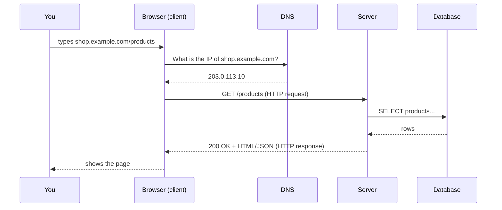
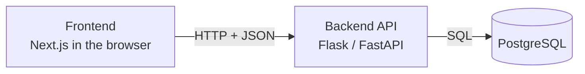

::part[Learn the Concept]{n="1"}

## 🎯 What you'll learn

- The roles of the **client**, the **server** and the **database**
- What an **HTTP request** and **response** contain
- How to read a **URL**, **HTTP methods** and **status codes**
- How to watch real requests in your browser's DevTools

## 🧠 The big idea

Think of a restaurant:

| Restaurant | Web |
|---|---|
| You (the customer) | The **client** — your browser or mobile app |
| The order slip with a fixed format | An **HTTP request** |
| The kitchen | The **server** — a program running on a computer somewhere |
| The pantry | The **database** |
| The plate that comes back | The **HTTP response** |

You never walk into the kitchen. You send a clearly formatted order, and you get something back. The web works the same way: **clients ask, servers answer**.

## ❓ Why does this exist?

Billions of different devices (phones, laptops, smart TVs) need to talk to millions of different servers written in different languages. That only works if everyone follows **the same rules** for asking and answering. Those rules are :term[HTTP]{bahasa="HyperText Transfer Protocol — aturan baku cara browser dan server saling bertukar pesan"}.

Splitting the work into client and server also means:

- The **client** focuses on showing things and reacting to the user.
- The **server** protects the data and the business rules (for example: "only the owner can see this order").

## 💥 What happens if we DON'T have shared rules?

Imagine every website invented its own format:

```text
Site A expects:  GIVE_ME products PAGE=2
Site B expects:  {"want": "products", "p": 2}
Site C expects:  products|2|please
```

Every browser would need custom code for every site. Nothing would work together. And if the client held all the data instead of a server, anyone could open DevTools and change their bank balance. 😱

## 📖 How it works, step by step

### 1. The URL: the address of what you want

```text
https://shop.example.com:443/products?category=shoes&page=2#reviews
└─┬─┘   └──────┬───────┘ └┬┘└───┬───┘ └─────────┬─────────┘ └──┬──┘
scheme        host      port  path          query          fragment
```

| Part | Meaning |
|---|---|
| **scheme** | How to talk: `https` = HTTP with encryption |
| **host** | Which server (a domain name) |
| **port** | Which "door" on that server (443 is the default for https, so it's usually hidden) |
| **path** | Which resource on the server |
| **query** | Extra options as `key=value` pairs |
| **fragment** | A spot *inside* the page — never sent to the server |

### 2. The journey of one request



- :term[DNS]{bahasa="Domain Name System — 'buku telepon' internet yang mengubah nama domain menjadi alamat IP"} turns a name into an **IP address** (the server's number on the internet).
- The browser opens a connection and sends the **request**.
- The server runs code — maybe asks the database — and sends a **response**.

### 3. Inside an HTTP request

```http
GET /products?page=2 HTTP/1.1
Host: shop.example.com
Accept: application/json
Authorization: Bearer eyJhbGciOi...
```

A request has:

1. A **method** — what you want to do
2. A **path** (+ query) — what you want to do it to
3. **Headers** — extra information (who you are, what format you accept)
4. An optional **body** — data you send (for example a form)

The most common :term[methods]{bahasa="metode — jenis aksi yang diminta ke server"}:

| Method | Meaning | Example |
|---|---|---|
| `GET` | Read something | Show the product list |
| `POST` | Create something | Place an order |
| `PUT` / `PATCH` | Replace / partly update | Change your address |
| `DELETE` | Remove something | Remove an item from the cart |

### 4. Inside an HTTP response

```http
HTTP/1.1 200 OK
Content-Type: application/json

[{"id": 1, "name": "Running Shoes", "price": 450000}]
```

The **status code** tells you what happened at a glance:

| Range | Meaning | Common examples |
|---|---|---|
| **2xx** | ✅ Success | `200 OK`, `201 Created`, `204 No Content` |
| **3xx** | ↪️ Go somewhere else | `301 Moved Permanently`, `304 Not Modified` |
| **4xx** | 🙋 **Client** made a mistake | `400 Bad Request`, `401 Unauthorized`, `403 Forbidden`, `404 Not Found` |
| **5xx** | 🔥 **Server** had a problem | `500 Internal Server Error`, `503 Service Unavailable` |

:::tip[Remember it like this]
**4xx = "you" messed up** (wrong URL, missing login, bad data). **5xx = "we" messed up** (bug or outage on the server).
:::

### 5. HTML vs JSON

- When you open a page, the server often sends **HTML** — the browser draws it.
- When an app asks for *data*, the server usually sends :term[JSON]{bahasa="JavaScript Object Notation — format teks untuk data, mirip dictionary di Python"} — the app decides how to show it.

Modern apps (like the ones you'll build) are often split into a **frontend** (runs in the browser, e.g. Next.js), a **backend API** (e.g. Flask/FastAPI, returns JSON) and a **database** (e.g. PostgreSQL):



### 6. HTTP is stateless

Each request stands alone: the server doesn't automatically remember your previous request. That's why apps send a **cookie** or a **token** (like the `Authorization` header above) with every request — it's how the server knows it's still you.

## ⚖️ Trade-offs

| Decision | ✅ Benefit | ❌ Cost |
|---|---|---|
| Stateless HTTP | Any server can handle any request → easy to add more servers | Must send identity (token/cookie) every time |
| Logic on the **server** | Secure, one source of truth | Every action needs a network round trip (slower, needs internet) |
| Logic on the **client** | Instant feedback, works offline | Can't be trusted — users can change it |
| JSON API + separate frontend | Web, mobile and other apps share one backend | More moving parts to build and deploy |

## ✅ When to use it / 🚫 When NOT to use it

✅ **Request → response HTTP** fits almost everything: loading pages, submitting forms, calling APIs.

🚫 It's a poor fit when the **server needs to push updates instantly** (live chat, multiplayer games, stock tickers). Those use **WebSockets** or **Server-Sent Events**, which keep a connection open. (AI chat apps often use Server-Sent Events to stream answers word by word — you'll build that in Module 7.)

## 🏭 How it's used in industry

- Engineers debug with the browser's **Network tab** every day: "What did the frontend send? What did the API return? Which status code?"
- Backend teams publish **API documentation** listing each method, path, request body and status code.
- Monitoring dashboards track the **percentage of 5xx responses** — a spike wakes someone up at night.

## ⚠️ Common mistakes

- **Trusting the client.** Validating a price only in the browser means someone can send `price: 1` directly to your API. Always validate on the server.
- **Returning `200 OK` for errors** with `{"error": "not found"}` in the body. Use the right status code — clients and monitoring tools rely on it.
- **Putting secrets in the frontend.** Anything sent to the browser can be read by the user.
- Thinking the **fragment** (`#reviews`) reaches the server. It doesn't.

::part[Explain & Design]{n="2"}

## 🗣️ Explain it

In **5 sentences or fewer**, explain to a friend who doesn't code what happens when they open Instagram and see their feed. Use the words *client*, *server*, *request*, *response* and *database* — but explain each one simply.

## 📐 Design it

You're designing the requests for a simple **food delivery app**. For each user action, write the **method**, a **path**, and the **success status code**:

1. See the list of restaurants near you
2. Open one restaurant's menu
3. Place an order
4. Cancel an order
5. A user asks for a restaurant id that doesn't exist — which status code?

:::quiz
Show a possible design

| Action | Method | Path | Status |
|---|---|---|---|
| List restaurants | `GET` | `/restaurants?near=-6.2,106.8` | `200` |
| Menu | `GET` | `/restaurants/42/menu` | `200` |
| Place order | `POST` | `/orders` | `201 Created` |
| Cancel order | `DELETE` (or `PATCH` with `status=cancelled`) | `/orders/981` | `204` or `200` |
| Unknown restaurant | — | `/restaurants/99999` | `404 Not Found` |

There are several good answers. What matters: **reading uses GET, creating uses POST, and "not found" is a 4xx**.
:::

### 📝 Self-review checklist

- [ ] My explanation used no unexplained jargon
- [ ] I said the **server**, not the client, talks to the database
- [ ] Every "read" action uses `GET`
- [ ] Creating something returns `201` (or at least a 2xx)
- [ ] I can say why a missing restaurant is **4xx**, not **5xx**

::ai-review{task="explain"}

::part[Toy Exercise]{n="3"}

## 🧸 Watch the web with your own eyes

:::exercise{ai="no-ai" title="Inspect real HTTP traffic"}
No code today — you'll be a detective in your browser.

1. Open any news or shopping site in Chrome.
2. Open DevTools: `Cmd + Option + I` (Mac) or `F12` (Windows) → **Network** tab. Tick **Preserve log**, then reload the page.
3. Click the **first request** (the document). Find: the **method**, the **status code**, and the `Content-Type` response header.
4. Type `fetch` in the filter box (or click **Fetch/XHR**). Click a request that returned **JSON**. Open the **Response** tab.
5. Visit a page that doesn't exist on that site, like `/this-page-does-not-exist`. Which status code do you get?

Write your findings in **My notes** below:

| Question | My answer |
|---|---|
| Method and status of the main document | |
| One JSON request: its path and what data it returned | |
| Status code of the missing page | |
| Total number of requests to load the page | |
:::

:::hints
- Can't see requests? Keep DevTools open and **reload** — it only records while open.
- The **Headers** tab shows method + status at the top under "General".
- Some sites show a nice "not found" page but still return `404`. Some (wrongly) return `200`. Which one is your site?
:::

### 🏆 Stretch goal

In the Network tab, right-click a JSON request → **Copy → Copy as cURL**. Paste it into your terminal and run it. You just made the same HTTP request *without a browser* — proof that "the web" is just requests and responses.

## ✅ Quick check

:::quiz
A mobile app sends `POST /orders` and gets `401`. Whose problem is it, and what's the likely cause?

It's a **client-side** problem (4xx). `401 Unauthorized` means the request didn't prove who the user is — for example a missing or expired login token.
:::

:::quiz
Why is HTTP described as "stateless", and how do sites still keep you logged in?

Each request is handled independently; the server doesn't remember earlier ones by itself. The client sends a **cookie** or **token** with every request so the server can recognize the user.
:::

:::quiz
Name one situation where plain request/response HTTP is not the best fit.

When the server must push updates instantly — live chat, multiplayer games, live prices, or streaming AI answers. Use WebSockets or Server-Sent Events.
:::

## 📖 Kamus (glossary)

| Term | Bahasa Indonesia |
|---|---|
| Client | Klien — aplikasi yang meminta data (browser, app HP) |
| Server | Server — program yang menjawab permintaan |
| Request / Response | Permintaan / Jawaban |
| Status code | Kode status — angka yang menjelaskan hasil permintaan |
| Stateless | Tanpa status — server tidak mengingat permintaan sebelumnya |

## 📚 Keep learning

- [MDN: An overview of HTTP](https://developer.mozilla.org/en-US/docs/Web/HTTP/Overview)
- [MDN: HTTP response status codes](https://developer.mozilla.org/en-US/docs/Web/HTTP/Status)
- [Chrome DevTools: Inspect network activity](https://developer.chrome.com/docs/devtools/network)
