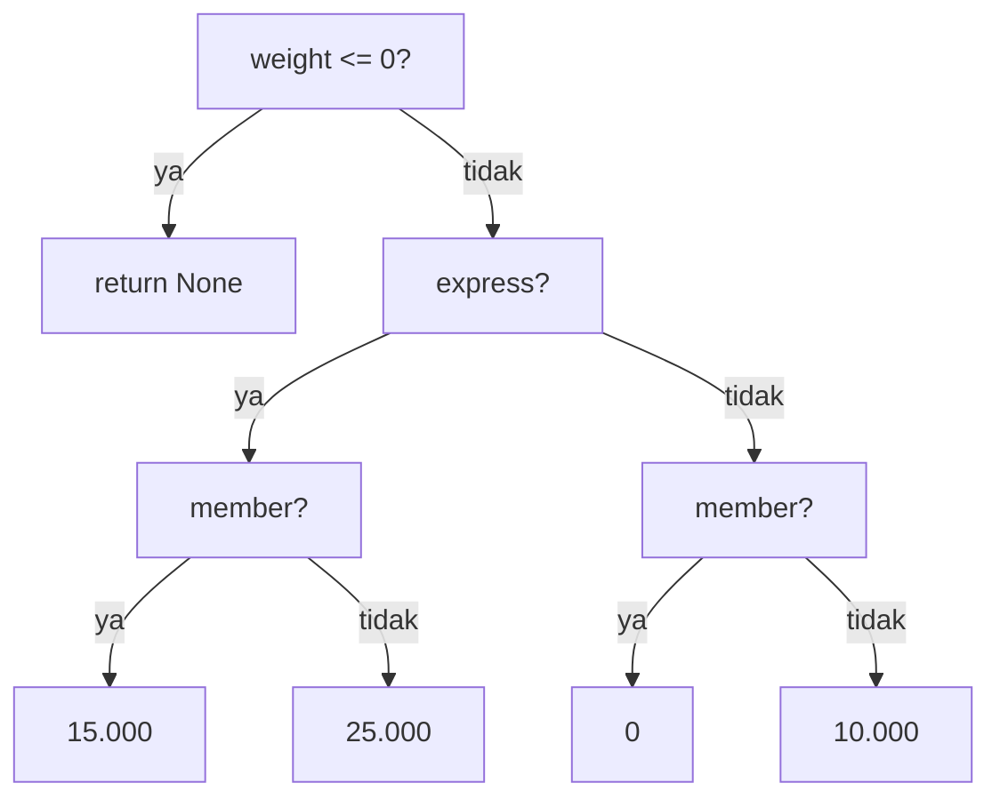

::part[Pelajari Konsepnya]{n="1"}

## 🎯 Yang akan kamu pelajari

- `if`, `elif` dan `else`, dan kenapa **urutan itu penting**
- **Guard clause** (early return) untuk hindari nesting dalam
- Ternary expression dan `match` statement — dan kapan pakainya
- Cara menguji setiap cabang

## 🔤 Istilah penting

| Istilah | Artinya (sederhana) |
|---|---|
| **Conditional / Percabangan** | Kode yang memilih jalur berdasarkan tes benar/salah |
| **`if` / `elif` / `else`** | Periksa berurutan, jalankan yang pertama cocok |
| **Branch / Cabang** | Satu jalur yang mungkin dilalui kode |
| **Guard clause** | Tangani kasus buruk lebih dulu, berhenti awal |
| **Nesting / Bertingkat** | Satu `if` di dalam `if` di dalam `if` |
| **Ternary / Satu baris** | Satu baris `if` yang memberi nilai |
| **`match`** | Pilih cabang berdasarkan bentuk data |
| **Branch coverage / Cakupan** | Uji setiap jalur, bukan hanya yang senang-senang |

## 🧠 Ide besarnya

Bayangkan kamu di depan persimpangan jalan. Ada tiga pintu di sebuah rumah:

1. Tidak punya kartu? → "Maaf, masuk tidak boleh." *(berhenti)*
2. Punya kartu tamu? → "Ke resepsionis dulu." *(berhenti)*
3. Punya kartu karyawan? → "Selamat datang."

Pintu diperiksa **berurutan** dan **berhenti di pintu pertama yang cocok**. Itu `if` / `elif` / `else`.

A :term[conditional]{bahasa="percabangan — kode memilih jalan berdasarkan kondisi benar/salah"} adalah **percabangan di jalan**. Program cek kondisi dan ambil **persis satu** jalur.

## ❓ Kenapa ini penting

Hampir setiap fitur adalah keputusan: apakah user bisa checkout, apakah diskon sah, apakah kita tampilkan tombol "Apply"? Tanpa percabangan, program hanya bisa buat satu hal, sama, setiap kali.

Dan urutan **penting sekali**. Tulis aturan dengan urutan salah dan satpam biar semua masuk:

```python
if user.has_card:          # too broad, checked first
    allow()
elif user.is_employee:     # never reached
    allow_full_access()
```

Program tetap jalan. Tidak ada error yang terlihat. Aturannya hanya salah — makanya menguji setiap cabang, bukan cuma jalur yang senang-senang, jadi bagian dari pelajaran ini.

## 📖 Langkah demi langkah

### 1. `if` / `elif` / `else`

```python
temperature = 31

if temperature >= 30:
    advice = "Stay hydrated"
elif temperature >= 20:
    advice = "Nice weather"
else:
    advice = "Bring a jacket"
```

- Python periksa kondisi **dari atas ke bawah**.
- Yang **pertama** benar, dijalankan; sisanya dilewat.
- `else` jalankan hanya kalau tidak ada yang cocok. Opsional.
- Badannya adalah blok yang **di-indent** (4 spasi). Indentasi *itu* syntax Python.

:::warning[Urutkan dari paling spesifik ke paling umum]
Untuk rentang, periksa kondisi **paling ketat** duluan (`>= 90` sebelum `>= 80` sebelum `>= 60`), atau pakai dua batas: `80 <= score < 90`.
:::

### 2. Beberapa `if` vs `if/elif`

```python
# Independent checks: ALL that are true will run
if has_discount_code:
    total -= 10_000
if is_member:
    total -= 5_000

# Mutually exclusive choice: only ONE runs
if plan == "free":
    limit = 3
elif plan == "pro":
    limit = 100
```

Tanya diri sendiri: *apakah lebih dari satu ini bisa benar di saat yang sama dan harus semuanya berlaku?* Kalau ya → `if` terpisah. Kalau tidak → `elif`.

### 3. Guard clause: gagal cepat, lalu kerjakan yang normal

Tangani pengecualian di pintu, lalu tulis kasus normal datar dan mudah dibaca. `if` bertingkat dalam itu seperti kalimat dengan lima "tapi".

```python
def shipping(weight: float, express: bool, member: bool) -> int | None:
    if weight <= 0:
        return None                  # guard: invalid input, leave early

    if express:
        return 15_000 if member else 25_000

    return 0 if member else 10_000
```

Tingkah laku sama seperti piramida di atas, tapi datar. Tangani kasus **aneh duluan** dan `return`, jadi jalur "normal" tidak tersembunyi dalam.

### 4. Percabangan satu baris (ternary)

```python
label = "Adult" if age >= 18 else "Minor"
```

Bagus untuk pilihan dua arah yang **mudah** yang hasilkan nilai. Kalau butuh `elif` atau beberapa pernyataan, pakai `if` biasa.

### 5. `match` (Python 3.10+)

```python
match status_code:
    case 200 | 201:
        message = "Success"
    case 404:
        message = "Not found"
    case 500:
        message = "Server error"
    case _:
        message = "Something else"
```

`match` bagus kalau bandingkan **satu nilai** dengan banyak pilihan tepat. Untuk rentang (`>= 90`), `if/elif` lebih jelas.

### 6. Uji setiap cabang

Cara cepat untuk cek diri: untuk setiap `if`, bisa kamu sebutkan satu input yang ambil jalur benar dan satu yang ambil jalur salah? Kalau tidak, cabang itu tidak teruji.

Setiap jalur melalui kondisimu adalah tingkah laku terpisah, dan setiap butuh setidaknya satu test. **Batas** itu tempat bug tinggal: kalau aturan bilang "≥ 500.000", uji `499_999`, `500_000` dan `500_001`.



Lima ujung → setidaknya **lima** test case.

### Pilih setup-mu

Setiap pilihan ada trade-off:

| Gaya | ✅ | ❌ |
|---|---|---|
| `if` bertingkat | Cermin cara kamu pikirnya dulu | Indentasi dalam, susah diikuti |
| Guard clause | Datar, mudah dibaca, jalur utama jelas | Beberapa `return` di satu fungsi |
| Ternary | Pendek untuk pilihan mudah | Tidak terbaca kalau bersarang |
| `match` | Bersih untuk banyak nilai tepat | Bukan untuk rentang; butuh Python 3.10+ |
| Dictionary lookup daripada `if` chain | Data, bukan kode — mudah diperluas | Cuma untuk pemetaan nilai ke nilai sederhana |

- ✅ Pakai percabangan untuk **aturan dan validasi**.
- ✅ Kalau chain hanya peta nilai ke nilai lain, pertimbangkan dictionary:
  `PLAN_LIMITS = {"free": 3, "pro": 100}` → `limit = PLAN_LIMITS[plan]`
- 🚫 Hindari lebih dari ~2 tingkat nesting — refactor dengan guard clause atau fungsi kecil.
- 🚫 Jangan ulangi kondisi yang sama di banyak tempat; beri nama sekali.


## ⚠️ Kesalahan umum

- Urutan salah saat cek rentang (bug nilai berapa di atas).
- Lupa tanda `:` atau indentasi.
- Pakai `if` dua kali padahal maksud `elif` → keduanya jalankan.
- Tidak tangani "tidak ada yang cocok" (tidak ada `else`, return `None` tidak sengaja).
- Tulis `if x == True:` daripada `if x:`.

::part[Jelaskan & Rancang]{n="2"}

## 🗣️ Jelaskan

Jelaskan perbedaan antara "beberapa `if` terpisah" dan "`if` / `elif`" pakai contoh kehidupan nyata (voucher diskon, lampu lalu lintas, nilai sekolah…).

## 📐 Rancang

Rancang logic untuk **percobaan login** sebelum tulis kode. Gambar flowchart (kertas, atau diagram mermaid di notes-mu) dan daftar test case:

- Akun tidak ada → "Email atau password salah"
- Akun terkunci → "Akun terkunci"
- Password salah → "Email atau password salah"
- Password benar tapi email belum terverifikasi → "Verifikasi email-mu"
- Selain itu → "Selamat datang"

:::quiz
Lihat contoh rancangan

```python
def login_message(account_exists, is_locked, password_ok, email_verified):
    if not account_exists:
        return "Invalid email or password"
    if is_locked:
        return "Account locked"
    if not password_ok:
        return "Invalid email or password"
    if not email_verified:
        return "Please verify your email"
    return "Welcome"
```

**Detail keamanan:** "tidak ada" dan "password salah" tampilkan **pesan sama**, jadi penyerang tidak bisa pakai form login untuk temukan email mana yang terdaftar.

Test case: satu per return statement → **5 test** minimal.
:::

### 📝 Checklist review mandiri

- [ ] Flowchart-ku punya satu ujung per pesan
- [ ] Cek terkunci terjadi **sebelum** cek password
- [ ] Aku perhatikan kenapa dua situasi beda bagikan satu pesan
- [ ] Aku daftar setidaknya 5 test case

::ai-review{task="design"}

::part[Latihan Kecil]{n="3"}

## 🧸 Aturan keputusan

:::exercise{path="exercises/m1/w0/04-conditionals" ai="no-ai" title="Nilai, status code, dan pengiriman"}
Di `rules.py`, implementasikan:

- `letter_grade(score)` → `"A"` (90–100), `"B"` (80–89), `"C"` (70–79), `"D"` (60–69), `"E"` (0–59); raise `ValueError` untuk score di bawah 0 atau di atas 100
- `status_category(code)` → `"informational"`, `"success"`, `"redirect"`, `"client error"`, `"server error"`, atau `"unknown"`
- `shipping_cost(weight_kg, express, member)` → aturan dari pelajaran (pakai guard clause!)
:::

:::hints
- Raise error dengan `raise ValueError("score must be between 0 and 100")` — lakukan **duluan**, sebagai guard.
- Cek rentang nilai tertinggi duluan, atau pakai dua batas seperti `80 <= score < 90`.
- Status rentang: 100–199, 200–299, 300–399, 400–499, 500–599.
- `shipping_cost` return `None` kalau `weight_kg <= 0`.
:::

### 🏆 Tantangan lebih jauh

Tulis ulang `status_category` **tanpa** `if` apapun: pakai pembagian integer (`code // 100`) dan dictionary.

## ✅ Cek cepat

:::quiz
Di chain `if/elif/else`, berapa banyak cabang yang bisa jalankan?

**Persis satu** — yang pertama kondisinya benar, atau `else` kalau tidak ada.
:::

:::quiz
Guard clause itu apa, dan kenapa pakainya?

Cek awal yang tangani kasus tidak sah atau khusus dan return (atau raise) langsung. Ia jaga logic utama tetap datar dan mudah dibaca.
:::

:::quiz
Aturan bilang "diskon untuk pesanan Rp 1.000.000 atau lebih". Nilai apa yang harus ditest?

Batas dan tetangganya: `999_999` (tidak), `1_000_000` (ya), `1_000_001` (ya).
:::


## 📚 Lanjut belajar

- [Tutorial Python: if statement](https://docs.python.org/3/tutorial/controlflow.html#if-statements)
- [Tutorial Python: match statement](https://docs.python.org/3/tutorial/controlflow.html#match-statements)
