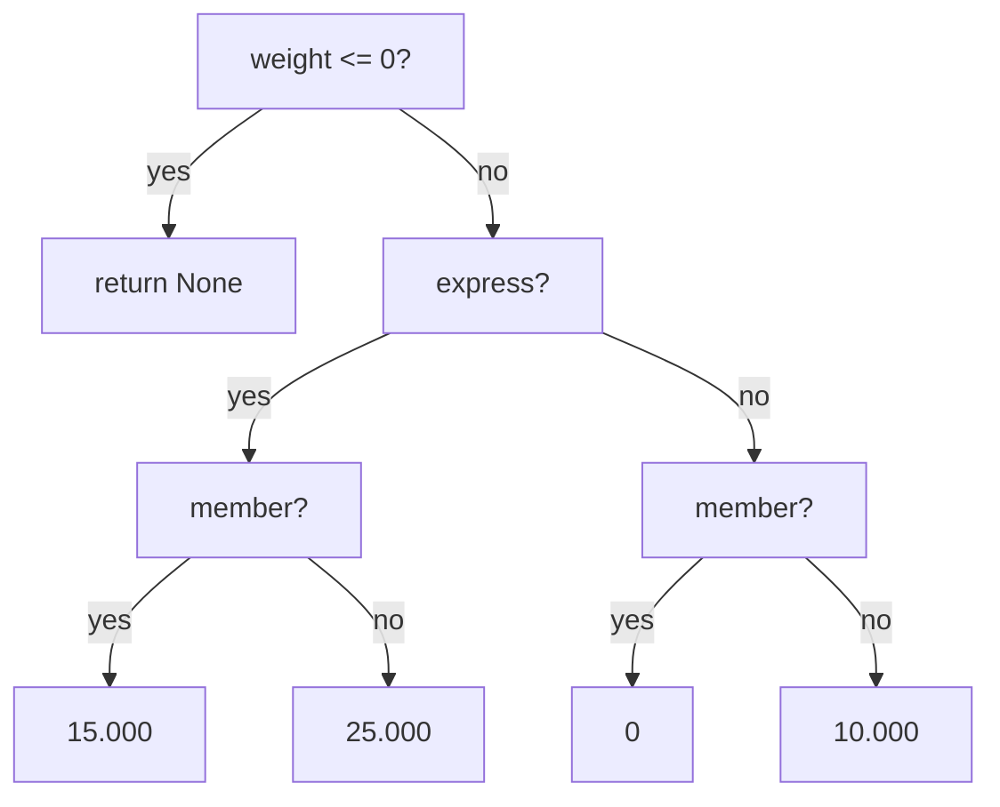

::part[Learn the Concept]{n="1"}

## 🎯 What you'll learn

- `if`, `elif` and `else`, and why **order matters**
- **Guard clauses** (early returns) to avoid deep nesting
- The ternary expression and `match` statement — and when to use them
- How to test every branch

## 🧠 The big idea

A :term[conditional]{bahasa="percabangan — kode yang memilih jalan berdasarkan kondisi benar/salah"} is a **fork in the road**. The program checks a condition and takes exactly one path.

Think of a security guard at an office:

1. No ID card? → "Sorry, you can't enter." *(stop)*
2. Visitor card? → "Go to reception." *(stop)*
3. Employee card? → "Welcome in."

The guard checks **in order** and stops at the **first** rule that matches. That's `if` / `elif` / `else`.

## ❓ Why does this exist?

Without choices, a program does the same thing for everyone: every user sees the admin page, every payment succeeds, every file is accepted. Real software is full of "it depends": on the user's role, the input, the time, the result of a previous step.

## 💥 What happens if we DON'T structure conditions well?

```python
def shipping(weight, express, member):
    if weight > 0:
        if express:
            if member:
                return 15000
            else:
                return 25000
        else:
            if member:
                return 0
            else:
                return 10000
    else:
        return None
```

It works, but it's a pyramid: hard to read, easy to break, and one wrong indent changes the meaning. Another classic bug:

```python
score = 95
if score >= 60:
    grade = "C"
elif score >= 80:     # never reached for 95 — the first match already won
    grade = "B"
elif score >= 90:
    grade = "A"
```

A 95 becomes a **C**. Nothing crashes. The bug ships.

## 📖 How it works, step by step

### 1. `if` / `elif` / `else`

```python
temperature = 31

if temperature >= 30:
    advice = "Stay hydrated"
elif temperature >= 20:
    advice = "Nice weather"
else:
    advice = "Bring a jacket"
```

- Python checks conditions **top to bottom**.
- The **first** true one runs; the rest are skipped.
- `else` runs only if nothing matched. It's optional.
- The body is the **indented** block (4 spaces). Indentation *is* the syntax in Python.

:::warning[Order from most specific to least specific]
For ranges, check the **strictest** condition first (`>= 90` before `>= 80` before `>= 60`), or use both bounds: `80 <= score < 90`.
:::

### 2. Several `if`s vs `if/elif`

```python
# Independent checks: ALL that are true will run
if has_discount_code:
    total -= 10_000
if is_member:
    total -= 5_000

# Mutually exclusive choice: only ONE runs
if plan == "free":
    limit = 3
elif plan == "pro":
    limit = 100
```

Ask yourself: *can more than one of these be true at the same time and should they all apply?* If yes → separate `if`s. If no → `elif`.

### 3. Guard clauses: fail fast, then do the main work

```python
def shipping(weight: float, express: bool, member: bool) -> int | None:
    if weight <= 0:
        return None                  # guard: invalid input, leave early

    if express:
        return 15_000 if member else 25_000

    return 0 if member else 10_000
```

Same behavior as the pyramid above, but flat. Handle the **weird cases first** and `return`, so the "normal" path isn't buried.

### 4. The one-line conditional (ternary)

```python
label = "Adult" if age >= 18 else "Minor"
```

Great for **simple** two-way choices that produce a value. If you need `elif` or several statements, use a normal `if`.

### 5. `match` (Python 3.10+)

```python
match status_code:
    case 200 | 201:
        message = "Success"
    case 404:
        message = "Not found"
    case 500:
        message = "Server error"
    case _:
        message = "Something else"
```

`match` shines when you compare **one value** against many exact options. For ranges (`>= 90`), `if/elif` is clearer.

### 6. Test every branch

Each path through your conditions is a separate behavior, and each needs at least one test. **Boundaries** are where bugs live: if the rule says "≥ 500.000", test `499_999`, `500_000` and `500_001`.



Five end points → at least **five** test cases.

## ⚖️ Trade-offs

| Style | ✅ | ❌ |
|---|---|---|
| Nested `if`s | Mirrors how you first think about it | Deep indentation, hard to follow |
| Guard clauses | Flat, readable, main path is obvious | Several `return`s in one function |
| Ternary | Short for simple choices | Unreadable when nested |
| `match` | Clean for many exact values | Not for ranges; needs Python 3.10+ |
| Lookup `dict` instead of `if` chain | Data, not code — easy to extend | Only for simple value → value mappings |

## ✅ When to use it / 🚫 When NOT to use it

- ✅ Use conditionals for **rules and validation**.
- ✅ When a chain only maps a value to another value, consider a dictionary:
  `PLAN_LIMITS = {"free": 3, "pro": 100}` → `limit = PLAN_LIMITS[plan]`
- 🚫 Avoid more than ~2 levels of nesting — refactor with guard clauses or small functions.
- 🚫 Don't repeat the same condition in many places; name it once.

## 🏭 How it's used in industry

- **Input validation** at the start of every API endpoint (guard clauses returning `400`).
- **Authorization**: `if not user.can_edit(post): return 403`.
- **Feature flags**: `if flags.is_enabled("new_checkout"): ...` lets companies release features to 5% of users first.
- Code reviewers flag deep nesting and missing `else` cases.

## ⚠️ Common mistakes

- Wrong order of range checks (the grade bug above).
- Forgetting the colon `:` or indentation.
- Using `if` twice when you meant `elif` → both run.
- Not handling "none of the above" (no `else`, returns `None` by accident).
- Writing `if x == True:` instead of `if x:`.

::part[Explain & Design]{n="2"}

## 🗣️ Explain it

Explain the difference between "several separate `if`s" and "`if` / `elif`" using a real-life example (discount vouchers, traffic lights, school grades…).

## 📐 Design it

Design the logic for a **login attempt** before writing code. Draw a flowchart (paper, or a mermaid diagram in your notes) and list the test cases:

- The account doesn't exist → "Invalid email or password"
- The account is locked → "Account locked"
- Wrong password → "Invalid email or password"
- Correct password but email not verified → "Please verify your email"
- Otherwise → "Welcome"

:::quiz
Show a possible design

```python
def login_message(account_exists, is_locked, password_ok, email_verified):
    if not account_exists:
        return "Invalid email or password"
    if is_locked:
        return "Account locked"
    if not password_ok:
        return "Invalid email or password"
    if not email_verified:
        return "Please verify your email"
    return "Welcome"
```

**Security detail:** "doesn't exist" and "wrong password" show the **same** message, so attackers can't use the login form to discover which emails are registered.

Test cases: one per return statement → **5 tests** minimum.
:::

### 📝 Self-review checklist

- [ ] My flowchart has one end point per message
- [ ] The locked check happens **before** checking the password
- [ ] I noticed why two different situations share one message
- [ ] I listed at least 5 test cases

::ai-review{task="design"}

::part[Toy Exercise]{n="3"}

## 🧸 Decision rules

:::exercise{path="exercises/m1/w0/04-conditionals" ai="no-ai" title="Grades, status codes and shipping"}
In `rules.py`, implement:

- `letter_grade(score)` → `"A"` (90–100), `"B"` (80–89), `"C"` (70–79), `"D"` (60–69), `"E"` (0–59); raise `ValueError` for scores below 0 or above 100
- `status_category(code)` → `"informational"`, `"success"`, `"redirect"`, `"client error"`, `"server error"`, or `"unknown"`
- `shipping_cost(weight_kg, express, member)` → the rules from the lesson (use guard clauses!)
:::

:::hints
- Raise an error with `raise ValueError("score must be between 0 and 100")` — do it **first**, as a guard.
- Check the highest grade range first, or use both bounds like `80 <= score < 90`.
- Status ranges: 100–199, 200–299, 300–399, 400–499, 500–599.
- `shipping_cost` returns `None` when `weight_kg <= 0`.
:::

### 🏆 Stretch goal

Rewrite `status_category` **without** any `if`: use integer division (`code // 100`) and a dictionary.

## ✅ Quick check

:::quiz
In an `if/elif/else` chain, how many branches can run?

**Exactly one** — the first whose condition is true, or `else` if none are.
:::

:::quiz
What is a guard clause, and why use it?

An early check that handles an invalid or special case and returns (or raises) immediately. It keeps the main logic flat and easy to read.
:::

:::quiz
A rule says "discount for orders of Rp 1.000.000 or more". Which values should your tests use?

The boundary and its neighbours: `999_999` (no), `1_000_000` (yes), `1_000_001` (yes).
:::

## 📖 Kamus (glossary)

| Term | Bahasa Indonesia |
|---|---|
| Conditional | Percabangan |
| Branch | Cabang — satu jalur yang bisa dijalankan |
| Guard clause | Pengecekan awal yang langsung keluar jika kondisi tidak valid |
| Nested | Bersarang — kode di dalam kode |
| Boundary value | Nilai batas |

## 📚 Keep learning

- [Python tutorial: if statements](https://docs.python.org/3/tutorial/controlflow.html#if-statements)
- [Python tutorial: match statements](https://docs.python.org/3/tutorial/controlflow.html#match-statements)
