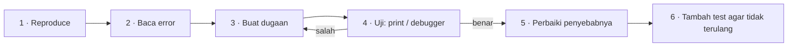

::part[Pelajari Konsepnya]{n="1"}

## 🎯 Yang akan kamu pelajari

- Cara membaca **traceback** Python dalam 30 detik
- 8 kesalahan yang paling sering kamu temui — dan apa arti masing-masing
- Sebuah **metode debugging** yang bisa diulang (bukan coba-coba sampai jalan)
- Tools: `print`, `breakpoint()`, debugger di editor-mu
- Cara pakai AI untuk debugging **tanpa** kehilangan kesempatan belajar

## 🔤 Istilah penting

| Istilah | Artinya (sederhana) |
|---|---|
| **Error / exception** | Python berhenti karena ada yang salah |
| **Traceback** | Laporan yang menunjukkan di mana terjadi, langkah demi langkah |
| **`SyntaxError`** | Python tidak bisa membaca kode-mu |
| **`NameError`** | Nama yang tidak ada (sering typo) |
| **`TypeError`** | Melakukan sesuatu yang tidak boleh dilakukan tipe data itu |
| **`IndexError` / `KeyError`** | Posisi / kunci tidak ada di situ |
| **Reproduce** | Membuat bug terjadi lagi, setiap kali, sesuai kehendak |
| **Hypothesis** | Dugaan-mu tentang penyebab, yang akan kamu uji |
| **`breakpoint()`** | Menjeda program untuk lihat apa yang terjadi |
| **Rubber duck** | Jelaskan masalah keras-keras sampai kamu lihat jawabannya |

## 🧠 Ide besarnya

Pesan error bukan komputer berteriak padamu. Ia seperti **laporan dokter**: mengatakan *apa* yang salah, *di mana*, dan sering *kenapa*. Pemula menutup laporannya dan menebak-nebak. Profesional membaca dulu.

:::tip
Engineer senior tidak membuat bug lebih sedikit. Mereka menemukannya **lebih cepat**, karena mengikuti metode.
:::

## ❓ Kenapa ini penting

Debugging adalah sebagian besar pemrograman. Bukan menulis kode — tapi mencari tahu kenapa kode yang kamu tulis tidak melakukan apa yang kamu maksud.

Pesan error bukanlah komputer berteriak; ia seperti **laporan dokter** yang bilang apa yang salah, di mana, dan sering kenapa. Pemula menutup laporan dan mulai ubah-ubah kode sembarangan. Profesional membaca, buat satu dugaan, dan uji dugaan itu.

Bedanya bukan bakat, tapi metode — dan metode itulah yang akan kamu pelajari di pelajaran ini.

## 📖 Langkah demi langkah

### 1. Baca traceback dari bawah ke atas

Baris paling bawah adalah diagnosisnya; baris di atasnya adalah jalan yang kamu tempuh untuk sampai situ. Baca baris paling bawah dulu, lalu naik sampai kamu temukan file yang kamu tulis.

```text
Traceback (most recent call last):
  File "shop.py", line 14, in <module>
    print(cart_summary(cart))
  File "shop.py", line 9, in cart_summary
    total += item["price"] * item["qty"]
KeyError: 'qty'
```

| Baca | Apa artinya |
|---|---|
| **Baris paling bawah** | Jenis error (`KeyError`) dan detailnya (`'qty'`) → *kamus tidak punya kunci `qty`* |
| **Baris di atasnya** | Kode yang tepatnya gagal: baris 9 di `cart_summary` |
| **Baris lebih atas** | Jalan yang kita tempuh: baris 14 memanggil `cart_summary` |

A :term[traceback]{bahasa="jejak panggilan — daftar baris kode yang sedang berjalan saat error terjadi"} adalah tumpukan "siapa yang memanggil siapa". **Bug-mu** biasanya ada di baris paling rendah yang menunjuk ke **file-mu** (bukan library).

### 2. Kesalahan yang umum

| Error | Biasanya berarti | Contoh |
|---|---|---|
| `SyntaxError` | Python tidak bisa baca kode-nya | `:` atau `)` ketinggalan, tanda kutip tidak ditutup |
| `IndentationError` | Spasi tidak rapi | mencampur tab dan spasi |
| `NameError` | Nama tidak ada (belum) | typo `totl`, atau dipakai sebelum ditugaskan |
| `TypeError` | Tipe salah untuk operasi ini | `"5" + 5`, panggil `None()`, jumlah argumen salah |
| `ValueError` | Tipe benar, nilai buruk | `int("abc")` |
| `IndexError` | Posisi di list tidak ada | `items[3]` pada list yang punya 3 item |
| `KeyError` | Kunci di dict tidak ada | `user["emial"]` |
| `AttributeError` | Object ini tidak punya method/attribute itu | `None.upper()`, `list.push()` |

:::warning[`'NoneType' object has no attribute …`]
Error paling membingungkan yang #1. Artinya variabel yang kamu pikir punya nilai ternyata `None` — sering karena fungsi lupa `return`. Lihat **dari mana nilai itu berasal**.
:::

### 3. Metode debugging

Reproduce → baca → dugakan satu penyebab → uji dugaan itu → perbaiki → pastikan. Mengubah tiga hal sekaligus dan berharap adalah cara yang lambat, bahkan kalau kadang kebetulan jalan.



1. **Reproduce**: temukan input terkecil yang gagal, setiap kali.
2. **Baca** traceback (dan pesan lengkapnya — jangan berhenti di kata pertama).
3. **Buat dugaan**: "Saya pikir `item` tidak punya `qty` karena kolom CSV-nya nama `quantity`."
4. **Uji dugaan**: print nilai-nya, atau jeda di debugger. Jangan ubah kode dulu.
5. **Perbaiki penyebabnya**, bukan gejalanya. (Membungkus segalanya dalam `try/except: pass` menyembunyikan bug, tidak memperbaikinya.)
6. **Lindungi**: tambah test case untuk input ini.

### 4. Debug dengan print (sederhana dan bagus-bagus saja)

```python
def cart_summary(cart):
    total = 0
    for item in cart:
        print("DEBUG item =", repr(item))    # repr shows quotes and types clearly
        total += item["price"] * item["qty"]
    return total
```

Pakai `repr()` atau f-string syntax `=`: `print(f"{item=}")` → `item={'price': 5000, 'quantity': 2}`. Hapus print debug saat selesai.

### 5. Jeda program: `breakpoint()`

```python
for item in cart:
    breakpoint()      # program pauses here, in the terminal
    total += item["price"] * item["qty"]
```

Di prompt `(Pdb)`: ketik nama variabel untuk lihatnya, `n` = baris berikutnya, `c` = lanjut, `q` = keluar.
Di VS Code kamu bisa klik di sebelah nomor baris untuk set red breakpoint dan jalankan dengan **debugger** — kamu akan lihat setiap variabel tanpa ketik.

### 6. Rubber duck debugging

Jelaskan kode-mu, baris demi baris, keras-keras kepada rubber duck (atau teman sabar). Setengah jalan kamu akan dengar diri-mu bilang "…terus baris ini menambah harga **ditambah** jumlahnya — oh." Ini sering berhasil.

### 7. Minta bantuan (manusia atau AI) dengan baik

Pertanyaan yang bagus termasuk:

- Apa yang kamu coba lakukan
- Kode **terkecil** yang menunjukkan masalahnya
- Pesan error **lengkap**
- Apa yang kamu harapkan vs apa yang terjadi
- Apa yang sudah kamu coba

:::note[Otak dulu, terus AI]
Habiskan **15–20 menit** dengan metode di atas dulu. Terus tanya AI untuk *jelaskan error-nya* atau *beri petunjuk* — bukan tulis ulang kode-mu. Sesudahnya, pastikan kamu bisa jelaskan perbaikannya dengan kata-katamu sendiri.
:::

### Pilih setup-mu

Setiap pilihan di sini adalah trade-off:

| Tool | ✅ | ❌ |
|---|---|---|
| `print` | Jalan di mana saja, nol setup | Berantakan kode; harus dihapus nanti |
| `breakpoint()` / pdb | Lihat apa saja live, tidak perlu editor | Perintah terminal yang perlu dipelajari |
| Debugger editor | Visual, cepat setelah dibiasakan | Setup per proyek |
| Logging (Module 2) | Tetap di production, punya level | Lebih banyak setup daripada print |
| Tanya AI langsung | Jawab cepat | Kamu tidak bangun skill-nya; jawaban bisa salah |

- ✅ Baca error **sebelum** ubah apapun, setiap kali.
- ✅ Pakai debugger kalau kamu perlu lebih dari ~3 print.
- 🚫 Jangan diamkan error dengan `except:` / `except Exception: pass` polos.
- 🚫 Jangan ubah beberapa hal sekaligus — kamu tidak tahu mana yang penting.


## ⚠️ Kesalahan umum

- Baca hanya baris pertama traceback.
- Perbaiki baris di mana error **muncul** bukan di mana nilai buruk **dibuat**.
- Asumsikan bug ada di library, bukan di kode-mu (hampir selalu di kode-mu).
- Hapus pesan error sebelum copy-nya.

::part[Jelaskan & Rancang]{n="2"}

## 🗣️ Jelaskan

Ambil error ini dan jelaskan, dengan bahasa sederhana, **apa yang terjadi** dan **tempat pertama yang akan kamu lihat**:

```text
  File "report.py", line 22, in average_score
    return total / len(scores)
ZeroDivisionError: division by zero
```

## 📐 Rancang

Tulis **bug report** singkat (seperti ticket asli) untuk situasi ini: pengguna bilang checkout page menunjukkan total `Rp 0` ketika cart punya tepat satu item. Termasuk: judul, langkah untuk ulang, harapan vs realitas, dugaan-mu pertama, dan cara kamu pastikan.

:::quiz
Lihat contoh bug report

**Judul:** Total checkout menunjukkan Rp 0 ketika cart berisi satu item

**Langkah untuk ulang:** 1) Kosongkan cart. 2) Tambah satu produk. 3) Buka checkout.

**Harapan:** Total sama dengan harga produk. **Realitas:** Total menunjukkan `Rp 0`. Dengan 2+ item totalnya benar.

**Dugaan:** Loop yang menjumlahkan item mulai dari index 1 (`range(1, len(items))`), lewatkan item pertama.

**Cara pastikan:** Print index yang dikunjungi loop untuk cart 1-item, atau tambah unit test `cart_total([(50_000, 1)]) == 50_000` dan lihat gagal.
:::

### 📝 Checklist review mandiri

- [ ] Penjelasan-ku bilang *kenapa* `len(scores)` adalah 0 (input kosong)
- [ ] Bug report punya langkah yang bisa diikuti orang lain
- [ ] Dugaan-ku bisa diuji
- [ ] Saya usulkan test yang akan tangkap ini di masa depan

::ai-review{task="explain"}

::part[Latihan Kecil]{n="3"}

## 🧸 Perburuan bug

:::exercise{path="exercises/m1/w0/07-debugging" ai="no-ai" title="Perbaiki 5 bug dengan metode"}
`buggy_report.py` hitung laporan penjualan kecil — dan punya **5 bug**. Jalankan test, baca setiap kegagalan dari bawah ke atas, buat dugaan, pastikan dengan `print` atau `breakpoint()`, terus perbaikinya.

Untuk setiap bug, tulis satu baris di **Catatan saya**: *error → penyebab → perbaikan*.

Aturan: **jangan tulis ulang** fungsinya dari nol. Temukan dan perbaiki baris yang rusak tertentu — itulah skill-nya.
:::

:::hints
- Jalankan satu test di satu waktu untuk fokus: `uv run pytest m1/w0/07-debugging -k average`.
- Satu bug adalah `return` yang hilang.
- Satu bug adalah off-by-one di `range`.
- Satu bug membandingkan teks dengan huruf besar berbeda.
- Untuk data "tidak ada penjualan", rata-rata seharusnya apa, dan kode lakukan apa?
:::

### 🏆 Tantangan

Buka folder di VS Code, set breakpoint di dalam `best_seller`, dan jalankan test dengan debugger (Testing panel → *Debug Test*). Langkah-langkah melalui loop dan lihat variabel berubah.

## ✅ Cek cepat

:::quiz
Dalam urutan apa kamu baca Python traceback, dan kenapa?

Dari bawah ke atas: baris paling bawah namakan error, baris di atasnya tunjukkan kode yang tepatnya gagal, dan baris di atasnya lagi tunjukkan jalan program sampai situ.
:::

:::quiz
`AttributeError: 'NoneType' object has no attribute 'strip'` — apa penyebab paling mungkin?

Variabel yang kamu panggil `.strip()` padanya adalah `None` — sering fungsi yang lupa `return`, atau lookup yang tidak menemukan apa-apa. Telusuri di mana nilai itu berasal.
:::

:::quiz
Kenapa tambah test setelah perbaiki bug?

Agar bug yang sama tidak bisa kembali tanpa kita tahu (test *regression*), dan buktikan perbaikan berhasil.
:::


## 📚 Lanjut belajar

- [Tutorial Python: Errors and Exceptions](https://docs.python.org/3/tutorial/errors.html)
- [Dokumentasi Python: pdb — the Python debugger](https://docs.python.org/3/library/pdb.html)
- [VS Code: Python debugging](https://code.visualstudio.com/docs/python/debugging)

## 📣 Akhir Minggu 0 — bagikan progresmu

:::linkedin{type="weekly"}
💡 Dulu saya takut pesan error merah. Minggu ini saya belajar membacanya dari bawah ke atas — dan mereka jadi tool debugging terbaik saya.

Minggu 0 perjalanan AI full-stack engineering saya:
- Cara web bekerja sungguhan: client, server, HTTP request dan status code
- Python dasar: tipe data, operator, conditional, loop dan function
- Metode debugging: reproduce → baca → dugakan → uji → perbaiki → tambah test

Pelajaran paling berguna: [satu hal yang click untuk kamu].

Minggu depan: hitung, cari dan sort algoritma — dan versi pertama project CareerPilot saya. 🚀

Apa satu habit debugging yang kamu pikir ingin dipelajari lebih awal?

#LearningInPublic #Python #SoftwareEngineering #CareerSwitch
:::
