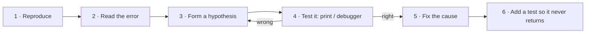

::part[Learn the Concept]{n="1"}

## 🎯 What you'll learn

- How to read a Python **traceback** in 30 seconds
- The 8 errors you'll meet most often — and what each one usually means
- A **repeatable debugging method** (not random changes until it works)
- Tools: `print`, `breakpoint()`, your editor's debugger
- How to use AI for debugging **without** losing the learning

## 🧠 The big idea

An error message is not the computer shouting at you. It's a **doctor's report**: it tells you *what* went wrong, *where*, and often *why*. Beginners close the report and guess. Professionals read it first.

:::tip
Senior engineers don't make fewer bugs. They find them **faster**, because they follow a method.
:::

## ❓ Why does this exist?

Every program has bugs — including ones written by experts and by AI. Debugging is how software actually gets finished. In real jobs you'll spend a large part of your time reading errors, logs and other people's code. It's a skill you can train, just like writing code.

## 💥 What happens if we DON'T debug methodically?

"Shotgun debugging": change a line, run, still broken, change another line, run… After an hour you have **new** bugs, you don't know which change did what, and if it finally works you don't know **why** — so the bug comes back next week.

## 📖 How it works, step by step

### 1. Read a traceback bottom-up

```text
Traceback (most recent call last):
  File "shop.py", line 14, in <module>
    print(cart_summary(cart))
  File "shop.py", line 9, in cart_summary
    total += item["price"] * item["qty"]
KeyError: 'qty'
```

| Read | What it tells you |
|---|---|
| **Last line** | The error type (`KeyError`) and detail (`'qty'`) → *a dictionary has no key named `qty`* |
| **Line above** | The exact code that failed: line 9 in `cart_summary` |
| **Lines further up** | How we got there: line 14 called `cart_summary` |

A :term[traceback]{bahasa="jejak panggilan — daftar baris kode yang sedang berjalan saat error terjadi"} is a stack of "who called whom". **Your** bug is usually in the lowest line that points to **your** file (not a library).

### 2. The common errors

| Error | Usually means | Example |
|---|---|---|
| `SyntaxError` | Python can't even read the code | missing `:` or `)`, unclosed quote |
| `IndentationError` | Spaces don't line up | mixing tabs and spaces |
| `NameError` | A name doesn't exist (yet) | typo `totl`, or used before assigning |
| `TypeError` | Wrong type for this operation | `"5" + 5`, calling `None()`, wrong number of arguments |
| `ValueError` | Right type, bad value | `int("abc")` |
| `IndexError` | List position doesn't exist | `items[3]` on a list of 3 |
| `KeyError` | Dict key doesn't exist | `user["emial"]` |
| `AttributeError` | That object has no such method/attribute | `None.upper()`, `list.push()` |

:::warning[`'NoneType' object has no attribute …`]
The #1 confusing error. It means a variable you expected to hold something is `None` — often because a function forgot to `return`. Look at **where that value came from**.
:::

### 3. The debugging method



1. **Reproduce**: find the smallest input that fails, every time.
2. **Read** the traceback (and the full message — don't stop at the first word).
3. **Hypothesize**: "I think `item` has no `qty` because the CSV column is called `quantity`."
4. **Test the hypothesis**: print the value, or pause in the debugger. Don't change code yet.
5. **Fix the cause**, not the symptom. (Wrapping everything in `try/except: pass` hides the bug; it doesn't fix it.)
6. **Protect**: add a test case for this input.

### 4. Print debugging (simple and fine)

```python
def cart_summary(cart):
    total = 0
    for item in cart:
        print("DEBUG item =", repr(item))    # repr shows quotes and types clearly
        total += item["price"] * item["qty"]
    return total
```

Use `repr()` or f-string `=` syntax: `print(f"{item=}")` → `item={'price': 5000, 'quantity': 2}`. Remove debug prints when done.

### 5. Pause the program: `breakpoint()`

```python
for item in cart:
    breakpoint()      # program pauses here, in the terminal
    total += item["price"] * item["qty"]
```

At the `(Pdb)` prompt: type a variable name to see it, `n` = next line, `c` = continue, `q` = quit.
In VS Code you can click left of a line number to set a red breakpoint and run with the **debugger** — you'll see every variable without typing.

### 6. Rubber duck debugging

Explain your code, line by line, out loud to a rubber duck (or a patient friend). Halfway through you'll hear yourself say "…and then this adds the price **plus** the quantity — oh." It works surprisingly often.

### 7. Asking for help (humans or AI) well

A good question includes:

- What you're trying to do
- The **smallest** code that shows the problem
- The **full** error message
- What you expected vs what happened
- What you already tried

:::note[Brain-first with AI]
Spend **15–20 minutes** on the method above first. Then ask AI to *explain the error* or *give a hint* — not to rewrite your code. Afterwards, make sure you can explain the fix in your own words.
:::

## ⚖️ Trade-offs

| Tool | ✅ | ❌ |
|---|---|---|
| `print` | Works everywhere, zero setup | Clutters code; must remove later |
| `breakpoint()` / pdb | Inspect anything live, no editor needed | Terminal commands to learn |
| Editor debugger | Visual, fast once learned | Setup per project |
| Logging (Module 2) | Stays in production, has levels | More setup than print |
| Asking AI immediately | Fast answer | You don't build the skill; answers can be wrong |

## ✅ When to use it / 🚫 When NOT to use it

- ✅ Read the error **before** changing anything, every time.
- ✅ Reach for the debugger when you'd need more than ~3 prints.
- 🚫 Don't silence errors with bare `except:` / `except Exception: pass`.
- 🚫 Don't change several things at once — you won't know which one mattered.

## 🏭 How it's used in industry

- Production errors are collected by tools like **Sentry**, which show the same traceback you see locally — plus how many users hit it.
- Bug tickets are expected to include **steps to reproduce**.
- After fixing, teams add a **regression test** so the bug can't silently come back.

## ⚠️ Common mistakes

- Reading only the first line of the traceback.
- Fixing the line where the error **appeared** instead of where the bad value was **created**.
- Assuming the bug is in the library, not your code (it's almost always your code).
- Deleting the error message before copying it.

::part[Explain & Design]{n="2"}

## 🗣️ Explain it

Take this error and explain, in plain language, **what happened** and **the first place you would look**:

```text
  File "report.py", line 22, in average_score
    return total / len(scores)
ZeroDivisionError: division by zero
```

## 📐 Design it

Write a short **bug report** (like a real ticket) for this situation: users report the checkout page shows a total of `Rp 0` when the cart has exactly one item. Include: title, steps to reproduce, expected vs actual, your first hypothesis, and how you'd confirm it.

:::quiz
Show an example bug report

**Title:** Checkout total is Rp 0 when cart contains a single item

**Steps to reproduce:** 1) Empty the cart. 2) Add any one product. 3) Open checkout.

**Expected:** Total equals the product price. **Actual:** Total shows `Rp 0`. With 2+ items the total is correct.

**Hypothesis:** The loop that sums items starts at index 1 (`range(1, len(items))`), skipping the first item.

**How to confirm:** Print the indexes the loop visits for a 1-item cart, or add a unit test `cart_total([(50_000, 1)]) == 50_000` and see it fail.
:::

### 📝 Self-review checklist

- [ ] My explanation says *why* `len(scores)` was 0 (empty input)
- [ ] The bug report has steps someone else could follow
- [ ] My hypothesis is testable
- [ ] I proposed a test that would catch it in the future

::ai-review{task="explain"}

::part[Toy Exercise]{n="3"}

## 🧸 Bug hunt

:::exercise{path="exercises/m1/w0/07-debugging" ai="no-ai" title="Fix 5 bugs with the method"}
`buggy_report.py` computes a small sales report — and contains **5 bugs**. Run the tests, read each failure bottom-up, form a hypothesis, confirm it with a `print` or `breakpoint()`, then fix it.

For each bug, write one line in **My notes**: *error → cause → fix*.

Rule: **don't rewrite** the functions from scratch. Find and fix the specific broken lines — that's the skill.
:::

:::hints
- Run one test at a time to focus: `uv run pytest m1/w0/07-debugging -k average`.
- One bug is a `return` that's missing.
- One bug is an off-by-one in a `range`.
- One bug compares text with different capitalization.
- For "no sales" data, what should an average be, and what does the code do?
:::

### 🏆 Stretch goal

Open the folder in VS Code, set a breakpoint inside `best_seller`, and run the tests with the debugger (Testing panel → *Debug Test*). Step through the loop and watch the variables change.

## ✅ Quick check

:::quiz
In which order should you read a Python traceback, and why?

Bottom-up: the last line names the error, the line above shows the exact failing code, and the lines above that show how the program got there.
:::

:::quiz
`AttributeError: 'NoneType' object has no attribute 'strip'` — what's the most likely cause?

A variable you called `.strip()` on is `None` — often a function that forgot to `return`, or a lookup that found nothing. Trace back where the value came from.
:::

:::quiz
Why add a test after fixing a bug?

So the same bug can't come back unnoticed later (a *regression test*), and to prove the fix works.
:::

## 📖 Kamus (glossary)

| Term | Bahasa Indonesia |
|---|---|
| Bug | Kesalahan dalam program |
| Debugging | Proses mencari dan memperbaiki bug |
| Traceback | Jejak error — urutan panggilan fungsi saat error |
| Reproduce | Mengulang kondisi sampai bug muncul lagi |
| Hypothesis | Dugaan yang bisa diuji |
| Regression test | Tes untuk memastikan bug lama tidak muncul lagi |

## 📚 Keep learning

- [Python tutorial: Errors and Exceptions](https://docs.python.org/3/tutorial/errors.html)
- [Python docs: pdb — the Python debugger](https://docs.python.org/3/library/pdb.html)
- [VS Code: Python debugging](https://code.visualstudio.com/docs/python/debugging)

## 📣 End of Week 0 — share your progress

:::linkedin{type="weekly"}
💡 I used to be scared of red error messages. This week I learned to read them bottom-up — and they became my best debugging tool.

Week 0 of my AI full-stack engineering journey:
- How the web really works: clients, servers, HTTP requests and status codes
- Python fundamentals: types, operators, conditionals, loops and functions
- A debugging method: reproduce → read → hypothesize → test → fix → add a test

The most useful lesson: [one thing that clicked for you].

Next week: counting, searching and sorting algorithms — and the first version of my CareerPilot project. 🚀

What's one debugging habit you wish you'd learned earlier?

#LearningInPublic #Python #SoftwareEngineering #CareerSwitch
:::
