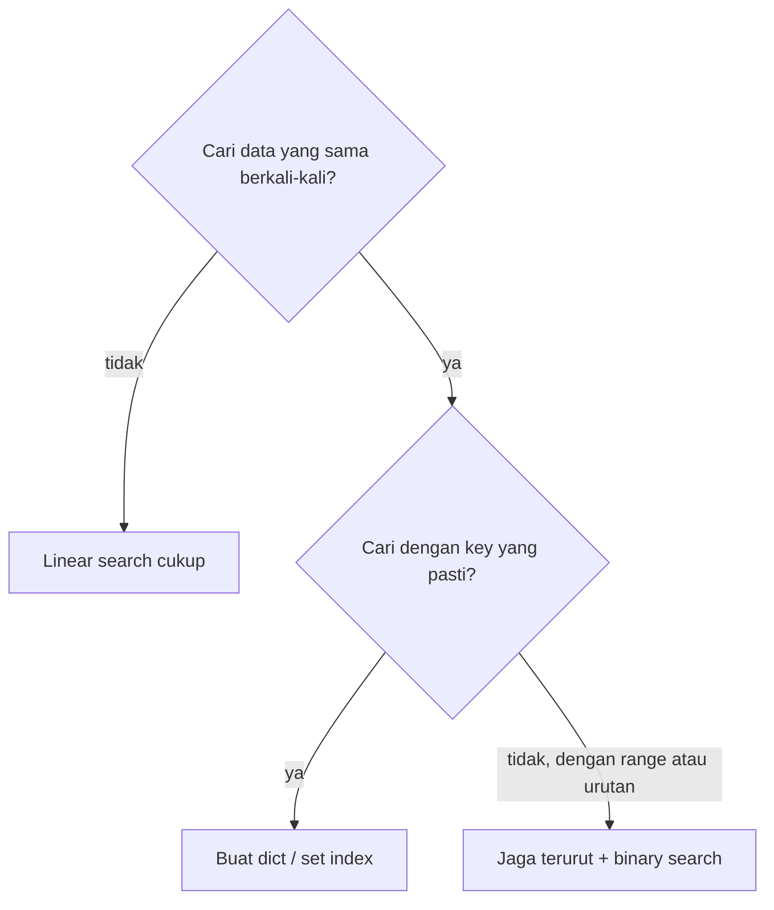

::part[Pelajari Konsepnya]{n="1"}

## 🎯 Yang akan kamu pelajari

- **Linear search**: sederhana, jalan di mana saja, lambat untuk data besar
- **Binary search**: sangat cepat, tapi butuh data yang **terurut**
- Mencari berdasarkan **syarat** ("pekerjaan pertama gaji lebih dari Rp 10 juta")
- Kapan lewati pencarian dengan menggunakan `set` atau `dict` **index**
- Python `in`, `.index()`, `next()` dan `bisect`

## 🔤 Istilah penting

| Istilah | Artinya (sederhana) |
|---|---|
| **Linear search** | Cek satu item per satu dari awal |
| **Binary search** | Cari dengan membelah dua daftar terurut setiap langkah |
| **Terurut** | Dalam urutan — syarat untuk binary search bekerja |
| **Cari berdasarkan syarat** | Temukan item pertama yang cocok dengan aturan |
| **`in`** | Pengecekan keberadaan di Python |
| **`next()`** | Ambil item pertama yang cocok dari generator, atau nilai default |
| **`bisect`** | Binary search bawaan Python |
| **Index (struktur data)** | Dict atau set yang dibuat sekali supaya pencarian instan |

## 🧠 Ide besarnya

Dua cara mencari kata *"kucing"* di kamus kertas:

1. **Linear**: mulai dari halaman 1 dan baca setiap kata sampai ketemu.
2. **Binary**: buka di tengah. Kata-kata di sana dimulai dari **M**? *"kucing"* datang lebih awal — buang setengah belakang. Buka tengah dari yang tersisa. Ulangi.

Cara kedua hanya jalan karena kamus **terurut**. Satu fakta ini mengubah pencarian 1.000 halaman jadi hanya **10 kali membuka halaman**.

## ❓ Kenapa ini penting

Pencarian adalah operasi paling sering di program manapun: cari user dengan email ini, order dengan id itu, pekerjaan pertama gaji lebih dari Rp 10 juta.

Cara kamu mencari menentukan apakah fitur tetap cepat saat data bertambah. Dengan 100 item, semuanya terasa instan; dengan 100.000 dalam loop, linear search adalah perbedaan antara halaman yang muat dan halaman yang timeout.

Dan pencarian paling cepat adalah tidak mencari sama sekali: buat dictionary sekali, lalu setiap pencarian nanti adalah satu langkah — alasan database punya index.

## 📖 Langkah demi langkah

### 1. Linear search

```python
def linear_search(items, target):
    for index, item in enumerate(items):
        if item == target:
            return index
    return -1        # convention: -1 means "not found"
```

- ✅ Jalan di **item apapun**, terurut atau tidak.
- ❌ Kasus terburuk periksa **setiap** item: n langkah.

Built-in Python juga linear: `target in my_list`, `my_list.index(target)`.

### 2. Mencari berdasarkan syarat

Sering kamu tidak tahu nilai pastinya — kamu tahu **aturannya**:

```python
def first_high_paying(jobs, minimum):
    for job in jobs:
        if job["salary"] >= minimum:
            return job
    return None

# Same thing, compact: next() returns the first match or the default
job = next((j for j in jobs if j["salary"] >= 10_000_000), None)
```

### 3. Binary search

Biaya sorting dibayar sekali; setelah itu setiap pencarian buang separuh halaman yang tersisa. Trade-off ini alasan data terurut sangat berharga.

Syarat: daftar sudah **terurut**.

```python
def binary_search(sorted_items, target):
    low, high = 0, len(sorted_items) - 1
    while low <= high:
        mid = (low + high) // 2
        if sorted_items[mid] == target:
            return mid
        if sorted_items[mid] < target:
            low = mid + 1        # target is in the right half
        else:
            high = mid - 1       # target is in the left half
    return -1
```

Telusuri: cari `23` di `[3, 8, 15, 23, 42, 57, 91]`

| Langkah | low | high | mid | nilai di mid | keputusan |
|---|---|---|---|---|---|
| 1 | 0 | 6 | 3 | 23 | ketemu ✅ |

Cari `57`:

| Langkah | low | high | mid | nilai | keputusan |
|---|---|---|---|---|---|
| 1 | 0 | 6 | 3 | 23 | 23 < 57 → low = 4 |
| 2 | 4 | 6 | 5 | 57 | ketemu ✅ |

Berapa langkah di kasus terburuk?

| Item | Linear (terburuk) | Binary (terburuk) |
|---|---|---|
| 1.000 | 1.000 | ~10 |
| 1.000.000 | 1.000.000 | ~20 |
| 1.000.000.000 | 1.000.000.000 | ~30 |

Setiap langkah **membelah dua** data yang tersisa. Ini pertumbuhan :term[logaritmic]{bahasa="logaritmik — waktu bertambah sangat lambat walau data bertambah sangat banyak"} — kamu akan mempelajarinya sebagai *O(log n)* di track DSA.

### 4. Python `bisect`

```python
import bisect

prices = [10, 20, 30, 40]
position = bisect.bisect_left(prices, 30)   # 2 — where 30 is (or would be inserted)
bisect.insort(prices, 25)                    # insert while keeping the list sorted
```

### 5. Pencarian terbaik adalah tidak mencari: buat index

Kalau kamu akan cari data yang sama berkali-kali, habiskan satu kali pass membangun dict. Kamu lakukan dengan tangan tepat apa yang database index lakukan nanti.

Kalau kamu mencari **data yang sama berkali-kali**, habiskan satu pass membangun dictionary atau set:

```python
users_by_email = {user["email"]: user for user in users}   # one pass: n steps

users_by_email.get("ana@mail.com")    # every lookup after that: ~1 step
```

```python
blocked_ids = set(load_blocked_ids())
if user_id in blocked_ids:            # fast, instead of scanning a list
    ...
```

Ini tepat apa yang **database index** lakukan — kamu akan bikin di Module 2.



### Pilih setupmu

Setiap opsi adalah trade-off:

| Pendekatan | Biaya setup | Setiap pencarian | Butuh | Bagus untuk |
|---|---|---|---|---|
| Linear | tidak ada | n | tidak ada | daftar kecil atau pencarian sekali |
| Binary | sort sekali (n log n) | log n | data terurut | range, "nilai terdekat", daftar besar terurut |
| Dict/set index | satu pass (n) + memori | ~1 | key yang pasti | pencarian exact berulang-ulang |

- ✅ Linear untuk daftar kecil (beberapa ratus) atau kalau kamu cari sekali.
- ✅ Binary search kalau data terurut dan kamu butuh range atau nilai terdekat.
- ✅ Dict/set kalau kamu cari exact key berulang-ulang.
- 🚫 Jangan sort daftar hanya untuk binary search **sekali** — sort lebih mahal dari satu linear search.
- 🚫 Jangan binary search data yang tidak terurut — hasilnya salah tapi diam-diam.


## ⚠️ Kesalahan umum

- Off-by-one di binary search: `while low < high` vs `<=`, atau lupa `+ 1`/`- 1` → infinite loop.
- Binary search data yang tidak terurut (atau terurut di field berbeda).
- Kembalikan `None` di satu fungsi dan `-1` di fungsi lain — pilih satu konvensi per codebase.
- Pakai daftar untuk cek "sudah pernah lihat ini?" di loop atas data besar.

::part[Jelaskan & Rancang]{n="2"}

## 🗣️ Jelaskan

Jelaskan binary search pakai permainan "tebak angkaku antara 1 dan 100". Kenapa pemain yang pintar selalu menang dalam **7 tebakan** atau kurang?

## 📐 Rancang

CareerPilot simpan 50.000 listing pekerjaan. Aplikasi butuh:

1. Tampilkan listing kalau user buka `/jobs/48213` (by id)
2. Tampilkan semua listing dengan gaji antara Rp 8 juta dan Rp 12 juta
3. Peringatan kalau import listing yang URL-nya sudah pernah di-import

Untuk masing-masing, pilih struktur data/strategi pencarian dan jelaskan alasannya.

:::quiz
Lihat contoh rancangan

1. **By id** → `dict` `{id: listing}` dibuat sekali. Key yang pasti, banyak pencarian → ~1 langkah masing-masing.
2. **Range gaji** → jaga listing **terurut by gaji**; pakai binary search (`bisect_left`/`bisect_right`) untuk cari awal dan akhir range, lalu slice. Scan linear juga jalan untuk 50k kalau jarang — ukur dulu.
3. **Duplicate URL** → `set` dari URL yang sudah di-import. `if url in seen_urls` cepat; tambahkan setiap URL baru.

Di Module 2 database lakukan ketiganya untuk kamu — dengan primary key, index di `salary`, dan constraint `UNIQUE` di `url`.
:::

### 📝 Checklist review mandiri

- [ ] Saya pilih berdasarkan *seberapa sering* dan *bagaimana* (key yang pasti vs range) data dicari
- [ ] Saya sebut syarat sorting untuk binary search
- [ ] Saya pertimbangkan biaya setup (buat index)

::ai-review{task="design"}

::part[Latihan Kecil]{n="3"}

## 🧸 Bangun tools pencarian-mu

:::exercise{path="exercises/m1/w1/02-searching" ai="no-ai" title="Linear, binary dan indexed search"}
Di `searching.py` terapkan:

- `linear_search(items, target)` → index atau `-1` (tidak boleh `.index()` atau `in`)
- `binary_search(sorted_items, target)` → index atau `-1` — dan kembalikan juga **jumlah langkah**: `(index, steps)`
- `first_job_over(jobs, minimum_salary)` → dict pekerjaan pertama dengan `salary >= minimum_salary`, atau `None`
- `build_index(jobs)` → dict dari `job["id"]` → pekerjaan
- `jobs_in_salary_range(jobs_sorted_by_salary, low, high)` → semua pekerjaan dengan `low <= salary <= high` pakai `bisect`
:::

:::hints
- Hitung satu "langkah" setiap kali kamu bandingkan terhadap `mid`.
- Untuk range di data terurut: `bisect_left(salaries, low)` kasih posisi pertama ≥ low; `bisect_right(salaries, high)` kasih posisi setelah ≤ high terakhir. Slice di antara keduanya.
- Buat daftar `salaries` dulu: `[job["salary"] for job in jobs_sorted_by_salary]`.
:::

### 🏆 Stretch goal

Tulis `binary_search_first(sorted_items, target)` yang kembalikan index **pertama** dari nilai yang muncul berkali-kali, contoh `[1, 2, 2, 2, 3]` dan `2` → `1`.

## ✅ Cek cepat

:::quiz
Kira-kira berapa langkah yang butuh binary search untuk 64 item terurut di kasus terburuk?

Kira-kira **6–7**: 64 → 32 → 16 → 8 → 4 → 2 → 1.
:::

:::quiz
Kenapa `x in my_set` tidak jadi lambat saat set bertambah, tapi `x in my_list` jadi lambat?

Set pakai hashing untuk loncat langsung ke tempat `x` akan berada; daftar harus bandingkan item satu per satu.
:::

:::quiz
Kapan linear search pilihan yang lebih baik?

Untuk data kecil, data tidak terurut yang kamu cari sekali, atau kalau cari berdasarkan syarat yang tidak ada index dukung.
:::


## 📚 Lanjut belajar

- [Dokumentasi Python: bisect](https://docs.python.org/3/library/bisect.html)
- [Tutorial Python: Sets](https://docs.python.org/3/tutorial/datastructures.html#sets)
