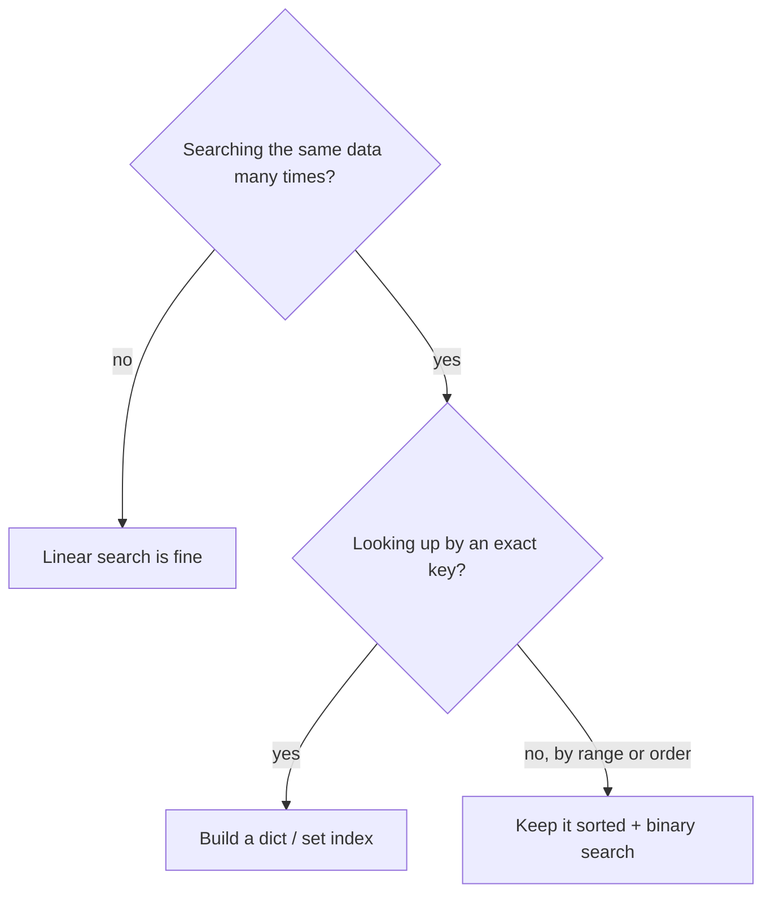

::part[Learn the Concept]{n="1"}

## 🎯 What you'll learn

- **Linear search**: simple, works on anything, slow for big data
- **Binary search**: very fast, but needs **sorted** data
- Searching by a **condition** ("first job over Rp 10 juta")
- When to skip searching entirely with a `set` or `dict` **index**
- Python's `in`, `.index()`, `next()` and `bisect`

## 🔤 Key words

| Word | In simple words | Bahasa Indonesia |
|---|---|---|
| **Linear search** | Check items one by one from the start | Cari satu per satu |
| **Binary search** | Halve a sorted list each step | Cari dengan membelah dua |
| **Sorted** | In order — the requirement for binary search | Terurut |
| **Search by condition** | Find the first item matching a rule | Cari berdasarkan syarat |
| **`in`** | Python's "is this present?" check | Pengecekan keberadaan |
| **`next()`** | Get the first match from a generator, or a default | Ambil yang pertama cocok |
| **`bisect`** | Python's built-in binary search | Pencari biner bawaan |
| **Index (data structure)** | A dict or set built once so lookups are instant | Struktur untuk pencarian cepat |

## 🧠 The big idea

Two ways to find the word *"kucing"* in a paper dictionary:

1. **Linear**: start at page 1 and read every word until you find it.
2. **Binary**: open the middle. Words there start with **M**? *"kucing"* comes earlier — throw away the second half. Open the middle of what's left. Repeat.

The second works only because the dictionary is **sorted**. That single fact turns a 1,000-page search into about **10 page flips**.

## ❓ Why it matters

Searching is the most common operation in any program: find the user with this email, the order with this id, the first job over Rp 10 juta.

How you search decides whether a feature stays fast as the data grows. With 100 items, everything feels instant; with 100,000 inside a loop, a linear search is the difference between a page that loads and a page that times out.

And the fastest search is often no search at all: build a dictionary once, then every later lookup is a single step — the reason databases have indexes at all.

## 📖 Step by step

### 1. Linear search

```python
def linear_search(items, target):
    for index, item in enumerate(items):
        if item == target:
            return index
    return -1        # convention: -1 means "not found"
```

- ✅ Works on **any** list, sorted or not.
- ❌ Worst case checks **every** item: n steps.

Python's built-ins are linear too: `target in my_list`, `my_list.index(target)`.

### 2. Searching by a condition

Often you don't know the exact value — you know a **rule**:

```python
def first_high_paying(jobs, minimum):
    for job in jobs:
        if job["salary"] >= minimum:
            return job
    return None

# Same thing, compact: next() returns the first match or the default
job = next((j for j in jobs if j["salary"] >= 10_000_000), None)
```

### 3. Binary search

The cost of sorting is paid once; after that each search throws away half the remaining pages. That trade is why sorted data is so valuable.

Requirement: the list is **sorted**.

```python
def binary_search(sorted_items, target):
    low, high = 0, len(sorted_items) - 1
    while low <= high:
        mid = (low + high) // 2
        if sorted_items[mid] == target:
            return mid
        if sorted_items[mid] < target:
            low = mid + 1        # target is in the right half
        else:
            high = mid - 1       # target is in the left half
    return -1
```

Trace it: find `23` in `[3, 8, 15, 23, 42, 57, 91]`

| Step | low | high | mid | value at mid | decision |
|---|---|---|---|---|---|
| 1 | 0 | 6 | 3 | 23 | found ✅ |

Find `57`:

| Step | low | high | mid | value | decision |
|---|---|---|---|---|---|
| 1 | 0 | 6 | 3 | 23 | 23 < 57 → low = 4 |
| 2 | 4 | 6 | 5 | 57 | found ✅ |

How many steps in the worst case?

| Items | Linear (worst) | Binary (worst) |
|---|---|---|
| 1,000 | 1,000 | ~10 |
| 1,000,000 | 1,000,000 | ~20 |
| 1,000,000,000 | 1,000,000,000 | ~30 |

Each step **halves** the remaining data. That's :term[logarithmic]{bahasa="logaritmik — waktu bertambah sangat lambat walau data bertambah sangat banyak"} growth — you'll formalize it as *O(log n)* in the DSA track.

### 4. Python's `bisect`

```python
import bisect

prices = [10, 20, 30, 40]
position = bisect.bisect_left(prices, 30)   # 2 — where 30 is (or would be inserted)
bisect.insort(prices, 25)                    # insert while keeping the list sorted
```

### 5. The best search is no search: build an index

If you'll look things up more than a couple of times, spend one pass building a dict. You're doing by hand exactly what a database index does for you later.

If you search the **same data many times**, spend one pass building a dictionary or set:

```python
users_by_email = {user["email"]: user for user in users}   # one pass: n steps

users_by_email.get("ana@mail.com")    # every lookup after that: ~1 step
```

```python
blocked_ids = set(load_blocked_ids())
if user_id in blocked_ids:            # fast, instead of scanning a list
    ...
```

This is exactly what a **database index** does — you'll create them in Module 2.



### Choosing your setup

Every option here is a trade-off:

| Approach | Setup cost | Each search | Needs | Good for |
|---|---|---|---|---|
| Linear | none | n | nothing | small or one-off searches |
| Binary | sort once (n log n) | log n | sorted data | ranges, "closest value", huge sorted data |
| Dict/set index | one pass (n) + memory | ~1 | exact keys | repeated exact lookups |

- ✅ Linear for small lists (a few hundred) or when you search once.
- ✅ Binary search when data is sorted and you need ranges or the nearest value.
- ✅ Dict/set when you look things up by an exact key again and again.
- 🚫 Don't sort a list just to binary search it **once** — sorting costs more than one linear search.
- 🚫 Don't binary search unsorted data — it returns wrong answers silently.


## ⚠️ Common mistakes

- Off-by-one in binary search: `while low < high` vs `<=`, or forgetting `+ 1`/`- 1` → infinite loop.
- Binary searching data that isn't sorted (or sorted by a different field).
- Returning `None` in one function and `-1` in another — pick one convention per codebase.
- Using a list for "have I seen this?" checks in a loop over large data.

::part[Explain & Design]{n="2"}

## 🗣️ Explain it

Explain binary search using the "guess my number between 1 and 100" game. Why can a smart player always win in **7 guesses** or fewer?

## 📐 Design it

CareerPilot stores 50,000 job listings. The app needs to:

1. Show a listing when a user opens `/jobs/48213` (by id)
2. Show all listings with salary between Rp 8 juta and Rp 12 juta
3. Warn when importing a listing whose URL was already imported

For each, choose a data structure/search strategy and explain why.

:::quiz
Show a possible design

1. **By id** → a `dict` `{id: listing}` built once. Exact key, many lookups → ~1 step each.
2. **Salary range** → keep listings **sorted by salary**; use binary search (`bisect_left`/`bisect_right`) to find the start and end of the range, then slice. A linear scan also works for 50k if it's rare — measure first.
3. **Duplicate URL** → a `set` of imported URLs. `if url in seen_urls` is fast; add each new URL.

In Module 2 the database does all three for you — with a primary key, an index on `salary`, and a `UNIQUE` constraint on `url`.
:::

### 📝 Self-review checklist

- [ ] I chose based on *how often* and *how* (exact key vs range) data is searched
- [ ] I mentioned the sorting requirement for binary search
- [ ] I considered the setup cost (building the index)

::ai-review{task="design"}

::part[Toy Exercise]{n="3"}

## 🧸 Build your search tools

:::exercise{path="exercises/m1/w1/02-searching" ai="no-ai" title="Linear, binary and indexed search"}
In `searching.py` implement:

- `linear_search(items, target)` → index or `-1` (no `.index()` or `in` allowed)
- `binary_search(sorted_items, target)` → index or `-1` — and return the **number of steps** too: `(index, steps)`
- `first_job_over(jobs, minimum_salary)` → the first job dict with `salary >= minimum_salary`, or `None`
- `build_index(jobs)` → dict of `job["id"]` → job
- `jobs_in_salary_range(jobs_sorted_by_salary, low, high)` → all jobs with `low <= salary <= high` using `bisect`
:::

:::hints
- Count a "step" each time you compare against `mid`.
- For ranges on sorted data: `bisect_left(salaries, low)` gives the first position ≥ low; `bisect_right(salaries, high)` gives the position after the last ≤ high. Slice between them.
- Build the `salaries` list first: `[job["salary"] for job in jobs_sorted_by_salary]`.
:::

### 🏆 Stretch goal

Write `binary_search_first(sorted_items, target)` that returns the **first** index of a value that appears several times, e.g. `[1, 2, 2, 2, 3]` and `2` → `1`.

## ✅ Quick check

:::quiz
About how many steps does binary search need for 64 sorted items in the worst case?

About **6–7**: 64 → 32 → 16 → 8 → 4 → 2 → 1.
:::

:::quiz
Why doesn't `x in my_set` get slower as the set grows, while `x in my_list` does?

A set uses hashing to jump directly to where `x` would be; a list must compare items one by one.
:::

:::quiz
When is linear search the better choice?

For small data, unsorted data you search only once, or when searching by a condition that no index supports.
:::


## 📚 Keep learning

- [Python docs: bisect](https://docs.python.org/3/library/bisect.html)
- [Python tutorial: Sets](https://docs.python.org/3/tutorial/datastructures.html#sets)
