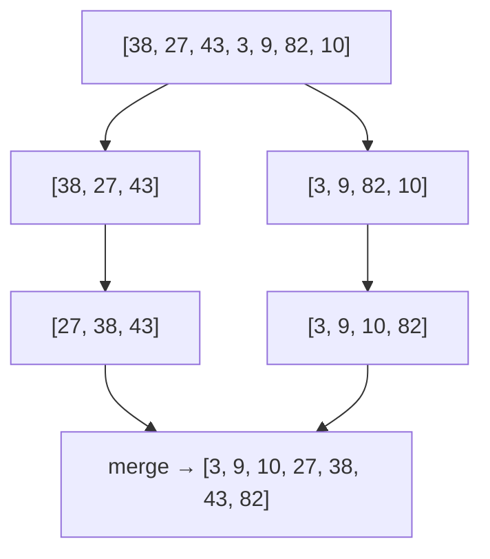

::part[Pelajari Konsepnya]{n="1"}

## 🎯 Yang akan kamu pelajari

- Kenapa sorting itu sebanding dengan biayanya
- Bagaimana **insertion sort** bekerja (dan kenapa sorting sederhana lambat)
- Ide di balik sorting cepat seperti **merge sort**
- Sorting di Python dengan `sorted()`, `.sort()`, `key=`, `reverse=` dan **multi-key** sort
- Apa itu **stable** sort dan kenapa penting untuk "sort by A, then B"

## 🔤 Istilah penting

| Istilah | Artinya (sederhana) |
|---|---|
| **Sorting** | Mengurutkan item dari kecil ke besar (atau sebaliknya) |
| **Insertion sort** | Geser setiap item ke tempat yang benar, seperti sorting kartu tangan |
| **Merge sort** | Pecah, urutkan setiap bagian, lalu gabungkan |
| **`sorted()` vs `.sort()`** | Hasil baru / ubah langsung di tempat |
| **`key=`** | Fungsi yang bilang apa yang harus diurutkan |
| **`reverse=True`** | Dari besar ke kecil |
| **Multi-key sort** | Urut berdasarkan satu field, terus field lain |
| **Stable sort** | Item yang nilainya sama tetap di urutan awalnya |

## 🧠 Ide besarnya

Bayangkan kamu sorting kartu: ambil kartu satu per satu dan **geser ke tempat yang benar** di antara kartu yang sudah kamu pegang. Itu namanya **insertion sort**.

Sekarang bayangin 10.000 kartu. Geser satu kartu lewat ribuan kartu lain — akan sangat lama. Algoritma yang lebih cepat **memecah** tumpukan, sorting tumpukan kecil, terus **menggabungkan** mereka — seperti dua orang, masing-masing sorting setengah deck, lalu menyapu stack mereka.

## ❓ Kenapa ini penting

Sorting membuat data bisa dipakai: harga dari termurah, aplikasi berdasarkan tanggal, hasil pencarian by relevance, leaderboard. Sorting juga membuka teknik lain — binary search, grouping duplikat, finding overlap — karena setelah sorting, item yang sama duduk di sebelahan.

Tahu cara kerjanya di dalam penting untuk dua alasan. Di interview kamu akan diminta jelaskan dan bandingkan sorting. Di kode nyata, kamu hampir pasti pakai Python built-in `sorted()` — tapi kamu perlu tahu *kenapa* dia O(n log n) dan kenapa membuat sorting nested-loop sendiri diam-diam ngubah halaman cepat jadi lambat.

## 📖 Langkah demi langkah

### 1. Insertion sort, dengan tangan

```python
def insertion_sort(values):
    result = list(values)                   # copy: don't change the caller's list
    for i in range(1, len(result)):
        current = result[i]
        j = i - 1
        while j >= 0 and result[j] > current:
            result[j + 1] = result[j]       # shift bigger items right
            j -= 1
        result[j + 1] = current             # drop current into the gap
    return result
```

Trace `[5, 2, 4, 1]`:

| Langkah | Diambil | List setelah |
|---|---|---|
| mulai | — | `[5, 2, 4, 1]` |
| i=1 | 2 | `[2, 5, 4, 1]` |
| i=2 | 4 | `[2, 4, 5, 1]` |
| i=3 | 1 | `[1, 2, 4, 5]` |

Kasus terburuk, setiap item geser melewati semua item sebelumnya: kira-kira n × n / 2 langkah. Data dua kali lebih besar → **4×** waktu.

### 2. Merge sort, idenya



1. **Pecah** list jadi dua sampai setiap bagian punya 1 item (list 1 item sudah sorted).
2. **Merge** pasangan bagian sorted dengan berulang ambil item depan yang lebih kecil.

Kira-kira n × log₂(n) langkah. Untuk 1.000.000 item: ~20 juta bukan ~500 miliar. Kamu akan buat sendiri dengan recursion di DSA track.

:::note
Python built-in sort (**Timsort**) campur merge sort dan insertion sort. Dia sangat dioptimasi — di kode nyata, pakai dia bukan bikin sendiri.
:::

### 3. Sorting di Python

```python
prices = [300, 100, 200]

new_list = sorted(prices)        # returns a NEW sorted list; prices unchanged
prices.sort()                    # sorts IN PLACE; returns None

sorted(prices, reverse=True)     # [300, 200, 100]
```

:::warning
`prices = prices.sort()` set `prices` ke `None`. `.sort()` ubah list dan return nothing.
:::

### 4. Sorting berdasarkan field dengan `key`

Ini yang akan kamu pakai setiap hari. `key=lambda job: job["salary"]` dibaca "sort by salary" — tidak perlu custom comparison function.

`key` adalah fungsi yang bilang **apa yang dibandingkan**:

```python
jobs = [
    {"title": "QA", "salary": 7_000_000},
    {"title": "Backend", "salary": 9_500_000},
    {"title": "Analyst", "salary": 8_000_000},
]

by_salary = sorted(jobs, key=lambda job: job["salary"], reverse=True)
by_title = sorted(jobs, key=lambda job: job["title"].lower())   # case-insensitive
```

### 5. Sorting berdasarkan beberapa field

Return **tuple** dari `key` — Python bandingkan tuple item demi item:

```python
# salary high→low, then title A→Z for equal salaries
sorted(jobs, key=lambda job: (-job["salary"], job["title"]))
```

Tanda minus flip urutan angka. Untuk text kamu tidak bisa tulis `-"abc"`, jadi untuk direction campur di text pakai trick **stability**:

### 6. Stability

Stability adalah yang bikin "sort by tanggal, terus by kota" work: sort field yang kurang penting duluan, terus yang penting, dan item yang sama tetap di urutan awal.

Sort adalah :term[stable]{bahasa="stabil — item yang nilainya sama tetap mempertahankan urutan aslinya"} kalau item yang compare sama tetap di urutan relative awalnya. Python sort stable, jadi kamu bisa sort dalam **pass**, dari key kurang penting ke yang paling penting:

```python
step1 = sorted(jobs, key=lambda job: job["title"], reverse=True)   # secondary: title Z→A
step2 = sorted(step1, key=lambda job: job["salary"], reverse=True) # primary: salary high→low
```

Salary sama tetap di urutan title Z→A dari step 1.

### Pilih setup kamu

Setiap opsi di sini ada trade-off:

| Algoritma | Kecepatan umum | Memori tambahan | Stable | Catatan |
|---|---|---|---|---|
| Insertion sort | n² (bagus kalau sudah hampir sorted) | tidak ada | ✅ | sederhana, bagus untuk list kecil |
| Selection / bubble sort | n² | tidak ada | bervariasi | hanya untuk belajar |
| Merge sort | n log n | n | ✅ | predictable, bagus untuk data linked dan file besar |
| Quick sort | n log n rata-rata, n² terburuk | kecil | ❌ | sangat cepat di praktik |
| Python `sorted` (Timsort) | n log n, ~n kalau sudah hampir sorted | n | ✅ | pakai ini |

| Python API | ✅ | ❌ |
|---|---|---|
| `sorted(x)` | original tidak berubah, work di apapun iterable | pakai memori tambahan |
| `x.sort()` | di tempat, tidak copy | ubah data yang orang lain pakai; return `None` |

- ✅ Sort kalau kamu perlu urutan untuk **display** atau untuk algoritma yang **butuh**.
- ✅ Kalau kamu hanya butuh **top 5** dari sejuta item, `heapq.nlargest(5, items, key=...)` avoid sorting semua.
- 🚫 Jangan sort dalam loop data yang sama — sort sekali, di luar.
- 🚫 Jangan sort di Python yang database bisa sort dengan `ORDER BY` dan index (Module 2).


## ⚠️ Kesalahan umum

- `x = x.sort()` → `None`.
- Lupa `reverse=True` untuk "top" / "terbaru".
- Case-sensitive sorting nama (`key=str.lower`).
- Sorting angka di text: `sorted(["10", "9", "100"])` → `['10', '100', '9']`. Convert duluan.
- Bandingkan `None` dengan angka: `sorted([3, None, 1])` → `TypeError`.

::part[Jelaskan & Rancang]{n="2"}

## 🗣️ Jelaskan

Jelaskan ke teman kenapa sorting 1.000 kertas ujian dengan "geser satu per satu ke tempat" butuh waktu jauh lebih lama dari pecah tumpukan di beberapa helpers dan gabung — tanpa pakai kata *algorithm* atau *complexity*.

## 📐 Rancang

CareerPilot tunjukin job listing. Rancang urutan sort untuk setiap view (field, direction, tie-breaker):

1. **"Best match"** view: by match score, tapi banyak job punya score sama
2. **"Newest"** view: beberapa listing tidak ada `posted_date`
3. **"Salary"** view: beberapa listing tidak ada salary info

:::quiz
Tunjukin satu design

1. **Best match**: `(-match_score, -posted_timestamp, title)` — tie go ke listing lebih baru, terus alphabetical jadi urutan stable antara refresh.
2. **Newest**: `posted_date` descending; listing **tanpa tanggal go last**: `key=lambda j: (j["posted_date"] is None, …)`. Karena `False < True`, item dengan tanggal datang duluan — terus sort item dengan tanggal newest-first (misal sort by date descending di pass pertama, dan by `is None` di pass kedua stable).
3. **Salary**: `salary_max` descending, missing salary last, tie-break by `salary_min` descending.

Key insight: **tentukan apa terjadi dengan missing value dan tie** — kalau tidak, urutan UI terlihat random dan user kehilangan trust.
:::

### 📝 Self-review checklist

- [ ] Setiap view punya minimal satu tie-breaker
- [ ] Missing value punya posisi yang ditentukan (pertama atau terakhir)
- [ ] Saya tahu direction mana yang perlu `reverse` atau tanda minus

::ai-review{task="design"}

::part[Latihan Kecil]{n="3"}

## 🧸 Sort seperti pro

:::exercise{path="exercises/m1/w1/03-sorting" ai="no-ai" title="Insertion sort dan real-world sorting"}
Di `sorting.py` bikin:

- `insertion_sort(values)` → **list baru** yang sorted (jangan pakai `sorted`/`.sort` di sini; jangan ubah input)
- `top_paying(jobs, n)` → `n` job dengan salary tertinggi, tie broken by title A→Z
- `sort_names(names)` → case-insensitive A→Z
- `newest_first(jobs)` → by `posted` (`"YYYY-MM-DD"` text) terbaru duluan; job dengan `posted = None` go last, tetap di urutan awal
:::

:::hints
- Test bahwa `insertion_sort` return copy: mulai dengan `result = list(values)`.
- `(-job["salary"], job["title"])` handle "salary desc, title asc" di satu key.
- ISO date seperti `"2026-09-13"` sort dengan benar sebagai text.
- Untuk `newest_first`: pecah jadi `with_date` dan `without_date`, sort yang pertama, terus concatenate. Atau pakai dua stable sort pass.
:::

### 🏆 Stretch goal

Bikin `merge_sorted(a, b)` yang merge dua list yang sudah sorted jadi satu list sorted dalam satu pass (jangan pakai `sorted`). Ini jantung merge sort.

## ✅ Cek cepat

:::quiz
Apa perbedaan `sorted(items)` dan `items.sort()`?

`sorted` return list baru dan `items` tidak berubah; `.sort()` reorder `items` di tempat dan return `None`.
:::

:::quiz
Gimana cara sort orang by age descending terus name ascending?

`sorted(people, key=lambda p: (-p["age"], p["name"]))`
:::

:::quiz
Apa arti "stable sort", dan gimana dia bantu?

Item yang compare sama tetap di urutan awalnya. Ini bikin kamu bisa sort by secondary key duluan dan primary key kedua, dapat urutan multi-key yang benar.
:::


## 📚 Lanjut belajar

- [Python docs: Sorting Techniques](https://docs.python.org/3/howto/sorting.html)
- [Visualgo: Sorting visualizations](https://visualgo.net/en/sorting)
