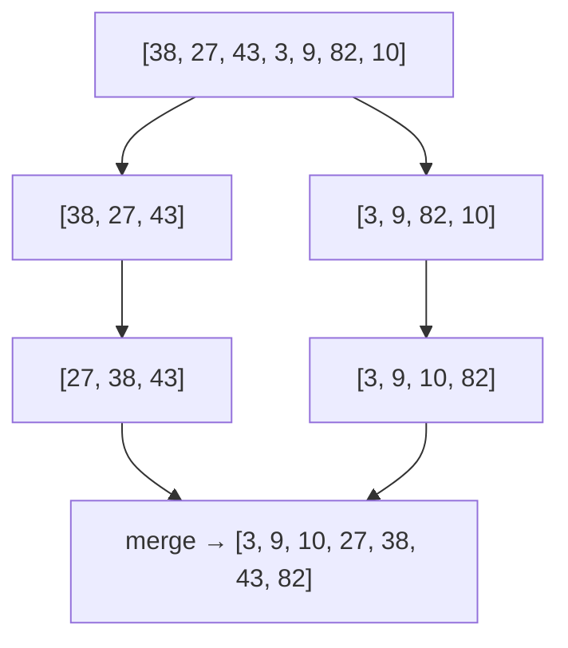

::part[Learn the Concept]{n="1"}

## 🎯 What you'll learn

- Why sorting is worth its cost
- How **insertion sort** works (and why simple sorts are slow)
- The idea behind fast sorts like **merge sort**
- Sorting in Python with `sorted()`, `.sort()`, `key=`, `reverse=` and **multi-key** sorts
- What a **stable** sort is and why it matters for "sort by A, then B"

## 🔤 Key words

| Word | In simple words | Bahasa Indonesia |
|---|---|---|
| **Sorting** | Putting items in order | Mengurutkan |
| **Insertion sort** | Slide each item into place, like sorting cards by hand | Sisip satu per satu |
| **Merge sort** | Split, sort the halves, then zip them together | Pecah, urutkan, gabungkan |
| **`sorted()` vs `.sort()`** | Returns a new list / changes the list in place | Hasil baru / ubah langsung |
| **`key=`** | The function that says what to sort by | Penentu dasar urutan |
| **`reverse=True`** | Biggest first | Dari besar ke kecil |
| **Multi-key sort** | Sorting by one field, then another | Urut berdasar beberapa kolom |
| **Stable sort** | Items with equal keys keep their previous order | Urutan data seri tetap |

## 🧠 The big idea

Sort a hand of playing cards the way most people do: pick up cards one at a time and **slide each into the right place** among the cards you already hold. That's **insertion sort**.

Now imagine 10,000 cards. Sliding each one past thousands of others takes forever. Faster algorithms **split** the pile, sort the small piles, and **merge** them — like two people each sorting half a deck, then zipping their stacks together.

## ❓ Why it matters

Sorting makes data usable: prices from cheapest, applications by date, search results by relevance, leaderboards. It also unlocks other techniques — binary search, grouping duplicates, finding overlaps — because after sorting, related items sit next to each other.

Knowing what happens inside matters for two reasons. In interviews you'll be asked to explain and compare sorts. In real code, you should almost always use Python's built-in `sorted()` — but you need to know *why* it's O(n log n) and why writing your own nested-loop sort quietly turns a fast page into a slow one.

## 📖 Step by step

### 1. Insertion sort, by hand

```python
def insertion_sort(values):
    result = list(values)                   # copy: don't change the caller's list
    for i in range(1, len(result)):
        current = result[i]
        j = i - 1
        while j >= 0 and result[j] > current:
            result[j + 1] = result[j]       # shift bigger items right
            j -= 1
        result[j + 1] = current             # drop current into the gap
    return result
```

Trace `[5, 2, 4, 1]`:

| Step | Picked | List after |
|---|---|---|
| start | — | `[5, 2, 4, 1]` |
| i=1 | 2 | `[2, 5, 4, 1]` |
| i=2 | 4 | `[2, 4, 5, 1]` |
| i=3 | 1 | `[1, 2, 4, 5]` |

Worst case, every item shifts past all the previous ones: about n × n / 2 steps. Double the data → **4×** the time.

### 2. Merge sort, the idea



1. **Split** the list in halves until pieces have 1 item (a 1-item list is sorted).
2. **Merge** pairs of sorted pieces by repeatedly taking the smaller front item.

About n × log₂(n) steps. For 1,000,000 items: ~20 million instead of ~500 billion. You'll implement it with recursion in the DSA track.

:::note
Python's built-in sort (**Timsort**) combines merge sort and insertion sort ideas. It's extremely well optimized — in real code, use it rather than writing your own.
:::

### 3. Sorting in Python

```python
prices = [300, 100, 200]

new_list = sorted(prices)        # returns a NEW sorted list; prices unchanged
prices.sort()                    # sorts IN PLACE; returns None

sorted(prices, reverse=True)     # [300, 200, 100]
```

:::warning
`prices = prices.sort()` sets `prices` to `None`. `.sort()` changes the list and returns nothing.
:::

### 4. Sorting by a field with `key`

This is the part you'll use daily. `key=lambda job: job["salary"]` reads as "sort by salary" — no custom comparison function needed.

`key` is a function that says **what to compare**:

```python
jobs = [
    {"title": "QA", "salary": 7_000_000},
    {"title": "Backend", "salary": 9_500_000},
    {"title": "Analyst", "salary": 8_000_000},
]

by_salary = sorted(jobs, key=lambda job: job["salary"], reverse=True)
by_title = sorted(jobs, key=lambda job: job["title"].lower())   # case-insensitive
```

### 5. Sorting by several fields

Return a **tuple** from `key` — Python compares tuples item by item:

```python
# salary high→low, then title A→Z for equal salaries
sorted(jobs, key=lambda job: (-job["salary"], job["title"]))
```

The minus sign flips a number's order. For text you can't write `-"abc"`, so for mixed directions on text use the **stability** trick:

### 6. Stability

Stability is what makes "sort by date, then by city" work: sort by the less important field first, then the more important one, and equal items keep the earlier order.

A sort is :term[stable]{bahasa="stabil — item yang nilainya sama tetap mempertahankan urutan aslinya"} when items that compare equal keep their original relative order. Python's sort is stable, so you can sort in **passes**, from the least important key to the most important:

```python
step1 = sorted(jobs, key=lambda job: job["title"], reverse=True)   # secondary: title Z→A
step2 = sorted(step1, key=lambda job: job["salary"], reverse=True) # primary: salary high→low
```

Equal salaries still appear in the Z→A title order from step 1.

### Choosing your setup

Every option here is a trade-off:

| Algorithm | Typical speed | Extra memory | Stable | Notes |
|---|---|---|---|---|
| Insertion sort | n² (great when almost sorted) | none | ✅ | simple, good for tiny lists |
| Selection / bubble sort | n² | none | varies | teaching only |
| Merge sort | n log n | n | ✅ | predictable, good for linked data and huge files |
| Quick sort | n log n average, n² worst | small | ❌ | very fast in practice |
| Python `sorted` (Timsort) | n log n, ~n if nearly sorted | n | ✅ | use this |

| Python API | ✅ | ❌ |
|---|---|---|
| `sorted(x)` | original stays untouched, works on any iterable | uses extra memory |
| `x.sort()` | in place, no copy | changes data others may be using; returns `None` |

- ✅ Sort when you need order for **display** or for an algorithm that **requires** it.
- ✅ If you only need the **top 5** from a million items, `heapq.nlargest(5, items, key=...)` avoids sorting everything.
- 🚫 Don't sort inside a loop over the same data — sort once, outside.
- 🚫 Don't sort in Python what the database can sort with `ORDER BY` and an index (Module 2).


## ⚠️ Common mistakes

- `x = x.sort()` → `None`.
- Forgetting `reverse=True` for "top" / "newest".
- Case-sensitive sorting of names (`key=str.lower`).
- Sorting numbers stored as text: `sorted(["10", "9", "100"])` → `['10', '100', '9']`. Convert first.
- Comparing `None` with numbers: `sorted([3, None, 1])` → `TypeError`.

::part[Explain & Design]{n="2"}

## 🗣️ Explain it

Explain to a friend why sorting 1,000 exam papers by "slide each into place" takes much longer than splitting the stack among several helpers and merging — without using the words *algorithm* or *complexity*.

## 📐 Design it

CareerPilot shows job listings. Design the sort order for each view (fields, direction, tie-breakers):

1. **"Best match"** view: by match score, but many jobs have the same score
2. **"Newest"** view: some listings have no `posted_date`
3. **"Salary"** view: some listings have no salary information

:::quiz
Show a possible design

1. **Best match**: `(-match_score, -posted_timestamp, title)` — ties go to the newer listing, then alphabetical so the order is stable between refreshes.
2. **Newest**: `posted_date` descending; listings **without a date go last**: `key=lambda j: (j["posted_date"] is None, …)`. Because `False < True`, items with a date come first — then sort dated items newest-first (e.g. sort by date descending in a first pass, and by `is None` in a second stable pass).
3. **Salary**: `salary_max` descending, missing salaries last, tie-break by `salary_min` descending.

Key insight: **decide what happens with missing values and ties** — otherwise the UI order looks random and users lose trust.
:::

### 📝 Self-review checklist

- [ ] Each view has at least one tie-breaker
- [ ] Missing values have a defined position (first or last)
- [ ] I know which directions need `reverse` or a minus sign

::ai-review{task="design"}

::part[Toy Exercise]{n="3"}

## 🧸 Sort like a pro

:::exercise{path="exercises/m1/w1/03-sorting" ai="no-ai" title="Insertion sort and real-world sorting"}
In `sorting.py` implement:

- `insertion_sort(values)` → a **new** sorted list (don't use `sorted`/`.sort` here; don't modify the input)
- `top_paying(jobs, n)` → the `n` highest-salary jobs, ties broken by title A→Z
- `sort_names(names)` → case-insensitive A→Z
- `newest_first(jobs)` → by `posted` (`"YYYY-MM-DD"` text) newest first; jobs with `posted = None` go last, keeping their original order
:::

:::hints
- Test that `insertion_sort` returns a copy: start with `result = list(values)`.
- `(-job["salary"], job["title"])` handles "salary desc, title asc" in one key.
- ISO dates like `"2026-09-13"` sort correctly as text.
- For `newest_first`: split into `with_date` and `without_date`, sort the first, then concatenate. Or use two stable sorting passes.
:::

### 🏆 Stretch goal

Implement `merge_sorted(a, b)` that merges two already-sorted lists into one sorted list in a single pass (no `sorted`). This is the heart of merge sort.

## ✅ Quick check

:::quiz
What's the difference between `sorted(items)` and `items.sort()`?

`sorted` returns a new list and leaves `items` unchanged; `.sort()` reorders `items` in place and returns `None`.
:::

:::quiz
How do you sort people by age descending and then name ascending?

`sorted(people, key=lambda p: (-p["age"], p["name"]))`
:::

:::quiz
What does "stable sort" mean, and how does it help?

Items that compare equal keep their original order. It lets you sort by the secondary key first and the primary key second, getting a correct multi-key order.
:::


## 📚 Keep learning

- [Python docs: Sorting Techniques](https://docs.python.org/3/howto/sorting.html)
- [Visualgo: Sorting visualizations](https://visualgo.net/en/sorting)
