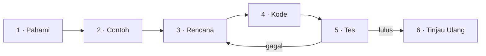

::part[Pelajari Konsepnya]{n="1"}

## 🎯 Yang akan kamu pelajari

- Proses 6 langkah: **Pahami → Contoh → Rencana → Kode → Tes → Tinjau Ulang**
- Cara menemukan **kasus tepi** sebelum mereka menemukan kamu
- Cara memecah masalah besar menjadi fungsi-fungsi kecil
- Apa yang harus dilakukan saat **buntu** (dan kapan minta bantuan)
- Bagaimana proses ini dipakai di coding interview

## 🔤 Istilah penting

| Istilah | Artinya (sederhana) |
|---|---|
| **Process (Proses)** | Langkah kerja yang bisa diulang, bahkan di hari jelek |
| **Edge case (Kasus tepi)** | Input tidak biasa yang bisa memecah kode sederhana (kosong, nol, sangat besar) |
| **Example (Contoh)** | Masukan nyata dengan hasil yang diharapkan |
| **Pseudocode (Pseudokode)** | Rencana ditulis dalam bahasa biasa sebelum kode asli |
| **Decomposition (Dekomposisi)** | Memecah masalah besar menjadi potongan kecil yang diberi nama |
| **Test (Tes)** | Mengecek hasil terhadap yang diharapkan |
| **Stuck (Buntu)** | Tidak tahu langkah berikutnya — normal, dan punya taktiknya sendiri |
| **Review (Tinjau Ulang)** | Memperbaiki solusi yang sudah jalan |

## 🧠 Ide besarnya

Developer yang baik bukan orang yang langsung melihat jawabannya. Mereka adalah orang punya **proses** yang tetap bekerja meskipun mereka tidak tahu.

Itu seperti merakit furnitur: kamu tidak langsung ambil palu. Kamu baca yang akan dibangun, periksa bagian-bagiannya, ikuti langkah demi langkah, dan pastikan setiap bagian kuat sebelum lanjut ke yang berikutnya.

## ❓ Kenapa ini penting

Interview dan pekerjaan nyata bukan tes apakah kamu bisa ingat jawaban dengan instan. Mereka tes apa yang kamu lakukan saat *belum* tahu: apakah kamu tanya tentang input, buat contoh, rencana sebelum ngetik, dan cek pekerjaanmu?

Developer yang baik bukan yang langsung lihat jawabannya. Mereka yang punya proses tetap bekerja saat masalahnya asing — seperti merakit furnitur: baca yang akan dibuat, periksa bagian-bagiannya, ikuti langkah-langkahnya, dan pastikan setiap bagian kuat sebelum lanjut.

Tanpa proses, kamu terjebak dalam loop: ngetik sesuatu, jalankan, gagal, ubah sesuatu secara acak, jalankan lagi. Itu bisa butuh berjam-jam untuk masalah yang proses ini bisa selesaikan dalam lima belas menit.

## 📖 Langkah demi langkah



### Langkah 1 · Pahami

- **Katakan ulang** masalahnya dengan kata-katamu sendiri.
- Identifikasi **masukan** (tipe, ukuran, boleh kosong/None?) dan **keluaran** (tipe, format).
- Tanya **pertanyaan klarifikasi**. Tulis asumsimu.

> *"Gaji tertinggi kedua" → Masukan: list integer, mungkin kosong. Keluaran: integer atau None. Pertanyaan: nilai berbeda? → Asumsikan ya: `[12, 12, 9]` → `9`.*

### Langkah 2 · Contoh (termasuk kasus tepi)

Tulis yang membosankan juga: list kosong, satu item, semua item sama, angka negatif. Paling banyak bug bersembunyi di sini.

Tulis masukan → keluaran yang diharapkan **sebelum** noding:

| Masukan | Diharapkan | Kenapa menarik |
|---|---|---|
| `[5, 9, 7]` | `7` | kasus normal |
| `[12, 12, 9]` | `9` | duplikat di atas |
| `[4]` | `None` | hanya satu nilai |
| `[]` | `None` | kosong |
| `[3, 3, 3]` | `None` | tidak ada nilai kedua yang berbeda |
| `[-1, -5]` | `-5` | angka negatif |

:term[Edge case]{bahasa="kasus tepi — input tidak biasa di batas kemungkinan yang sering memunculkan bug"} yang sering dipikirkan: **kosong**, **satu item**, **semua sama**, **duplikat**, **negatif/nol**, **sangat besar**, **tidak berurut/sudah berurut**, **None/field hilang**, **besar-kecil huruf/spasi berbeda**.

### Langkah 3 · Rencana (pseudokode)

Selesaikan dalam bahasa biasa dulu. Pilih pendekatan paling sederhana yang bekerja; sebutkan yang lebih cepat kalau relevan.

```text
unique = nilai gaji yang berbeda
jika kurang dari 2 nilai berbeda: return None
sort unique menurun
return yang kedua
```

Alternatif (satu kali lewat, tanpa sort): track `highest` dan `second` saat loop. Lebih efisien, agak lebih sulit dapat benar. **Mulai dari sederhana**, optimasi kalau perlu.

Untuk masalah lebih besar, rencananya adalah list **fungsi-fungsi kecil**:

```text
parse_csv(path) -> list of rows
clean_row(row) -> job or None
count_skills(jobs) -> dict
format_report(counts) -> str
```

### Langkah 4 · Kode

Terjemahkan rencananya. Simpan pseudokode sebagai komentar kalau membantu. Kode **satu fungsi pada satu waktu**.

```python
def second_highest(salaries: list[int]) -> int | None:
    unique = sorted(set(salaries), reverse=True)
    if len(unique) < 2:
        return None
    return unique[1]
```

### Langkah 5 · Tes

Jalankan contoh dari langkah 2. Kalau kode lulus kasus bahagia tapi kamu tidak pernah coba list kosong, kamu belum tahu apakah bekerja.

Ubah tabel Step 2 menjadi tes — kamu sudah tulis mereka!

```python
import pytest

@pytest.mark.parametrize("salaries, expected", [
    ([5, 9, 7], 7), ([12, 12, 9], 9), ([4], None), ([], None), ([3, 3, 3], None), ([-1, -5], -5),
])
def test_second_highest(salaries, expected):
    assert second_highest(salaries) == expected
```

Kalau tes gagal, balik ke **Rencana**, bukan edit acak-acakan (ingat metode debug).

### Langkah 6 · Tinjau Ulang

- Apakah **mudah dibaca**? Nama bagus? Apakah teman kerja bisa mengerti dalam semenit?
- Apakah **efisien cukup** untuk ukuran data sungguhan?
- Apakah semua kasus tepi dari Langkah 2 terpilih?
- Apa yang kamu **tingkatkan** dengan waktu lebih?

### Saat kamu buntu

| Buntu selama… | Lakukan ini |
|---|---|
| 5 menit | Baca ulang masalahnya. Kerjakan contoh kecil **dengan tangan** di kertas. |
| 15 menit | Sederhanakan: selesaikan versi lebih kecil (tanpa duplikat, hanya 2 item). |
| 25 menit | Tulis apa yang kamu tahu dan apa yang tepat menghalangimu. Jelaskan ke rubber duck. |
| 30–45 menit | Tanya **hint** (mentor, komunitas, AI — hint, bukan solusi). |

:::tip[Time-boxing]
Buntu adalah bagian belajar. Buntu tiga jam bukan. Pasang timer.
:::

### Saat coding interview

Bicarakan langkah yang sama **dengan suara keras**:

1. "Biarkan aku katakan ulang masalahnya…" dan tanya pertanyaan
2. "Ini beberapa contoh, termasuk kasus tepi…"
3. "Pendekatan sederhana adalah… biayanya… Pendekatan lebih cepat adalah…"
4. Kode sambil jelaskan
5. "Biarkan aku jalan lewat contohku…"
6. "Dengan waktu lebih aku akan…"

Diam adalah musuh — interviewer hanya bisa kasih kredit untuk pemikiran yang mereka dengar.

### Pilih pengaturanmu

Setiap pilihan di sini adalah trade-off:

| Pilihan | ✅ | ❌ |
|---|---|---|
| Solusi sederhana dulu | Cepat ditulis dan diverifikasi | Mungkin terlalu lambat untuk data besar |
| Optimasi dulu | Efisien | Lebih lambat ditulis, lebih banyak bug, mungkin tidak perlu |
| Banyak perencanaan di awal | Lebih sedikit rewrite | Berlebihan untuk tugas kecil |
| Eksplorasi kode dulu | Bagus belajar API baru | Mudah kehilangan arah |

- ✅ Pakai proses lengkap untuk apa pun yang tidak sepele, dan **selalu** saat interview.
- ✅ Skalakan untuk tugas kecil: versi mental 30 detik tetap lebih baik dari tidak ada.
- 🚫 Jangan lewatkan contoh — itu pencari bug paling murah yang ada.
- 🚫 Jangan optimasi sebelum punya versi yang bekerja dan teruji (kecuali constraint menuntut).


## ⚠️ Kesalahan umum

- Ngetik kode sebelum pahami format keluaran.
- Tes hanya contoh dari deskripsi tugas.
- Selesaikan segalanya dalam satu fungsi raksasa.
- Optimasi terlalu cepat, atau tidak pernah cek performa sama sekali.
- Diam (saat interview) atau buntu sendirian (di pekerjaan) terlalu lama.

::part[Jelaskan & Rancang]{n="2"}

## 🗣️ Jelaskan

Jelaskan ke teman kenapa menulis contoh masukan dan keluaran **sebelum** kode hemat waktu, pakai perbandingan yang bukan tentang program (resep, rencanakan perjalanan…).

## 📐 Rancang

Terapkan Langkah 1–3 (tanpa kode dulu!) ke masalah ini:

> **Slot interview.** Diberi list rentang waktu sibuk untuk satu hari seperti `[("09:00", "10:30"), ("13:00", "14:00")]`, dan durasi meeting dalam menit, kembalikan semua slot bebas antara 09:00 dan 17:00 yang cukup panjang.

Tulis: masalahmu yang dikatakan ulang, 3 pertanyaan klarifikasi (dengan asumsi kamu), paling tidak 6 contoh termasuk kasus tepi, dan pseudokode dipecah menjadi fungsi-fungsi kecil.

:::quiz
Tunjukkan rancangan yang mungkin

**Dikatakan ulang:** Temukan celah dalam jendela 09:00–17:00 yang tidak tercakup rentang sibuk mana pun, dan kembalikan yang paling tidak `length` menit panjang.

**Pertanyaan & asumsi:** Apakah rentang sibuk bisa tumpang tindih? → ya, gabung. Apakah terurut? → tidak, sort. Apakah waktu akhir eksklusif (akhir 10:30 berarti bebas dari 10:30)? → ya.

**Contoh:** tidak ada rentang sibuk → `[09:00–17:00]`; penuh sibuk → `[]`; rentang tumpang tindih `(9–11), (10–12)` → dianggap `9–12`; rentang sibuk mulai sebelum 09:00 atau akhir sesudah 17:00 → dipotong; celah persis sama durasi → masuk; celah 1 menit terlalu pendek → dikecualikan.

**Rencana:**

```text
to_minutes("HH:MM") -> int
to_text(minutes) -> "HH:MM"
merge_ranges(ranges) -> sorted, non-overlapping ranges
free_gaps(merged, day_start, day_end) -> list of gaps
long_enough(gaps, length) -> filtered gaps
```

Ubah waktu ke **menit sejak tengah malam** mengubah masalah waktu menjadi math integer sederhana.
:::

### 📝 Checklist tinjau ulang diri

- [ ] Aku tanya tentang tumpang tindih, urutan, dan batas
- [ ] Contohku termasuk input kosong dan kasus batas
- [ ] Rencanaku dipecah menjadi fungsi-fungsi kecil yang bisa diuji
- [ ] Aku pertimbangkan ubah data ke representasi lebih mudah

::ai-review{task="design"}

::part[Latihan Kecil]{n="3"}

## 🧸 Selesaikan dengan proses

:::exercise{path="exercises/m1/w1/05-problem-solving" ai="no-ai" title="Free interview slots"}
Implementasikan rancangan di atas di `slots.py`. README mendaftar tanda tangan fungsi yang tepat.

**Sebelum tulis kode apa pun**, tulis contohmu dan pseudokodemu di **My notes** di bawah. Lalu implementasikan satu fungsi pada satu waktu, jalankan tes setelah masing-masing.
:::

:::hints
- Mulai dengan `to_minutes` dan `to_text` — tes memeriksanya terpisah.
- Gabung: sort by start; kalau rentang berikutnya mulai **pada atau sebelum** akhir saat ini, perluas akhir saat ini ke max kedua akhir.
- Jalan lewat rentang gabung dengan `cursor` yang mulai dari day start. Awal rentang minus cursor adalah celah.
- Jangan lupa celah **sesudah** rentang sibuk terakhir.
:::

### 🏆 Tujuan stretch

Terima rentang sibuk untuk **beberapa orang** (list of lists) dan kembalikan slot saat **semua orang** bebas.

## ✅ Cek cepat

:::quiz
Sebut lima jenis kasus tepi yang harus dipikirkan untuk hampir setiap fungsi yang ambil list.

List kosong, satu item, semua item sama, duplikat, dan nilai ekstrim (negatif, nol, sangat besar) — plus None/nilai hilang dan input tidak berurut.
:::

:::quiz
Kenapa oke (bahkan bagus) mulai dengan solusi sederhana dan lebih lambat?

Itu lebih cepat ditulis dan diverifikasi, beri baseline yang benar dan tes, dan kamu mungkin menemukan sudah cukup cepat. Optimasi dengan bukti.
:::

:::quiz
Saat interview, kamu sadar pendekatanmu tidak akan bekerja di tengah ngetik. Apa yang kamu lakukan?

Katakan dengan suara keras, jelaskan kenapa, balik ke perencanaan, dan usulkan pendekatan disesuaikan. Pulih dengan alasan jelas adalah sinyal positif.
:::


## 📚 Lanjut belajar

- [pytest: Parametrizing tests](https://docs.pytest.org/en/stable/how-to/parametrize.html)
- *How to Solve It* by George Pólya — buku klasik tentang problem solving (math, tapi langsung berlaku ke kode)

## 🎓 Akhir Modul 1 — bagikan progresmu

:::linkedin{type="reflection"}
🎓 Modul 1 selesai: Algoritma & Programming.

Apa yang kupelajari:
- Cara web bekerja: client, server, HTTP dan status code
- Dasar Python, plus baca traceback dan debug metodis
- Hitung, cari (hai binary search 👋), sort, filter dan gabung data
- Proses problem solving: pahami → contoh → rencana → kode → tes → tinjau ulang

Apa yang kubangun: [X] latihan dengan tes otomatis, dan versi awal CareerPilot — CLI yang analisis job listing dan lapor skill paling dibutuhkan.

Bagian tersulit: [jawabanmu yang jujur]. Apa yang membantu: [jawabanmu].

Selanjutnya: backend development dengan Flask dan PostgreSQL. 🚀

#LearningInPublic #Python #Algorithms #SoftwareEngineering
:::
