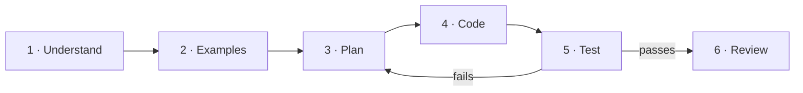

::part[Learn the Concept]{n="1"}

## 🎯 What you'll learn

- A 6-step process: **Understand → Examples → Plan → Code → Test → Review**
- How to find **edge cases** before they find you
- How to break a big problem into small functions
- What to do when you're **stuck** (and when to ask for help)
- How this exact process is used in coding interviews

## 🔤 Key words

| Word | In simple words | Bahasa Indonesia |
|---|---|---|
| **Process** | A repeatable set of steps that works even on a bad day | Langkah kerja yang bisa diulang |
| **Edge case** | An unusual input that breaks naive code (empty, zero, huge) | Kasus tepi |
| **Example** | A concrete input with its expected output | Contoh masukan dan hasil |
| **Pseudocode** | The plan written in plain words before real code | Rencana dalam bahasa biasa |
| **Decomposition** | Splitting a big problem into small named pieces | Memecah masalah |
| **Test** | Checking the result against what you expected | Memeriksa hasil |
| **Stuck** | Not knowing the next step — normal, and has its own tactics | Buntu |
| **Review** | Improving the working solution afterwards | Meninjau ulang |

## 🧠 The big idea

Good developers aren't people who instantly see the answer. They're people with a **process** that works even when they don't.

It's like building furniture: you don't grab a hammer first. You read what you're building, check the parts, follow steps, and check that each part is solid before the next one.

## ❓ Why it matters

Interviews and real jobs don't test whether you can recall an answer instantly. They test what you do when you *don't* know it yet: do you ask about the input, write an example, plan before typing, and check your work?

Good developers aren't the ones who instantly see the answer. They're the ones with a process that still works when the problem is unfamiliar — like assembling furniture: read what you're building, check the parts, follow the steps, and make sure each part is solid before the next one.

Without a process you get the familiar loop: type something, run it, it fails, change something at random, run again. That can take hours on a problem the process would solve in fifteen minutes.

## 📖 Step by step



### Step 1 · Understand

- **Restate** the problem in your own words.
- Identify **inputs** (type, size, can they be empty/None?) and **outputs** (type, format).
- Ask **clarifying questions**. Write down any assumptions.

> *"Second highest salary" → Input: list of ints, maybe empty. Output: int or None. Question: distinct values? → Assume yes: `[12, 12, 9]` → `9`.*

### Step 2 · Examples (including edge cases)

Write the boring ones too: empty list, one item, all items the same, a negative number. Most bugs hide in exactly these.

Write input → expected output **before** coding:

| Input | Expected | Why it's interesting |
|---|---|---|
| `[5, 9, 7]` | `7` | normal case |
| `[12, 12, 9]` | `9` | duplicates at the top |
| `[4]` | `None` | only one value |
| `[]` | `None` | empty |
| `[3, 3, 3]` | `None` | no second distinct value |
| `[-1, -5]` | `-5` | negative numbers |

Common :term[edge cases]{bahasa="kasus tepi — input tidak biasa di batas kemungkinan yang sering memunculkan bug"} to always consider: **empty**, **one item**, **all the same**, **duplicates**, **negative/zero**, **very large**, **unsorted/already sorted**, **None/missing fields**, **different capitalization/whitespace**.

### Step 3 · Plan (pseudocode)

Solve it in plain language first. Pick the simplest approach that works; mention faster ones if relevant.

```text
unique = distinct values of salaries
if fewer than 2 unique values: return None
sort unique descending
return the second one
```

Alternative (one pass, no sorting): track `highest` and `second` while looping. More efficient, slightly harder to get right. **Start simple**, optimize if needed.

For bigger problems, the plan is a list of **small functions**:

```text
parse_csv(path) -> list of rows
clean_row(row) -> job or None
count_skills(jobs) -> dict
format_report(counts) -> str
```

### Step 4 · Code

Translate the plan. Keep the pseudocode as comments if it helps. Code **one function at a time**.

```python
def second_highest(salaries: list[int]) -> int | None:
    unique = sorted(set(salaries), reverse=True)
    if len(unique) < 2:
        return None
    return unique[1]
```

### Step 5 · Test

Run your examples from step 2. If the code passes the happy case but you never tried the empty list, you don't know yet whether it works.

Turn your Step 2 table into tests — you already wrote them!

```python
import pytest

@pytest.mark.parametrize("salaries, expected", [
    ([5, 9, 7], 7), ([12, 12, 9], 9), ([4], None), ([], None), ([3, 3, 3], None), ([-1, -5], -5),
])
def test_second_highest(salaries, expected):
    assert second_highest(salaries) == expected
```

If a test fails, go back to **Plan**, not random edits (remember the debugging method).

### Step 6 · Review

- Is it **readable**? Good names? Could a teammate understand it in a minute?
- Is it **efficient enough** for the real data size?
- Did you handle every edge case from Step 2?
- What would you **improve** with more time?

### When you're stuck

| Stuck for… | Do this |
|---|---|
| 5 min | Re-read the problem. Work a tiny example **by hand** on paper. |
| 15 min | Simplify: solve a smaller version (no duplicates, only 2 items). |
| 25 min | Write what you know and what exactly is blocking you. Explain it to a rubber duck. |
| 30–45 min | Ask for a **hint** (mentor, community, AI — hint, not solution). |

:::tip[Time-boxing]
Getting stuck is part of learning. Staying stuck for 3 hours is not. Set a timer.
:::

### In a coding interview

Talk through the same steps **out loud**:

1. "Let me restate the problem…" and ask questions
2. "Here are some examples, including edge cases…"
3. "A simple approach is… it costs… A faster approach would be…"
4. Code while explaining
5. "Let me walk through my examples…"
6. "With more time I'd…"

Silence is the enemy — interviewers can only give you credit for thinking they can hear.

### Choosing your setup

Every option here is a trade-off:

| Choice | ✅ | ❌ |
|---|---|---|
| Simple first solution | Fast to write and verify | May be too slow for big data |
| Optimized first | Efficient | Slower to write, more bugs, may be unnecessary |
| Lots of upfront planning | Fewer rewrites | Overkill for tiny tasks |
| Code-first exploration | Good for learning an unknown API | Easy to lose direction |

- ✅ Use the full process for anything non-trivial, and **always** in interviews.
- ✅ Scale it down for small tasks: a 30-second mental version still beats none.
- 🚫 Don't skip examples — they're the cheapest bug-finder that exists.
- 🚫 Don't optimize before you have a working, tested version (unless the constraints demand it).


## ⚠️ Common mistakes

- Coding before understanding the output format.
- Testing only the example from the task description.
- Solving everything in one giant function.
- Optimizing too early, or never checking performance at all.
- Staying silent (in interviews) or stuck alone (at work) for too long.

::part[Explain & Design]{n="2"}

## 🗣️ Explain it

Explain to a friend why writing example inputs and outputs **before** coding saves time, using a non-programming comparison (a recipe, planning a trip…).

## 📐 Design it

Apply Steps 1–3 (no code yet!) to this problem:

> **Interview slots.** Given a list of busy time ranges for one day like `[("09:00", "10:30"), ("13:00", "14:00")]`, and a meeting length in minutes, return all free slots between 09:00 and 17:00 that are long enough.

Write: your restated problem, 3 clarifying questions (with your assumed answers), at least 6 examples including edge cases, and pseudocode split into small functions.

:::quiz
Show a possible design

**Restated:** Find gaps inside the 09:00–17:00 window not covered by any busy range, and return those at least `length` minutes long.

**Questions & assumptions:** Can busy ranges overlap? → yes, merge them. Are they sorted? → no, sort them. Is an end time exclusive (10:30 end means free from 10:30)? → yes.

**Examples:** no busy ranges → `[09:00–17:00]`; fully busy → `[]`; overlapping ranges `(9–11), (10–12)` → treated as `9–12`; busy range starting before 09:00 or ending after 17:00 → clipped; gap exactly equal to the length → included; gap 1 minute too short → excluded.

**Plan:**

```text
to_minutes("HH:MM") -> int
to_text(minutes) -> "HH:MM"
merge_ranges(ranges) -> sorted, non-overlapping ranges
free_gaps(merged, day_start, day_end) -> list of gaps
long_enough(gaps, length) -> filtered gaps
```

Converting times to **minutes since midnight** turns a time problem into simple integer math.
:::

### 📝 Self-review checklist

- [ ] I asked about overlaps, ordering and boundaries
- [ ] My examples include an empty input and a boundary case
- [ ] My plan is split into small, testable functions
- [ ] I considered converting data into an easier representation

::ai-review{task="design"}

::part[Toy Exercise]{n="3"}

## 🧸 Solve it with the process

:::exercise{path="exercises/m1/w1/05-problem-solving" ai="no-ai" title="Free interview slots"}
Implement the design above in `slots.py`. The README lists the exact function signatures.

**Before writing any code**, write your examples and pseudocode in **My notes** below. Then implement one function at a time, running the tests after each.
:::

:::hints
- Start with `to_minutes` and `to_text` — the tests check them separately.
- Merge: sort by start; if the next range starts **at or before** the current end, extend the current end to the max of both ends.
- Walk the merged ranges with a `cursor` that starts at the day start. Each range's start minus the cursor is a gap.
- Don't forget the gap **after** the last busy range.
:::

### 🏆 Stretch goal

Accept busy ranges for **several people** (a list of lists) and return slots when **everyone** is free.

## ✅ Quick check

:::quiz
Name five kinds of edge cases you should consider for almost any function that takes a list.

Empty list, one item, all items the same, duplicates, and extreme values (negative, zero, very large) — plus None/missing values and unsorted input.
:::

:::quiz
Why is it fine (even good) to start with a simple, slower solution?

It's faster to write and verify, gives you a correct baseline and tests, and you may find it's already fast enough. Optimize with evidence.
:::

:::quiz
In an interview, you realize your approach won't work halfway through coding. What do you do?

Say it out loud, explain why, go back to planning, and propose an adjusted approach. Recovering with clear reasoning is a positive signal.
:::


## 📚 Keep learning

- [pytest: Parametrizing tests](https://docs.pytest.org/en/stable/how-to/parametrize.html)
- *How to Solve It* by George Pólya — the classic book on problem solving (math, but it applies directly to code)

## 🎓 End of Module 1 — share your progress

:::linkedin{type="reflection"}
🎓 Module 1 done: Algorithms & Programming.

What I learned:
- How the web works: clients, servers, HTTP and status codes
- Python fundamentals, plus reading tracebacks and debugging methodically
- Counting, searching (hello binary search 👋), sorting, filtering and joining data
- A problem-solving process: understand → examples → plan → code → test → review

What I built: [X] exercises with automated tests, and the first version of CareerPilot — a CLI that analyzes job listings and reports the most in-demand skills.

The hardest part: [your honest answer]. What helped: [your answer].

Next up: backend development with Flask and PostgreSQL. 🚀

#LearningInPublic #Python #Algorithms #SoftwareEngineering
:::
