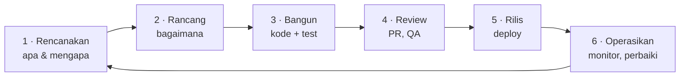

::part[Pelajari Konsepnya]{n="1"}

## 🎯 Yang akan kamu pelajari

- Perbedaan antara **coding** dan **software engineering**
- **Software development lifecycle** (SDLC): dari ide sampai production dan kembali lagi
- Cara tim mengorganisir pekerjaan: **Agile**, Scrum, Kanban, ticket dan user story
- Peran-peran yang akan kamu bekerja sama dengannya, dan posisi kamu
- Arti sesungguhnya dari "selesai"

## 🔤 Istilah penting

| Istilah | Artinya (sederhana) |
|---|---|
| **Software engineering** | Membangun perangkat lunak yang tetap benar dan bisa diubah saat tim mengerjakannya bertahun-tahun |
| **SDLC** | Siklus yang dilalui sebuah fitur: ide → build → rilis → belajar |
| **Agile** | Cara kerja dalam siklus pendek dan menyesuaikan, daripada merencanakan segalanya di depan |
| **Scrum / Kanban** | Dua cara umum tim mengatur kerja: sprint tetap, atau papan yang mengalir |
| **Ticket / user story** | Satu unit pekerjaan ditulis dari sudut pandang pengguna |
| **Backlog** | Daftar tunggu pekerjaan, yang penting duluan |
| **Code review** | Satu rekan membaca perubahanmu sebelum di-merge |
| **Definition of Done** | Kesepakatan tim tentang arti "selesai" |
| **Technical debt** | Jalan pintas hari ini yang bikin perubahan lebih lambat besok |

## 🧠 Ide besarnya

Coding itu **memasang batu bata**. Software engineering itu **membangun rumah yang akan ditinggali keluarga 20 tahun**: memahami kebutuhan keluarga, merencanakan, membangun dengan aman, memeriksa pekerjaan, memperbaiki kebocoran, dan menambah kamar nanti tanpa atap roboh.

> Software engineering = membangun perangkat lunak yang **benar**, **mudah dirawat**, **aman** dan **berguna** — dengan **tim**, selama **bertahun-tahun**.

## ❓ Kenapa ini penting

Script yang kamu tulis untuk satu sore tidak butuh proses. Produk sungguhan membutuhkannya:

- Banyak orang mengubah kode yang sama setiap hari.
- Kodenya hidup bertahun-tahun, dan orang yang membuatnya pergi.
- Kesalahan bisa biaya uang, data, atau kepercayaan.
- Yang pengguna butuhkan terus berubah.

Praktik engineering — version control, review, test, perencanaan, monitoring — ada agar tim bisa terus mengubah perangkat lunak **cepat tanpa merusak sesuatu**. Mereka adalah inspeksi bangunan, bukan paperwork tambahan.

Tanpa mereka, startup rilis cepat dengan "sekadar coding": tanpa test, tanpa review, secret di kode, satu developer yang tahu alur pembayaran. Enam bulan kemudian setiap rilis rusak sesuatu, developer itu keluar, API key yang bocor biaya Rp 80 juta tagihan cloud, dan fitur baru butuh berminggu-minggu karena tidak ada yang berani menyentuh apa pun.

## 📖 Langkah demi langkah

### 1. Siklus pengembangan perangkat lunak

Pikirnya sebagai loop, bukan garis: kamu belajar sesuatu dari pengguna sungguhan dan mulai putaran berikutnya dengan informasi lebih baik.

| Fase | Pertanyaan | Hasil |
|---|---|---|
| **Rencanakan** | Masalah apa? Untuk siapa? Bagaimana kita tahu berhasil? | user story, kriteria penerimaan |
| **Rancang** | Komponen mana, data, API? Apa yang bisa salah? | diagram, kontrak API, design doc |
| **Bangun** | Apakah berfungsi? Sudah di-test? | kode, test |
| **Review** | Benar, mudah dibaca, aman? | pull request, komentar review |
| **Rilis** | Bagaimana ship dengan aman? Bisa di-rollback? | CI/CD pipeline, release note |
| **Operasikan** | Sehat? Pengguna senang? | log, dashboard, alert, laporan bug |

Ini adalah **loop**: yang kamu pelajari di production memberi makan rencana berikutnya.

### 2. Agile dalam satu halaman

Daripada merencanakan segalanya untuk setahun (dan salah), :term[Agile]{bahasa="Agile — cara kerja iteratif: rencana kecil, rilis sering, belajar dari feedback"} tim bekerja dalam siklus pendek dan menyesuaikan.

| Praktik | Seperti apa |
|---|---|
| **User story** | *Sebagai job seeker, saya ingin filter pekerjaan per kota, jadi saya hanya lihat listing relevan.* |
| **Kriteria penerimaan** | *Diberikan pekerjaan di Jakarta dan Bandung, saat saya filter "jakarta", maka saya hanya lihat pekerjaan Jakarta (tidak peduli besar kecil huruf).* |
| **Backlog** | daftar prioritas story dan bug |
| **Sprint** (Scrum) | siklus 1–2 minggu: rencanakan → bangun → demo → retrospektif |
| **Kanban board** | kolom seperti *To do → In progress → Review → Done*, batasi pekerjaan sedang berjalan |
| **Stand-up** | sinkronisasi harian 10–15 menit: progres, rencana, penghambat |

Tool: Jira, Linear, GitHub Projects, Trello.

### 3. Orang yang kamu bekerja sama dengan

| Peran | Peduli tentang | Kamu akan bicara tentang |
|---|---|---|
| Product manager | masalah yang benar, prioritas | scope, trade-off, deadline |
| Designer (UI/UX) | usability, flow | edge case, loading dan error state |
| Backend / frontend / full-stack engineer | membangun itu | API, kontrak, review |
| QA engineer | kualitas, rencana test | kriteria penerimaan, bug |
| DevOps / SRE / platform | keandalan, deployment | infrastruktur, insiden |
| Data / ML / AI engineer | data, model | event, dataset, fitur AI |
| Tech lead / engineering manager | arsitektur, orang, delivery | keputusan desain, pertumbuhan |

### 4. Perjalanan fitur di perusahaan sungguhan

1. PM menulis story dengan kriteria penerimaan.
2. Kamu tanya, estimasi, mungkin tulis catatan desain pendek.
3. Kamu buat **branch**, tulis kode **dan test**.
4. Kamu buka **pull request**; CI jalankan test dan linter otomatis.
5. Rekan **review**; kamu jawab komentar.
6. Merge dan **deploy** (sering otomatis, kadang di balik feature flag).
7. Kamu **cek** log/metrik; PM verifikasi kriteria penerimaan.

### 5. Definition of Done

"Selesai" seperti menyerahkan kamar yang disewa: bukan sekadar "saya berhenti bekerja", tapi bersih, diperiksa, dan kunci diserahkan — merge, test, dokumentasi dan rilis.

"Jalan di laptopku" bukan selesai. **Definition of Done** tim biasa:

- [ ] Kriteria penerimaan terpenuhi
- [ ] Test ditulis dan pass di CI
- [ ] Kode di-review dan disetujui
- [ ] Tanpa warning lint/security baru
- [ ] Docs/README diperbarui kalau perilaku berubah
- [ ] Deploy dan verifikasi (atau siap deploy)

### Memilih setup-mu

Setiap pilihan di sini adalah trade-off:

| Pilihan | ✅ | ❌ |
|---|---|---|
| Banyak proses (doc besar, persetujuan) | dapat diprediksi, aman untuk domain regulasi (bank) | lambat, frustasi untuk tim kecil |
| Proses minimal | cepat di awal | chaos saat tim dan codebase berkembang |
| Scrum (sprint) | ritme, demo reguler | ceremony bisa terasa berat |
| Kanban (flow) | fleksibel, bagus untuk support/ops | butuh disiplin agar work in progress tidak bertumpuk |

Jumlah proses yang tepat **tumbuh dengan tim, risiko, dan produk**.

- ✅ Terapkan kebiasaan engineering ringan bahkan untuk proyek solo (Git, test, README) — mereka jadi sinyal portfolio-mu.
- ✅ Tulis kriteria penerimaan sebelum bangun apa pun yang tidak trivial.
- 🚫 Jangan copy ceremony besar-perusahaan ke proyek dua orang.
- 🚫 Jangan anggap "proses" pengganti bicara ke pengguna dan rekan kerja.

## ⚠️ Kesalahan umum

- Mulai coding sebelum paham masalahnya.
- Pull request besar yang tidak ada yang bisa review dengan benar.
- Anggap test dan dokumentasi "tambahan" bukan bagian dari selesai.
- Diam saat terjebak berhari-hari.
- Guna sibuk sebagai ganti deliver nilai.

:::revoshop
Buka repo RevoShop-mu dan cari bukti siklus hidup: folder `jira/` (perencanaan), `docs/` dan bagian *Architecture* di README (desain), `tests/` (bangun), `.pylintrc` dan bagian *Code Quality & Security* (review), `Dockerfile` dan `Procfile` (rilis), `app/logging_config.py` dan route `/health` di `app/routes/health.py` (operasikan). Fase mana di proyek-mu yang **paling lemah**, dan apa yang akan kamu tambahkan?
:::

## 🏆 Praktik terbaik

- [ ] **Jelaskan sebelum coding**: nyatakan ulang kebutuhan dan daftar kriteria penerimaan dan edge case.
- [ ] **Batch kecil**: ticket kecil, branch kecil, pull request kecil (idealnya di bawah ~400 baris berubah).
- [ ] **Otomatisasi cek membosankan**: test, linting dan formatting jalankan di CI, bukan di kepala reviewer.
- [ ] **Tulis sesuatu**: README, catatan keputusan (ADR), runbook. Masa depanmu adalah rekan kerja.
- [ ] **Bikin pekerjaan terlihat**: perbarui ticket/board; muncul penghambat di stand-up, bukan di deadline.
- [ ] **Miliki end to end**: sesudah merge, cek itu benar-benar jalan di environment yang deploy.
- [ ] **Budaya tanpa kesalahan**: saat sesuatu rusak, perbaiki sistem (test, cek, doc), bukan orang.
- [ ] **Keamanan dan privasi dari hari satu**: tanpa secret di kode, least privilege, validasi input.

::part[Jelaskan & Rancang]{n="2"}

## 🗣️ Jelaskan

Jelaskan ke teman yang pikir "programmer sekadar ngetik kode sepanjang hari" apa yang benar-benar dilakukan software engineer dalam satu minggu biasa. Sebutkan paling tidak empat aktivitas yang bukan menulis kode.

## 📐 Rancang

Tulis **user story dengan kriteria penerimaan** untuk fitur CareerPilot Fase 2 ini:

> Pengguna bisa ubah status aplikasi (applied → interview → offer / rejected).

Sertakan paling tidak 4 kriteria penerimaan, termasuk kasus **tidak valid**, dan tulis **Definition of Done** checklist untuk itu.

:::quiz
Lihat contoh

**Story:** Sebagai job seeker, saya ingin perbarui status aplikasi saya, jadi pipeline saya tunjukkan di mana saya dengan setiap perusahaan.

**Kriteria penerimaan:**
1. Diberikan aplikasi saya dengan status `applied`, saat saya set ke `interview`, maka ia tersimpan dan kembali dengan status `interview` dan timestamp diperbarui.
2. Diberikan status tidak valid seperti `maybe`, maka API merespons `400` dengan pesan daftar status yang diizinkan.
3. Diberikan aplikasi yang punya **pengguna lain**, maka API merespons `404` (jangan ungkap itu ada).
4. Diberikan status `rejected` atau `offer`, saat saya coba pindah kembali ke `applied`, maka ditolak dengan `409 Conflict` *(keputusan produk — klarifikasi dengan PM!).
5. Setiap perubahan status tercatat dalam daftar riwayat dengan tanggal.

**Definition of Done:** kriteria tercakup test · PR di-review · API doc diperbarui · migration ada · deploy ke staging dan cek dengan request nyata.
:::

### 📝 Checklist self-review

- [ ] Story saya punya *siapa*, *apa* dan *mengapa*
- [ ] Kriteria bisa di-test (Given/When/Then)
- [ ] Saya sertakan kasus input tidak valid dan otorisasi
- [ ] Saya tandai aturan yang tidak jelas sebagai pertanyaan bukan tebakan

::ai-review{task="design"}

::part[Latihan Kecil]{n="3"}

:::exercise{ai="no-ai" title="Petakan siklus hidup produk sungguhan"}
Bukan kode hari ini — latihan berpikir seperti engineer.

1. Pilih satu app yang kamu pakai setiap hari (Gojek, Tokopedia, Spotify…).
2. Pilih **satu fitur** (mis. "nilai driver-mu").
3. Di **My notes**, tulis: 2 user story · 4 kriteria penerimaan · 3 hal yang bisa salah di production · peran mana yang terlibat · apa yang akan kamu monitor setelah rilis (2 metrik).
4. Lalu lihat README RevoShop-mu dan tulis **Definition of Done** 5-item yang *ingin* kamu pakai untuk itu.
:::

### 🏆 Stretch goal

Buat **GitHub Project** gratis (Kanban board) untuk CareerPilot dengan kolom *Backlog → To do → In progress → Review → Done* dan tambahkan lima story pertama Fase 2.

## ✅ Cek cepat

:::quiz
Apa yang bikin kriteria penerimaan berguna?

Mereka definisikan "selesai" dalam istilah bisa di-test sebelum bangun, jadi developer, QA dan produk sepakat tentang perilaku yang diharapkan — dan langsung jadi test.
:::

:::quiz
Kenapa tim lebih suka pull request kecil?

Mereka di-review lebih cepat dan lebih hati-hati, lebih mudah di-test dan di-rollback, dan bikin merge conflict lebih sedikit.
:::

:::quiz
Arti "tanpa kesalahan" setelah insiden?

Tim fokus pada apa di sistem yang izinkan kesalahan (test hilang, doc tidak jelas, tanpa alert) dan perbaiki itu, daripada hukum satu orang.
:::

## 📚 Lanjut belajar

- [Atlassian: Agile guide](https://www.atlassian.com/agile)
- [Google SRE: Blameless postmortem culture](https://sre.google/sre-book/postmortem-culture/)
- [GitHub Projects quickstart](https://docs.github.com/en/issues/planning-and-tracking-with-projects/learning-about-projects/quickstart-for-projects)
