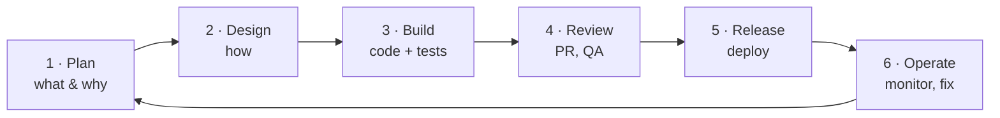

::part[Learn the Concept]{n="1"}

## 🎯 What you'll learn

- The difference between **coding** and **software engineering**
- The **software development lifecycle** (SDLC): from idea to production and back
- How teams organize work: **Agile**, Scrum, Kanban, tickets and user stories
- The roles you'll work with, and where you fit
- What "done" really means

## 🔤 Key words

| Word | In simple words | Bahasa Indonesia |
|---|---|---|
| **Software engineering** | Building software that stays correct and changeable while a team works on it for years | Rekayasa perangkat lunak |
| **SDLC** | The cycle a feature goes through: idea → build → release → learn | Siklus hidup pengembangan |
| **Agile** | Working in short cycles and adjusting, instead of planning everything up front | Cara kerja bertahap |
| **Scrum / Kanban** | Two common ways teams organise that work: fixed sprints, or a flowing board | Dua metode mengatur kerja |
| **Ticket / user story** | One written piece of work, described from the user's point of view | Satu unit pekerjaan |
| **Backlog** | The waiting list of work, most important first | Daftar tunggu pekerjaan |
| **Code review** | A teammate reading your change before it is merged | Pemeriksaan kode |
| **Definition of Done** | The team's agreement on what "finished" means | Kesepakatan arti "selesai" |
| **Technical debt** | Shortcuts today that make changes slower tomorrow | Utang teknis |

## 🧠 The big idea

Coding is **laying bricks**. Software engineering is **building a house people will live in for 20 years**: understanding what the family needs, planning, building safely, inspecting the work, fixing leaks, and adding a room later without the roof falling in.

> Software engineering = building software that is **correct**, **maintainable**, **secure** and **useful** — with a **team**, over **time**.

## ❓ Why it matters

A script you write for one afternoon needs no process. A real product does:

- Many people change the same code every day.
- The code lives for years, and the person who wrote it leaves.
- Mistakes cost money, data or trust.
- What users need keeps changing.

Engineering practices — version control, reviews, tests, planning, monitoring — exist so a team can keep changing software **quickly without breaking it**. They are the building inspections, not extra paperwork.

Without them, a startup ships fast by "just coding": no tests, no reviews, secrets in the code, one developer who understands the payment flow. Six months later every release breaks something, that developer quits, a leaked API key costs Rp 80 juta in cloud bills, and new features take weeks because nobody dares touch anything.

## 📖 Step by step

### 1. The software development lifecycle

Think of it as a loop, not a line: you learn something from real users and start the next turn with better information.

| Phase | Questions | Artifacts |
|---|---|---|
| **Plan** | What problem? For whom? How do we know it worked? | user stories, acceptance criteria |
| **Design** | Which components, data, APIs? What could go wrong? | diagrams, API contract, design doc |
| **Build** | Does it work? Is it tested? | code, tests |
| **Review** | Is it correct, readable, secure? | pull request, review comments |
| **Release** | How do we ship safely? Can we roll back? | CI/CD pipeline, release notes |
| **Operate** | Is it healthy? Are users happy? | logs, dashboards, alerts, bug reports |

It's a **loop**: what you learn in production feeds the next plan.

### 2. Agile in one page

Instead of planning everything for a year (and being wrong), :term[Agile]{bahasa="Agile — cara kerja iteratif: rencana kecil, rilis sering, belajar dari feedback"} teams work in short cycles and adjust.

| Practice | What it looks like |
|---|---|
| **User story** | *As a job seeker, I want to filter jobs by city, so I only see relevant listings.* |
| **Acceptance criteria** | *Given jobs in Jakarta and Bandung, when I filter by "jakarta", then I only see Jakarta jobs (case-insensitive).* |
| **Backlog** | prioritized list of stories and bugs |
| **Sprint** (Scrum) | 1–2 week cycle: plan → build → demo → retrospective |
| **Kanban board** | columns like *To do → In progress → Review → Done*, limiting work in progress |
| **Stand-up** | 10–15 min daily sync: progress, plan, blockers |

Tools: Jira, Linear, GitHub Projects, Trello.

### 3. Who you work with

| Role | Cares about | You'll talk about |
|---|---|---|
| Product manager | the right problem, priorities | scope, trade-offs, deadlines |
| Designer (UI/UX) | usability, flows | edge cases, loading and error states |
| Backend / frontend / full-stack engineers | building it | APIs, contracts, reviews |
| QA engineer | quality, test plans | acceptance criteria, bugs |
| DevOps / SRE / platform | reliability, deployments | infrastructure, incidents |
| Data / ML / AI engineers | data, models | events, datasets, AI features |
| Tech lead / engineering manager | architecture, people, delivery | design decisions, growth |

### 4. A feature's journey at a real company

1. PM writes a story with acceptance criteria.
2. You ask questions, estimate, maybe write a short design note.
3. You create a **branch**, write code **and tests**.
4. You open a **pull request**; CI runs tests and linters automatically.
5. A teammate **reviews**; you address comments.
6. It merges and **deploys** (often automatically, sometimes behind a feature flag).
7. You **check** logs/metrics; the PM verifies the acceptance criteria.

### 5. Definition of Done

"Done" is like handing over a rented room: not just "I stopped working", but cleaned, checked, and with the keys handed over — merged, tested, documented and released.

"It works on my laptop" isn't done. A typical team's **Definition of Done**:

- [ ] Acceptance criteria met
- [ ] Tests written and passing in CI
- [ ] Code reviewed and approved
- [ ] No new lint/security warnings
- [ ] Docs/README updated if behavior changed
- [ ] Deployed and verified (or ready to deploy)

### Choosing your setup

Every option here is a trade-off:

| Choice | ✅ | ❌ |
|---|---|---|
| Lots of process (big docs, approvals) | predictable, safe for regulated domains (banks) | slow, frustrating for small teams |
| Minimal process | fast at the start | chaos as the team and codebase grow |
| Scrum (sprints) | rhythm, regular demos | ceremonies can feel heavy |
| Kanban (flow) | flexible, great for support/ops | needs discipline to avoid endless WIP |

The right amount of process **grows with the team, the risk and the product**.

- ✅ Apply lightweight engineering habits even to solo projects (Git, tests, README) — they become your portfolio signal.
- ✅ Write acceptance criteria before building anything non-trivial.
- 🚫 Don't copy big-company ceremonies into a two-person project.
- 🚫 Don't treat "process" as a substitute for talking to users and teammates.

## ⚠️ Common mistakes

- Starting to code before understanding the problem.
- Huge pull requests that nobody can review properly.
- Treating tests and documentation as "extra" instead of part of done.
- Staying silent when stuck for days.
- Confusing being busy with delivering value.

:::revoshop
Open your RevoShop repo and look for evidence of the lifecycle: the `jira/` folder (planning), `docs/` and the README's *Architecture* section (design), `tests/` (build), `.pylintrc` and the *Code Quality & Security* section (review), `Dockerfile` and `Procfile` (release), `app/logging_config.py` and the `/health` route in `app/routes/health.py` (operate). Which phase is the **weakest** in your project, and what would you add?
:::

## 🏆 Best practices

- [ ] **Clarify before coding**: restate the requirement and list acceptance criteria and edge cases.
- [ ] **Small batches**: small tickets, small branches, small pull requests (ideally under ~400 changed lines).
- [ ] **Automate the boring checks**: tests, linting and formatting run in CI, not in reviewers' heads.
- [ ] **Write things down**: README, decision notes (ADRs), runbooks. Future-you is a teammate.
- [ ] **Make work visible**: update the ticket/board; raise blockers early at stand-up, not at the deadline.
- [ ] **Own it end to end**: after merging, check that it actually works in the deployed environment.
- [ ] **Blameless culture**: when things break, fix the system (tests, checks, docs), not the person.
- [ ] **Security and privacy from day one**: no secrets in code, least privilege, validate input.

::part[Explain & Design]{n="2"}

## 🗣️ Explain it

Explain to a friend who thinks "programmers just type code all day" what a software engineer actually does in a typical week. Mention at least four activities that aren't writing code.

## 📐 Design it

Write a **user story with acceptance criteria** for this CareerPilot Phase 2 feature:

> Users can change an application's status (applied → interview → offer / rejected).

Include at least 4 acceptance criteria, including **invalid** cases, and write your **Definition of Done** checklist for it.

:::quiz
Show an example

**Story:** As a job seeker, I want to update the status of an application, so my pipeline reflects where I am with each company.

**Acceptance criteria:**
1. Given my application with status `applied`, when I set it to `interview`, then it's saved and returned with status `interview` and an updated timestamp.
2. Given an invalid status like `maybe`, then the API responds `400` with a message listing the allowed statuses.
3. Given an application that belongs to **another user**, then the API responds `404` (don't reveal it exists).
4. Given status `rejected` or `offer`, when I try to move back to `applied`, then it's rejected with `409 Conflict` *(product decision — clarify with the PM!)*.
5. Every status change is recorded in a history list with the date.

**Definition of Done:** criteria covered by tests · PR reviewed · API docs updated · migration included · deployed to staging and checked with a real request.
:::

### 📝 Self-review checklist

- [ ] My story has *who*, *what* and *why*
- [ ] Criteria are testable (Given/When/Then)
- [ ] I included invalid input and authorization cases
- [ ] I flagged an unclear rule as a question instead of guessing

::ai-review{task="design"}

::part[Toy Exercise]{n="3"}

:::exercise{ai="no-ai" title="Map a real product's lifecycle"}
No code today — practice thinking like an engineer.

1. Pick an app you use daily (Gojek, Tokopedia, Spotify…).
2. Choose **one feature** (e.g. "rate your driver").
3. In **My notes**, write: 2 user stories · 4 acceptance criteria · 3 things that could go wrong in production · which roles would be involved · what you'd monitor after release (2 metrics).
4. Then look at your RevoShop README and write a 5-item **Definition of Done** you *wish* you had used for it.
:::

### 🏆 Stretch goal

Create a free **GitHub Project** (Kanban board) for CareerPilot with columns *Backlog → To do → In progress → Review → Done* and add Phase 2's first five stories.

## ✅ Quick check

:::quiz
What makes acceptance criteria useful?

They define "done" in testable terms before building, so developers, QA and product agree on the expected behavior — and they turn directly into tests.
:::

:::quiz
Why do teams prefer small pull requests?

They're reviewed faster and more carefully, are easier to test and roll back, and cause fewer merge conflicts.
:::

:::quiz
What does "blameless" mean after an incident?

The team focuses on what in the system allowed the mistake (missing test, unclear docs, no alert) and fixes that, instead of punishing an individual.
:::

## 📚 Keep learning

- [Atlassian: Agile guide](https://www.atlassian.com/agile)
- [Google SRE: Blameless postmortem culture](https://sre.google/sre-book/postmortem-culture/)
- [GitHub Projects quickstart](https://docs.github.com/en/issues/planning-and-tracking-with-projects/learning-about-projects/quickstart-for-projects)
