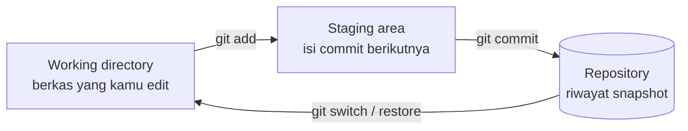

::part[Pelajari Konsepnya]{n="1"}

## 🎯 Yang akan kamu pelajari

- Apa yang diselesaikan version control, dan cara Git menyimpan riwayat sebagai **snapshot**
- Tiga area: **working directory → staging area → repository**
- Perintah sehari-hari: `status`, `add`, `commit`, `log`, `diff`, `switch`, `merge`
- `.gitignore` dan menjaga secret tetap aman
- Menulis pesan commit yang bisa digunakan orang lain
- Membatalkan sesuatu **dengan aman**: `restore`, `revert`, `commit --amend`, dan kapan `reset` berbahaya

## 🔤 Istilah penting

| Istilah | Artinya (sederhana) |
|---|---|
| **Version control** | Tool yang mengingat setiap versi proyekmu dan siapa yang mengubah apa | 
| **Repository (repo)** | Folder proyek plus seluruh riwayatnya |
| **Commit** | Satu snapshot tersimpan dengan pesan |
| **Working directory** | Berkas yang sedang kamu kerjakan sekarang |
| **Staging area** | Tempat memilih perubahan mana yang masuk commit berikutnya |
| **Branch** | Jalur kerja paralel terpisah |
| **`.gitignore`** | Daftar berkas yang Git tidak boleh simpan (secret, hasil build) |
| **`git revert`** | Membatalkan commit lama dengan membuat commit baru — aman |
| **`git reset --hard`** | Membuang perubahan; bisa kehilangan kerja — berbahaya |

## 🧠 Ide besarnya

Git adalah **sistem save-game** untuk proyekmu. Setiap :term[commit]{bahasa="commit — satu snapshot tersimpan dari proyek, lengkap dengan pesan dan penulisnya"} adalah titik selamat yang bisa kamu kembali, bandingkan, atau bagikan, dan branch adalah **timeline paralel** di mana kamu bisa coba hal baru tanpa menyentuh cerita utama.

Tiga area bekerja seperti memasak: **working directory** adalah meja dapur, **staging area** adalah piring yang kamu tata, dan **commit** adalah foto yang kamu ambil dari piring yang sudah jadi.

## ❓ Kenapa ini penting

Tanpa version control:

- `final.py`, `final_v2.py`, `final_REAL_fix.py`…
- "Kemarin masih jalan" — tapi apa yang berubah?
- Dua orang edit berkas yang sama dan saling menimpa.
- Tidak ada cara tahu **siapa** mengubah baris dan **kenapa**.

Git menjawab *apa yang berubah, kapan, oleh siapa, mengapa* — dan biarkan kamu kembali. Tapi dipakai dengan salah, tetap sakit:

- Satu commit besar bernama `update` dengan 60 berkas: tidak bisa di-review atau dibatalkan sebagian.
- `.env` dengan password database di-commit ke repo publik → bot menemukannya dalam hitungan menit.
- `git reset --hard` dijalankan dalam panik → sehari kerja belum di-commit hilang.

## 📖 Langkah demi langkah

### 1. Tiga area



- **Working directory**: berkas aktualmu.
- **Staging area** (index): yang sudah kamu *pilih* untuk masuk commit berikutnya.
- **Repository**: riwayat tersimpan (di dalam folder tersembunyi `.git/`).

Staging area membiarkan kamu pisahkan kerja berantakan menjadi **commit bersih dan terfokus**.

### 2. Langkah awal

```bash
git config --global user.name "Your Name"
git config --global user.email "you@example.com"
git config --global init.defaultBranch main

mkdir careerpilot && cd careerpilot
git init
```

### 3. Alur sehari-hari

```bash
git status                  # what changed? what's staged?
git diff                    # unstaged changes, line by line
git add analyze.py          # stage one file
git add -p                  # stage PART of a file, hunk by hunk (great habit)
git diff --staged           # review exactly what will be committed
git commit -m "feat(cli): add salary statistics"
git log --oneline --graph   # history
```

:::tip
Jalankan `git status` terus-menerus. Ia tahu di mana kamu dan biasanya sarankan perintah berikutnya.
:::

### 4. `.gitignore`

File `.gitignore` berisi daftar apa yang Git **tidak boleh** lacak:

```gitignore
# Python
__pycache__/
.venv/
.pytest_cache/

# Secrets
.env
!.env.example

# OS / editor
.DS_Store
.idea/
```

`.gitignore` hanya pengaruhi berkas **yang belum dilacak**. Kalau sudah di-commit `.env`, menambahnya ke `.gitignore` tidak cukup: jalankan `git rm --cached .env`, commit, dan **rotasi secret-nya** (anggap sudah bocor).

### 5. Pesan commit

Tulis pesan untuk orang yang akan membacanya enam bulan nanti jam 2 pagi — mungkin kamu sendiri. Jelaskan *kenapa*, bukan hanya *apa*.

Pesan bagus menjelaskan **kenapa**, jadi kamu di masa depan paham tanpa membaca diff.

Format **Conventional Commits**, dipakai banyak tim:

```text
<type>(<scope>): <ringkasan singkat dalam modus imperatif>

<opsional body: kenapa, konteks, trade-off>
```

| Tipe | Untuk |
|---|---|
| `feat` | fitur baru |
| `fix` | perbaikan bug |
| `docs` | hanya dokumentasi |
| `test` | menambah/memperbaiki test |
| `refactor` | perubahan kode tanpa ubah perilaku |
| `chore` | tooling, dependency, konfigurasi |
| `style` | hanya format |

| ❌ | ✅ |
|---|---|
| `update` | `feat(cli): filter jobs by minimum salary` |
| `fix bug` | `fix(cli): handle listings without salary` |
| `changes` | `refactor(analyze): extract format_rupiah_number` |

### 6. Branch

```bash
git switch -c feature/salary-filter   # create and switch to a new branch
# …work and commit…
git switch main
git merge feature/salary-filter        # bring the work into main
git branch -d feature/salary-filter    # delete the merged branch
```

A :term[branch]{bahasa="branch — cabang/jalur kerja terpisah yang menunjuk ke rangkaian commit"} hanyalah pointer bergerak ke commit — murah dibuat, jadi pakai untuk setiap perubahan.

### 7. Tag

```bash
git tag -a v0.1.0 -m "Phase 1: job listings CLI"
git tag
```

Tag menandai rilis (seperti fase CareerPilot).

### 8. Membatalkan sesuatu — dengan aman

Aturan jempol: `revert` menulis halaman baru di buku riwayat (aman, bisa dibagikan), sementara `reset --hard` robek halaman (cepat, kadang tidak bisa dipulihkan).

| Situasi | Perintah | Aman? |
|---|---|---|
| Buang perubahan tidak di-stage di berkas | `git restore file.py` | ⚠️ kehilangan editan itu |
| Batalkan stage berkas (simpan editan) | `git restore --staged file.py` | ✅ |
| Perbaiki pesan commit **terakhir** atau tambah berkas yang lupa (belum di-push) | `git commit --amend` | ✅ lokal |
| Batalkan commit yang **sudah dibagikan** | `git revert <commit>` — buat commit baru yang membalikannya | ✅ selalu |
| Pindah branch ke belakang, simpan perubahan sebagai uncommitted | `git reset --soft HEAD~1` | ✅ lokal |
| Buang commit dan perubahan | `git reset --hard …` | 🔴 merusak |
| "Commit saya hilang!" | `git reflog` — tunjukkan di mana HEAD pernah berada; pulihkan dari sini | ✅ penyelamat |
| Simpan kerja sementara | `git stash` / `git stash pop` | ✅ |

:::danger[Aturan emas]
Jangan tulis ulang riwayat (`reset --hard`, `commit --amend`, rebase) di commit yang **orang lain sudah punya** (misalnya di-push ke branch bersama). Pakai `git revert` sebaliknya.
:::

### Pilih setup kamu

Setiap opsi di sini adalah trade-off:

| Pilihan | ✅ | ❌ |
|---|---|---|
| Commit kecil, sering | mudah di-review, undo tepat, riwayat jelas | butuh disiplin sedikit |
| Commit besar | langkah lebih sedikit | sulit di-review, bisect, atau revert |
| `git add .` | cepat | gampang commit sampah atau secret |
| `git add -p` | sengaja, commit bersih | lebih lambat |
| Merge | jaga riwayat sungguhan | commit merge tambahan |
| Rebase (pelajaran berikutnya) | riwayat linear | tulis ulang riwayat — hati-hati dengan branch bersama |

- ✅ Pakai Git untuk **setiap** proyek, bahkan solo, dari berkas pertama.
- ✅ Commit saat unit kerja kecil selesai dan test pass.
- 🚫 Jangan commit secret, berkas yang dibuat, binary besar atau dataset (pakai Git LFS atau storage untuk berkas besar).
- 🚫 Jangan pakai `reset --hard` kecuali yakin — `stash` dulu kalau ragu.

## ⚠️ Kesalahan umum

- Commit `.env`, `.venv/` atau `node_modules/`.
- Pesan seperti `wip`, `asdf`, `final`.
- Kerja langsung di `main` untuk semuanya.
- Panik dan hapus folder repo bukan pakai `git reflog`.
- Amend atau reset commit yang sudah di-push ke branch bersama.

:::revoshop
Di repo RevoShop-mu jalankan `git log --oneline | head -30`. Berapa banyak pesan yang ikuti format `type: summary` yang jelas (seperti `docs: update Postman collection link…`)? Buka `.gitignore`: ia sudah abaikan `.venv/`, `.env` (sambil simpan `.env.example`), output coverage dan folder IDE — apakah kamu bisa jelaskan baris `!.env.example`? Terakhir, jalankan `git log --oneline -- app/services/order_service.py`: apakah kamu bisa ceritakan **kisah** cara logika order berkembang hanya dari pesan?
:::

## 🏆 Praktik terbaik

- [ ] Buat `.gitignore` **sebelum** commit pertama (pakai template GitHub sebagai awal).
- [ ] Commit **satu perubahan logis** sekali; review dengan `git diff --staged` sebelum commit.
- [ ] Pakai **Conventional Commits** dalam modus imperatif: "add", "fix", bukan "added", "fixes".
- [ ] Jangan pernah commit secret; sediakan `.env.example` sebaliknya. Kalau secret bocor, **rotasi** sekarang juga.
- [ ] Kerja di **branch**, jaga `main` selalu jalan.
- [ ] Pull/sync sering untuk hindari konflik besar; push branch-mu setiap hari sebagai backup.
- [ ] Lebih suka `git switch`/`git restore` (jelas, modern) daripada `git checkout` yang kelebihan beban.
- [ ] Nyalakan secret scanning (GitHub push protection) dan pikirkan pre-commit hook (misalnya `gitleaks`).
- [ ] Tag rilis (`v0.1.0`) dan simpan CHANGELOG untuk proyek yang orang lain pakai.

::part[Jelaskan & Rancang]{n="2"}

## 🗣️ Jelaskan

Jelaskan staging area ke non-programmer dengan analogi (mengemas kotak sebelum kirim, pilih foto untuk album…). Lalu jelaskan kenapa `git revert` lebih aman daripada `git reset --hard` untuk kerja bersama.

## 📐 Rancang

Kamu kerja seharian tanpa commit. `git status` tunjukkan perubahan di: `analyze.py` (filter gaji baru **dan** perbaikan crash kalau skill kosong), `test_acceptance.py` (test untuk keduanya), `README.md` (penggunaan filter), `.env` (API key lokal), dan `notes-to-self.txt`.

Rencana commit-nya: berkas/hunk mana masuk commit mana, dalam urutan berapa, dengan pesan apa? Apa yang terjadi `.env` dan `notes-to-self.txt`?

:::quiz
Lihat rencana yang mungkin

1. `fix(cli): handle listings with empty skills` — hunk perbaikan crash di `analyze.py` + test-nya (pakai `git add -p`).
2. `feat(cli): add --min-salary filter` — hunk filter di `analyze.py` + test-nya.
3. `docs(readme): document --min-salary usage` — `README.md`.

`.env` → tambah ke `.gitignore` (dan buat `.env.example`). `notes-to-self.txt` → jangan commit; tambah ke `.gitignore` atau pindah keluar repo.

Perbaiki dulu: ia independen, dan bisa di-cherry-pick atau dirilis sendiri.
:::

### 📝 Checklist review mandiri

- [ ] Setiap commit berisi satu perubahan logis **beserta** test-nya
- [ ] Aku pakai partial staging untuk berkas yang campur
- [ ] Tidak ada secret atau berkas pribadi yang di-commit
- [ ] Pesan ikuti `type(scope): summary`

::ai-review{task="design"}

::part[Latihan Kecil]{n="3"}

:::exercise{path="exercises/m2/w1/04-git-fundamentals" ai="no-ai" title="Bangun riwayat praktik yang bersih"}
Buat repository Git kecil di `exercises/m2/w1/04-git-fundamentals/practice/` dengan mengikuti cerita di folder README: commit dengan pesan Conventional Commit, `.gitignore` yang lindungi berkas `.env`, branch fitur yang di-merge ke `main`, satu `git revert`, dan tag rilis.

Test-nya cek riwayat repository-mu. (Folder `practice/` diabaikan oleh Git repo handbook sendiri.)
:::

:::hints
- `git -C practice log --oneline --graph --all` tunjukkan riwayat-mu dari folder latihan.
- Buat pesan buruk di commit terakhir? `git commit --amend -m "…"` (ia lokal, jadi tidak masalah).
- `git revert HEAD` balikan commit terakhir dengan membuat yang baru.
:::

## ✅ Cek cepat

:::quiz
Apa yang dilakukan `git add -p` dan kenapa berguna?

Ia biarkan kamu stage bagian **terpilih** dari berkas, hunk demi hunk, jadi satu berkas dengan dua perubahan tidak terkait bisa masuk dua commit terpisah yang terfokus.
:::

:::quiz
Kamu commit `.env` kemarin dan push-nya. Apakah menambahnya ke `.gitignore` sudah cukup?

Tidak. Lepas dari tracking (`git rm --cached .env`), commit, dan **rotasi setiap secret** di dalamnya — sudah di riwayat dan di remote. (Menulis ulang riwayat dengan tool seperti `git filter-repo` mungkin juga perlu, tapi rotasi dulu.)
:::

:::quiz
Cara cari commit yang "hilang" setelah reset yang buruk?

`git reflog` daftar posisi `HEAD` terakhir-terakhir; cari hash commit dan pulihkan (misalnya `git switch -c rescue <hash>`).
:::


## 📚 Lanjut belajar

- [Pro Git book (gratis, resmi)](https://git-scm.com/book/en/v2)
- [Conventional Commits](https://www.conventionalcommits.org/)
- [GitHub: .gitignore templates](https://github.com/github/gitignore)
- [Learn Git Branching (interaktif)](https://learngitbranching.js.org/)
