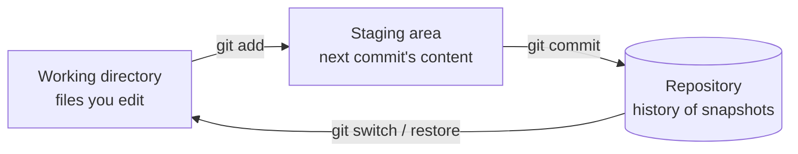

::part[Learn the Concept]{n="1"}

## 🎯 What you'll learn

- What version control solves, and how Git stores history as **snapshots**
- The three areas: **working directory → staging area → repository**
- Everyday commands: `status`, `add`, `commit`, `log`, `diff`, `switch`, `merge`
- `.gitignore` and keeping secrets out
- Writing commit messages people can use
- Undoing things **safely**: `restore`, `revert`, `commit --amend`, and when `reset` is dangerous

## 🧠 The big idea

Git is a **save-game system** for your project. Each :term[commit]{bahasa="commit — satu snapshot tersimpan dari proyek, lengkap dengan pesan dan penulisnya"} is a save point you can return to, compare, or share. Branches are **parallel timelines** where you can try things without touching the main story.

## ❓ Why does this exist?

Without version control:

- `final.py`, `final_v2.py`, `final_REAL_fix.py`…
- "It worked yesterday" — but what changed?
- Two people editing the same file overwrite each other.
- No way to see **who** changed a line and **why**.

Git answers *what changed, when, by whom, why* — and lets you go back.

## 💥 What happens if we DON'T use it well?

- One giant commit called `update` with 60 files: impossible to review or undo partly.
- `.env` with a database password committed and pushed to a public repo → bots find it within minutes.
- `git reset --hard` run in panic → a day of uncommitted work is gone.

## 📖 How it works, step by step

### 1. The three areas



- **Working directory**: your actual files.
- **Staging area** (index): what you've *chosen* to include in the next commit.
- **Repository**: the saved history (inside the hidden `.git/` folder).

The staging area lets you split messy work into **clean, focused commits**.

### 2. First steps

```bash
git config --global user.name "Your Name"
git config --global user.email "you@example.com"
git config --global init.defaultBranch main

mkdir careerpilot && cd careerpilot
git init
```

### 3. The everyday loop

```bash
git status                  # what changed? what's staged?
git diff                    # unstaged changes, line by line
git add analyze.py          # stage one file
git add -p                  # stage PART of a file, hunk by hunk (great habit)
git diff --staged           # review exactly what will be committed
git commit -m "feat(cli): add salary statistics"
git log --oneline --graph   # history
```

:::tip
Run `git status` constantly. It tells you where you are and usually suggests the next command.
:::

### 4. `.gitignore`

A `.gitignore` file lists what Git should **never** track:

```gitignore
# Python
__pycache__/
.venv/
.pytest_cache/

# Secrets
.env
!.env.example

# OS / editor
.DS_Store
.idea/
```

`.gitignore` only affects **untracked** files. If you already committed `.env`, adding it to `.gitignore` isn't enough: run `git rm --cached .env`, commit, and **rotate the secret** (assume it's leaked).

### 5. Commit messages

A good message explains **why**, so future-you understands the change without reading the diff.

**Conventional Commits** format, used by many teams:

```text
<type>(<scope>): <short summary in imperative mood>

<optional body: why, context, trade-offs>
```

| Type | Use for |
|---|---|
| `feat` | new feature |
| `fix` | bug fix |
| `docs` | documentation only |
| `test` | adding/fixing tests |
| `refactor` | code change without behavior change |
| `chore` | tooling, dependencies, config |
| `style` | formatting only |

| ❌ | ✅ |
|---|---|
| `update` | `feat(cli): filter jobs by minimum salary` |
| `fix bug` | `fix(cli): handle listings without salary` |
| `changes` | `refactor(analyze): extract format_rupiah_number` |

### 6. Branches

```bash
git switch -c feature/salary-filter   # create and switch to a new branch
# …work and commit…
git switch main
git merge feature/salary-filter        # bring the work into main
git branch -d feature/salary-filter    # delete the merged branch
```

A :term[branch]{bahasa="branch — cabang/jalur kerja terpisah yang menunjuk ke rangkaian commit"} is just a movable pointer to a commit — cheap to create, so use them for every change.

### 7. Tags

```bash
git tag -a v0.1.0 -m "Phase 1: job listings CLI"
git tag
```

Tags mark releases (like CareerPilot's phases).

### 8. Undoing things — safely

| Situation | Command | Safe? |
|---|---|---|
| Discard unstaged changes to a file | `git restore file.py` | ⚠️ loses those edits |
| Unstage a file (keep edits) | `git restore --staged file.py` | ✅ |
| Fix the **last** commit's message or add a forgotten file (not pushed yet) | `git commit --amend` | ✅ locally |
| Undo a commit that's **already shared** | `git revert <commit>` — creates a new commit that reverses it | ✅ always |
| Move a branch back, keeping changes as uncommitted | `git reset --soft HEAD~1` | ✅ locally |
| Throw away commits and changes | `git reset --hard …` | 🔴 destructive |
| "I lost a commit!" | `git reflog` — shows where HEAD has been; recover from there | ✅ lifesaver |
| Put work aside temporarily | `git stash` / `git stash pop` | ✅ |

:::danger[The golden rule]
Never rewrite history (`reset --hard`, `commit --amend`, rebase) on commits **other people already have** (e.g. pushed to a shared branch). Use `git revert` instead.
:::

## ⚖️ Trade-offs

| Choice | ✅ | ❌ |
|---|---|---|
| Small, frequent commits | easy review, precise undo, clear history | a little discipline |
| Large commits | fewer steps | hard to review, bisect or revert |
| `git add .` | fast | easily commits junk or secrets |
| `git add -p` | deliberate, clean commits | slower |
| Merge | preserves true history | extra merge commits |
| Rebase (next lesson) | linear history | rewrites history — careful with shared branches |

## ✅ When to use it / 🚫 When NOT to use it

- ✅ Use Git for **every** project, even solo, from the first file.
- ✅ Commit when a small unit of work is complete and tests pass.
- 🚫 Don't commit secrets, generated files, huge binaries or datasets (use Git LFS or storage for big files).
- 🚫 Don't use `reset --hard` unless you're sure — `stash` first if in doubt.

## 🏆 Best practices

- [ ] Create `.gitignore` **before** the first commit (use GitHub's templates as a start).
- [ ] Commit **one logical change** at a time; review with `git diff --staged` before committing.
- [ ] Use **Conventional Commits** in imperative mood: "add", "fix", not "added", "fixes".
- [ ] Never commit secrets; provide a `.env.example` instead. If a secret leaks, **rotate** it immediately.
- [ ] Work on **branches**, keep `main` always working.
- [ ] Pull/sync often to avoid big conflicts; push your branch daily as a backup.
- [ ] Prefer `git switch`/`git restore` (clear, modern) over the overloaded `git checkout`.
- [ ] Enable secret scanning (GitHub push protection) and consider a pre-commit hook (e.g. `gitleaks`).
- [ ] Tag releases (`v0.1.0`) and keep a CHANGELOG for projects others use.

## 🏭 How it's used in industry

- Every company uses Git (GitHub, GitLab, Bitbucket). It's assumed knowledge in every job listing.
- Commit history is used for **code review**, **release notes** (generated from Conventional Commits), **debugging** (`git blame`, `git bisect`) and **audits**.
- Recruiters look at your GitHub contribution graph and commit messages as a signal of habits.

## ⚠️ Common mistakes

- Committing `.env`, `.venv/` or `node_modules/`.
- Messages like `wip`, `asdf`, `final`.
- Working directly on `main` for everything.
- Panicking and deleting the repo folder instead of using `git reflog`.
- Amending or resetting commits that were already pushed to a shared branch.

:::revoshop
In your RevoShop repo run `git log --oneline | head -30`. How many messages follow a clear `type: summary` format (like `docs: update Postman collection link…`)? Open `.gitignore`: it already ignores `.venv/`, `.env` (while keeping `.env.example`), coverage output and IDE folders — can you explain the `!.env.example` line? Finally, run `git log --oneline -- app/services/order_service.py`: can you tell the **story** of how the order logic evolved from the messages alone?
:::

::part[Explain & Design]{n="2"}

## 🗣️ Explain it

Explain the staging area to a non-programmer using an analogy (packing a box before shipping, choosing photos for an album…). Then explain why `git revert` is safer than `git reset --hard` on shared work.

## 📐 Design it

You worked all afternoon without committing. `git status` shows changes in: `analyze.py` (a new salary filter **and** a fix for a crash on empty skills), `test_acceptance.py` (tests for both), `README.md` (usage for the filter), `.env` (a local API key), and `notes-to-self.txt`.

Plan the commits: which files/hunks go into each commit, in what order, with which messages? What happens to `.env` and `notes-to-self.txt`?

:::quiz
Show a possible plan

1. `fix(cli): handle listings with empty skills` — the crash-fix hunk in `analyze.py` + its test (use `git add -p`).
2. `feat(cli): add --min-salary filter` — the filter hunks in `analyze.py` + its tests.
3. `docs(readme): document --min-salary usage` — `README.md`.

`.env` → add to `.gitignore` (and create `.env.example`). `notes-to-self.txt` → don't commit; add to `.gitignore` or move outside the repo.

Fix first: it's independent, and it could be cherry-picked or released on its own.
:::

### 📝 Self-review checklist

- [ ] Each commit contains one logical change **with** its tests
- [ ] I used partial staging for the mixed file
- [ ] No secrets or personal files are committed
- [ ] Messages follow `type(scope): summary`

::ai-review{task="design"}

::part[Toy Exercise]{n="3"}

:::exercise{path="exercises/m2/w1/04-git-fundamentals" ai="no-ai" title="Build a clean practice history"}
Create a small Git repository at `exercises/m2/w1/04-git-fundamentals/practice/` by following the story in the folder's README: commits with Conventional Commit messages, a `.gitignore` that protects a `.env` file, a feature branch merged into `main`, a `git revert`, and a release tag.

The tests inspect your repository's history. (The `practice/` folder is ignored by the handbook's own Git repo.)
:::

:::hints
- `git -C practice log --oneline --graph --all` shows your history from the exercise folder.
- Made a bad message on the last commit? `git commit --amend -m "…"` (it's local, so that's fine).
- `git revert HEAD` reverses the most recent commit by adding a new one.
:::

## ✅ Quick check

:::quiz
What does `git add -p` do and why is it useful?

It lets you stage selected **parts** of files, hunk by hunk, so one file with two unrelated changes can go into two separate, focused commits.
:::

:::quiz
You committed `.env` yesterday and pushed it. Is adding it to `.gitignore` enough?

No. Remove it from tracking (`git rm --cached .env`), commit, and **rotate every secret** in it — it's already in the history and on the remote. (Rewriting history with tools like `git filter-repo` may also be needed, but rotating comes first.)
:::

:::quiz
How can you find a commit you "lost" after a bad reset?

`git reflog` lists recent positions of `HEAD`; find the commit hash and restore it (e.g. `git switch -c rescue <hash>`).
:::

## 📖 Kamus (glossary)

| Term | Bahasa Indonesia |
|---|---|
| Version control | Kontrol versi — pencatatan riwayat perubahan |
| Commit | Snapshot tersimpan |
| Staging area | Area persiapan sebelum commit |
| Branch | Cabang kerja |
| Merge | Menggabungkan cabang |
| Revert | Membatalkan commit dengan commit baru |

## 📚 Keep learning

- [Pro Git book (free, official)](https://git-scm.com/book/en/v2)
- [Conventional Commits](https://www.conventionalcommits.org/)
- [GitHub: .gitignore templates](https://github.com/github/gitignore)
- [Learn Git Branching (interactive)](https://learngitbranching.js.org/)
