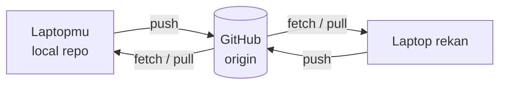
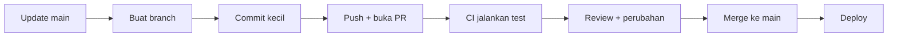

::part[Pelajari Konsepnya]{n="1"}

## 🎯 Yang akan kamu pelajari

- **Remote**: `clone`, `fetch`, `pull`, `push`
- **GitHub flow**: branch → commit → pull request → review → merge
- Cara menulis dan review **pull request** dengan baik
- **Merge vs rebase**, dan kapan masing-masing cocok
- Mengatasi **merge conflict** langkah demi langkah
- Melindungi `main` dengan branch rule dan CI

## 🔤 Istilah penting

| Istilah | Artinya (sederhana) |
|---|---|
| **Remote** | Salinan repo yang dibagikan, biasanya di GitHub |
| **`fetch` vs `pull`** | Fetch hanya unduh; pull unduh lalu gabung |
| **Pull request (PR)** | Minta rekan untuk review perubahan sebelum merge |
| **Code review** | Rekan membaca dan memberi komentar pada perubahan |
| **Merge** | Menggabung dua branch sambil menjaga riwayat keduanya |
| **Rebase** | Atur ulang commit ke atas branch utama, untuk riwayat lurus |
| **Merge conflict** | Git tidak bisa otomatis gabung karena baris sama berubah berbeda |
| **Branch protection** | Aturan `main`: wajib PR, wajib CI pass |
| **Force push** | Timpa riwayat remote — sangat berbahaya di branch bersama |

## 🧠 Ide besarnya

Bayangkan dokumen bersama — tapi setiap orang menulis di **salinan mereka sendiri**, dan perubahan masuk versi resmi hanya setelah seseorang **review**. Itu alur pull request: semua orang kerja bersamaan tanpa saling menghalangi, dengan satu pintu pemeriksaan sebelum masuk `main`.

`main` adalah **etalase toko**: selalu harus rapih, jadi apa pun yang masuk harus dicek dulu.

## ❓ Kenapa ini penting

Saat 5 — atau 500 — engineer mengubah kode yang sama:

- kerja harus jalan **bersamaan tanpa saling halangi**,
- setiap perubahan perlu **dua pasang mata** (bug, keamanan, desain, berbagi pengetahuan),
- `main` harus tetap **bisa di-deploy** setiap saat,
- dan ada **catatan** mengapa perubahan itu dibuat.

Tanpa cara kerja ini:

- Semua push langsung ke `main`: satu push rusak, seluruh tim terhenti.
- Satu branch hidup tiga minggu: merge-nya buat 40 konflik dan app rusak.
- Konflik "diselesaikan" dengan cuma ambil versi sendiri: bug fix rekan hilang diam-diam.
- `git push --force` di branch bersama menghapus commit orang lain.

## 📖 Langkah demi langkah

### 1. Remote

```bash
git clone git@github.com:you/careerpilot.git   # copy a remote repo (remote is named "origin")
git remote -v                                    # list remotes

git fetch                    # download new commits, don't change your files
git pull                     # fetch + integrate into your current branch
git push -u origin feature/salary-filter   # upload a branch and track it
```



:::tip
Pakai **SSH key** atau GitHub CLI (`gh auth login`) untuk autentikasi — bukan password.
:::

### 2. GitHub flow



```bash
git switch main && git pull
git switch -c feat/application-status
# …commits…
git push -u origin feat/application-status
gh pr create --fill          # or open the PR on github.com
```

Konvensi nama branch: `feat/…`, `fix/…`, `docs/…`, sering dengan ticket id: `feat/CP-42-application-status`.

### 3. Pull request yang baik

PR adalah **surat pendek ke reviewer**: apa yang berubah, kenapa, cara kamu test, dan apa yang kurang yakin. Surat pendek dibaca; surat 40 file cuma di-skim.

```md
## What
Adds PATCH /applications/{id}/status with validation and history.

## Why
Users need to move applications through their pipeline (CP-42).

## How
- New `ApplicationStatus` enum and transition rules in `services/applications.py`
- History rows written in the same transaction

## How to test
1. `docker compose up`, run migrations
2. `pytest tests/test_application_status.py`
3. Try `PATCH /applications/1/status {"status": "interview"}` in Swagger

## Screenshots / notes
Invalid transitions return 409 — confirm with PM?
```

Jaga PR tetap **kecil** (satu tujuan, idealnya < 400 baris), link ticket, dan review diff sendiri sebelum minta orang lain.

### 4. Review kode

Cari, urut penting:

1. **Kebenaran**: apa ini sesuai ticket? Edge case? Test?
2. **Keamanan**: validasi input, cek auth, secret, SQL injection.
3. **Desain**: tempat logic ini tepat? Mudah dibaca? Ada duplikasi?
4. **Gaya**: sebagian besar serahkan pada linter.

Komentar dengan baik dan konkret: *"Ini biarkan user ubah aplikasi orang lain — sebaiknya filter `user_id` di sini?"* lebih baik dari *"salah"*. Pakai label seperti **nit:** (opsional), **question:**, **blocking:**.

### 5. Merge vs rebase

Branch kamu ketinggalan `main`. Dua cara mengejar:

| | `git merge main` | `git rebase main` |
|---|---|---|
| Apa yang dilakukan | tambah commit merge yang gabung dua riwayat | main atur ulang commit kamu di atasnya |
| Riwayat | asli, tapi bisa berantakan | bersih dan lurus |
| Tulis ulang commit? | tidak | **ya** (hash commit baru) |
| Aman di branch bersama? | ✅ | ⚠️ hanya kalau hanya kamu yang pakai |

Di GitHub, PR sering merge dengan **squash merge** (seluruh PR jadi satu commit di `main`) — riwayat bersih tanpa perlu rebase semua orang.

Kalau kamu rebase branch yang sudah di-push, update dengan `git push --force-with-lease` (tolak kalau ada orang lain push) — jangan `--force` biasa.

### 6. Mengatasi merge conflict

Konflik bukan error — Git bilang "dua orang atur ulang rak yang sama; kamu tentukan bentuknya". Jaga kombinasi yang benar, hapus marker, lalu jalankan test sebelum commit.

:term[merge conflict]{bahasa="Konflik merge — situasi saat Git tidak bisa otomatis menggabungkan karena baris yang sama diubah berbeda di dua branch"} terlihat seperti ini:

```python
def format_salary(amount):
<<<<<<< HEAD
    return f"Rp {amount:,}".replace(",", ".")
=======
    return f"IDR {amount:,}"
>>>>>>> feature/currency-label
```

Langkah demi langkah:

1. **Jangan panik.** `git status` tampilkan file yang konflik.
2. Buka setiap file. Antara `<<<<<<<` dan `=======` adalah **punya kamu**; antara `=======` dan `>>>>>>>` adalah **punya mereka**.
3. Tentukan **hasil gabung yang benar** — sering kali campuran keduanya. Tanya author lain kalau kurang yakin.
4. Hapus **semua** marker.
5. Jalankan test.
6. `git add <file>` lalu `git commit` (merge) atau `git rebase --continue`.

Stuck? `git merge --abort` / `git rebase --abort` kembali ke posisi awal.

### 7. Melindungi `main`

Repository setting → **Branch protection / rulesets**:

- Wajib pull request sebelum merge
- Wajib **CI pass**
- Wajib minimal 1 approval
- Blok force push ke `main`
- *(Opsional)* `CODEOWNERS` otomatis minta reviewer untuk folder tertentu

### Pilih setup kamu

Setiap pilihan punya trade-off:

| Pilihan | ✅ | ❌ |
|---|---|---|
| Branch jangka pendek (jam–hari) | sedikit konflik, feedback cepat | butuh kerja kecil, bertahap |
| Branch jangka panjang | isolasi kerja besar | merge sakit, kode ketinggalan |
| Commit merge | riwayat pas persis | graf lebih ramai |
| Rebase / squash | riwayat lurus, mudah dibaca | rewrite commit butuh hati-hati |
| Strict protection rule | `main` stabil | sedikit lambat untuk fix kecil |

- ✅ Alur PR untuk **semua** project tim — dan solo portfolio (tunjukkan kebiasaan baik).
- ✅ Rebase **punya** unpublished atau personal branch agar riwayat rapi.
- 🚫 Jangan rebase atau force-push `main` atau branch yang orang lain pakai.
- 🚫 Jangan approve PR tanpa benar-benar baca ("LGTM" tanpa lihat).

## ⚠️ Kesalahan umum

- Commit langsung ke `main`.
- PR raksasa ("refactor + fitur + format").
- Biarkan conflict marker di kode.
- `git push --force` di branch bersama.
- Pull dengan uncomitted change dan jadi bingung (`git stash` dulu, atau commit).

:::revoshop
Kalau repo RevoShop kamu di organisasi GitHub, cek **Settings → Branches/Rules**: apakah `main` terlindungi? Lihat tab **Pull requests**: apakah kamu kerja lewat PR atau push ke `main`? Tulis cara kamu setup RevoShop untuk tim 3 orang: nama branch, template PR, required check (contoh `pytest`, `pylint`, `bandit`), dan aturan review.
:::

## 🏆 Praktik terbaik

- [ ] Pull `main` sebelum mulai; update branch dari `main` paling tidak setiap hari.
- [ ] Jaga PR **kecil dan fokus**, dengan deskripsi: apa, kenapa, cara test, screenshot.
- [ ] Self-review diff di GitHub sebelum minta orang review.
- [ ] Lindungi `main`: PR wajib, CI wajib pass, jangan force push.
- [ ] Pakai `--force-with-lease`, jangan `--force`, dan hanya di branch kamu sendiri.
- [ ] Atasi konflik dengan mengerti **kedua** perubahan, lalu test sebelum commit.
- [ ] Review kebenaran dan keamanan dulu; gaya serahkan linter. Baik dan spesifik.
- [ ] Autentikasi SSH key atau `gh`; aktifkan 2FA di GitHub.
- [ ] Hapus branch yang sudah merge agar repo tetap rapi.

::part[Jelaskan & Rancang]{n="2"}

## 🗣️ Jelaskan

Jelaskan ke orang non-programmer kenapa tim pakai pull request bukannya semuanya edit file yang sama langsung. Lalu jelaskan merge conflict dengan contoh kehidupan nyata.

## 📐 Rancang

Tulis **pull request template** (`.github/pull_request_template.md`) dan **review checklist** untuk repo CareerPilot, dan daftar branch protection rule yang akan kamu aktifkan untuk `main`.

:::quiz
Lihat contoh rancangan

```md
## What & why
<!-- Link the issue: Closes #12 -->

## How to test
- [ ] Commands / steps

## Checklist
- [ ] Tests added or updated, and passing
- [ ] No secrets or personal data
- [ ] Docs/README updated if behavior changed
- [ ] Screenshots for UI changes
```

**Review checklist:** acceptance criteria met · edge cases & error handling · auth/ownership checks · input validation · tests meaningful · naming & structure · no leftover debug code.

**Protection rules for `main`:** require PR · require CI (`pytest`, lint) to pass · require 1 approval (for a solo project: at least require CI) · block force pushes and deletion · require branches to be up to date before merging.
:::

### 📝 Checklist review mandiri

- [ ] Template minta *kenapa* dan *cara test*, bukan cuma *apa*
- [ ] Keamanan muncul di review checklist
- [ ] `main` tidak terima kode fail atau yang tidak di-review

::ai-review{task="design"}

::part[Latihan Kecil]{n="3"}

:::exercise{path="exercises/m2/w1/05-git-collaboration" ai="no-ai" title="Lab merge conflict"}
Jalankan `bash make_conflict.sh` di folder latihan. Script itu buat `conflict-lab/`, sebuah repo yang dua branchnya ubah fungsi sama berbeda, dan mulai merge yang **konflik**.

Selesaikan dengan cara kedua intention tetap ada (README jelaskan apa yang masing-masing branch mau), selesaikan merge, dan jalankan test. Test cek tidak ada conflict marker, merge commit ada, kedua perubahan selamat, dan kode masih jalan.
:::

:::hints
- `git -C conflict-lab status` tampilkan file yang konflik.
- Baca kedua sisi sebelum hapus apa pun.
- Setelah edit: `git add pricing.py`, lalu `git commit --no-edit` untuk selesaikan merge.
- Kacau? `git merge --abort` atau jalankan `make_conflict.sh` lagi (recreate lab).
:::

### 🏆 Tujuan stretch

Recreate lab dan selesaikan dengan **rebase** sebaliknya: `git switch feature/discount && git rebase main`. Bandingkan `git log --graph` untuk kedua cara.

## ✅ Cek cepat

:::quiz
Apa bedanya `git fetch` dan `git pull`?

`fetch` unduh commit baru dari remote tanpa ubah branch kamu; `pull` fetch **dan** gabungkan (merge atau rebase) ke branch sekarang kamu.
:::

:::quiz
Kapan rebase berisiko?

Saat branch sudah dibagikan dan orang lain sudah bikin kerjaan di atasnya — rebase tulis ulang hash commit, jadi riwayat mereka diverge. Hanya rebase branch yang cuma kamu pakai.
:::

:::quiz
Apa yang kamu lakukan setelah selesaikan konflik di semua file?

Hapus setiap marker, jalankan test, `git add` file-nya, lalu commit (atau `git rebase --continue`).
:::


## 📚 Lanjut belajar

- [GitHub Docs: GitHub flow](https://docs.github.com/en/get-started/using-github/github-flow)
- [GitHub Docs: Resolving a merge conflict using the command line](https://docs.github.com/en/pull-requests/collaborating-with-pull-requests/addressing-merge-conflicts/resolving-a-merge-conflict-using-the-command-line)
- [Google Engineering Practices: Code review](https://google.github.io/eng-practices/review/)

## 📣 Bagikan progresmu

:::linkedin{type="concept"}
🔀 Merge conflict dulunya bikin takut aku. Ini yang akhirnya aku pahami:

Konflik cuma Git bilang: "Dua orang ubah baris yang sama berbeda — aku nggak akan nebak mana yang benar."

Rutinitas 5-langkah aku sekarang:
1. `git status` lihat file yang konflik
2. Baca KEDUA sisi sebelum hapus apa pun
3. Tulis hasil gabung yang benar (sering kali kamu perlu kedua perubahan)
4. Hapus marker dan jalankan test
5. `git add` + commit

Pelajaran sungguhan: branch jangka pendek, short-lived berarti sedikit konflik dari awal.

Apa git tip terbaik kamu untuk pemula?

#Git #LearningInPublic #SoftwareEngineering
:::
