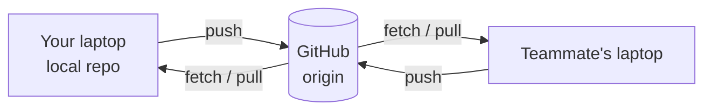
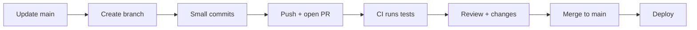

::part[Learn the Concept]{n="1"}

## 🎯 What you'll learn

- **Remotes**: `clone`, `fetch`, `pull`, `push`
- **GitHub flow**: branch → commit → pull request → review → merge
- How to write and review **pull requests** well
- **Merge vs rebase**, and when each is appropriate
- Resolving **merge conflicts** step by step
- Protecting `main` with branch rules and CI

## 🔤 Key words

| Word | In simple words | Bahasa Indonesia |
|---|---|---|
| **Remote** | The shared copy of the repo, usually on GitHub | Salinan bersama di server |
| **`fetch` vs `pull`** | Fetch downloads new commits; pull downloads and merges them | Unduh saja vs unduh + gabung |
| **Pull request (PR)** | A request to merge your branch, where others can review it | Usulan penggabungan |
| **Code review** | A teammate reading your change and commenting | Pemeriksaan oleh rekan |
| **Merge** | Joining two branches, keeping both histories | Menggabungkan jalur kerja |
| **Rebase** | Replaying your commits on top of the latest main, for a straight history | Menata ulang commit |
| **Merge conflict** | Two branches changed the same lines, so Git asks you to choose | Bentrokan perubahan |
| **Branch protection** | Rules on `main`: require a PR, require green checks | Aturan pelindung main |
| **Force push** | Overwriting the remote history — dangerous on shared branches | Menimpa riwayat remote |

## 🧠 The big idea

Think of a shared document — but where everyone writes in their **own copy**, and changes only reach the official version after someone **reviews** them. That's the pull request workflow: freedom to work in parallel, with one checkpoint before anything lands in `main`.

`main` is the shop's display window: it should always be presentable, so nothing goes in without a check.

## ❓ Why it matters

When 5 — or 500 — engineers change the same codebase:

- work must happen **in parallel** without people blocking each other,
- every change needs a **second pair of eyes** (bugs, security, design, sharing knowledge),
- `main` must stay **deployable** at all times,
- and there must be a **record** of why each change was made.

Without this way of working:

- Everyone pushes straight to `main`: one broken push stops the whole team.
- A branch lives for three weeks: merging it produces 40 conflicts and a broken app.
- Conflicts "resolved" by keeping only your own version: a teammate's bug fix quietly disappears.
- `git push --force` on a shared branch erases other people's commits.

## 📖 Step by step

### 1. Remotes

```bash
git clone git@github.com:you/careerpilot.git   # copy a remote repo (remote is named "origin")
git remote -v                                    # list remotes

git fetch                    # download new commits, don't change your files
git pull                     # fetch + integrate into your current branch
git push -u origin feature/salary-filter   # upload a branch and track it
```



:::tip
Use **SSH keys** or the GitHub CLI (`gh auth login`) to authenticate — not your password.
:::

### 2. GitHub flow



```bash
git switch main && git pull
git switch -c feat/application-status
# …commits…
git push -u origin feat/application-status
gh pr create --fill          # or open the PR on github.com
```

Branch naming conventions: `feat/…`, `fix/…`, `docs/…`, often with a ticket id: `feat/CP-42-application-status`.

### 3. A good pull request

A PR is a **short letter to your reviewer**: what changed, why, how you tested it, and anything you're unsure about. Small letters get read; 40-file letters get skimmed.

```md
## What
Adds PATCH /applications/{id}/status with validation and history.

## Why
Users need to move applications through their pipeline (CP-42).

## How
- New `ApplicationStatus` enum and transition rules in `services/applications.py`
- History rows written in the same transaction

## How to test
1. `docker compose up`, run migrations
2. `pytest tests/test_application_status.py`
3. Try `PATCH /applications/1/status {"status": "interview"}` in Swagger

## Screenshots / notes
Invalid transitions return 409 — confirm with PM?
```

Keep PRs **small** (one purpose, ideally < 400 lines), link the ticket, and review your own diff before asking others.

### 4. Reviewing code

Look for, in order of importance:

1. **Correctness**: does it do what the ticket says? Edge cases? Tests?
2. **Security**: input validation, auth checks, secrets, SQL injection.
3. **Design**: right place for this logic? Readable? Duplicated?
4. **Style**: mostly left to linters.

Comment kindly and concretely: *"This lets a user update someone else's application — should we filter by `user_id` here?"* beats *"wrong"*. Use labels like **nit:** (optional), **question:**, **blocking:**.

### 5. Merge vs rebase

Your branch fell behind `main`. Two ways to catch up:

| | `git merge main` | `git rebase main` |
|---|---|---|
| What it does | adds a merge commit combining both histories | replays your commits on top of the latest `main` |
| History | true, but can get noisy | clean and linear |
| Rewrites commits? | no | **yes** (new commit hashes) |
| Safe on shared branches? | ✅ | ⚠️ only on branches only **you** use |

On GitHub, PRs are often merged with **squash merge** (the whole PR becomes one commit on `main`) — clean history without asking everyone to rebase.

If you rebase a branch you already pushed, update it with `git push --force-with-lease` (refuses if someone else pushed in the meantime) — never plain `--force`.

### 6. Resolving a merge conflict

A conflict is not an error — it's Git saying "two people rearranged the same shelf; you decide how it should look". Keep the correct combination, remove the markers, then run the tests before committing.

A :term[merge conflict]{bahasa="konflik merge — Git tidak bisa otomatis menggabungkan karena baris yang sama diubah berbeda"} looks like this:

```python
def format_salary(amount):
<<<<<<< HEAD
    return f"Rp {amount:,}".replace(",", ".")
=======
    return f"IDR {amount:,}"
>>>>>>> feature/currency-label
```

Step by step:

1. **Don't panic.** `git status` lists the conflicted files.
2. Open each file. Between `<<<<<<<` and `=======` is **your** side; between `=======` and `>>>>>>>` is **theirs**.
3. Decide the **correct combined result** — often a mix of both. Talk to the other author if unsure.
4. Remove **all** markers.
5. Run the tests.
6. `git add <file>` then `git commit` (merge) or `git rebase --continue`.

Stuck? `git merge --abort` / `git rebase --abort` returns to before you started.

### 7. Protecting `main`

Repository settings → **Branch protection / rulesets**:

- Require a pull request before merging
- Require **passing CI checks**
- Require at least 1 approval
- Block force pushes to `main`
- *(Optional)* `CODEOWNERS` to auto-request reviewers for certain folders

### Choosing your setup

Every option here is a trade-off:

| Choice | ✅ | ❌ |
|---|---|---|
| Short-lived branches (hours–days) | few conflicts, fast feedback | requires small, incremental work |
| Long-lived branches | isolate big work | painful merges, stale code |
| Merge commits | preserves exact history | busier graph |
| Rebase / squash | linear, readable history | rewriting commits needs care |
| Strict protection rules | stable `main` | slightly slower for tiny fixes |

- ✅ PR workflow for **all** team projects — and for solo portfolio projects (it shows the habit).
- ✅ Rebase your **own** unpublished or personal branch to keep history tidy.
- 🚫 Never rebase or force-push `main` or a branch others are working on.
- 🚫 Don't approve PRs you didn't actually read ("LGTM" without looking).

## ⚠️ Common mistakes

- Committing directly to `main`.
- Giant PRs ("refactor + feature + formatting").
- Leaving conflict markers in the code.
- `git push --force` on shared branches.
- Pulling with uncommitted changes and getting confused (`git stash` first, or commit).

:::revoshop
If your RevoShop repo belongs to a GitHub organization, check the repository **Settings → Branches/Rules**: is `main` protected? Look at the **Pull requests** tab: did you work through PRs or push to `main`? Write down how you'd set up RevoShop for a 3-person team: branch naming, PR template, required checks (e.g. `pytest`, `pylint`, `bandit`), and review rules.
:::

## 🏆 Best practices

- [ ] Pull `main` before starting work; update your branch from `main` at least daily.
- [ ] Keep PRs **small and focused**, with a description: what, why, how to test, screenshots.
- [ ] Self-review your diff on GitHub before requesting review.
- [ ] Protect `main`: PR required, CI must pass, no force pushes.
- [ ] Use `--force-with-lease`, never `--force`, and only on your own branches.
- [ ] Resolve conflicts by understanding **both** changes, then run tests before committing.
- [ ] Review for correctness and security first; leave style to linters. Be kind and specific.
- [ ] Authenticate with SSH keys or `gh`; enable 2FA on GitHub.
- [ ] Delete merged branches to keep the repo tidy.

::part[Explain & Design]{n="2"}

## 🗣️ Explain it

Explain to a non-programmer why a team uses pull requests instead of everyone editing the same files directly. Then explain what a merge conflict is using a real-life example.

## 📐 Design it

Write a **pull request template** (`.github/pull_request_template.md`) and a **review checklist** for the CareerPilot repo, and list the branch protection rules you'd enable for `main`.

:::quiz
Show a possible design

```md
## What & why
<!-- Link the issue: Closes #12 -->

## How to test
- [ ] Commands / steps

## Checklist
- [ ] Tests added or updated, and passing
- [ ] No secrets or personal data
- [ ] Docs/README updated if behavior changed
- [ ] Screenshots for UI changes
```

**Review checklist:** acceptance criteria met · edge cases & error handling · auth/ownership checks · input validation · tests meaningful · naming & structure · no leftover debug code.

**Protection rules for `main`:** require PR · require CI (`pytest`, lint) to pass · require 1 approval (for a solo project: at least require CI) · block force pushes and deletion · require branches to be up to date before merging.
:::

### 📝 Self-review checklist

- [ ] The template asks *why* and *how to test*, not only *what*
- [ ] Security appears in the review checklist
- [ ] `main` can't receive failing or unreviewed code

::ai-review{task="design"}

::part[Toy Exercise]{n="3"}

:::exercise{path="exercises/m2/w1/05-git-collaboration" ai="no-ai" title="Merge conflict lab"}
Run `bash make_conflict.sh` inside the exercise folder. It creates `conflict-lab/`, a repo where two branches changed the same function differently, and starts a merge that **conflicts**.

Resolve it so the result keeps **both** intentions (the README explains exactly what each branch wanted), finish the merge, and run the tests. The tests check that no conflict markers remain, the merge commit exists, both changes survived, and the code still works.
:::

:::hints
- `git -C conflict-lab status` shows which files conflict.
- Read both sides before deleting anything.
- After editing: `git add pricing.py`, then `git commit --no-edit` to finish the merge.
- Messed up? `git merge --abort` or simply run `make_conflict.sh` again (it recreates the lab).
:::

### 🏆 Stretch goal

Recreate the lab and resolve it with **rebase** instead: `git switch feature/discount && git rebase main`. Compare `git log --graph` for both approaches.

## ✅ Quick check

:::quiz
What's the difference between `git fetch` and `git pull`?

`fetch` downloads new commits from the remote without touching your branch; `pull` fetches **and** integrates them (merge or rebase) into your current branch.
:::

:::quiz
When is rebasing risky?

When the branch has already been shared and others have based work on it — rebase rewrites commit hashes, so their history diverges. Only rebase branches you alone use.
:::

:::quiz
What do you do right after resolving conflicts in all files?

Remove every marker, run the tests, `git add` the files, then commit (or `git rebase --continue`).
:::


## 📚 Keep learning

- [GitHub Docs: GitHub flow](https://docs.github.com/en/get-started/using-github/github-flow)
- [GitHub Docs: Resolving a merge conflict using the command line](https://docs.github.com/en/pull-requests/collaborating-with-pull-requests/addressing-merge-conflicts/resolving-a-merge-conflict-using-the-command-line)
- [Google Engineering Practices: Code review](https://google.github.io/eng-practices/review/)

## 📣 Share your progress

:::linkedin{type="concept"}
🔀 Merge conflicts used to scare me. Here's what finally made them click:

A conflict is just Git saying: "Two people changed the same lines differently — I won't guess which one is right."

My 5-step routine now:
1. `git status` to see the conflicted files
2. Read BOTH sides before deleting anything
3. Write the combined result (often you need both changes)
4. Remove the markers and run the tests
5. `git add` + commit

The real lesson: small, short-lived branches mean fewer conflicts in the first place.

What's your best Git tip for beginners?

#Git #LearningInPublic #SoftwareEngineering
:::
