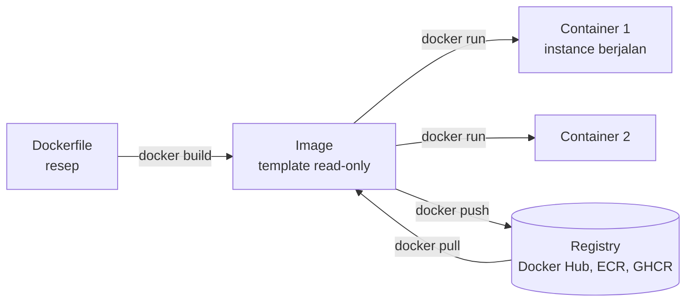

::part[Pelajari Konsepnya]{n="1"}

## 🎯 Yang akan kamu pelajari

- Apa itu container dan perbedaannya dengan virtual machine
- **Image** vs **container**, **registry**, **layer**
- Menulis **Dockerfile** yang baik (dan `.dockerignore`)
- Perintah sehari-hari: `build`, `run`, `ps`, `logs`, `exec`, `stop`
- **Port**, **environment variable** dan **volume**
- Menjalankan app + database bersama dengan **Docker Compose**

## 🔤 Istilah penting

| Istilah | Artinya (sederhana) |
|---|---|
| **Container** | Paket aplikasi yang berjalan dalam kotak terisolasi sendiri |
| **Image** | Template read-only yang menjadi awal container |
| **Dockerfile** | Resep untuk membuat image, langkah demi langkah |
| **Layer** | Satu langkah yang disimpan dari resep; layer tidak berubah dipakai ulang |
| **Registry** | Toko online untuk image (Docker Hub, GHCR) |
| **Port mapping** | Menghubungkan port di komputermu ke port di dalam container |
| **Volume** | Penyimpanan yang hidup di luar container, jadi data tetap |
| **Docker Compose** | Satu file untuk menjalankan beberapa container bersama (app + database) |

## 🧠 Ide besarnya

Dulu, kargo dimuat satu per satu — karung, tong, peti dari berbagai bentuk — lambat dan rapuh. **Container pengiriman standar** mengubah semuanya: masukkan apa saja ke dalam, dan setiap kapal, kren dan truk di dunia bisa memindahnya.

:term[Container]{bahasa="container — paket berisi aplikasi beserta semua kebutuhannya, berjalan terisolasi dan sama di mana saja"} melakukan hal yang sama untuk software: aplikasimu, versi Python-nya, library-nya dan pengaturan-nya dalam satu kotak standar yang berperilaku sama di laptopmu, PC Windows teman, CI, dan server cloud.

Image adalah **kotak yang ditutup rapat**; container adalah kotak itu **dibuka dan bekerja**.

## ❓ Kenapa ini penting

- "Jalan di mesinku" — sistem operasi berbeda, versi Python berbeda, atau library sistem yang hilang.
- Onboarding: pasang PostgreSQL, Redis dan Python yang tepat dengan tangan butuh berapa jam.
- Deploy perlu paket yang **bisa diulang**: apa yang kamu test sama persis dengan yang jalan di production.

Tanpa container, production punya Python 3.10 sementara kamu develop di 3.12, dependency butuh library sistem yang tidak ada dalam catatan, dan langkah deploy hidup di kepala satu orang.

Dengan **Dockerfile yang ditulis buruk** kamu dapat masalah baru: image 2 GB berdasarkan `python:latest` (yang berubah diam-diam), semua dependency rebuild setiap code berubah, app berjalan sebagai `root`, dan `.env` penuh secret yang terbaked di image dan di-push ke registry.

## 📖 Langkah demi langkah

### 1. Container vs virtual machine

| | Virtual machine | Container |
|---|---|---|
| Includes | sistem operasi guest lengkap | hanya app + library-nya, pakai kernel host |
| Size | gigabyte | megabyte hingga ratusan MB |
| Starts in | menit | detik |
| Isolation | kuat | baik (process-level) |

### 2. Vocabulary



- **Dockerfile** — resepnya
- **Image** — paket yang dibuat dan read-only (terdiri dari **layer** yang di-cache)
- **Container** — instance berjalan dari image
- **Registry** — tempat image disimpan dan dibagikan

### 3. Dockerfile yang baik untuk Python API

Urutan penting seperti packing koper: taruh benda yang jarang berubah (dependency) di bawah, dan kodemu di atas. Maka code change hanya re-pack layer atas.

```dockerfile
# 1. Pin a small, specific base image (never "latest")
FROM python:3.12-slim

# 2. Sensible Python settings for containers
ENV PYTHONDONTWRITEBYTECODE=1 \
    PYTHONUNBUFFERED=1

WORKDIR /app

# 3. Copy dependency files FIRST → this layer is cached until requirements change
COPY requirements.txt .
RUN pip install --no-cache-dir -r requirements.txt

# 4. Then copy the code (changes often)
COPY . .

# 5. Don't run as root
RUN useradd --create-home appuser
USER appuser

EXPOSE 8000

# 6. Exec form (JSON array) so signals like Ctrl+C / docker stop reach the app
CMD ["gunicorn", "--bind", "0.0.0.0:8000", "app:app"]
```

**Layer caching:** setiap instruksi buat layer. Docker pakai ulang layer yang di-cache sampai ada yang berubah, lalu rebuild semuanya **setelah** titik itu. Copy `requirements.txt` sebelum kodenya berarti code change tidak reinstall semua package — build dari menit jadi detik.

### 4. `.dockerignore`

Seperti `.gitignore`, tapi untuk apa yang masuk ke dalam build:

```text
.git
.venv
__pycache__/
.pytest_cache/
.env
*.log
```

Build lebih kecil, upload lebih cepat — dan **tidak ada secret** yang kesenggol masuk image.

### 5. Perintah sehari-hari

```bash
docker build -t careerpilot-api:dev .          # build an image with a tag
docker run --rm -p 8091:8000 careerpilot-api:dev   # run it; host port 8091 → container port 8000
docker run -d --name api -p 8091:8000 --env-file .env careerpilot-api:dev   # detached, with env vars
docker ps                                       # running containers
docker logs -f api                              # follow logs
docker exec -it api sh                          # open a shell inside the container
docker stop api && docker rm api                # stop and remove
docker images && docker system df               # what's using disk space
```

`-p HOST:CONTAINER` map port. Di dalam container app dengar di `8000`; kamu capai di `http://localhost:8091`.

### 6. Konfigurasi dan secret

- Kirim pengaturan sebagai **environment variable** saat runtime (`-e`, `--env-file`, Compose `environment:`).
- **Jangan pernah** masukkan secret di Dockerfile (`ENV SECRET_KEY=…`) atau copy `.env` ke image — siapa saja punya image bisa baca (`docker history`, `docker inspect`).

### 7. Volume: data yang lebih panjang dari container

Container punya disk sendiri adalah **kamar hotel** — dibersihkan saat checkout. Volume adalah **loker penyimpanan** yang tetap punya di antara menginap, tempat data database seharusnya.

Container **bisa dibuang**: hapus satu dan file dalamnya hilang. Database butuh **volume**:

```bash
docker run -d --name db -e POSTGRES_PASSWORD=dev -p 5491:5432 \
  -v pgdata:/var/lib/postgresql/data postgres:16-alpine
```

### 8. Docker Compose: beberapa service bersama

`compose.yaml`:

```yaml
services:
  db:
    image: postgres:16-alpine
    environment:
      POSTGRES_USER: careerpilot
      POSTGRES_PASSWORD: ${POSTGRES_PASSWORD:?set it in .env}
      POSTGRES_DB: careerpilot
    ports:
      - "${POSTGRES_PORT:-5491}:5432"
    volumes:
      - pgdata:/var/lib/postgresql/data
    healthcheck:
      test: ["CMD-SHELL", "pg_isready -U careerpilot"]
      interval: 5s
      retries: 5

  api:
    build: .
    env_file: .env
    environment:
      DATABASE_URL: postgresql://careerpilot:${POSTGRES_PASSWORD}@db:5432/careerpilot
    ports:
      - "${FLASK_PORT:-5091}:8000"
    depends_on:
      db:
        condition: service_healthy

volumes:
  pgdata:
```

```bash
docker compose up --build      # start everything
docker compose logs -f api
docker compose down            # stop (add -v to also delete volumes — careful!)
```

Di dalam Compose, service mencapai satu sama lain dengan **nama service**: API connect ke host `db`, bukan `localhost`.

### Pilih setup-mu

Setiap pilihan di sini ada trade-off:

| Pilihan | ✅ | ❌ |
|---|---|---|
| Container | environment konsisten, onboarding gampang, artifact deploy standar | kurva belajar; layer lain untuk debug; pakai disk |
| `python:3.12-slim` | kecil, compatible | kurang beberapa build tool |
| `alpine` base | tiny | musl libc bisa pecah atau lambat Python package dengan native code |
| Code mount sebagai volume di dev | live reload | beda dari production image |
| Database di Docker untuk **dev** | nol install | untuk **production**, managed database biasanya lebih aman |

- ✅ Dev dependency lokal (PostgreSQL, Redis) — tidak ada install manual.
- ✅ Packaging API dan worker untuk deploy.
- ✅ Buat CI sama dengan production.
- 🚫 Jangan containerize cuma untuk jalankan satu file script sekali.
- 🚫 Jangan simpan data penting di container tanpa volume.
- 🚫 Jangan terbake secret atau config spesifik-environment di image.

## ⚠️ Kesalahan umum

- `COPY . .` sebelum install dependency (rebuild lambat).
- Pakai `localhost` untuk capai container lain daripada nama service.
- Port confusion: lupa `-p`, atau kacau antara host dan container port.
- `docker compose down -v` dan hilang development database.
- Image membesar ke gigabyte (tidak ada `.dockerignore`, base image penuh, cache disimpan).

:::revoshop
RevoShop `Dockerfile`-mu sudah ikuti beberapa praktik terbaik: `python:3.12-slim`, `PYTHONDONTWRITEBYTECODE`/`PYTHONUNBUFFERED`, `requirements.txt` dicopy **sebelum** kodenya, `--no-cache-dir`, bersihkan apt list, non-root `appuser`, exec-form `CMD` dengan gunicorn. Cari satu per satu dan jelaskan **kenapa** ada. Buka `docker-compose.yml`: database punya **healthcheck** dengan `pg_isready`, dan web service connect ke host `db`. Satu pertanyaan: default `JWT_SECRET_KEY` adalah `dev-secret-key-change-me` — apa yang hentikan itu dari sampai ke production, dan gimana kamu enforce? (Hint: syntax `${VAR:?error}`.)
:::

## 🏆 Praktik terbaik

- [ ] Pin base image ke versi spesifik (`python:3.12-slim`), jangan `latest`.
- [ ] Urut instruksi dari paling jarang ke paling sering berubah (dependency sebelum kode) untuk **layer caching**.
- [ ] Tambah **`.dockerignore`** (exclude `.git`, `.venv`, `.env`, cache).
- [ ] Jalankan sebagai **user non-root**.
- [ ] Pakai `pip install --no-cache-dir` (atau `uv sync --frozen`) dan bersihkan cache package manager di `RUN` yang sama.
- [ ] Pakai **exec form** untuk `CMD`/`ENTRYPOINT` (`["gunicorn", …]`).
- [ ] Kirim config dan secret saat **runtime**; jangan `ENV`/`ARG` secret.
- [ ] Satu process per container; tambah **healthcheck**; log ke stdout.
- [ ] Pakai **multi-stage build** agar build tool tidak masuk image akhir (Module 5).
- [ ] Scan image untuk vulnerability (`docker scout`, Trivy) dan keep base image updated.

::part[Jelaskan & Rancang]{n="2"}

## 🗣️ Jelaskan

Jelaskan perbedaan antara image dan container ke orang yang bukan programmer (resep vs hidangan, class vs object, atau analogi sendiri). Lalu jelaskan kenapa urutan baris di Dockerfile mempengaruhi kecepatan build.

## 📐 Rancang

Rancang stack development lokal untuk **CareerPilot Phase 2** dengan Docker Compose: service mana, image mana, port mana (pakai non-default port dari handbook), volume mana, API mencari database gimana, secret dari mana, dan API tunggu apa sebelum start.

:::quiz
Tunjukkan satu rancangan kemungkinan

| Service | Image | Host port | Volume | Catatan |
|---|---|---|---|---|
| `db` | `postgres:16-alpine` | `5491` → 5432 | `pgdata` | healthcheck `pg_isready` |
| `api` | built dari `api/Dockerfile` | `5091` → 8000 | kode mount di dev untuk reload | `DATABASE_URL` pakai host `db`; `depends_on: db: condition: service_healthy` |
| `adminer` *(opsional)* | `adminer` | `8081` → 8080 | — | UI database untuk development |

Secret: `.env` (tidak di-commit) direferensikan dengan `env_file`, dengan `.env.example` di-commit. Nilai wajib pakai `${POSTGRES_PASSWORD:?…}` agar Compose berhenti cepat kalau tidak ada. Migrasi jalankan sebagai perintah one-off terpisah atau langkah entrypoint.
:::

### 📝 Checklist self-review

- [ ] Service bicara satu sama lain pakai nama service
- [ ] Database punya volume dan healthcheck
- [ ] Secret berasal dari `.env` yang tidak di-commit, jangan Dockerfile
- [ ] Port tidak bentrok dengan app lokal lain

::ai-review{task="design"}

::part[Latihan Kecil]{n="3"}

:::exercise{path="exercises/m2/w1/07-docker-basics" ai="no-ai" title="Perbaiki Dockerfile yang buruk"}
Folder berisi tiny Python web app dengan **Dockerfile buruk** dan tidak ada `.dockerignore`. Perbaiki keduanya. Test mengecek praktik terbaik statis (Docker tidak perlu): pinned slim base image, dependency layer sebelum kode, `--no-cache-dir`, non-root user, tidak ada secret di `ENV`/`ARG`, exec-form `CMD`, `EXPOSE`, dan `.dockerignore` yang exclude `.env`, `.venv`, `.git` dan `__pycache__`.

Kalau kamu punya Docker terpasang, build dan jalankan juga: `docker build -t toy-api .` lalu `docker run --rm -p 8091:8000 toy-api` dan buka http://localhost:8091.
:::

:::hints
- Baca pesan gagal test satu per satu.
- App baca greeting dari environment variable — kirim dengan `-e GREETING=…` saat runtime, bukan `ENV` di Dockerfile.
- `useradd --create-home appuser` lalu `USER appuser`.
:::

### 🏆 Stretch goal

Tambah instruksi `HEALTHCHECK` dan `compose.yaml` yang jalankan app di host port `8091` dengan greeting berasal dari file `.env`.

## ✅ Cek cepat

:::quiz
Kenapa copy `requirements.txt` dan install dependency sebelum `COPY . .`?

Docker cache layer. Dependency berubah jarang; kode berubah sering. Dengan urutan ini, code change pakai ulang cached dependency layer daripada reinstall semuanya.
:::

:::quiz
Di dalam Docker Compose, kenapa API pakai `db` sebagai database host, bukan `localhost`?

Setiap container punya `localhost` sendiri. Compose taruh service di network bersama di mana mereka mencari satu sama lain dengan **nama service**.
:::

:::quiz
Kenapa `ENV SECRET_KEY=abc123` di Dockerfile adalah masalah?

Nilainya tersimpan di dalam image layer; siapa saja yang bisa pull image bisa baca. Secret harus dikirim saat runtime.
:::


## 📚 Lanjut belajar

- [Docker Docs: Get started](https://docs.docker.com/get-started/)
- [Docker Docs: Building best practices](https://docs.docker.com/build/building/best-practices/)
- [Docker Docs: Compose file reference](https://docs.docker.com/reference/compose-file/)

## 📣 Akhir Minggu 1 — bagikan progresmu

:::linkedin{type="weekly"}
🧰 Minggu ini aku level up toolkit software engineering — hal yang tidak terlihat tapi semua andalkan.

- Terminal: pipe, exit code, dan script kecil aman (`set -euo pipefail` adalah teman baru)
- Git: commit bersih, pull request, dan resolve merge conflict santai
- Python project reproducible dengan uv dan lock file
- Docker: Dockerfile yang cache layer, jalankan non-root dan simpan secret dengan aman

Favorit aku "aha": [satu hal yang jelas].

Minggu depan: PostgreSQL dan design database. 🐘

#LearningInPublic #Git #Docker #Python #SoftwareEngineering
:::
