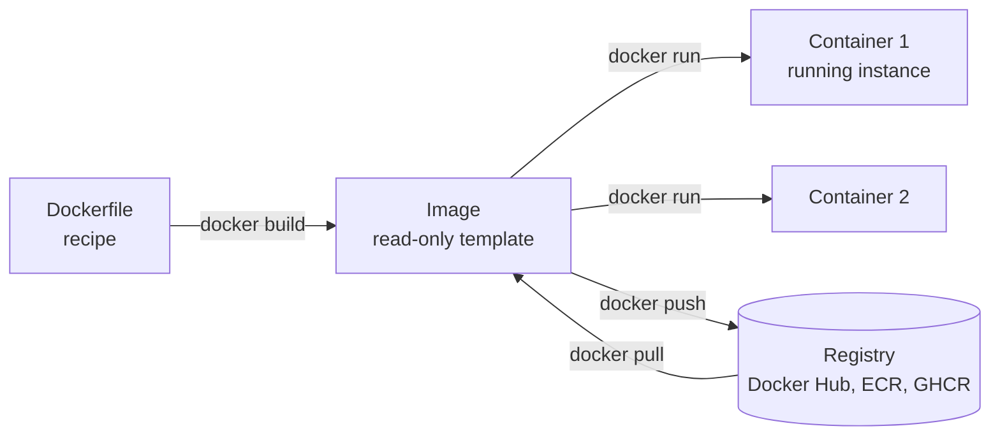

::part[Learn the Concept]{n="1"}

## 🎯 What you'll learn

- What containers are, and how they differ from virtual machines
- **Images** vs **containers**, **registries**, **layers**
- Writing a good **Dockerfile** (and `.dockerignore`)
- Everyday commands: `build`, `run`, `ps`, `logs`, `exec`, `stop`
- **Ports**, **environment variables** and **volumes**
- Running an app + database together with **Docker Compose**

## 🧠 The big idea

Before shipping containers, cargo was loaded piece by piece — sacks, barrels, crates of every shape — slow and fragile. The **standard shipping container** changed everything: pack anything inside, and every ship, crane and truck in the world can move it.

A :term[container]{bahasa="container — paket berisi aplikasi beserta semua kebutuhannya, berjalan terisolasi dan sama di mana pun"} does the same for software: your app, its Python version, its libraries and settings in one standard box that runs the same on your laptop, a teammate's Windows PC, CI, and a cloud server.

## ❓ Why does this exist?

- "Works on my machine" — different OS, Python version, missing system library.
- Onboarding: installing PostgreSQL, Redis and the right Python by hand takes hours.
- Deployments need a **repeatable** artifact: what was tested is exactly what runs in production.

## 💥 What happens if we DON'T use it (or use it badly)?

Without containers: production has Python 3.10 but you developed on 3.12; a dependency needs a system library nobody documented; deployment steps live in one person's head.

With a **bad** Dockerfile: a 2 GB image based on `python:latest` (which silently changes), rebuilding all dependencies on every code change, running as `root`, and the `.env` file with secrets baked into the image and pushed to a registry.

## 📖 How it works, step by step

### 1. Containers vs virtual machines

| | Virtual machine | Container |
|---|---|---|
| Includes | a full guest operating system | just the app + its libraries, sharing the host's kernel |
| Size | gigabytes | megabytes to hundreds of MB |
| Starts in | minutes | seconds |
| Isolation | strong | good (process-level) |

### 2. Vocabulary



- **Dockerfile** — the recipe
- **Image** — the built, read-only package (made of cached **layers**)
- **Container** — a running instance of an image
- **Registry** — where images are stored and shared

### 3. A good Dockerfile for a Python API

```dockerfile
# 1. Pin a small, specific base image (never "latest")
FROM python:3.12-slim

# 2. Sensible Python settings for containers
ENV PYTHONDONTWRITEBYTECODE=1 \
    PYTHONUNBUFFERED=1

WORKDIR /app

# 3. Copy dependency files FIRST → this layer is cached until requirements change
COPY requirements.txt .
RUN pip install --no-cache-dir -r requirements.txt

# 4. Then copy the code (changes often)
COPY . .

# 5. Don't run as root
RUN useradd --create-home appuser
USER appuser

EXPOSE 8000

# 6. Exec form (JSON array) so signals like Ctrl+C / docker stop reach the app
CMD ["gunicorn", "--bind", "0.0.0.0:8000", "app:app"]
```

**Layer caching:** each instruction creates a layer. Docker reuses cached layers until something changes, and rebuilds everything **after** that point. Copying `requirements.txt` before the code means a code change doesn't reinstall all packages — builds go from minutes to seconds.

### 4. `.dockerignore`

Like `.gitignore`, but for what gets sent into the build:

```text
.git
.venv
__pycache__/
.pytest_cache/
.env
*.log
```

Smaller builds, faster uploads — and **no secrets** accidentally copied into the image.

### 5. Everyday commands

```bash
docker build -t careerpilot-api:dev .          # build an image with a tag
docker run --rm -p 8091:8000 careerpilot-api:dev   # run it; host port 8091 → container port 8000
docker run -d --name api -p 8091:8000 --env-file .env careerpilot-api:dev   # detached, with env vars
docker ps                                       # running containers
docker logs -f api                              # follow logs
docker exec -it api sh                          # open a shell inside the container
docker stop api && docker rm api                # stop and remove
docker images && docker system df               # what's using disk space
```

`-p HOST:CONTAINER` maps ports. Inside the container the app listens on `8000`; you reach it at `http://localhost:8091`.

### 6. Configuration and secrets

- Pass settings as **environment variables** at run time (`-e`, `--env-file`, Compose `environment:`).
- **Never** put secrets in the Dockerfile (`ENV SECRET_KEY=…`) or copy `.env` into the image — anyone with the image can read them (`docker history`, `docker inspect`).

### 7. Volumes: data that outlives containers

Containers are **disposable**: delete one and its internal files are gone. Databases need a **volume**:

```bash
docker run -d --name db -e POSTGRES_PASSWORD=dev -p 5491:5432 \
  -v pgdata:/var/lib/postgresql/data postgres:16-alpine
```

### 8. Docker Compose: several services together

`compose.yaml`:

```yaml
services:
  db:
    image: postgres:16-alpine
    environment:
      POSTGRES_USER: careerpilot
      POSTGRES_PASSWORD: ${POSTGRES_PASSWORD:?set it in .env}
      POSTGRES_DB: careerpilot
    ports:
      - "${POSTGRES_PORT:-5491}:5432"
    volumes:
      - pgdata:/var/lib/postgresql/data
    healthcheck:
      test: ["CMD-SHELL", "pg_isready -U careerpilot"]
      interval: 5s
      retries: 5

  api:
    build: .
    env_file: .env
    environment:
      DATABASE_URL: postgresql://careerpilot:${POSTGRES_PASSWORD}@db:5432/careerpilot
    ports:
      - "${FLASK_PORT:-5091}:8000"
    depends_on:
      db:
        condition: service_healthy

volumes:
  pgdata:
```

```bash
docker compose up --build      # start everything
docker compose logs -f api
docker compose down            # stop (add -v to also delete volumes — careful!)
```

Inside Compose, services reach each other by **service name**: the API connects to host `db`, not `localhost`.

## ⚖️ Trade-offs

| Choice | ✅ | ❌ |
|---|---|---|
| Containers | consistent environments, easy onboarding, standard deploy artifact | learning curve; another layer to debug; disk usage |
| `python:3.12-slim` | small, compatible | lacks some build tools |
| `alpine` bases | tiny | musl libc can break or slow Python packages with native code |
| Code mounted as a volume in dev | live reload | differs from production image |
| Database in Docker for **dev** | zero install | for **production**, managed databases are usually safer |

## ✅ When to use it / 🚫 When NOT to use it

- ✅ Local dev dependencies (PostgreSQL, Redis) — no manual installs.
- ✅ Packaging APIs and workers for deployment.
- ✅ Making CI identical to production.
- 🚫 Don't containerize just to run a one-file script once.
- 🚫 Don't store important data inside a container without a volume.
- 🚫 Don't bake secrets or environment-specific config into images.

## 🏆 Best practices

- [ ] Pin base images to a specific version (`python:3.12-slim`), never `latest`.
- [ ] Order instructions from least to most frequently changing (dependencies before code) for **layer caching**.
- [ ] Add a **`.dockerignore`** (exclude `.git`, `.venv`, `.env`, caches).
- [ ] Run as a **non-root user**.
- [ ] Use `pip install --no-cache-dir` (or `uv sync --frozen`) and clean up package manager caches in the same `RUN`.
- [ ] Use **exec form** for `CMD`/`ENTRYPOINT` (`["gunicorn", …]`).
- [ ] Pass config and secrets at **runtime**; never `ENV`/`ARG` secrets.
- [ ] One process per container; add a **healthcheck**; log to stdout.
- [ ] Use **multi-stage builds** to keep build tools out of the final image (Module 5).
- [ ] Scan images for vulnerabilities (`docker scout`, Trivy) and keep base images updated.

## 🏭 How it's used in industry

- Almost every modern backend job listing mentions Docker; it's the input format for Kubernetes, AWS ECS, Cloud Run and most PaaS platforms.
- CI builds an image per commit, tags it with the git SHA, pushes it to a registry, and deploys that exact image.
- `docker compose` is the standard way to run a project's local stack.

## ⚠️ Common mistakes

- `COPY . .` before installing dependencies (slow rebuilds).
- Using `localhost` to reach another container instead of the service name.
- Port confusion: forgetting `-p`, or mixing up host and container ports.
- `docker compose down -v` and losing the development database.
- Images growing to gigabytes (no `.dockerignore`, full base image, caches kept).

:::revoshop
Your RevoShop `Dockerfile` already follows several best practices: `python:3.12-slim`, `PYTHONDONTWRITEBYTECODE`/`PYTHONUNBUFFERED`, `requirements.txt` copied **before** the code, `--no-cache-dir`, cleaning apt lists, a non-root `appuser`, exec-form `CMD` with gunicorn. Find each one and explain **why** it's there. Then open `docker-compose.yml`: the database has a **healthcheck** with `pg_isready`, and the web service connects to host `db`. One question for you: the default `JWT_SECRET_KEY` is `dev-secret-key-change-me` — what stops that default from reaching production, and how would you enforce it? (Hint: `${VAR:?error}` syntax.)
:::

::part[Explain & Design]{n="2"}

## 🗣️ Explain it

Explain the difference between an image and a container to a non-programmer (recipe vs dish, class vs object, or your own analogy). Then explain why the order of lines in a Dockerfile affects build speed.

## 📐 Design it

Design the local development stack for **CareerPilot Phase 2** with Docker Compose: which services, which images, which ports (use this handbook's non-default ports), which volumes, how the API finds the database, where secrets come from, and what the API waits for before starting.

:::quiz
Show a possible design

| Service | Image | Host port | Volume | Notes |
|---|---|---|---|---|
| `db` | `postgres:16-alpine` | `5491` → 5432 | `pgdata` | healthcheck `pg_isready` |
| `api` | built from `api/Dockerfile` | `5091` → 8000 | code mounted in dev for reload | `DATABASE_URL` uses host `db`; `depends_on: db: condition: service_healthy` |
| `adminer` *(optional)* | `adminer` | `8081` → 8080 | — | database UI for development |

Secrets: `.env` (git-ignored) referenced by `env_file`, with `.env.example` committed. Required values use `${POSTGRES_PASSWORD:?…}` so Compose fails fast if they're missing. Migrations run as a separate one-off command or an entrypoint step.
:::

### 📝 Self-review checklist

- [ ] Services talk to each other by service name
- [ ] The database has a volume and a healthcheck
- [ ] Secrets come from a git-ignored `.env`, never the Dockerfile
- [ ] Ports don't clash with other local apps

::ai-review{task="design"}

::part[Toy Exercise]{n="3"}

:::exercise{path="exercises/m2/w1/07-docker-basics" ai="no-ai" title="Fix a bad Dockerfile"}
The folder contains a tiny Python web app with a **bad** `Dockerfile` and no `.dockerignore`. Fix both. The tests check best practices statically (no Docker needed): pinned slim base image, dependency layer before code, `--no-cache-dir`, non-root user, no secrets in `ENV`/`ARG`, exec-form `CMD`, `EXPOSE`, and a `.dockerignore` that excludes `.env`, `.venv`, `.git` and `__pycache__`.

If you have Docker installed, also build and run it: `docker build -t toy-api .` then `docker run --rm -p 8091:8000 toy-api` and open http://localhost:8091.
:::

:::hints
- Read the tests' failure messages one by one.
- The app reads its greeting from an environment variable — pass it with `-e GREETING=…` at run time instead of `ENV` in the Dockerfile.
- `useradd --create-home appuser` then `USER appuser`.
:::

### 🏆 Stretch goal

Add a `HEALTHCHECK` instruction and a `compose.yaml` that runs the app on host port `8091` with the greeting coming from a `.env` file.

## ✅ Quick check

:::quiz
Why copy `requirements.txt` and install dependencies before `COPY . .`?

Docker caches layers. Dependencies change rarely; code changes often. With this order, a code change reuses the cached dependency layer instead of reinstalling everything.
:::

:::quiz
Inside Docker Compose, why does the API use `db` as the database host instead of `localhost`?

Each container has its own `localhost`. Compose puts services on a shared network where they find each other by **service name**.
:::

:::quiz
Why is `ENV SECRET_KEY=abc123` in a Dockerfile a problem?

The value is stored inside the image layers; anyone who can pull the image can read it. Secrets must be provided at runtime.
:::

## 📖 Kamus (glossary)

| Term | Bahasa Indonesia |
|---|---|
| Image | Template aplikasi siap jalan |
| Container | Instance image yang sedang berjalan |
| Layer | Lapisan hasil tiap instruksi Dockerfile |
| Registry | Tempat penyimpanan image |
| Volume | Penyimpanan data di luar container |
| Port mapping | Pemetaan port host ke port container |

## 📚 Keep learning

- [Docker Docs: Get started](https://docs.docker.com/get-started/)
- [Docker Docs: Building best practices](https://docs.docker.com/build/building/best-practices/)
- [Docker Docs: Compose file reference](https://docs.docker.com/reference/compose-file/)

## 📣 End of Week 1 — share your progress

:::linkedin{type="weekly"}
🧰 This week I leveled up my software engineering toolkit — the things nobody sees but everyone relies on.

- Terminal: pipes, exit codes and small safe scripts (`set -euo pipefail` is my new friend)
- Git: clean commits, pull requests, and resolving merge conflicts calmly
- Reproducible Python projects with uv and lock files
- Docker: a Dockerfile that caches layers, runs as non-root and keeps secrets out

My favorite "aha": [one thing that clicked].

Next week: PostgreSQL and database design. 🐘

#LearningInPublic #Git #Docker #Python #SoftwareEngineering
:::
