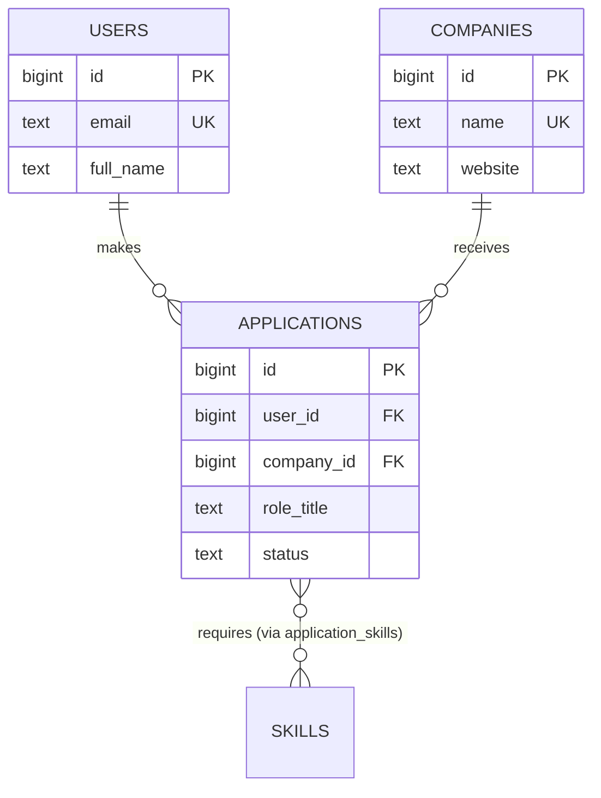
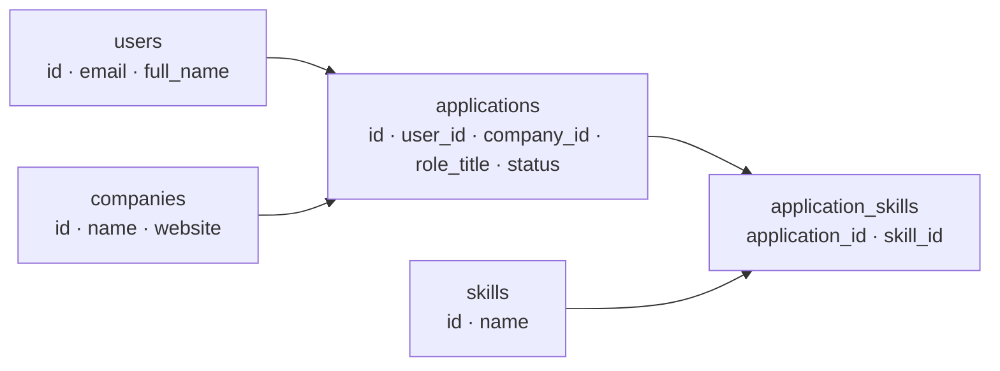

::part[Pelajari Konsepnya]{n="1"}

## 🎯 Yang akan kamu pelajari

- Proses langkah demi langkah untuk merancang schema dari kebutuhan
- **Entitas**, **atribut**, **primary key** (surrogate vs natural), dan **foreign key**
- Menggambar **diagram ER**
- **Normalisasi** (1NF, 2NF, 3NF) dengan contoh nyata — dan kapan harus **denormalisasi**
- Memakai **constraint** sebagai dokumentasi yang dipaksakan
- Konvensi: penamaan, timestamp, soft delete

## 🔤 Istilah penting

| Istilah | Artinya (sederhana) |
|---|---|
| **Schema** | Rancangan tabel, kolom, dan cara menghubungkannya |
| **Entity** | Objek yang kamu simpan (user, perusahaan, aplikasi) |
| **Primary key** | Kolom yang mengidentifikasi setiap baris secara unik |
| **Foreign key** | Kolom yang menunjuk ke baris di tabel lain |
| **ER diagram** | Gambar tabel dan cara mereka terhubung |
| **Normalisasi** | Menyimpan setiap fakta di tepat satu tempat |
| **Anomali** | Masalah akibat data ganda (update ketinggalan satu salinan) |
| **Constraint** | Aturan yang database sendiri paksakan (`NOT NULL`, `UNIQUE`, `CHECK`) |
| **Denormalisasi** | Duplikasi data sengaja demi kecepatan, dengan rencana sinkronisasi |

## 🧠 Ide besarnya

Schema itu seperti **denah rumah** datamu. Memindahkan dinding setelah orang sudah tinggal mahal; menggambarnya benar di kertas itu murah.

:term[Normalisasi]{bahasa="normalisasi — menyusun tabel agar setiap fakta disimpan di satu tempat"} adalah satu ide sederhana: **simpan setiap fakta di tepat satu tempat**. Kalau website perusahaan muncul di 500 baris, suatu hari 500 salinan itu bakal berbeda — seperti nomor telepon ditulis di 500 catatan tempel.

## ❓ Kenapa ini penting

- Aplikasi berubah, tapi data tetap. Schema yang bagus menjaga data **benar** bertahun-tahun.
- Database adalah **pertahanan terakhir**: bug di aplikasi, script, atau alat admin tidak bisa memasukkan data salah kalau constraint melarangnya.
- Struktur bagus juga membuat query lebih sederhana dan cepat.

Lihat spreadsheet pencari kerja yang langsung dimasukkan ke satu tabel:

| user_email | user_name | company | company_website | role | status | skills |
|---|---|---|---|---|---|---|
| ana@mail.com | Ana | Kopi Data | kopidata.id | Data Analyst | applied | SQL, Python |
| ana@mail.com | Ana S. | Kopi Data | www.kopidata.id | Analytics Eng | Interview | python,dbt |
| budi@mail.com | Budi | kopi data | kopidata.id | QA | aplied | |

Apa yang salah:

- **Masalah update**: Ana ganti nama → kamu harus update setiap baris, tapi satu ketinggalan ("Ana" vs "Ana S.").
- **Masalah insert**: tidak bisa catat perusahaan sampai seseorang apply ke sana.
- **Masalah delete**: hapus satu-satunya aplikasi Budi → hilang fakta bahwa Kopi Data ada.
- **Nilai tidak konsisten**: `applied` / `aplied`, `Kopi Data` / `kopi data`.
- **Banyak nilai satu sel**: "SQL, Python" tidak bisa dicari atau dihitung dengan andal.

## 📖 Langkah demi langkah

### 1. Proses desain

1. **Catat kata benda** di kebutuhan → calon **entitas** (user, perusahaan, aplikasi, skill).
2. Untuk setiap, catat **atribut** dan pilih **primary key**.
3. Temukan **relasi** dan **cardinality**-nya (one-to-many, many-to-many).
4. **Normalisasi** (di bawah).
5. Tambah **constraint**: NOT NULL, UNIQUE, CHECK, FOREIGN KEY, DEFAULT.
6. Cek dengan query nyata yang kamu butuhkan ("aplikasi per status untuk satu user").
7. Review dengan orang lain. Baru tulis SQL atau migrasi.

### 2. Kunci

| Kunci | Apa itu | Contoh |
|---|---|---|
| **Primary key (PK)** | mengidentifikasi baris secara unik; tidak boleh kosong | `applications.id` |
| **Surrogate key** | id yang dibuat tanpa arti khusus | `bigint identity`, `uuid` |
| **Natural key** | nilai unik dunia nyata | email, ISBN, NIK |
| **Foreign key (FK)** | kolom yang menunjuk ke PK tabel lain | `applications.user_id → users.id` |
| **Composite key** | PK yang terdiri dari beberapa kolom | `(user_id, skill_id)` |

Lebih suka **surrogate primary key** (nilai alami berubah — orang ganti email!) dan paksakan keunikan alami dengan `UNIQUE` constraint.

### 3. Diagram ER



`||--o{` dibaca "persis satu … ke nol atau banyak". Kamu akan implementasikan tabel junction many-to-many di materi 04.

### 4. Normalisasi dalam tiga langkah

Cara singkat mengingatnya: satu nilai per sel (1NF), setiap kolom bergantung pada kunci utuh (2NF), dan tidak ada yang bergantung pada kolom non-key lain (3NF).

**1NF — nilai atomik, tidak ada grup berulang.** Satu nilai per sel. `skills = "SQL, Python"` menjadi baris terpisah di tabel relasi `skills`.

**2NF — setiap kolom bergantung pada kunci utuh.** Di tabel dengan kunci `(application_id, skill_id)`, kolom seperti `company_name` bergantung hanya pada `application_id` → tidak cocok di sana.

**3NF — tidak ada kolom bergantung pada kolom non-key lain.** Di `applications`, `company_website` bergantung pada `company`, bukan pada aplikasi → pindahkan ke `companies`.

Cara singkat diingat: *setiap kolom non-key harus menggambarkan **kunci, kunci utuh, dan hanya kunci**.*

Spreadsheet menjadi:



Sekarang nama Ana tinggal di satu baris, perusahaan ada terpisah, dan skill bisa dihitung.

### 5. Constraint adalah dokumentasi yang tidak bisa bohong

```sql
CREATE TABLE applications (
    id          bigint GENERATED ALWAYS AS IDENTITY PRIMARY KEY,
    user_id     bigint NOT NULL REFERENCES users (id),
    company_id  bigint NOT NULL REFERENCES companies (id),
    role_title  text   NOT NULL CHECK (length(trim(role_title)) > 0),
    status      text   NOT NULL DEFAULT 'applied'
                CHECK (status IN ('wishlist', 'applied', 'interview', 'offer', 'rejected', 'withdrawn')),
    created_at  timestamptz NOT NULL DEFAULT now(),
    UNIQUE (user_id, company_id, role_title)
);
```

| Constraint | Melindungi dari |
|---|---|
| `NOT NULL` | data yang hilang |
| `UNIQUE` | duplikat (dua akun dengan satu email) |
| `CHECK` | nilai salah (`aplied`, gaji negatif) |
| `REFERENCES` (FK) | orphan (aplikasi untuk user yang tidak ada) |
| `DEFAULT` | nilai terlupakan |

**Keunikan case-insensitive untuk email**: index unik pada nilai yang diubah ke huruf kecil.

```sql
CREATE UNIQUE INDEX users_email_lower_key ON users (lower(email));
```

### 6. Konvensi

| Topik | Konvensi (pilih satu, tetap konsisten) |
|---|---|
| Nama tabel | plural `snake_case`: `users`, `job_listings` |
| Nama kolom | `snake_case`; FK bernama `<singular>_id`: `user_id` |
| Boolean | `is_…`, `has_…` |
| Timestamp | `created_at`, `updated_at` (`timestamptz`) di kebanyakan tabel |
| Nilai status | `CHECK (status IN (…))`, atau tabel lookup / enum kalau daftar bertambah |
| Penghapusan | hard `DELETE`, atau **soft delete** dengan `deleted_at timestamptz` kalau butuh history atau undo |

### 7. Kapan denormalisasi

Denormalisasi seperti menyimpan salinan daftar harga di kasir: lebih cepat dibaca, tapi harus ingat update-nya. Lakukan sengaja, bukan kebetulan.

Normalisasi mengoptimalkan **kebenaran**. Kadang kamu sengaja duplikasi data demi **kecepatan atau history**:

- Pesanan menyimpan **harga saat pembelian** (`price_ordered`), bukan hanya link ke produk — harga berubah nanti, pesanan tidak boleh.
- **Snapshot alamat pengiriman** di pesanan, karena user bisa edit alamat mereka nanti.
- Cache `applications_count` di perusahaan untuk dashboard sibuk (perbarui dengan hati-hati).

Denormalisasi **sengaja, dengan alasan tertulis** — jangan kebetulan.

### Memilih setup-mu

Setiap opsi di sini ada trade-off:

| Pilihan | ✅ | ❌ |
|---|---|---|
| Ternormalisasi (3NF) | satu sumber kebenaran, tidak ada anomali, query fleksibel | lebih banyak join |
| Denormalisasi | lebih sedikit join, baca cepat, snapshot history | data duplikat bisa melenceng; logic tulis lebih rumit |
| Surrogate PK | stabil, ringkas, join sederhana | perlu UNIQUE terpisah untuk keunikan alami |
| Natural PK | bermakna | nilai berubah; composite key panjang di mana-mana |
| `CHECK (status IN …)` | sederhana, mudah dibaca | mengubah daftar perlu migrasi |
| Tabel lookup status | data bisa diedit, bisa simpan label | join ekstra |
| Soft delete | bisa dipulihkan, bisa audit | setiap query harus filter `deleted_at IS NULL`; keunikan jadi rumit |

- ✅ Normalisasi ke 3NF secara default untuk data transaksional (user, pesanan, aplikasi).
- ✅ Snapshot nilai yang tidak boleh berubah mundur (harga, alamat di pesanan).
- 🚫 Jangan simpan daftar berpisah koma di kolom.
- 🚫 Jangan pakai `jsonb` untuk hindari desain schema untuk data yang kamu query per field.
- 🚫 Jangan over-normalize jadi puluhan tabel kecil untuk data yang tidak berubah independen.

## ⚠️ Kesalahan umum

- Simpan daftar di kolom teks (`"python, sql"`).
- Pakai email sebagai primary key.
- Tidak ada foreign key "karena aplikasi yang cek".
- Tidak ada `UNIQUE` → duplikat muncul saat dua request race.
- Status sebagai teks bebas tanpa `CHECK`.
- Hanya `timestamp` tanpa zona waktu.

:::revoshop
RevoShop penuh dengan keputusan desain nyata. Di `queries/schema.sql`, temukan `CHECK (status IN (…))` di `orders` dan check pada harga dan kuantitas. Terus lihat nama migrasi di `migrations/versions/`: `add_shipping_snapshot_to_orders`, `rebuild_order_items_as_full_model`, `add_is_active_column_to_all_tables`, `add_deleted_at_column_in_order_model`. Untuk setiap, jelaskan **prinsip desain mana** yang diterapkan (snapshot denormalisasi? soft delete?) dan **kenapa** dibutuhkan. Bisa defendnya di interview?
:::

## 🏆 Praktik terbaik

- [ ] **Desain dari query dan kebutuhan**, terus gambar ERD sebelum tulis SQL.
- [ ] Setiap tabel punya **primary key**; lebih suka `bigint identity` atau `uuid`.
- [ ] Paksakan aturan **di database** (NOT NULL, UNIQUE, CHECK, FK) — bukan hanya di kode aplikasi.
- [ ] **Namai constraint** (`CONSTRAINT applications_status_valid CHECK …`) supaya pesan error jelas.
- [ ] Keunikan case-insensitive untuk email/username (index `UNIQUE` pada `lower(email)`, atau tipe `citext`).
- [ ] Tambah `created_at` / `updated_at` (`timestamptz`, default `now()`) ke tabel bisnis.
- [ ] Simpan uang sebagai `bigint` (unit terkecil) atau `numeric`; simpan snapshot history di pesanan/invoice.
- [ ] Tentukan strategi penghapusan per tabel (hard vs soft delete) dan dokumen.
- [ ] Tetap nama konsisten dan membosankan; hindari reserved word.
- [ ] Review perubahan schema seperti kode — lewat migrasi dan pull request.

::part[Jelaskan & Rancang]{n="2"}

## 🗣️ Jelaskan

Jelaskan normalisasi ke non-programmer memakai masalah "fakta sama di banyak tempat" — misalnya, sekolah di mana setiap daftar kelas simpan nomor telepon guru.

## 📐 Rancang

Normalisasikan spreadsheet **interview tracking** CareerPilot ini ke tabel. Gambar ERD (Mermaid `erDiagram` di catatan-mu), pilih kunci, dan catat constraint:

| user_email | company | role | interview_date | interview_type | interviewer_names | result | feedback |
|---|---|---|---|---|---|---|---|
| ana@mail.com | Kopi Data | Data Analyst | 2026-09-20 10:00 | technical | "Rina, Joko" | passed | good SQL |
| ana@mail.com | Kopi Data | Data Analyst | 2026-09-27 14:00 | hr | "Maya" | pending | |

:::quiz
Lihat contoh desain

- `users(id PK, email UNIQUE lower(), full_name)`
- `companies(id PK, name UNIQUE)`
- `applications(id PK, user_id FK, company_id FK, role_title, status, UNIQUE(user_id, company_id, role_title))`
- `interviews(id PK, application_id FK NOT NULL, scheduled_at timestamptz NOT NULL, type CHECK IN ('hr','technical','system_design','final'), result CHECK IN ('pending','passed','failed') DEFAULT 'pending', feedback text)`
- `interviewers(id PK, company_id FK, name)` dan `interview_participants(interview_id FK, interviewer_id FK, PRIMARY KEY (interview_id, interviewer_id))`

Nama terpisah koma jadi relasi many-to-many (1NF), dan fakta perusahaan/role keluar dari baris interview (3NF). Kalau cuma butuh nama sebagai teks dan tidak pernah query per pewawancara, tetap `interviewer_names text[]` bisa dibenarkan — bilang saja eksplisit.
:::

### 📝 Checklist review mandiri

- [ ] Tidak ada sel multi-nilai lagi
- [ ] Setiap fakta (nama perusahaan, email user) tinggal di satu tabel
- [ ] Tanggal pakai `timestamptz`; tipe/hasil punya `CHECK`
- [ ] Saya sudah justifikasi penyederhanaan apa pun

::ai-review{task="design"}

::part[Latihan Kecil]{n="3"}

:::exercise{path="exercises/m2/w2/02-schema-design" ai="no-ai" title="Schema inti CareerPilot"}
Tulis `schema.sql` dengan tabel `users`, `companies`, dan `applications` untuk CareerPilot Phase 2. README catat setiap aturan. Test tidak peduli SQL persis-mu — mereka **coba insert data bagus dan buruk** dan cek bahwa PostgreSQL terima atau tolak.
:::

:::hints
- Buat tabel urutan dependensi: `users` dan `companies` sebelum `applications`.
- Email unik case-insensitive: `CREATE UNIQUE INDEX … ON users (lower(email));`
- Satu aplikasi per user, perusahaan, role: `UNIQUE (user_id, company_id, role_title)` level tabel.
- `salary_expectation bigint CHECK (salary_expectation >= 0)` masih izinkan `NULL` — itu sengaja.
:::

### 🏆 Tantangan tambahan

Tambah tabel `application_status_history` (aplikasi, status lama, status baru, changed_at) dan tulis di catatan-mu bagaimana aplikasi insert baris setiap kali status berubah.

## ✅ Cek cepat

:::quiz
Apa itu update anomaly?

Saat fakta sama disimpan di beberapa baris, dan update memerlukan ubah semuanya — kalau satu ketinggalan, data saling bertentangan.
:::

:::quiz
Kenapa lebih suka surrogate primary key daripada pakai email sebagai kunci?

Email berubah, dan setiap foreign key harus berubah. ID yang dibuat hindari itu; keunikan email tetap dipaksakan dengan `UNIQUE` constraint.
:::

:::quiz
Beri satu alasan bagus untuk denormalisasi.

Untuk simpan snapshot history yang tidak boleh berubah (contoh harga produk di pesanan), atau percepat path baca panas — dilakukan sengaja dan didokumen.
:::


## 📚 Lanjut belajar

- [PostgreSQL docs: Constraints](https://www.postgresql.org/docs/current/ddl-constraints.html)
- [Mermaid: Entity Relationship Diagrams](https://mermaid.js.org/syntax/entityRelationshipDiagram.html)
