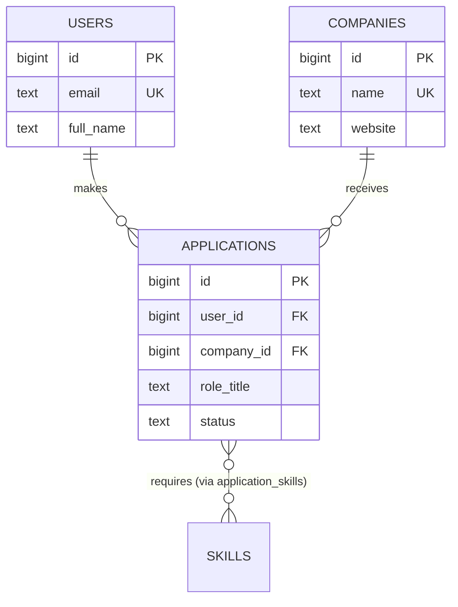
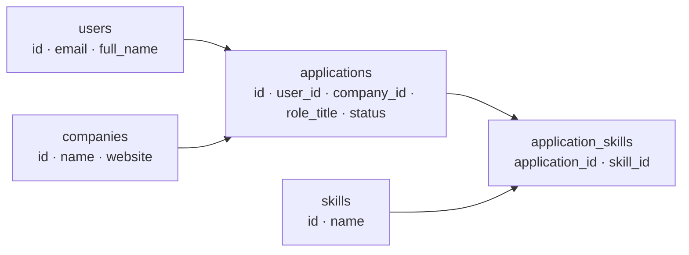

::part[Learn the Concept]{n="1"}

## 🎯 What you'll learn

- A step-by-step process to design a schema from requirements
- **Entities**, **attributes**, **primary keys** (surrogate vs natural) and **foreign keys**
- Drawing an **ER diagram**
- **Normalization** (1NF, 2NF, 3NF) explained with a real example — and when to **denormalize**
- Using **constraints** as enforced documentation
- Conventions: naming, timestamps, soft deletes

## 🔤 Key words

| Word | In simple words | Bahasa Indonesia |
|---|---|---|
| **Schema** | The design of your tables, columns and links | Rancangan tabel |
| **Entity** | A thing you store (user, company, application) | Objek yang disimpan |
| **Primary key** | The column that identifies each row uniquely | Penanda unik baris |
| **Foreign key** | A column pointing at another table's row | Penunjuk ke tabel lain |
| **ER diagram** | A picture of tables and how they connect | Diagram hubungan tabel |
| **Normalization** | Storing each fact in exactly one place | Menata agar tidak berulang |
| **Anomaly** | A problem caused by duplicated data (updates that miss a copy) | Masalah akibat data ganda |
| **Constraint** | A rule the database itself enforces (`NOT NULL`, `UNIQUE`, `CHECK`) | Aturan yang dipaksakan database |
| **Denormalization** | Deliberately duplicating data for speed, with a plan to keep it in sync | Duplikasi sengaja demi kecepatan |

## 🧠 The big idea

A schema is the **floor plan** of your data. Moving a wall after people already live in the house is expensive; drawing it correctly on paper is cheap.

:term[Normalization]{bahasa="normalisasi — menata tabel agar setiap fakta disimpan tepat di satu tempat"} is one simple idea: **store each fact in exactly one place**. If a company's website appears in 500 rows, one day those 500 copies will disagree — like a phone number written on 500 sticky notes.

## ❓ Why it matters

- Apps outlive their first version, and data outlives apps. A good schema keeps data **correct** for years.
- The database is the **last line of defence**: a bug in any app, script or admin tool can't insert invalid data if a constraint forbids it.
- Good structure also makes queries simpler and faster.

Here's a job hunter's spreadsheet turned straight into one table:

| user_email | user_name | company | company_website | role | status | skills |
|---|---|---|---|---|---|---|
| ana@mail.com | Ana | Kopi Data | kopidata.id | Data Analyst | applied | SQL, Python |
| ana@mail.com | Ana S. | Kopi Data | www.kopidata.id | Analytics Eng | Interview | python,dbt |
| budi@mail.com | Budi | kopi data | kopidata.id | QA | aplied | |

What goes wrong:

- **Update problem**: Ana changes her name → you must update every row, and one gets missed ("Ana" vs "Ana S.").
- **Insert problem**: you can't record a company until somebody applies there.
- **Delete problem**: delete Budi's only application → you lose the fact that Kopi Data exists.
- **Inconsistent values**: `applied` / `aplied`, `Kopi Data` / `kopi data`.
- **Many values in one cell**: "SQL, Python" can't be searched or counted reliably.

## 📖 Step by step

### 1. The design process

1. **List the nouns** in the requirements → candidate **entities** (users, companies, applications, skills).
2. For each, list **attributes** and pick a **primary key**.
3. Find **relationships** and their **cardinality** (one-to-many, many-to-many).
4. **Normalize** (below).
5. Add **constraints**: NOT NULL, UNIQUE, CHECK, FOREIGN KEY, DEFAULT.
6. Check against real **queries** you'll need ("applications per status for a user").
7. Review with someone. Then write the SQL/migration.

### 2. Keys

| Key | What | Example |
|---|---|---|
| **Primary key (PK)** | uniquely identifies a row; never null | `applications.id` |
| **Surrogate key** | meaningless generated id | `bigint identity`, `uuid` |
| **Natural key** | a real-world unique value | email, ISBN, NIK |
| **Foreign key (FK)** | a column pointing to another table's PK | `applications.user_id → users.id` |
| **Composite key** | PK made of several columns | `(user_id, skill_id)` |

Prefer **surrogate primary keys** (natural values change — people change emails!) and enforce natural uniqueness with a `UNIQUE` constraint.

### 3. ER diagram



`||--o{` reads "exactly one … to zero or many". You'll implement many-to-many junction tables in lesson 04.

### 4. Normalization in three steps

A short way to remember it: one value per cell (1NF), every column depends on the whole key (2NF), and nothing depends on another non-key column (3NF).

**1NF — atomic values, no repeating groups.** One value per cell. `skills = "SQL, Python"` becomes separate rows in a `skills` relationship table.

**2NF — every column depends on the whole key.** In a table keyed by `(application_id, skill_id)`, a column like `company_name` depends only on `application_id` → it doesn't belong there.

**3NF — no column depends on another non-key column.** In `applications`, `company_website` depends on `company`, not on the application → move it to `companies`.

Short version to remember: *every non-key column must describe **the key, the whole key, and nothing but the key**.*

The spreadsheet becomes:



Now Ana's name lives in one row, companies exist independently, and skills are countable.

### 5. Constraints are documentation that can't lie

```sql
CREATE TABLE applications (
    id          bigint GENERATED ALWAYS AS IDENTITY PRIMARY KEY,
    user_id     bigint NOT NULL REFERENCES users (id),
    company_id  bigint NOT NULL REFERENCES companies (id),
    role_title  text   NOT NULL CHECK (length(trim(role_title)) > 0),
    status      text   NOT NULL DEFAULT 'applied'
                CHECK (status IN ('wishlist', 'applied', 'interview', 'offer', 'rejected', 'withdrawn')),
    created_at  timestamptz NOT NULL DEFAULT now(),
    UNIQUE (user_id, company_id, role_title)
);
```

| Constraint | Protects against |
|---|---|
| `NOT NULL` | missing required data |
| `UNIQUE` | duplicates (two accounts with one email) |
| `CHECK` | invalid values (`aplied`, negative salary) |
| `REFERENCES` (FK) | orphans (an application for a user that doesn't exist) |
| `DEFAULT` | forgotten values |

**Case-insensitive uniqueness** for emails: a unique index on the lowercased value.

```sql
CREATE UNIQUE INDEX users_email_lower_key ON users (lower(email));
```

### 6. Conventions

| Topic | Convention (pick one and be consistent) |
|---|---|
| Table names | plural `snake_case`: `users`, `job_listings` |
| Column names | `snake_case`; FKs named `<singular>_id`: `user_id` |
| Booleans | `is_…`, `has_…` |
| Timestamps | `created_at`, `updated_at` (`timestamptz`) on most tables |
| Status values | `CHECK (status IN (…))`, or a lookup table / enum when the list grows |
| Deletion | hard `DELETE`, or **soft delete** with `deleted_at timestamptz` when you need history/undo |

### 7. When to denormalize

Denormalizing is like keeping a copy of the price list at the counter: faster to read, but now you must remember to update it. Do it on purpose, never by accident.

Normalization optimizes **correctness**. Sometimes you deliberately duplicate data for **speed or history**:

- An order stores the **price at purchase time** (`price_ordered`), not just a link to the product — prices change later, orders must not.
- A shipping **address snapshot** on the order, because the user may edit their address book later.
- A cached `applications_count` on companies for a busy dashboard (keep it updated carefully).

Denormalize **on purpose, with a reason written down** — never by accident.

### Choosing your setup

Every option here is a trade-off:

| Choice | ✅ | ❌ |
|---|---|---|
| Normalized (3NF) | one source of truth, no anomalies, flexible queries | more joins |
| Denormalized | fewer joins, faster reads, historical snapshots | duplicated data can drift; more write logic |
| Surrogate PK | stable, compact, simple joins | needs a separate UNIQUE for natural uniqueness |
| Natural PK | meaningful | values change; long composite keys everywhere |
| `CHECK (status IN …)` | simple, readable | changing the list needs a migration |
| Lookup table for statuses | editable data, can store labels | extra join |
| Soft delete | recoverable, auditable | every query must filter `deleted_at IS NULL`; uniqueness gets tricky |

- ✅ Normalize to 3NF by default for transactional data (users, orders, applications).
- ✅ Snapshot values that must not change retroactively (prices, addresses on orders).
- 🚫 Don't put comma-separated lists in a column.
- 🚫 Don't use `jsonb` to avoid designing a schema for data you query by field.
- 🚫 Don't over-normalize into dozens of tiny tables for data that never changes independently.

## ⚠️ Common mistakes

- Storing lists in text columns (`"python, sql"`).
- Using email as the primary key.
- Missing foreign keys "because the app checks it".
- No `UNIQUE` → duplicates appear the first time two requests race.
- Statuses as free text without a `CHECK`.
- Only `timestamp` without time zone.

:::revoshop
RevoShop is full of real design decisions. In `queries/schema.sql`, find the `CHECK (status IN (…))` on `orders` and the checks on prices and quantities. Then look at the migration names in `migrations/versions/`: `add_shipping_snapshot_to_orders`, `rebuild_order_items_as_full_model`, `add_is_active_column_to_all_tables`, `add_deleted_at_column_in_order_model`. For each, explain **which design principle** it applies (denormalized snapshot? soft delete?) and **why** it was needed. Could you defend these choices in an interview?
:::

## 🏆 Best practices

- [ ] **Design from queries and requirements**, then draw an ERD before writing SQL.
- [ ] Every table has a **primary key**; prefer `bigint identity` or `uuid`.
- [ ] Enforce rules **in the database** (NOT NULL, UNIQUE, CHECK, FK) — not only in application code.
- [ ] **Name constraints** (`CONSTRAINT applications_status_valid CHECK …`) so error messages are clear.
- [ ] Case-insensitive uniqueness for emails/usernames (`UNIQUE` index on `lower(email)`, or the `citext` type).
- [ ] Add `created_at` / `updated_at` (`timestamptz`, default `now()`) to business tables.
- [ ] Store money as `bigint` (smallest unit) or `numeric`; store historical snapshots on orders/invoices.
- [ ] Decide deletion strategy per table (hard vs soft delete) and document it.
- [ ] Keep names consistent and boring; avoid reserved words.
- [ ] Review schema changes like code — through migrations and pull requests.

::part[Explain & Design]{n="2"}

## 🗣️ Explain it

Explain normalization to a non-programmer using the "same fact in many places" problem — for example, a school where each class list stores the teacher's phone number.

## 📐 Design it

Normalize this CareerPilot **interview tracking** spreadsheet into tables. Draw the ERD (Mermaid `erDiagram` in your notes), choose keys, and list the constraints:

| user_email | company | role | interview_date | interview_type | interviewer_names | result | feedback |
|---|---|---|---|---|---|---|---|
| ana@mail.com | Kopi Data | Data Analyst | 2026-09-20 10:00 | technical | "Rina, Joko" | passed | good SQL |
| ana@mail.com | Kopi Data | Data Analyst | 2026-09-27 14:00 | hr | "Maya" | pending | |

:::quiz
Show a possible design

- `users(id PK, email UNIQUE lower(), full_name)`
- `companies(id PK, name UNIQUE)`
- `applications(id PK, user_id FK, company_id FK, role_title, status, UNIQUE(user_id, company_id, role_title))`
- `interviews(id PK, application_id FK NOT NULL, scheduled_at timestamptz NOT NULL, type CHECK IN ('hr','technical','system_design','final'), result CHECK IN ('pending','passed','failed') DEFAULT 'pending', feedback text)`
- `interviewers(id PK, company_id FK, name)` and `interview_participants(interview_id FK, interviewer_id FK, PRIMARY KEY (interview_id, interviewer_id))`

The comma-separated names become a many-to-many relationship (1NF), and company/role facts move out of the interview rows (3NF). If you only ever need names as text and never query by interviewer, keeping `interviewer_names text[]` is a defensible simplification — say so explicitly.
:::

### 📝 Self-review checklist

- [ ] No multi-value cells remain
- [ ] Each fact (company name, user email) lives in one table
- [ ] Dates use `timestamptz`; types/results have `CHECK`s
- [ ] I justified any simplification

::ai-review{task="design"}

::part[Toy Exercise]{n="3"}

:::exercise{path="exercises/m2/w2/02-schema-design" ai="no-ai" title="CareerPilot core schema"}
Write `schema.sql` with the `users`, `companies` and `applications` tables for CareerPilot Phase 2. The README lists every rule. The tests don't care about your exact SQL — they **try to insert good and bad data** and check that PostgreSQL accepts or rejects it.
:::

:::hints
- Create tables in dependency order: `users` and `companies` before `applications`.
- Case-insensitive unique email: `CREATE UNIQUE INDEX … ON users (lower(email));`
- One application per user, company and role: a table-level `UNIQUE (user_id, company_id, role_title)`.
- `salary_expectation bigint CHECK (salary_expectation >= 0)` still allows `NULL` — that's intended.
:::

### 🏆 Stretch goal

Add an `application_status_history` table (application, old status, new status, changed_at) and write, in your notes, how the app would insert a row every time the status changes.

## ✅ Quick check

:::quiz
What's an update anomaly?

When the same fact is stored in several rows, and updating it requires changing all of them — if one is missed, the data contradicts itself.
:::

:::quiz
Why prefer a surrogate primary key over using email as the key?

Emails change, and every foreign key would have to change with them. A stable generated id avoids that; uniqueness of email is still enforced with a `UNIQUE` constraint.
:::

:::quiz
Give one good reason to denormalize.

To keep a historical snapshot that must not change (e.g. the product price stored on an order), or to speed up a hot read path — done deliberately and documented.
:::


## 📚 Keep learning

- [PostgreSQL docs: Constraints](https://www.postgresql.org/docs/current/ddl-constraints.html)
- [Mermaid: Entity Relationship Diagrams](https://mermaid.js.org/syntax/entityRelationshipDiagram.html)
