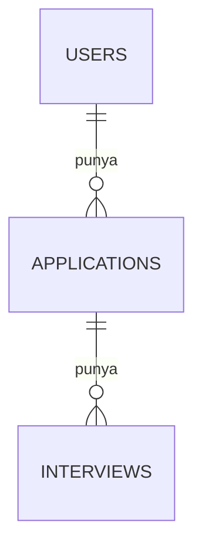
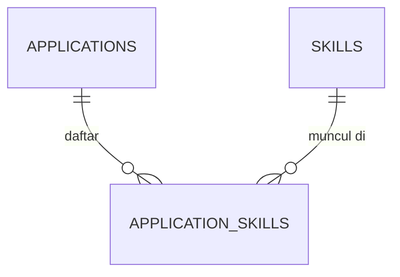

::part[Pelajari Konsepnya]{n="1"}

## 🎯 Yang akan kamu pelajari

- Tiga bentuk hubungan: **satu ke banyak**, **banyak ke banyak**, **satu ke satu**
- Bagaimana **foreign key** menjamin **integritas referensial**
- Pilihan `ON DELETE` — `CASCADE`, `RESTRICT`, `SET NULL` — dan cara memilihnya
- Tabel penghubung dengan **kunci gabungan** dan kolom tambahan
- Hubungan yang menunjuk ke diri sendiri (self-referencing)
- Kenapa kolom foreign key perlu **indeks**

## 🔤 Istilah penting

| Istilah | Artinya (sederhana) |
|---|---|
| **Hubungan** | Tautan antar baris di dua tabel |
| **Satu ke banyak** | Satu user punya banyak application |
| **Banyak ke banyak** | Job butuh banyak skill; satu skill cocok untuk banyak job |
| **Tabel penghubung** | Tabel di tengah yang menyimpan tautan banyak ke banyak |
| **Kunci gabungan** | Kunci dibuat dari dua kolom bersamaan |
| **Integritas referensial** | Jaminan bahwa setiap tautan menunjuk baris yang benar-benar ada |
| **Baris menggantung** | Baris yang menunjuk sesuatu yang sudah dihapus |
| **`ON DELETE CASCADE`** | Hapus induk, anak ikut hilang |

## 🧠 Ide besarnya

:term[Foreign key]{bahasa="foreign key — kolom yang harus berisi id yang benar-benar ada di tabel lain"} itu **tautan yang harus menunjuk sesuatu yang nyata** — seperti nomor kartu anggota perpustakaan yang harus milik orang yang benar-benar terdaftar.

Database kemudian menolak:

- menambah kartu untuk anggota yang tidak ada (**baris menggantung**),
- dan, tergantung aturan pilihan kamu, menghapus anggota yang masih punya buku pinjam.

## ❓ Kenapa ini penting

Data saling terhubung: user punya application, application punya interview, job butuh skill. Tanpa referensi yang dijaga, kamu dapat **baris menggantung** (interview untuk application yang sudah dihapus), **halaman error** (perusahaan yang sudah tidak ada), dan kehilangan data atau sisa-sisa ketika sesuatu dihapus.

Contoh nyata:

- Bug menghapus perusahaan; 300 application sekarang menunjuk `company_id = 17`, yang tidak ada lagi, dan halaman application crash.
- User menghapus akun, tapi CV, interview, dan catatan mereka tetap selamanya — masalah **privasi**.
- Dua request menyimpan skill link yang sama di saat bersamaan → baris duplikat menggelembungkan hitungan "top skills".

## 📖 Langkah demi langkah

### 1. Satu ke banyak (paling sering)

Satu user → banyak application. Taruh foreign key di sisi **"banyak"**.

```sql
CREATE TABLE applications (
    id       bigint GENERATED ALWAYS AS IDENTITY PRIMARY KEY,
    user_id  bigint NOT NULL REFERENCES users (id) ON DELETE CASCADE,
    ...
);
```



### 2. Banyak ke banyak: tabel penghubung

Tabel penghubung adalah **lembar kehadiran** antar dua daftar: satu baris per pasangan, plus fakta tentang pasangan itu (kapan disimpan, seberapa penting skill-nya).

Application butuh banyak skill; satu skill muncul di banyak application. Tidak ada tabel yang bisa menampung id tabel lain — jadi tambah tabel **di tengah**:

```sql
CREATE TABLE application_skills (
    application_id bigint NOT NULL REFERENCES applications (id) ON DELETE CASCADE,
    skill_id       bigint NOT NULL REFERENCES skills (id) ON DELETE RESTRICT,
    level          text   NOT NULL CHECK (level IN ('nice_to_have', 'required')),
    PRIMARY KEY (application_id, skill_id)          -- no duplicate links
);
```



Tabel penghubung bisa membawa **fakta tentang hubungan** (`level`, `added_at`) — hubungan sendiri jadi hal yang utama (first-class).

### 3. Satu ke satu

User punya **nol atau satu** profile. Buat foreign key jadi **kunci utama** (atau tambah `UNIQUE`):

```sql
CREATE TABLE user_profiles (
    user_id  bigint PRIMARY KEY REFERENCES users (id) ON DELETE CASCADE,
    headline text
);
```

Kenapa pisah daripada tambah kolom ke `users`? Data opsional atau jarang dipakai, aturan akses berbeda (data sensitif), atau kolom sangat besar.

### 4. Menunjuk ke diri sendiri (self-referencing)

Komentar balas komentar, karyawan melapor ke manajer:

```sql
CREATE TABLE comments (
    id        bigint GENERATED ALWAYS AS IDENTITY PRIMARY KEY,
    parent_id bigint REFERENCES comments (id) ON DELETE CASCADE,  -- NULL = top-level
    body      text NOT NULL
);
```

(Query thread bersarang pakai recursive CTE — dan rekursi dari DSA Stage 1!)

### 5. ON DELETE: tentukan arti menghapus induk

Ini keputusan bisnis, bukan teknis: menghapus user *harus* hapus catatan pribadi mereka (cascade), tapi jangan hapus silent invoice yang sudah dibayar (restrict).

| Pilihan | Ketika baris induk dihapus… | Bagus untuk |
|---|---|---|
| `CASCADE` | anak dihapus juga | hal yang **punya** induk: application user, interview application |
| `RESTRICT` / `NO ACTION` (bawaan) | hapus **gagal** selama ada anak | data referensi bersama: perusahaan, skill, produk di pesanan lama |
| `SET NULL` | anak tetap, FK jadi `NULL` | tautan opsional: `assigned_recruiter_id` ketika recruiter pergi |
| `SET DEFAULT` | FK jadi default-nya | jarang |

:::warning[CASCADE kuat]
Satu `DELETE FROM users WHERE id = 7` bisa hapus ribuan baris di banyak tabel. Tepat untuk "hapus akun saya" — dan bencana di tabel yang salah. Pilih per hubungan, dan pikirkan **soft delete** kalau riwayat penting.
:::

### 6. Indeks foreign key kamu

PostgreSQL indeks kunci utama untuk kamu, tapi bukan kolom yang menunjuk — jadi "semua application untuk user 7" scan seluruh tabel sampai kamu indeks sendiri.

PostgreSQL otomatis indeks **kunci utama** dan **unique constraint**, tapi **bukan** kolom foreign key. Tanpa indeks:

- `SELECT … WHERE user_id = 7` scan seluruh tabel,
- dan setiap `DELETE` di induk harus scan tabel anak untuk cek atau cascade.

```sql
CREATE INDEX applications_user_id_idx ON applications (user_id);
```

Kunci gabungan `(application_id, skill_id)` sudah cover lookup `application_id` (kolom pertama), tapi **tidak** `skill_id` sendiri.

### 7. Join antar hubungan (preview lesson 05)

```sql
SELECT a.role_title, s.name AS skill, x.level
FROM applications a
JOIN application_skills x ON x.application_id = a.id
JOIN skills s ON s.id = x.skill_id
WHERE a.user_id = 7;
```

### Pilih setup kamu

Setiap pilihan di sini adalah trade-off:

| Pilihan | ✅ | ❌ |
|---|---|---|
| Foreign key dijaga | integritas terjamin setiap penulis | overhead tulis kecil; data harus disisipkan berurutan |
| Tanpa FK ("app cek") | bulk load sedikit lebih cepat | baris menggantung muncul nanti; bug rusak data |
| `CASCADE` | cleanup otomatis, account delete sederhana | delete massal tak sengaja |
| `RESTRICT` | lindungi data bersama | kamu harus cleanup anak manual |
| Tabel penghubung | fleksibel, bisa simpan data hubungan | satu join ekstra |
| Kolom array (`skill_ids bigint[]`) | tabel lebih sedikit | tidak ada FK enforce, query dan count lebih susah |

- ✅ Tambah foreign key untuk **setiap** hubungan nyata di data transaksional.
- ✅ `CASCADE` untuk anak punya; `RESTRICT` untuk data bersama/referensi; `SET NULL` untuk tautan opsional.
- 🚫 Jangan model banyak ke banyak pakai id berkomak atau array kalau kamu perlu query atau enforce.
- 🚫 Jangan lupa data warehouse dan sistem skala sangat tinggi skip FK sengaja — itu pengecualian informed, bukan default.

## ⚠️ Kesalahan umum

- Lupa indeks di kolom FK.
- `CASCADE` di data bersama (hapus skill hapus dari setiap application).
- Tabel penghubung banyak ke banyak tanpa unique constraint.
- FK nullable padahal hubungan wajib.
- Dependency sirkular yang bikin disisipkan data mustahil tanpa defer constraint.

:::revoshop
Di `queries/schema.sql` RevoShop, temukan setiap `FOREIGN KEY … REFERENCES` dan empat baris `CREATE INDEX` di bawah — mereka indeks persis kolom foreign key. Sekarang cek model di `app/models/` (misal `orders.py`, `carts.py`): pilihan `ondelete=` atau `cascade=` apa yang kamu pakai? Apa yang seharusnya terjadi ke **carts**, **addresses**, dan **orders** user saat akun dihapus — dan apakah kode kamu lakukan itu? Kenapa order mungkin butuh `RESTRICT` + soft delete daripada `CASCADE`?
:::

## 🏆 Praktik terbaik

- [ ] Deklarasikan foreign key untuk setiap hubungan; beri nama kolom `<singular>_id`.
- [ ] Pilih `ON DELETE` **dengan sengaja** untuk setiap FK dan dokumentasikan kenapa.
- [ ] **Indeks setiap kolom foreign key** yang bukan kolom pertama indeks yang ada.
- [ ] Pakai **kunci gabungan** (atau `UNIQUE`) di tabel penghubung cegah duplikat tautan.
- [ ] Jaga rekam sejarah (order, invoice) aman dari cascade — pakai `RESTRICT` dan/atau soft delete, plus snapshot.
- [ ] Model satu ke satu dengan FK jadi kunci utama (atau `UNIQUE`).
- [ ] Test jalur delete (hapus akun, hapus perusahaan) — gampang salah.
- [ ] Untuk request "hapus data saya" gaya GDPR, daftar setiap tabel punya data personal dan cara dihapus.

::part[Jelaskan & Rancang]{n="2"}

## 🗣️ Jelaskan

Jelaskan ke non-programmer kenapa toko online jangan hapus order lama ketika produk dihapus dari katalog, tapi harus hapus shopping cart user saat akun dihapus. Hubungkan ke `RESTRICT` dan `CASCADE`.

## 📐 Rancang

Rancang hubungan untuk **SupportDesk AI** (preview Module 7): customer, conversation, message, help article, article chunk (untuk cari AI), dan artikel mana yang **dikutip** di setiap AI message. Untuk setiap foreign key, pilih `ON DELETE` dan jelaskan.

:::quiz
Tunjukkan desain mungkin

| Tabel | Foreign key | ON DELETE | Kenapa |
|---|---|---|---|
| `conversations` | `customer_id → customers` | `CASCADE` | conversation punya customer (privacy delete) |
| `messages` | `conversation_id → conversations` | `CASCADE` | punya conversation |
| `article_chunks` | `article_id → help_articles` | `CASCADE` | chunk data turunan; dibuat ulang saat edit |
| `message_citations` (penghubung) | `message_id → messages`, `chunk_id → article_chunks` | `CASCADE` / `SET NULL`* | citation link punya message; *kalau chunk sering dibuat ulang, simpan citation dengan `SET NULL` plus text snapshot apa yang dikutip |
| `conversations` | `assigned_agent_id → agents` (nullable) | `SET NULL` | kalau agent pergi, conversation tetap |

Kunci gabungan di `message_citations (message_id, chunk_id)`; indeks di setiap FK. Simpan **snapshot** teks dikutip jaga jawaban audit bahkan setelah artikel berubah.
:::

### 📝 Checklist self-review

- [ ] Setiap hubungan punya pilihan `ON DELETE` eksplisit dengan alasan
- [ ] Banyak ke banyak pakai tabel penghubung dengan kunci gabungan
- [ ] Saya pertimbangkan audit (apa yang dikutip AI) dan privasi (delete customer)

::ai-review{task="design"}

::part[Latihan Kecil]{n="3"}

:::exercise{path="exercises/m2/w2/04-relationships" ai="no-ai" title="Hubungan & aturan ON DELETE"}
Tambahkan `applications`, `skills`, `application_skills`, `interviews`, dan `user_profiles` di atas `base.sql` yang diberikan. Test sisipkan data terhubung lalu **hapus** user, perusahaan, application, dan skill untuk cek cascade dan restriction berperilaku persis sesuai spesifikasi — dan cek setiap foreign key punya indeks.
:::

:::hints
- `REFERENCES users (id) ON DELETE CASCADE`
- Kunci gabungan: `PRIMARY KEY (application_id, skill_id)`
- Satu ke satu: `user_id bigint PRIMARY KEY REFERENCES users (id) …`
- Kolom FK mana sudah kolom **pertama** kunci utama? Yang tidak perlu indeks ekstra.
:::

### 🏆 Target tambahan

Tulis query yang daftar, untuk user Ana, setiap application dengan daftar skill **required** dipisahkan komak: `string_agg(s.name, ', ' ORDER BY s.name)`.

## ✅ Cek cepat

:::quiz
Foreign key masuk di mana di hubungan satu ke banyak?

Di sisi "banyak": `applications.user_id` referensi `users.id`.
:::

:::quiz
Kenapa indeks kunci utama otomatis PostgreSQL tidak bantu query `application_skills.skill_id`?

Indeks `(application_id, skill_id)` urut `application_id` dulu; cari kolom kedua sendiri tidak bisa pakai efisien. Tambah indeks `skill_id`.
:::

:::quiz
Pilihan `ON DELETE` apa yang pakai untuk `orders.product_id`, dan kenapa?

`RESTRICT` (plus soft-delete produk) — order lama adalah rekam bisnis dan tidak boleh hilang atau putus referensi product saat katalog berubah.
:::

## 📚 Lanjut belajar

- [PostgreSQL docs: Foreign key](https://www.postgresql.org/docs/current/ddl-constraints.html#DDL-CONSTRAINTS-FK)
- [PostgreSQL docs: Indeks dan foreign key (Tipe Indeks)](https://www.postgresql.org/docs/current/indexes-types.html)
