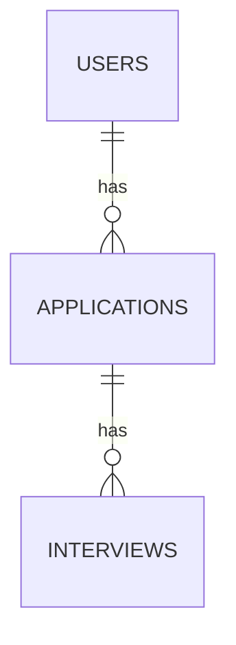
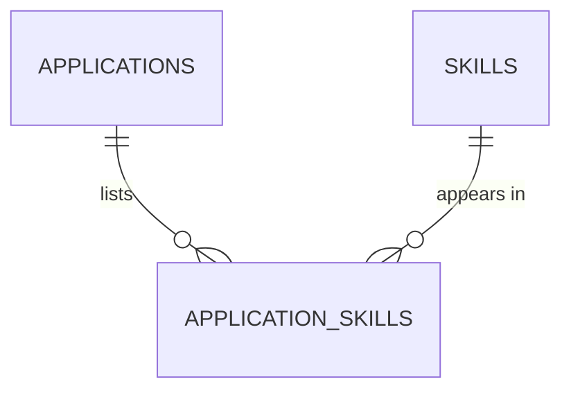

::part[Learn the Concept]{n="1"}

## 🎯 What you'll learn

- The three relationship shapes: **one-to-many**, **many-to-many**, **one-to-one**
- How **foreign keys** enforce **referential integrity**
- `ON DELETE` options — `CASCADE`, `RESTRICT`, `SET NULL` — and how to choose
- Junction tables with **composite primary keys** and extra columns
- Self-referencing relationships
- Why foreign key columns need **indexes**

## 🔤 Key words

| Word | In simple words | Bahasa Indonesia |
|---|---|---|
| **Relationship** | A link between rows in two tables | Hubungan antar tabel |
| **One-to-many** | One user has many applications | Satu ke banyak |
| **Many-to-many** | Jobs need many skills; a skill fits many jobs | Banyak ke banyak |
| **Junction table** | The in-between table that stores a many-to-many link | Tabel penghubung |
| **Composite primary key** | A key made of two columns together | Kunci gabungan |
| **Referential integrity** | The guarantee that every link points at a row that exists | Jaminan tautan valid |
| **Orphan row** | A row pointing at something that was deleted | Baris menggantung |
| **`ON DELETE CASCADE`** | Delete the parent and its children go too | Hapus induk, anak ikut terhapus |
| **`ON DELETE RESTRICT`** | Refuse to delete a parent that still has children | Tolak hapus jika masih ada anak |
| **`ON DELETE SET NULL`** | Keep the child but forget the link | Simpan anak, hapus tautannya |

## 🧠 The big idea

A :term[foreign key]{bahasa="foreign key — kolom yang harus berisi id yang benar-benar ada di tabel lain"} is a **reference that must point to something real** — like a library card number that must belong to an actual member.

The database then refuses to:

- add a card for a member who doesn't exist (an **orphan**),
- and, depending on the rule you choose, delete a member who still has borrowed books.

## ❓ Why it matters

Data is connected: users have applications, applications have interviews, jobs require skills. Without enforced references you get **orphans** (interviews belonging to deleted applications), **broken pages** (a company that no longer exists), and either silent data loss or leftovers when something is deleted.

Concretely:

- A bug deletes a company; 300 applications now point at `company_id = 17`, which doesn't exist, and the applications page crashes.
- A user deletes their account, but their CVs, interviews and notes stay forever — a **privacy** problem.
- Two requests save the same skill link at the same moment → duplicate rows inflate the "top skills" counts.

## 📖 Step by step

### 1. One-to-many (the most common)

One user → many applications. Put the foreign key on the **"many"** side.

```sql
CREATE TABLE applications (
    id       bigint GENERATED ALWAYS AS IDENTITY PRIMARY KEY,
    user_id  bigint NOT NULL REFERENCES users (id) ON DELETE CASCADE,
    ...
);
```



### 2. Many-to-many: a junction table

A junction table is the **attendance sheet** between two lists: one line per pairing, plus extra facts about that pairing (when it was saved, how important the skill is).

An application requires many skills; a skill appears in many applications. Neither table can hold the other's id — so add a table **in between**:

```sql
CREATE TABLE application_skills (
    application_id bigint NOT NULL REFERENCES applications (id) ON DELETE CASCADE,
    skill_id       bigint NOT NULL REFERENCES skills (id) ON DELETE RESTRICT,
    level          text   NOT NULL CHECK (level IN ('nice_to_have', 'required')),
    PRIMARY KEY (application_id, skill_id)          -- no duplicate links
);
```



The junction table can carry **facts about the relationship** (`level`, `added_at`) — the relationship itself becomes a first-class thing.

### 3. One-to-one

A user has **zero or one** profile. Make the foreign key the **primary key** (or add `UNIQUE`):

```sql
CREATE TABLE user_profiles (
    user_id  bigint PRIMARY KEY REFERENCES users (id) ON DELETE CASCADE,
    headline text
);
```

Why split instead of adding columns to `users`? Optional or rarely-used data, different access rules (sensitive data), or very large columns.

### 4. Self-referencing

A comment replying to a comment, an employee reporting to a manager:

```sql
CREATE TABLE comments (
    id        bigint GENERATED ALWAYS AS IDENTITY PRIMARY KEY,
    parent_id bigint REFERENCES comments (id) ON DELETE CASCADE,  -- NULL = top-level
    body      text NOT NULL
);
```

(Querying nested threads uses recursive CTEs — and recursion from DSA Stage 1!)

### 5. ON DELETE: decide what deleting a parent means

This is a business decision, not a technical one: deleting a user *should* remove their private notes (cascade), but must not silently erase paid invoices (restrict).

| Option | When the parent row is deleted… | Good for |
|---|---|---|
| `CASCADE` | children are deleted too | things that **belong** to the parent: a user's applications, an application's interviews |
| `RESTRICT` / `NO ACTION` (default) | the delete **fails** while children exist | shared reference data: companies, skills, products in past orders |
| `SET NULL` | children stay, FK set to `NULL` | optional links: `assigned_recruiter_id` when a recruiter leaves |
| `SET DEFAULT` | FK set to its default | rare |

:::warning[CASCADE is powerful]
One `DELETE FROM users WHERE id = 7` can remove thousands of rows across many tables. That's exactly right for "delete my account" — and a disaster on the wrong table. Choose per relationship, and consider **soft delete** where history matters.
:::

### 6. Index your foreign keys

PostgreSQL indexes the primary key for you, but not the column pointing at it — so "all applications for user 7" scans the whole table until you add that index yourself.

PostgreSQL automatically indexes **primary keys** and **unique constraints**, but **not** foreign key columns. Without an index:

- `SELECT … WHERE user_id = 7` scans the whole table,
- and every `DELETE` on the parent must scan the child table to check or cascade.

```sql
CREATE INDEX applications_user_id_idx ON applications (user_id);
```

A composite primary key `(application_id, skill_id)` already covers lookups by `application_id` (the first column), but **not** by `skill_id` alone.

### 7. Joining across a relationship (preview of lesson 05)

```sql
SELECT a.role_title, s.name AS skill, x.level
FROM applications a
JOIN application_skills x ON x.application_id = a.id
JOIN skills s ON s.id = x.skill_id
WHERE a.user_id = 7;
```

### Choosing your setup

Every option here is a trade-off:

| Choice | ✅ | ❌ |
|---|---|---|
| Enforced FKs | integrity guaranteed for every writer | small write overhead; data must be inserted in order |
| No FKs ("app checks it") | slightly faster bulk loads | orphans appear eventually; bugs corrupt data |
| `CASCADE` | automatic cleanup, simple account deletion | accidental mass deletes |
| `RESTRICT` | protects shared data | you must clean up children explicitly |
| Junction table | flexible, can store relationship data | an extra join |
| Array column (`skill_ids bigint[]`) | fewer tables | no FK enforcement, harder queries and counts |

- ✅ Add foreign keys for **every** real relationship in transactional data.
- ✅ `CASCADE` for owned children; `RESTRICT` for shared/reference data; `SET NULL` for optional links.
- 🚫 Don't model many-to-many with comma-separated ids or arrays when you need to query or enforce it.
- 🚫 Don't forget that data warehouses and some very high-scale systems skip FKs deliberately — that's an informed exception, not a default.

## ⚠️ Common mistakes

- Missing index on FK columns.
- `CASCADE` on shared data (deleting a skill wipes it from every application).
- Many-to-many junction table without a unique constraint.
- Nullable FK where the relationship is actually required.
- Circular dependencies that make inserting data impossible without deferring constraints.

:::revoshop
In RevoShop's `queries/schema.sql`, find every `FOREIGN KEY … REFERENCES` and the four `CREATE INDEX` lines at the bottom — they index exactly the foreign key columns. Now check the models in `app/models/` (e.g. `orders.py`, `carts.py`): which `ondelete=` or `cascade=` options did you use? What should happen to a user's **carts**, **addresses** and **orders** when the account is deleted — and does your code do that? Why might orders need `RESTRICT` + soft delete rather than `CASCADE`?
:::

## 🏆 Best practices

- [ ] Declare a foreign key for every relationship; name columns `<singular>_id`.
- [ ] Choose `ON DELETE` **explicitly** for each FK and document why.
- [ ] **Index every foreign key column** that isn't the leading column of an existing index.
- [ ] Use a **composite primary key** (or `UNIQUE`) on junction tables to prevent duplicate links.
- [ ] Keep historical records (orders, invoices) safe from cascades — use `RESTRICT` and/or soft delete, plus snapshots.
- [ ] Model one-to-one with the FK as the primary key (or `UNIQUE`).
- [ ] Test deletion paths (account deletion, removing a company) — they're easy to get wrong.
- [ ] For GDPR-style "delete my data" requests, list every table holding personal data and how it's removed.

::part[Explain & Design]{n="2"}

## 🗣️ Explain it

Explain to a non-programmer why an online shop should not delete past orders when a product is removed from the catalog, but should delete a user's shopping cart when the account is deleted. Connect it to `RESTRICT` and `CASCADE`.

## 📐 Design it

Design the relationships for **SupportDesk AI** (Module 7 preview): customers, conversations, messages, help articles, article chunks (for AI search), and which articles were **cited** in each AI message. For each foreign key, choose `ON DELETE` and justify it.

:::quiz
Show a possible design

| Table | Foreign keys | ON DELETE | Why |
|---|---|---|---|
| `conversations` | `customer_id → customers` | `CASCADE` | conversations belong to the customer (privacy deletion) |
| `messages` | `conversation_id → conversations` | `CASCADE` | owned by the conversation |
| `article_chunks` | `article_id → help_articles` | `CASCADE` | chunks are derived data; re-generated on edit |
| `message_citations` (junction) | `message_id → messages`, `chunk_id → article_chunks` | `CASCADE` / `SET NULL`* | citation links belong to the message; *if chunks are regenerated often, keep the citation with `SET NULL` plus a text snapshot of what was cited |
| `conversations` | `assigned_agent_id → agents` (nullable) | `SET NULL` | if an agent leaves, keep the conversation |

Composite PK on `message_citations (message_id, chunk_id)`; indexes on every FK. Storing a **snapshot** of cited text keeps answers auditable even after articles change.
:::

### 📝 Self-review checklist

- [ ] Every relationship has an explicit `ON DELETE` choice with a reason
- [ ] Many-to-many uses a junction table with a composite key
- [ ] I considered auditability (what the AI cited) and privacy (customer deletion)

::ai-review{task="design"}

::part[Toy Exercise]{n="3"}

:::exercise{path="exercises/m2/w2/04-relationships" ai="no-ai" title="Relationships & ON DELETE rules"}
Add `applications`, `skills`, `application_skills`, `interviews` and `user_profiles` on top of the provided `base.sql`. The tests insert connected data and then **delete** users, companies, applications and skills to check that cascades and restrictions behave exactly as specified — and they check that every foreign key has an index.
:::

:::hints
- `REFERENCES users (id) ON DELETE CASCADE`
- A composite primary key: `PRIMARY KEY (application_id, skill_id)`
- One-to-one: `user_id bigint PRIMARY KEY REFERENCES users (id) …`
- Which FK columns are already the **first** column of a primary key? Those don't need an extra index.
:::

### 🏆 Stretch goal

Write a query that lists, for user Ana, each application with a comma-separated list of its **required** skills: `string_agg(s.name, ', ' ORDER BY s.name)`.

## ✅ Quick check

:::quiz
Where does the foreign key go in a one-to-many relationship?

On the "many" side: `applications.user_id` references `users.id`.
:::

:::quiz
Why doesn't PostgreSQL's automatic primary key index help queries on `application_skills.skill_id`?

The index on `(application_id, skill_id)` is ordered by `application_id` first; searching by the second column alone can't use it efficiently. Add an index on `skill_id`.
:::

:::quiz
Which `ON DELETE` option would you use for `orders.product_id`, and why?

`RESTRICT` (plus soft-deleting products) — past orders are business records and must never disappear or lose their product reference when the catalog changes.
:::


## 📚 Keep learning

- [PostgreSQL docs: Foreign keys](https://www.postgresql.org/docs/current/ddl-constraints.html#DDL-CONSTRAINTS-FK)
- [PostgreSQL docs: Indexes and foreign keys (Index Types)](https://www.postgresql.org/docs/current/indexes-types.html)
