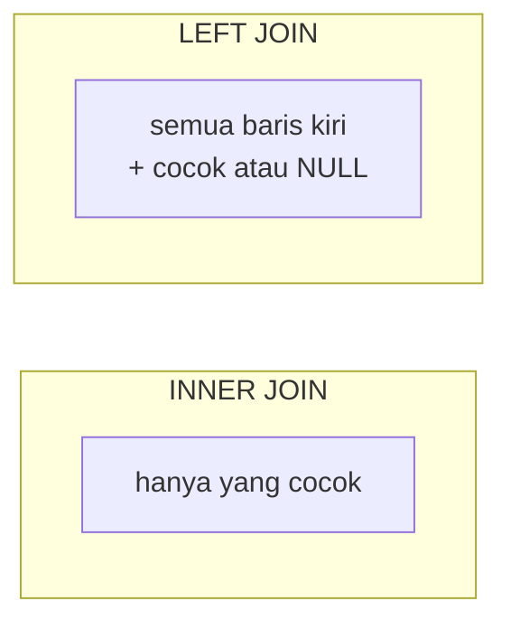

::part[Pelajari Konsepnya]{n="1"}

## 🎯 Yang akan kamu pelajari

- `INNER JOIN`, `LEFT JOIN` (dan kapan `RIGHT`/`FULL` muncul)
- **Anti-join**: baris yang **tidak** punya pasangan
- Agregasi lintas join tanpa **penghitungan ganda**
- Subquery: scalar, `IN`, `EXISTS`
- **CTE** (`WITH`) untuk membuat kueri yang mudah dibaca
- Pertama kali lihat **window function** (`ROW_NUMBER`, "terbaru per grup")

## 🔤 Istilah penting

| Istilah | Artinya (sederhana) |
|---|---|
| **JOIN** | Menggabungkan baris dari dua tabel yang cocok bersama |
| **`INNER JOIN`** | Hanya baris yang ada di kedua tabel |
| **`LEFT JOIN`** | Semua baris dari tabel kiri, cocok atau tidak |
| **Anti-join** | Mencari baris yang **tidak punya** pasangan |
| **Cartesian product** | Setiap baris dikombinasi dengan setiap baris — hasil kondisi join yang salah |
| **Subquery** | Kueri yang ditulis di dalam kueri lain |
| **CTE (`WITH`)** | Langkah bernama di atas kueri, untuk membacanya lebih mudah |
| **Window function** | Perhitungan di banyak baris terkait, tanpa mengempang baris |

## 🧠 Ide besarnya

Normalisasi memisahkan datamu ke banyak tabel. **JOIN** menyatukannya kembali untuk satu pertanyaan spesifik.

Bayangkan dua daftar di acara sekolah: **siswa** dan **pendaftaran**. Satu join adalah berjalan di daftar pendaftaran dan mencari nama setiap siswa lewat ID-nya.

- **INNER JOIN**: hanya orang yang ada di **kedua** daftar.
- **LEFT JOIN**: **semua orang** dari daftar kiri, dengan detail pendaftaran kalau punya, dan kosong kalau tidak.

## ❓ Kenapa ini penting

Hampir setiap layar yang berguna perlu data dari banyak tabel: *"aplikasi dengan nama perusahaan dan skill yang dibutuhkan"*, *"perusahaan dengan nol pelamar"*, *"aplikasi terbaru setiap user"*. Kalau di Python, berarti load tabel utuh dan samakan dalam loop — Module 1 tunjukkan betapa lambatnya. Database mengerjakannya dengan index, dalam satu putaran.

Join yang salah paham memberi **angka keliru, tanpa peringatan**:

```sql
-- "Companies with their application counts" — but Batik Soft (0 applications) disappears
SELECT c.name, COUNT(*) FROM companies c JOIN applications a ON a.company_id = c.id GROUP BY c.name;

-- Missing join condition: every application paired with every skill (a "cartesian product")
SELECT * FROM applications, skills;      -- 9 × 6 = 54 meaningless rows

-- Double counting: joining skills multiplies application rows before SUM
SELECT u.full_name, SUM(a.salary_offer)
FROM users u JOIN applications a ON a.user_id = u.id
JOIN application_skills x ON x.application_id = a.id
GROUP BY u.full_name;                    -- offers counted once PER SKILL 😬
```

## 📖 Langkah demi langkah

### 1. INNER JOIN

```sql
SELECT u.full_name, c.name AS company, a.role_title
FROM applications a
JOIN users u     ON u.id = a.user_id
JOIN companies c ON c.id = a.company_id;
```

`JOIN` berarti `INNER JOIN`. Baris tanpa pasangan di **masing-masing** sisi dibuang. Gunakan **alias tabel** (`a`, `u`, `c`) dan sebutkan setiap kolom dengan lengkap.

### 2. LEFT JOIN

```sql
SELECT c.name, a.role_title
FROM companies c
LEFT JOIN applications a ON a.company_id = c.id;
```

Setiap perusahaan muncul; perusahaan tanpa aplikasi punya `NULL` di kolom `a.*`.



| Join | Menyimpan |
|---|---|
| `INNER JOIN` | hanya yang cocok |
| `LEFT JOIN` | semua baris dari tabel kiri |
| `RIGHT JOIN` | semua baris dari tabel kanan (tulis ulang sebagai LEFT JOIN untuk kejelasan) |
| `FULL JOIN` | semua baris dari kedua sisi — berguna untuk membandingkan dua sumber data |
| `CROSS JOIN` | setiap kombinasi (jarang apa yang kamu mau) |

:::warning[Jebakan LEFT JOIN + WHERE]
`LEFT JOIN applications a ON … WHERE a.status = 'offer'` berubah kembali menjadi inner join: perusahaan tanpa aplikasi punya `a.status = NULL`, yang gagal `WHERE`. Letakkan kondisi tentang tabel **kanan** di dalam `ON`: `LEFT JOIN applications a ON a.company_id = c.id AND a.status = 'offer'`.
:::

### 3. Menghitung dengan LEFT JOIN

```sql
SELECT c.name, COUNT(a.id) AS applications     -- NOT COUNT(*)
FROM companies c
LEFT JOIN applications a ON a.company_id = c.id
GROUP BY c.id, c.name;
```

`COUNT(*)` menghitung baris dengan NULL sebagai 1; `COUNT(a.id)` menghitung yang sungguhan cocok → 0.

### 4. Anti-join: "siapa saja yang tidak punya?"

Ini cara menjawab "siapa yang tidak datang?" — simpan semua dari daftar kiri, lalu simpan hanya baris di mana pasangannya kosong.

```sql
-- LEFT JOIN + IS NULL
SELECT u.full_name
FROM users u
LEFT JOIN applications a ON a.user_id = u.id
WHERE a.id IS NULL;

-- NOT EXISTS (same result, often clearer)
SELECT u.full_name
FROM users u
WHERE NOT EXISTS (SELECT 1 FROM applications a WHERE a.user_id = u.id);
```

:::danger[Hindari NOT IN dengan subquery]
`WHERE id NOT IN (SELECT user_id FROM …)` kembalikan **tidak ada apa-apa** kalau subquery punya satu `NULL`. Lebih baik `NOT EXISTS`.
:::

### 5. Subquery

```sql
-- Scalar subquery: a single value
SELECT role_title, salary_offer
FROM applications
WHERE salary_offer > (SELECT AVG(salary_offer) FROM applications WHERE status = 'offer');

-- EXISTS: "is there at least one matching row?" — stops at the first match
SELECT u.full_name
FROM users u
WHERE EXISTS (SELECT 1 FROM applications a WHERE a.user_id = u.id AND a.status = 'offer');
```

### 6. CTE: beri nama langkahnya

CTE seperti menulis resep dalam langkah-langkah bukannya satu kalimat panjang: "pertama buat saus, terus masak mi, lalu satukan". Hasil yang sama, jauh lebih mudah dibaca dan debug.

A :term[CTE]{bahasa="Common Table Expression — hasil query sementara yang diberi nama dengan WITH, agar query kompleks mudah dibaca"} biarkan kamu tulis kueri sebagai langkah yang mudah dibaca:

```sql
WITH offers AS (
    SELECT user_id, COUNT(*) AS offer_count, MAX(salary_offer) AS best_offer
    FROM applications
    WHERE status = 'offer'
    GROUP BY user_id
)
SELECT u.full_name, o.offer_count, o.best_offer
FROM users u
JOIN offers o ON o.user_id = u.id
ORDER BY o.best_offer DESC;
```

Agregasi **sebelum** join (di dalam CTE) juga adalah obat untuk penghitungan ganda.

### 7. Conditional aggregates

```sql
SELECT user_id,
       COUNT(*)                                          AS total,
       COUNT(*) FILTER (WHERE status IN ('applied', 'interview')) AS active,
       COUNT(*) FILTER (WHERE status = 'offer')          AS offers
FROM applications
GROUP BY user_id;
```

(`SUM(CASE WHEN … THEN 1 ELSE 0 END)` melakukan yang sama di database tanpa `FILTER`.)

### 8. Window function: "terbaru per grup"

Agregat mengempang baris; **window function** tambahkan perhitungan **di samping** setiap baris:

```sql
SELECT user_id, role_title, applied_on,
       ROW_NUMBER() OVER (PARTITION BY user_id ORDER BY applied_on DESC) AS rn
FROM applications;
```

Bungkus dalam CTE dan simpan `rn = 1` → aplikasi terbaru setiap user. Juga berguna: `RANK()`, `LAG()` (baris sebelumnya), total berjalan dengan `SUM(...) OVER (ORDER BY …)`.

### 9. Self-join

Gabungkan tabel dengan dirinya sendiri dengan dua alias — contoh: pasangan user yang melamar perusahaan yang sama:

```sql
SELECT a1.company_id, a1.user_id, a2.user_id
FROM applications a1
JOIN applications a2 ON a2.company_id = a1.company_id AND a2.user_id > a1.user_id;
```

### Pilih cara kerjamu

Setiap pilihan di sini ada trade-off:

| Pilihan | ✅ | ❌ |
|---|---|---|
| Satu kueri dengan join | satu putaran, pakai index | SQL kompleks untuk dibaca dan ditest |
| Beberapa kueri sederhana di code | potongan sederhana | lebih banyak putaran; risiko kueri N+1 (Week 4) |
| Subquery | dibaca seperti pertanyaan | bisa lebih sulit di-optimize di beberapa kasus |
| CTE | mudah dibaca, langkah yang bisa dipakai ulang | rantai CTE sangat panjang bisa sembunyikan masalah performa |
| Window function | logik "per grup" yang kuat tanpa self-join | syntax baru untuk dipelajari |
| `NOT EXISTS` vs `LEFT JOIN … IS NULL` | keduanya oke; `NOT EXISTS` aman NULL dan jelas | — |

- ✅ Join di database bukannya di loop Python.
- ✅ `LEFT JOIN` saat pertanyaan termasuk "semua …, walaupun tanpa …".
- ✅ CTE saat kueri punya lebih dari satu langkah logis.
- 🚫 Jangan join tabel yang tidak kamu perlukan.
- 🚫 Jangan `SUM` lintas join yang mengalikan baris — agregasi dulu.

## ⚠️ Kesalahan umum

- Lupa kondisi join → cartesian product.
- `COUNT(*)` dengan LEFT JOIN.
- `WHERE` di tabel kanan sesudah LEFT JOIN.
- `NOT IN` kembalikan tidak ada karena NULL.
- Penghitungan ganda melalui join satu-ke-banyak.

:::revoshop
Pilih satu endpoint di RevoShop yang kembalikan order dengan item-nya, contoh di `app/repositories/order_repository.py` atau `app/services/order_service.py`. Tulis SQL yang benar-benar dijalankannya (hint: sementara log kueri SQLAlchemy dengan `SQLALCHEMY_ECHO=True`, atau alasan dari ORM call-nya). Apakah satu kueri dengan JOIN, atau satu kueri untuk order ditambah satu per item? Kamu akan analisis pola "N+1" itu di Week 4.
:::

## 🏆 Praktik terbaik

- [ ] Selalu tulis explicit `JOIN … ON …` (jangan pernah comma join tanpa kondisi).
- [ ] Gunakan alias pendek, bermakna dan **sebutkan setiap kolom** (`a.status`).
- [ ] Pilih `INNER` vs `LEFT` dengan sengaja; taruh filter tabel-kanan di `ON` untuk LEFT join.
- [ ] Hitung dengan `COUNT(child.id)` di aggregate LEFT JOIN.
- [ ] Gunakan `EXISTS` / `NOT EXISTS` untuk "punya / tidak punya"; hindari `NOT IN` dengan subquery.
- [ ] Agregasi **sebelum** join saat join akan mengalikan baris.
- [ ] Index kolom join (foreign key!) dan cek plan dengan `EXPLAIN ANALYZE` (materi berikutnya).
- [ ] Pecah kueri kompleks jadi CTE; test setiap langkah sendiri.

::part[Jelaskan & Rancang]{n="2"}

## 🗣️ Jelaskan

Jelaskan INNER vs LEFT JOIN pakai kelas dan daftar klub ekstrakurikuler. Lalu jelaskan dalam dua kalimat kenapa join skill bisa membuat SUM gaji terlalu besar.

## 📐 Rancang

Tulis SQL untuk widget dashboard CareerPilot ini (tabel dari seed latihan):

1. "Perusahaan yang belum kamu lamar" untuk user 1
2. "Penawaran terbaik per industri" untuk user 1 (industri, perusahaan, gaji)
3. "Kesenjangan skill": skill yang muncul di minimal 2 dari **semua** aplikasi tapi **tidak ada** satu pun di aplikasi user 1

:::quiz
Lihat SQL yang mungkin

```sql
-- 1
SELECT c.name
FROM companies c
WHERE NOT EXISTS (
  SELECT 1 FROM applications a WHERE a.company_id = c.id AND a.user_id = 1
);

-- 2  (latest-per-group pattern with a window function)
WITH ranked AS (
  SELECT c.industry, c.name AS company, a.salary_offer,
         ROW_NUMBER() OVER (PARTITION BY c.industry ORDER BY a.salary_offer DESC) AS rn
  FROM applications a JOIN companies c ON c.id = a.company_id
  WHERE a.user_id = 1 AND a.status = 'offer'
)
SELECT industry, company, salary_offer FROM ranked WHERE rn = 1;

-- 3
WITH demand AS (
  SELECT x.skill_id FROM application_skills x
  GROUP BY x.skill_id HAVING COUNT(*) >= 2
), mine AS (
  SELECT DISTINCT x.skill_id
  FROM application_skills x JOIN applications a ON a.id = x.application_id
  WHERE a.user_id = 1
)
SELECT s.name
FROM skills s
JOIN demand d ON d.skill_id = s.id
WHERE NOT EXISTS (SELECT 1 FROM mine m WHERE m.skill_id = s.id);
```
:::

### 📝 Checklist review mandiri

- [ ] Aku gunakan `NOT EXISTS` untuk "tidak ada"
- [ ] "Terbaik per grup" tidak hilang yang seri dengan diam-diam (atau aku putuskan OK)
- [ ] Aku pisah logik multi-langkah jadi CTE

::ai-review{task="design"}

::part[Latihan Kecil]{n="3"}

:::exercise{path="exercises/m2/w2/05-joins-subqueries" ai="no-ai" title="Sepuluh soal join"}
Pecahkan 10 pertanyaan di dataset kecil fiktif: inner dan left join, anti-join, hitung dengan nol, scalar subquery, `EXISTS`, window function untuk "terbaru per user", self-join, dan CTE dengan penghitungan bersyarat. Hasil dibandingkan persis.
:::

:::hints
- Gambar tabel dan panah di kertas sebelum tulis setiap kueri.
- q03 dan q06: `LEFT JOIN` + `COUNT(child_column)`.
- q08: `ROW_NUMBER() OVER (PARTITION BY user_id ORDER BY applied_on DESC)` di CTE.
- q09: join `applications` ke dirinya di `company_id`; gunakan perbandingan nama untuk simpan setiap pasang sekali.
:::

### 🏆 Tantangan lebih

Tulis kueri yang tunjukkan, untuk setiap user, jumlah hari antara aplikasi berturut-turut (`LAG(applied_on) OVER (PARTITION BY user_id ORDER BY applied_on)`).

## ✅ Cek cepat

:::quiz
Kenapa `NOT IN (subquery)` bisa kembalikan tidak ada baris sama sekali?

Kalau subquery kembalikan `NULL` apa pun, setiap perbandingan `x NOT IN (…)` jadi tidak jelas, jadi tidak ada baris yang lulus. `NOT EXISTS` tidak punya masalah ini.
:::

:::quiz
Gimana cara dapat "aplikasi terbaru per user"?

Gunakan `ROW_NUMBER() OVER (PARTITION BY user_id ORDER BY applied_on DESC)` di CTE/subquery dan simpan baris di mana nilainya sama dengan 1 (PostgreSQL punya `DISTINCT ON` juga).
:::

:::quiz
Apa yang buat penghitungan ganda di agregat join, dan gimana cara diperbaiki?

Join satu-ke-banyak ulang baris parent sekali per child, jadi sum di kolom parent jadi besar. Agregasi di CTE/subquery dulu, terus join hasilnya.
:::


## 📚 Lanjut belajar

- [Tutorial PostgreSQL: Joins Between Tables](https://www.postgresql.org/docs/current/tutorial-join.html)
- [Dokumentasi PostgreSQL: WITH Queries (CTEs)](https://www.postgresql.org/docs/current/queries-with.html)
- [Tutorial PostgreSQL: Window Functions](https://www.postgresql.org/docs/current/tutorial-window.html)
