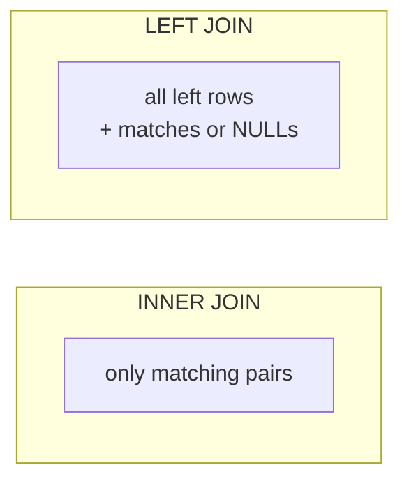

::part[Learn the Concept]{n="1"}

## 🎯 What you'll learn

- `INNER JOIN`, `LEFT JOIN` (and when `RIGHT`/`FULL` appear)
- The **anti-join**: rows with **no** match
- Aggregating across joins without **double counting**
- Subqueries: scalar, `IN`, `EXISTS`
- **CTEs** (`WITH`) to make complex queries readable
- A first look at **window functions** (`ROW_NUMBER`, "latest per group")

## 🔤 Key words

| Word | In simple words | Bahasa Indonesia |
|---|---|---|
| **JOIN** | Combining rows from two tables that belong together | Menggabungkan tabel |
| **`INNER JOIN`** | Keep only rows that exist in both tables | Hanya yang cocok di keduanya |
| **`LEFT JOIN`** | Keep every row from the left table, matched or not | Semua dari tabel kiri |
| **Anti-join** | Finding rows that have **no** match | Mencari yang tidak punya pasangan |
| **Cartesian product** | Every row paired with every row — what a missing join condition gives you | Semua kombinasi (salah) |
| **Double counting** | A sum inflated because a join multiplied the rows | Penjumlahan ganda |
| **Subquery** | A query written inside another query | Kueri di dalam kueri |
| **`EXISTS`** | "Is there at least one matching row?" | Apakah ada yang cocok |
| **CTE (`WITH`)** | A named step at the top of a query, to keep it readable | Langkah bernama |
| **Window function** | A calculation across related rows, without collapsing them | Perhitungan antar baris |

## 🧠 The big idea

Normalization split your data into tables. **JOIN** puts it back together for one specific question.

Picture two lists at a school event: **students** and **registrations**. A join is walking down the registrations and looking up each student's name by their id.

- **INNER JOIN**: only people who appear in **both** lists.
- **LEFT JOIN**: **everyone** from the left list, with registration details if they have any, and blanks if they don't.

## ❓ Why it matters

Almost every useful screen needs data from several tables: *"applications with company names and required skills"*, *"companies with zero applicants"*, *"each user's latest application"*. Doing that in Python means loading whole tables and matching them in loops — Module 1 showed how slow that gets. The database does it with indexes, in one round trip.

Misunderstood joins give **wrong numbers, silently**:

```sql
-- "Companies with their application counts" — but Batik Soft (0 applications) disappears
SELECT c.name, COUNT(*) FROM companies c JOIN applications a ON a.company_id = c.id GROUP BY c.name;

-- Missing join condition: every application paired with every skill (a "cartesian product")
SELECT * FROM applications, skills;      -- 9 × 6 = 54 meaningless rows

-- Double counting: joining skills multiplies application rows before SUM
SELECT u.full_name, SUM(a.salary_offer)
FROM users u JOIN applications a ON a.user_id = u.id
JOIN application_skills x ON x.application_id = a.id
GROUP BY u.full_name;                    -- offers counted once PER SKILL 😬
```

## 📖 Step by step

### 1. INNER JOIN

```sql
SELECT u.full_name, c.name AS company, a.role_title
FROM applications a
JOIN users u     ON u.id = a.user_id
JOIN companies c ON c.id = a.company_id;
```

`JOIN` means `INNER JOIN`. Rows without a match on **either** side are dropped. Use **table aliases** (`a`, `u`, `c`) and qualify every column.

### 2. LEFT JOIN

```sql
SELECT c.name, a.role_title
FROM companies c
LEFT JOIN applications a ON a.company_id = c.id;
```

Every company appears; companies without applications have `NULL` in `a.*` columns.



| Join | Keeps |
|---|---|
| `INNER JOIN` | matches only |
| `LEFT JOIN` | all rows from the left table |
| `RIGHT JOIN` | all rows from the right table (rewrite as LEFT JOIN for readability) |
| `FULL JOIN` | all rows from both sides — useful for comparing two data sources |
| `CROSS JOIN` | every combination (rarely what you want) |

:::warning[The LEFT JOIN + WHERE trap]
`LEFT JOIN applications a ON … WHERE a.status = 'offer'` turns back into an inner join: companies without applications have `a.status = NULL`, which fails the `WHERE`. Put conditions about the **right** table inside `ON`: `LEFT JOIN applications a ON a.company_id = c.id AND a.status = 'offer'`.
:::

### 3. Counting with LEFT JOIN

```sql
SELECT c.name, COUNT(a.id) AS applications     -- NOT COUNT(*)
FROM companies c
LEFT JOIN applications a ON a.company_id = c.id
GROUP BY c.id, c.name;
```

`COUNT(*)` counts the row with NULLs as 1; `COUNT(a.id)` counts real matches → 0.

### 4. Anti-join: "which ones have none?"

This is how you answer "who didn't come?" — keep everyone from the left list, then keep only the rows where the match came back empty.

```sql
-- LEFT JOIN + IS NULL
SELECT u.full_name
FROM users u
LEFT JOIN applications a ON a.user_id = u.id
WHERE a.id IS NULL;

-- NOT EXISTS (same result, often clearer)
SELECT u.full_name
FROM users u
WHERE NOT EXISTS (SELECT 1 FROM applications a WHERE a.user_id = u.id);
```

:::danger[Avoid NOT IN with subqueries]
`WHERE id NOT IN (SELECT user_id FROM …)` returns **nothing** if the subquery contains a single `NULL`. Prefer `NOT EXISTS`.
:::

### 5. Subqueries

```sql
-- Scalar subquery: a single value
SELECT role_title, salary_offer
FROM applications
WHERE salary_offer > (SELECT AVG(salary_offer) FROM applications WHERE status = 'offer');

-- EXISTS: "is there at least one matching row?" — stops at the first match
SELECT u.full_name
FROM users u
WHERE EXISTS (SELECT 1 FROM applications a WHERE a.user_id = u.id AND a.status = 'offer');
```

### 6. CTEs: name the steps

A CTE is like writing a recipe in steps instead of one long sentence: "first make the sauce, then cook the noodles, then combine". Same result, far easier to read and debug.

A :term[CTE]{bahasa="Common Table Expression — hasil query sementara yang diberi nama dengan WITH, agar query kompleks mudah dibaca"} lets you write a query as readable steps:

```sql
WITH offers AS (
    SELECT user_id, COUNT(*) AS offer_count, MAX(salary_offer) AS best_offer
    FROM applications
    WHERE status = 'offer'
    GROUP BY user_id
)
SELECT u.full_name, o.offer_count, o.best_offer
FROM users u
JOIN offers o ON o.user_id = u.id
ORDER BY o.best_offer DESC;
```

Aggregating **before** joining (inside a CTE) is also the cure for double counting.

### 7. Conditional aggregates

```sql
SELECT user_id,
       COUNT(*)                                          AS total,
       COUNT(*) FILTER (WHERE status IN ('applied', 'interview')) AS active,
       COUNT(*) FILTER (WHERE status = 'offer')          AS offers
FROM applications
GROUP BY user_id;
```

(`SUM(CASE WHEN … THEN 1 ELSE 0 END)` does the same in databases without `FILTER`.)

### 8. Window functions: "latest per group"

Aggregates collapse rows; **window functions** add a calculation **next to** each row:

```sql
SELECT user_id, role_title, applied_on,
       ROW_NUMBER() OVER (PARTITION BY user_id ORDER BY applied_on DESC) AS rn
FROM applications;
```

Wrap it in a CTE and keep `rn = 1` → each user's most recent application. Also useful: `RANK()`, `LAG()` (previous row), running totals with `SUM(...) OVER (ORDER BY …)`.

### 9. Self-join

Join a table to itself with two aliases — e.g. pairs of users who applied to the same company:

```sql
SELECT a1.company_id, a1.user_id, a2.user_id
FROM applications a1
JOIN applications a2 ON a2.company_id = a1.company_id AND a2.user_id > a1.user_id;
```

### Choosing your setup

Every option here is a trade-off:

| Choice | ✅ | ❌ |
|---|---|---|
| One query with joins | one round trip, uses indexes | complex SQL to read and test |
| Several simple queries in code | simple pieces | more round trips; risk of N+1 queries (Week 4) |
| Subquery | reads like the question | can be harder to optimize in some cases |
| CTE | readable, reusable steps | very long CTE chains can hide performance issues |
| Window functions | powerful "per group" logic without self-joins | new syntax to learn |
| `NOT EXISTS` vs `LEFT JOIN … IS NULL` | both fine; `NOT EXISTS` is NULL-safe and clear | — |

- ✅ Join in the database instead of in Python loops.
- ✅ `LEFT JOIN` when the question includes "all …, even without …".
- ✅ CTEs when a query has more than one logical step.
- 🚫 Don't join tables you don't need.
- 🚫 Don't `SUM` across a join that multiplies rows — aggregate first.

## ⚠️ Common mistakes

- Forgetting a join condition → cartesian product.
- `COUNT(*)` with LEFT JOIN.
- `WHERE` on the right table after a LEFT JOIN.
- `NOT IN` returning nothing because of a NULL.
- Double counting through one-to-many joins.

:::revoshop
Pick an endpoint in RevoShop that returns an order with its items, e.g. in `app/repositories/order_repository.py` or `app/services/order_service.py`. Write down the SQL it effectively runs (hint: temporarily log SQLAlchemy queries with `SQLALCHEMY_ECHO=True`, or reason from the ORM calls). Is it one query with a JOIN, or one query for the order plus one per item? You'll analyze that "N+1" pattern in Week 4.
:::

## 🏆 Best practices

- [ ] Always write explicit `JOIN … ON …` (never comma joins without conditions).
- [ ] Use short, meaningful aliases and **qualify every column** (`a.status`).
- [ ] Choose `INNER` vs `LEFT` deliberately; put right-table filters in `ON` for LEFT joins.
- [ ] Count with `COUNT(child.id)` in LEFT JOIN aggregates.
- [ ] Use `EXISTS` / `NOT EXISTS` for "has any / has none"; avoid `NOT IN` with subqueries.
- [ ] Aggregate **before** joining when a join would multiply rows.
- [ ] Index join columns (foreign keys!) and check plans with `EXPLAIN ANALYZE` (next lesson).
- [ ] Break complex queries into CTEs; test each step on its own.

::part[Explain & Design]{n="2"}

## 🗣️ Explain it

Explain INNER vs LEFT JOIN using a class and an extracurricular club list. Then explain in two sentences why joining skills can make a salary SUM too big.

## 📐 Design it

Write SQL for these CareerPilot dashboard widgets (tables from the exercise seed):

1. "Companies you haven't applied to yet" for user 1
2. "Your best offer per industry" for user 1 (industry, company, salary)
3. "Skills gap": skills that appear in at least 2 of **all** applications but in **none** of user 1's applications

:::quiz
Show possible SQL

```sql
-- 1
SELECT c.name
FROM companies c
WHERE NOT EXISTS (
  SELECT 1 FROM applications a WHERE a.company_id = c.id AND a.user_id = 1
);

-- 2  (latest-per-group pattern with a window function)
WITH ranked AS (
  SELECT c.industry, c.name AS company, a.salary_offer,
         ROW_NUMBER() OVER (PARTITION BY c.industry ORDER BY a.salary_offer DESC) AS rn
  FROM applications a JOIN companies c ON c.id = a.company_id
  WHERE a.user_id = 1 AND a.status = 'offer'
)
SELECT industry, company, salary_offer FROM ranked WHERE rn = 1;

-- 3
WITH demand AS (
  SELECT x.skill_id FROM application_skills x
  GROUP BY x.skill_id HAVING COUNT(*) >= 2
), mine AS (
  SELECT DISTINCT x.skill_id
  FROM application_skills x JOIN applications a ON a.id = x.application_id
  WHERE a.user_id = 1
)
SELECT s.name
FROM skills s
JOIN demand d ON d.skill_id = s.id
WHERE NOT EXISTS (SELECT 1 FROM mine m WHERE m.skill_id = s.id);
```
:::

### 📝 Self-review checklist

- [ ] I used `NOT EXISTS` for "none"
- [ ] "Best per group" doesn't lose ties silently (or I decided it's OK)
- [ ] I split multi-step logic into CTEs

::ai-review{task="design"}

::part[Toy Exercise]{n="3"}

:::exercise{path="exercises/m2/w2/05-joins-subqueries" ai="no-ai" title="Ten join puzzles"}
Solve 10 questions on a small fictional dataset: inner and left joins, an anti-join, counting with zeros, a scalar subquery, `EXISTS`, a window function for "latest per user", a self-join, and a CTE with conditional counts. Results are compared exactly.
:::

:::hints
- Draw the tables and arrows on paper before writing each query.
- q03 and q06: `LEFT JOIN` + `COUNT(child_column)`.
- q08: `ROW_NUMBER() OVER (PARTITION BY user_id ORDER BY applied_on DESC)` in a CTE.
- q09: join `applications` to itself on `company_id`; use the name comparison to keep each pair once.
:::

### 🏆 Stretch goal

Write a query showing, for each user, the number of days between consecutive applications (`LAG(applied_on) OVER (PARTITION BY user_id ORDER BY applied_on)`).

## ✅ Quick check

:::quiz
Why can `NOT IN (subquery)` return no rows at all?

If the subquery returns any `NULL`, every `x NOT IN (…)` comparison becomes unknown, so no row passes. `NOT EXISTS` doesn't have this problem.
:::

:::quiz
How do you get "the latest application per user"?

Use `ROW_NUMBER() OVER (PARTITION BY user_id ORDER BY applied_on DESC)` in a CTE/subquery and keep rows where it equals 1 (PostgreSQL's `DISTINCT ON` also works).
:::

:::quiz
What causes double counting in joined aggregates, and how do you fix it?

A one-to-many join repeats parent rows once per child, so sums over parent columns are inflated. Aggregate in a CTE/subquery first, then join the results.
:::


## 📚 Keep learning

- [PostgreSQL tutorial: Joins Between Tables](https://www.postgresql.org/docs/current/tutorial-join.html)
- [PostgreSQL docs: WITH Queries (CTEs)](https://www.postgresql.org/docs/current/queries-with.html)
- [PostgreSQL tutorial: Window Functions](https://www.postgresql.org/docs/current/tutorial-window.html)
