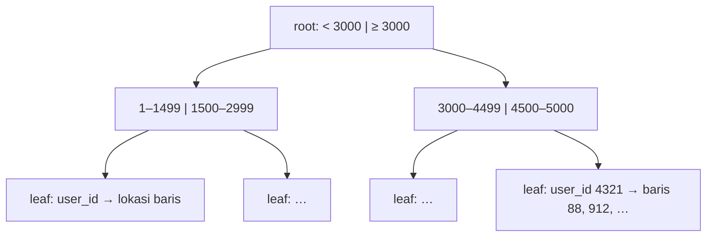

::part[Pelajari Konsepnya]{n="1"}

## 🎯 Yang akan kamu pelajari

- Apa itu **indeks** dan bagaimana **B-tree** menemukan baris dengan cepat
- Membaca rencana dengan `EXPLAIN` dan `EXPLAIN ANALYZE`: Seq Scan, Index Scan, Bitmap scan
- Indeks **composite** dan kenapa **urutan kolom** penting
- Indeks **expression** dan **partial**
- Apa **biaya** indeks (penulisan, disk, memori) dan cara menghindari terlalu banyak indeks

## 🔤 Istilah penting

| Istilah | Artinya (sederhana) |
|---|---|
| **Index** | Struktur pencarian cepat yang memungkinkan database melompat langsung ke baris yang dicari |
| **B-tree** | Bentuk pohon yang paling banyak dipakai indeks, jadi pencarian hanya membutuhkan beberapa langkah |
| **Sequential scan** | Membaca setiap baris untuk menemukan yang cocok |
| **Index scan** | Pakai indeks untuk melompat langsung ke baris yang cocok |
| **`EXPLAIN ANALYZE`** | Tanya database untuk menampilkan rencananya dan berapa lama benar-benar berjalan |
| **Composite index** | Satu indeks atas beberapa kolom, dalam urutan yang dipilih |
| **Expression index** | Indeks atas hasil perhitungan, seperti `lower(email)` |
| **Partial index** | Indeks yang hanya mencover sebagian baris (`WHERE status = 'open'`) |

## 🧠 Ide besarnya

Indeks itu seperti **daftar belakang buku pelajaran**. Untuk menemukan "foreign key", kamu tidak perlu membaca 600 halaman — cukup cari di daftar itu dan langsung tahu halaman 214. Itu adalah **sequential scan** vs **index scan**.

Konsepnya sama seperti kamus pencarian yang kamu buat di Module 1, tapi database menjaganya otomatis, di disk, untuk jutaan baris.

## ❓ Kenapa ini penting

Kueri yang instan dengan 1.000 baris bisa memakan waktu hitungan detik dengan 10 juta baris. Masalahnya biasanya bukan server yang lemah — tapi membaca setiap baris untuk menemukan segelintir. Indeks mengubah "cek semuanya" jadi "lompat ke halaman yang tepat" (pencarian biner, lagi).

Kalau dipakai dengan buruk, indeks membawa masalah sendiri:

- Halaman daftar aplikasi menjalankan `WHERE user_id = ? ORDER BY created_at DESC` — full table scan plus sort setiap request. Dengan 500 user online, CPU database melesat ke 100%.
- Ada yang menambahkan indeks di **setiap** kolom "untuk keamanan": insert jadi lambat, database membesar, dan kebanyakan indeks itu tidak pernah dipakai.
- Ada indeks di `email`, tapi kueri pakai `lower(email)` — jadi indeks diabaikan.

## 📖 Langkah demi langkah

### 1. Cara kerja indeks B-tree (disederhanakan)



Tipe indeks bawaan adalah **B-tree**: pohon yang terurut dan seimbang. Beberapa langkah turun pohon membawa ke entri yang cocok, yang menunjuk ke baris tabel. Karena **terurut**, itu membantu dengan `=`, `<`, `>`, `BETWEEN`, `ORDER BY` dan `LIKE 'abc%'` (dengan pengaturan yang tepat).

### 2. EXPLAIN dan EXPLAIN ANALYZE

Ini adalah database menunjukkan cara kerjanya. Baca dari bawah ke atas, dan cari langkah di mana jumlah baris tiba-tiba besar — di situ waktu terbuang.

```sql
EXPLAIN ANALYZE
SELECT id, status FROM applications WHERE user_id = 1234 ORDER BY created_at DESC LIMIT 20;
```

```text
Limit  (actual time=0.041..0.047 rows=12 loops=1)
  ->  Index Scan using applications_user_created_idx on applications
        Index Cond: (user_id = 1234)
Planning Time: 0.2 ms
Execution Time: 0.07 ms
```

| Node rencana | Artinya |
|---|---|
| `Seq Scan` | baca seluruh tabel — oke untuk tabel kecil atau kalau kebanyakan baris cocok |
| `Index Scan` | jalan di indeks, lalu ambil baris yang cocok |
| `Index Only Scan` | semua yang dibutuhkan ada di indeks — tidak perlu akses tabel |
| `Bitmap Index Scan` + `Bitmap Heap Scan` | kumpulkan lokasi yang cocok dulu, lalu baca mereka berurutan — bagus untuk hasil yang sedang-sedangan |
| `Sort` | urutkan di memori/disk — indeks dengan urutan yang tepat bisa menghilangkannya |
| `Nested Loop` / `Hash Join` / `Merge Join` | strategi join |

`EXPLAIN` menunjukkan rencana yang **diperkirakan**; `EXPLAIN ANALYZE` benar-benar **menjalankan** kueri dan menunjukkan waktu nyata dan jumlah baris (hati-hati dengan `UPDATE`/`DELETE` — bungkus dengan `BEGIN … ROLLBACK`).

:::note
Planner memutuskan berdasarkan **statistik**. Setelah muat banyak data, jalankan `ANALYZE table_name` (autovacuum biasanya melakukannya untuk kamu). Di tabel kecil, planner sering memilih Seq Scan — itu benar, bukan bug.
:::

### 3. Indeks composite: urutan penting

Indeks composite bekerja seperti buku telepon yang diurutkan berdasarkan nama belakang lalu nama depan: bagus untuk "semua Santoso", tapi tidak berguna untuk "semua yang namanya Budi". Letakkan kolom filter tepat di depan.

```sql
CREATE INDEX applications_user_created_idx ON applications (user_id, created_at DESC);
```

Pikir buku telepon yang diurutkan **nama belakang, lalu nama depan**:

| Kueri | Bisakah pakai `(user_id, created_at)`? |
|---|---|
| `WHERE user_id = 7` | ✅ kolom di depan |
| `WHERE user_id = 7 ORDER BY created_at DESC` | ✅ sempurna — filter dan urutan jadi satu |
| `WHERE user_id = 7 AND created_at > '2026-09-01'` | ✅ |
| `WHERE created_at > '2026-09-01'` | ❌ tidak efisien — seperti cari buku telepon berdasarkan nama depan |

Peraturan jempol: **kolom equality dulu, lalu kolom range/sort**.

### 4. Indeks expression

Kalau kueri pakai fungsi, indeks **ekspresi yang sama**:

```sql
CREATE INDEX users_email_lower_idx ON users (lower(email));
-- used by: WHERE lower(email) = lower($1)
```

### 5. Indeks partial

Indeks hanya baris yang kamu tanya:

```sql
CREATE INDEX applications_follow_up_active_idx
ON applications (follow_up_on)
WHERE status IN ('applied', 'interview');
```

Lebih kecil, lebih cepat, dan murah untuk dijaga dibanding indeks setiap baris. Bagus untuk subset "active", "tidak dihapus" (`WHERE deleted_at IS NULL`) dan "pending".

### 6. Indeks unique

Constraint `UNIQUE` dijaga dengan indeks unique — keduanya **melindungi data** dan **percepat pencarian**.

### 7. Apa yang indeks keluarkan

Setiap indeks adalah salinan kedua yang harus diperbarui pada setiap penulisan — seperti menjaga katalog kartu di sebelah rak buku. Berguna untuk perpustakaan, tapi buang-buang kalau kamu punya dua belas katalog yang tidak ada yang baca.

| Biaya | Mengapa |
|---|---|
| `INSERT`/`UPDATE`/`DELETE` jadi lambat | setiap indeks harus diperbarui juga |
| Disk dan memori | tabel besar → indeks besar |
| Kerumitan perencanaan | banyak indeks yang tumpang tindih bingungkan perawatan |

Temukan indeks yang tidak dipakai dengan `pg_stat_user_indexes` (`idx_scan = 0`) dan hapus.

### 8. Kapan indeks tidak bisa membantu

- Wildcard di depan: `title ILIKE '%engineer%'` → pakai ekstensi `pg_trgm` atau full-text search.
- Kolom dengan selectivity rendah sendirian (boolean di mana 90% baris `true`).
- Kueri yang kembalikan kebanyakan tabel juga.
- Fungsi di kolom yang tidak cocok dengan expression index.

### Memilih setup-mu

Setiap pilihan di sini adalah trade-off:

| Pilihan | ✅ | ❌ |
|---|---|---|
| Tambah indeks | baca cepat | penulisan lambat, simpan lebih banyak |
| Indeks composite | layani filter + sort bersama | hanya bantu kueri yang mulai dengan kolom di depannya |
| Beberapa indeks satu kolom | fleksibel | sering lebih buruk daripada satu composite yang dirancang baik |
| Indeks partial | kecil dan murah | hanya dipakai saat kueri cocok dengan `WHERE`-nya |
| Indeks semuanya | "cepat"… dalam teori | penulisan lambat, bloat, banyak indeks tidak dipakai |
| Tidak ada indeks di tabel kecil | lebih sederhana | oke sampai tabel membesar — lihat lagi |

- ✅ Indeks **foreign key**, kolom di `WHERE`/`JOIN`/`ORDER BY` yang sering, dan business key yang unik.
- ✅ Rancang indeks dari **kueri nyata** — idealnya yang paling lambat/paling sering dari monitoring.
- 🚫 Jangan tambah indeks tanpa cek rencana sebelum dan sesudah.
- 🚫 Jangan indeks kolom yang jarang ditanya atau punya sangat sedikit nilai berbeda (sendirian).

## ⚠️ Kesalahan umum

- Indeks `created_at` sendirian saat kueri filter `user_id` dulu.
- Berharap `WHERE lower(email) = …` pakai indeks di `email`.
- `EXPLAIN ANALYZE` di `DELETE` production tanpa transaksi.
- Menilai rencana di tabel dengan 20 baris.
- Buat indeks di migrasi yang kunci tabel besar di jam bisnis.

:::revoshop
Akhir `queries/schema.sql` RevoShop ada indeks di `products(category_id)`, `orders(user_id)`, `order_items(order_id)` dan `order_items(product_id)` — semua foreign key. Sekarang pikir endpoint nyata: daftar produk yang difilter kategori **dan diurutkan terbaru**, dan "pesananku, terbaru dulu". Indeks **composite** mana yang layani kueri itu lebih baik? Muat data seed RevoShop, jalankan `EXPLAIN ANALYZE` di kueri itu, dan catat rencananya sebelum dan sesudah.
:::

## 🏆 Praktik terbaik

- [ ] **Ukur dulu**: `EXPLAIN (ANALYZE, BUFFERS)` dengan volume data nyata.
- [ ] Indeks foreign key dan kolom filter/sort yang paling sering.
- [ ] Letakkan **kolom equality sebelum kolom range/sort** di indeks composite.
- [ ] Cocokkan expression index dengan ekspresi yang tepat di kueri (`lower(email)`).
- [ ] Pakai **indeks partial** untuk subset panas (active, tidak dihapus).
- [ ] Namai indeks konsisten: `<table>_<columns>_idx`.
- [ ] Di tabel production besar, pakai `CREATE INDEX CONCURRENTLY` untuk hindari kunci penulisan (di migrasi yang izinkan).
- [ ] Lihat indeks yang tidak dipakai berkala (`pg_stat_user_indexes`) dan hapus.
- [ ] Aktifkan `pg_stat_statements` di production untuk temukan kueri yang benar-benar mahal.

::part[Jelaskan & Rancang]{n="2"}

## 🗣️ Jelaskan

Jelaskan kepada orang yang bukan programmer kenapa menambah indeks membuat pencarian cepat tapi menambah data jadi sedikit lambat. Pakai indeks buku atau katalog perpustakaan.

## 📐 Rancang

Tabel `job_listings` CareerPilot akan punya 2 juta baris. Rancang indeks untuk kueri yang sering ini — dan bilang kueri mana yang TIDAK akan kamu indeks, dan mengapa:

1. `WHERE city = $1 AND is_remote = false ORDER BY posted_on DESC LIMIT 20`
2. `WHERE source_url = $1` (cek duplikat saat import)
3. `WHERE status = 'open' AND salary_max >= $1` (hanya ~10% listing yang open)
4. `WHERE title ILIKE '%' || $1 || '%'` (kotak pencarian)
5. `WHERE is_remote = true` (~50% baris)

:::quiz
Lihat contoh rancangan

1. `(city, is_remote, posted_on DESC)` — kolom equality dulu, lalu kolom sort.
2. `UNIQUE (source_url)` — paksakan tidak ada duplikat **dan** indeks pencarian.
3. Partial: `(salary_max) WHERE status = 'open'` — kecil dan tertarget.
4. B-tree tidak bisa layani wildcard di depan → `pg_trgm` GIN index (`CREATE INDEX … USING gin (title gin_trgm_ops)`) atau full-text search; nanti, semantic search (Module 7).
5. **Jangan indeks sendirian** — setengah tabel cocok, Seq Scan lebih murah. Bisa jadi kolom di indeks composite (seperti di #1).
:::

### 📝 Checklist review mandiri

- [ ] Indeks composite letakkan equality sebelum kolom sort/range
- [ ] Saya pakai UNIQUE di tempat yang juga aturan data
- [ ] Saya ketahui kueri yang B-tree tidak bisa bantu
- [ ] Saya hindari indeks selectivity rendah yang tidak berguna

::ai-review{task="design"}

::part[Latihan Kecil]{n="3"}

:::exercise{path="exercises/m2/w2/06-indexes" ai="no-ai" title="Buat kueri lambat jadi cepat"}
Dengan 60.000 aplikasi yang dibuat, empat kueri semuanya mulai dengan sequential scan. Buat **paling banyak empat** indeks supaya tidak ada yang melakukannya — termasuk satu indeks **expression** dan satu indeks **partial**. Test membaca rencana kueri nyata.
:::

:::hints
- Jalankan setiap kueri dengan `EXPLAIN ANALYZE` sebelum tulis indeks.
- Q1 filter satu kolom dan urutkan kolom lain → satu indeks composite.
- Q2 pakai `lower(email)` → indeks ekspresi itu.
- Q3 punya `WHERE status IN (…)` bisa jadi `WHERE` indeksnya sendiri.
:::

### 🏆 Tujuan stretch

Bandingkan output `EXPLAIN (ANALYZE, BUFFERS)` untuk Q4 dengan `CREATE INDEX … (company_id)` lalu dengan `(company_id) INCLUDE (status)` sambil pilih `status`. Kapan kamu dapat **Index Only Scan**?

## ✅ Cek cepat

:::quiz
Bisakah indeks di `(user_id, created_at)` percepat `WHERE created_at > '2026-09-01'` sendirian?

Tidak efisien — indeks diurutkan `user_id` dulu. Kueri perlu pakai kolom di depan.
:::

:::quiz
Kenapa PostgreSQL mungkin pilih Seq Scan walaupun ada indeks?

Tabel kecil, atau kondisi cocok banyak baris, atau statistik sudah lama — membaca berurutan diperkirakan lebih murah.
:::

:::quiz
Apa itu indeks partial dan kapan berguna?

Indeks yang hanya cover baris cocok `WHERE` — berguna saat kueri selalu targetkan subset kecil (active, pending, tidak dihapus).
:::


## 📚 Lanjut belajar

- [Dokumen PostgreSQL: Indexes](https://www.postgresql.org/docs/current/indexes.html)
- [Dokumen PostgreSQL: Using EXPLAIN](https://www.postgresql.org/docs/current/using-explain.html)
- [Use The Index, Luke! — SQL indexing explained](https://use-the-index-luke.com/)
