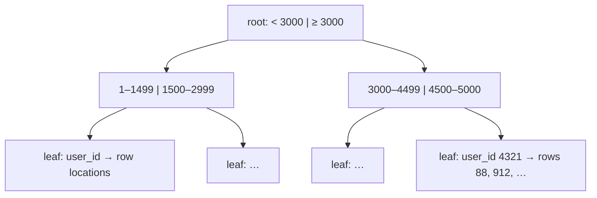

::part[Learn the Concept]{n="1"}

## 🎯 What you'll learn

- What an **index** is and how a **B-tree** finds rows fast
- Reading plans with `EXPLAIN` and `EXPLAIN ANALYZE`: Seq Scan, Index Scan, Bitmap scans
- **Composite** indexes and why **column order** matters
- **Expression** and **partial** indexes
- What indexes **cost** (writes, disk, memory) and how to avoid over-indexing

## 🔤 Key words

| Word | In simple words | Bahasa Indonesia |
|---|---|---|
| **Index** | An extra sorted structure that lets the database jump straight to rows | Struktur pencarian cepat |
| **B-tree** | The tree shape most indexes use, so lookups take a few steps | Bentuk pohon indeks |
| **Sequential scan** | Reading every row to find matches | Membaca semua baris |
| **Index scan** | Using the index to go straight to matching rows | Membaca lewat indeks |
| **`EXPLAIN ANALYZE`** | Asking the database to show its plan and how long it really took | Menampilkan rencana kueri |
| **Composite index** | One index over several columns, in a chosen order | Indeks gabungan kolom |
| **Expression index** | An index on a calculation, like `lower(email)` | Indeks atas hasil perhitungan |
| **Partial index** | An index that covers only some rows (`WHERE status = 'open'`) | Indeks sebagian baris |
| **Selectivity** | How few rows a condition matches — the fewer, the more an index helps | Ketajaman penyaringan |

## 🧠 The big idea

An :term[index]{bahasa="indeks — struktur data tambahan yang membuat pencarian baris jauh lebih cepat"} is the **index at the back of a textbook**. To find "foreign key" you don't read 600 pages (a **sequential scan**) — you look it up alphabetically and jump to page 214 (an **index scan**).

It's the same idea as the dictionary index you built for searching in Module 1, except the database maintains it automatically, on disk, for millions of rows.

## ❓ Why it matters

A query that is instant with 1,000 rows can take seconds with 10 million. The cause usually isn't a weak server — it's reading every row to find a handful. Indexes turn "check them all" into "jump to the right page" (binary search, again).

Used badly, they cause their own problems:

- The application list page runs `WHERE user_id = ? ORDER BY created_at DESC` — a full table scan plus a sort on every request. With 500 users online the database CPU hits 100%.
- Someone adds an index on **every** column "to be safe": inserts get slow, the database grows, and most of those indexes are never used.
- An index on `email` exists, but the query uses `lower(email)` — so the index is ignored.

## 📖 Step by step

### 1. How a B-tree index works (simplified)



The default index type is a **B-tree**: a sorted, balanced tree. A few steps down the tree lead to the matching entries, which point to the table rows. Because it's **sorted**, it helps with `=`, `<`, `>`, `BETWEEN`, `ORDER BY` and prefix `LIKE 'abc%'` (with the right settings).

### 2. EXPLAIN and EXPLAIN ANALYZE

This is the database showing its working. Read it bottom-up, and look for the step where the row count suddenly becomes huge — that's where the time goes.

```sql
EXPLAIN ANALYZE
SELECT id, status FROM applications WHERE user_id = 1234 ORDER BY created_at DESC LIMIT 20;
```

```text
Limit  (actual time=0.041..0.047 rows=12 loops=1)
  ->  Index Scan using applications_user_created_idx on applications
        Index Cond: (user_id = 1234)
Planning Time: 0.2 ms
Execution Time: 0.07 ms
```

| Plan node | Meaning |
|---|---|
| `Seq Scan` | reads the whole table — fine for small tables or when most rows match |
| `Index Scan` | walks the index, then fetches matching rows |
| `Index Only Scan` | everything needed is in the index — no table access |
| `Bitmap Index Scan` + `Bitmap Heap Scan` | collects matching locations first, then reads them in order — good for medium-sized result sets |
| `Sort` | sorting in memory/disk — an index in the right order can remove it |
| `Nested Loop` / `Hash Join` / `Merge Join` | join strategies |

`EXPLAIN` shows the **estimated** plan; `EXPLAIN ANALYZE` actually **runs** the query and shows real times and row counts (careful with `UPDATE`/`DELETE` — wrap in `BEGIN … ROLLBACK`).

:::note
The planner decides based on **statistics**. After loading lots of data, run `ANALYZE table_name` (autovacuum usually does this for you). On tiny tables the planner often prefers a Seq Scan — that's correct, not a bug.
:::

### 3. Composite indexes: order matters

A composite index works like a phone book sorted by surname then first name: great for "all the Santosos", useless for "everyone called Budi". Put the column you filter by exactly first.

```sql
CREATE INDEX applications_user_created_idx ON applications (user_id, created_at DESC);
```

Think of a phone book sorted by **last name, then first name**:

| Query | Can it use `(user_id, created_at)`? |
|---|---|
| `WHERE user_id = 7` | ✅ leading column |
| `WHERE user_id = 7 ORDER BY created_at DESC` | ✅ perfect — filter and order in one |
| `WHERE user_id = 7 AND created_at > '2026-09-01'` | ✅ |
| `WHERE created_at > '2026-09-01'` | ❌ not efficiently — like searching a phone book by first name |

Rule of thumb: **equality columns first, then range/sort columns**.

### 4. Expression indexes

If the query applies a function, index the **same expression**:

```sql
CREATE INDEX users_email_lower_idx ON users (lower(email));
-- used by: WHERE lower(email) = lower($1)
```

### 5. Partial indexes

Index only the rows you query:

```sql
CREATE INDEX applications_follow_up_active_idx
ON applications (follow_up_on)
WHERE status IN ('applied', 'interview');
```

Smaller, faster, and cheaper to maintain than indexing every row. Great for "active", "not deleted" (`WHERE deleted_at IS NULL`) and "pending" subsets.

### 6. Unique indexes

`UNIQUE` constraints are enforced by unique indexes — they both **protect data** and **speed up lookups**.

### 7. What indexes cost

Every index is a second copy that must be updated on every write — like keeping a card catalogue next to the shelves. Useful for a library, wasteful if you keep twelve catalogues nobody reads.

| Cost | Why |
|---|---|
| Slower `INSERT`/`UPDATE`/`DELETE` | every index must be updated too |
| Disk and memory | large tables → large indexes |
| Planning complexity | many overlapping indexes confuse maintenance |

Find unused indexes with `pg_stat_user_indexes` (`idx_scan = 0`) and remove them.

### 8. When indexes can't help

- Leading wildcards: `title ILIKE '%engineer%'` → use the `pg_trgm` extension or full-text search.
- Low-selectivity columns alone (a boolean where 90% of rows are `true`).
- Queries that return most of the table anyway.
- Functions on the column that don't match an expression index.

### Choosing your setup

Every option here is a trade-off:

| Choice | ✅ | ❌ |
|---|---|---|
| Add an index | fast reads | slower writes, more storage |
| Composite index | serves filter + sort together | only helps queries starting with its leading columns |
| Several single-column indexes | flexible | often worse than one well-designed composite |
| Partial index | small and cheap | only used when the query matches its `WHERE` |
| Index everything | "fast"… in theory | slow writes, bloat, many unused indexes |
| No indexes on a small table | simpler | fine until the table grows — revisit |

- ✅ Index **foreign keys**, columns in frequent `WHERE`/`JOIN`/`ORDER BY`, and unique business keys.
- ✅ Design indexes from **real queries** — ideally the slowest/most frequent ones from monitoring.
- 🚫 Don't add indexes without checking the plan before and after.
- 🚫 Don't index columns that are rarely queried or have very few distinct values (on their own).

## ⚠️ Common mistakes

- Indexing `created_at` alone when queries filter by `user_id` first.
- Expecting `WHERE lower(email) = …` to use an index on `email`.
- `EXPLAIN ANALYZE` on a `DELETE` in production without a transaction.
- Judging plans on a table with 20 rows.
- Creating indexes in a migration that locks a huge table during business hours.

:::revoshop
RevoShop's `queries/schema.sql` ends with indexes on `products(category_id)`, `orders(user_id)`, `order_items(order_id)` and `order_items(product_id)` — all foreign keys. Now think about real endpoints: the product list filtered by category **and sorted by newest**, and "my orders, newest first". Which **composite** indexes would serve those queries better? Load RevoShop's seed data, run `EXPLAIN ANALYZE` on those queries, and write down the plan before and after.
:::

## 🏆 Best practices

- [ ] **Measure first**: `EXPLAIN (ANALYZE, BUFFERS)` on realistic data volumes.
- [ ] Index foreign keys and the columns of your most frequent filters/sorts.
- [ ] Put **equality columns before range/sort columns** in composite indexes.
- [ ] Match expression indexes to the exact expression in queries (`lower(email)`).
- [ ] Use **partial indexes** for hot subsets (active, not deleted).
- [ ] Name indexes consistently: `<table>_<columns>_idx`.
- [ ] On big production tables, use `CREATE INDEX CONCURRENTLY` to avoid blocking writes (inside migrations that allow it).
- [ ] Review unused indexes periodically (`pg_stat_user_indexes`) and remove them.
- [ ] Enable `pg_stat_statements` in production to find the queries that actually cost the most.

::part[Explain & Design]{n="2"}

## 🗣️ Explain it

Explain to a non-programmer why adding an index makes searching faster but makes adding new data slightly slower. Use the textbook index or a library catalog.

## 📐 Design it

CareerPilot's `job_listings` table will have 2 million rows. Design indexes for these frequent queries — and say which query you would **not** index, and why:

1. `WHERE city = $1 AND is_remote = false ORDER BY posted_on DESC LIMIT 20`
2. `WHERE source_url = $1` (duplicate check on import)
3. `WHERE status = 'open' AND salary_max >= $1` (only ~10% of listings are open)
4. `WHERE title ILIKE '%' || $1 || '%'` (search box)
5. `WHERE is_remote = true` (~50% of rows)

:::quiz
Show a possible design

1. `(city, is_remote, posted_on DESC)` — equality columns first, then the sort column.
2. `UNIQUE (source_url)` — enforces no duplicates **and** indexes lookups.
3. Partial: `(salary_max) WHERE status = 'open'` — small and targeted.
4. A B-tree can't serve a leading wildcard → `pg_trgm` GIN index (`CREATE INDEX … USING gin (title gin_trgm_ops)`) or full-text search; later, semantic search (Module 7).
5. **Don't index alone** — half the table matches, a Seq Scan is cheaper. It can be a column inside a composite index (as in #1).
:::

### 📝 Self-review checklist

- [ ] Composite indexes put equality before sort/range columns
- [ ] I used UNIQUE where it's also a data rule
- [ ] I recognized a query a B-tree can't help
- [ ] I avoided a useless low-selectivity index

::ai-review{task="design"}

::part[Toy Exercise]{n="3"}

:::exercise{path="exercises/m2/w2/06-indexes" ai="no-ai" title="Make slow queries fast"}
With 60,000 generated applications, four queries all start with sequential scans. Create **at most four** indexes so none of them does — including one **expression** index and one **partial** index. The tests read the real query plans.
:::

:::hints
- Run each query with `EXPLAIN ANALYZE` before writing any index.
- Q1 filters by one column and sorts by another → one composite index.
- Q2 uses `lower(email)` → index that exact expression.
- Q3's `WHERE status IN (…)` can become the index's own `WHERE`.
:::

### 🏆 Stretch goal

Compare `EXPLAIN (ANALYZE, BUFFERS)` output for Q4 with `CREATE INDEX … (company_id)` and then with `(company_id) INCLUDE (status)` while selecting `status`. When do you get an **Index Only Scan**?

## ✅ Quick check

:::quiz
Can an index on `(user_id, created_at)` speed up `WHERE created_at > '2026-09-01'` alone?

Not efficiently — the index is ordered by `user_id` first. Queries need to use the leading column(s).
:::

:::quiz
Why might PostgreSQL choose a Seq Scan even though an index exists?

The table is small, or the condition matches a large share of rows, or statistics are outdated — reading sequentially is then estimated to be cheaper.
:::

:::quiz
What's a partial index and when is it useful?

An index that covers only rows matching a `WHERE` condition — useful when queries always target a small subset (active, pending, not deleted).
:::


## 📚 Keep learning

- [PostgreSQL docs: Indexes](https://www.postgresql.org/docs/current/indexes.html)
- [PostgreSQL docs: Using EXPLAIN](https://www.postgresql.org/docs/current/using-explain.html)
- [Use The Index, Luke! — SQL indexing explained](https://use-the-index-luke.com/)
