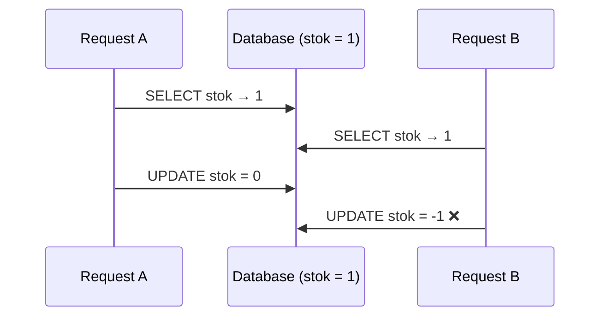

::part[Pelajari Konsepnya]{n="1"}

## 🎯 Yang akan kamu pelajari

- Apa itu **transaksi**: `BEGIN`, `COMMIT`, `ROLLBACK`
- Jaminan **ACID** dalam bahasa sederhana
- **Race condition**: mengapa "cek, lalu ubah" bisa salah saat banyak orang bertindak
- Mengatasi race dengan **atomic update**, **constraint**, dan **row lock** (`SELECT … FOR UPDATE`)
- **Isolation level** dan **deadlock**, dari sudut pandang praktis
- Pakai transaksi dari Python dengan **psycopg**

## 🔤 Istilah penting

| Istilah | Artinya (sederhana) |
|---|---|
| **Transaksi** | Sekelompok langkah yang semua harus berhasil, atau semua dibatalkan |
| **`COMMIT` / `ROLLBACK`** | Simpan semua / batalkan semua |
| **Atomic** | Utuh semua atau tidak sama sekali, tidak separuh |
| **ACID** | Empat jaminan database: atomic, consistent, isolated, durable |
| **Race condition** | Dua permintaan sama-sama "cek lalu ubah" di saat bersamaan, hasilnya salah |
| **Atomic update** | Biarkan database yang hitung (`stock = stock - 1`), bukan aplikasi |
| **Row lock (`FOR UPDATE`)** | Pegang satu baris agar orang lain tidak bisa mengubahnya sampai selesai |
| **Isolation level** | Seberapa banyak satu transaksi bisa lihat pekerjaan transaksi lain yang belum selesai |
| **Deadlock** | Dua transaksi saling menunggu lock satu sama lain — hang selamanya |

## 🧠 Ide besarnya

Bayangkan kamu transfer uang dari rekening A ke rekening B di bank. Ada dua langkah: ambil uang dari A, masukkan ke B. Tapi kedua langkah **harus berhasil bersama-sama**. Kalau listrik mati di tengah-tengah, uang tidak boleh hilang.

> **Semua atau tidak sama sekali.** Setiap langkah disimpan (`COMMIT`), atau tidak ada yang disimpan (`ROLLBACK`).

:term[Transaksi]{bahasa="transaksi — sekelompok perintah database yang berhasil semua atau gagal semua"} itu seperti transfer bank: aman karena keduanya terjadi sebagai **satu unit**.

## ❓ Kenapa ini penting

Operasi nyata punya beberapa langkah: buat pesanan, kurangi stok, catat pembayaran, tulis log audit. Kegagalan bisa terjadi **di antara** langkah-langkah — bug, timeout, crash. Ribuan pengguna bertindak **di saat bersamaan**: dua orang membeli item terakhir, dua tab membuka aplikasi yang sama.

Tanpa transaksi:

```python
stock = db.execute("SELECT stock FROM products WHERE id = 5").fetchone()[0]   # both requests read 1
if stock >= 1:
    db.execute("UPDATE products SET stock = stock - 1 WHERE id = 5")            # both decrement
    db.execute("INSERT INTO orders ...")                                         # two orders, stock = -1
```

Tanpa mengelompokkan langkah-langkah, stok berkurang berhasil tapi insert pesanan gagal → barang hilang dari inventori tanpa pesanan di belakangnya. Pelanggan ditagih barang yang tidak ada, atau gudang mengirim pesanan bayangan.

## 📖 Langkah demi langkah

### 1. BEGIN, COMMIT, ROLLBACK

```sql
BEGIN;
UPDATE products SET stock = stock - 1 WHERE id = 5;
INSERT INTO orders (user_id, total) VALUES (7, 60000);
COMMIT;        -- both changes become visible and permanent

BEGIN;
UPDATE products SET stock = stock - 1 WHERE id = 5;
ROLLBACK;      -- as if nothing happened
```

Di PostgreSQL, **setiap** pernyataan berjalan dalam transaksi; tanpa `BEGIN` setiap pernyataan langsung commit ("autocommit").

Kalau ada pernyataan dalam transaksi yang **gagal**, PostgreSQL menandai transaksi sebagai aborted — kamu harus `ROLLBACK`.

### 2. ACID dalam bahasa sederhana

| Huruf | Jaminan | Arti sehari-hari |
|---|---|---|
| **A**tomicity | semua atau tidak sama sekali | tidak ada pesanan yang setengah selesai |
| **C**onsistency | constraint selalu berlaku | tidak ada stok negatif jika `CHECK (stock >= 0)` ada |
| **I**solation | transaksi bersamaan tidak lihat pekerjaan separuh selesai yang lain | pengguna lain tidak pernah lihat pesanan tanpa barangnya |
| **D**urability | data yang disimpan selamat dari crash | sekali "pesanan dikonfirmasi", ada di disk |

### 3. Race condition dan tiga cara mencegahnya

Penyebab aslinya selalu sama: dua orang baca angka yang sama sebelum ada yang tulis. Perbaikannya: "biarkan database hitung", "biarkan constraint tolak kondisi buruk", atau "pegang baris sambil putuskan".

:term[Race condition]{bahasa="race condition — hasil salah karena dua proses berjalan bersamaan dan saling mendahului"} terjadi saat hasil bergantung pada timing.



**Perbaikan 1 — atomic conditional update** (paling sederhana, sering terbaik):

```sql
UPDATE products SET stock = stock - 1
WHERE id = 5 AND stock >= 1
RETURNING stock;
-- 0 rows returned → out of stock
```

Cek dan ubah terjadi dalam **satu** pernyataan; permintaan kedua menunggu yang pertama, cek ulang kondisi, dan tidak ubah apa pun.

**Perbaikan 2 — constraint sebagai jaring pengaman:**

```sql
ALTER TABLE products ADD CONSTRAINT stock_non_negative CHECK (stock >= 0);
```

Bahkan kode yang buggy tidak bisa kurangi stok jadi negatif. Unique constraint lakukan hal sama untuk duplikat ("satu aplikasi per posisi").

**Perbaikan 3 — pegang baris, lalu putuskan di kode aplikasi:**

```sql
BEGIN;
SELECT stock, price FROM products WHERE id = 5 FOR UPDATE;   -- others wait here
-- application checks business rules…
UPDATE products SET stock = stock - 1 WHERE id = 5;
COMMIT;
```

`FOR UPDATE` kunci baris yang dipilih sampai transaksi selesai. Pakai saat keputusan butuh logika lebih dari klausa `WHERE` yang bisa ekspresikan.

### 4. Isolation level (pandangan praktis)

| Level (PostgreSQL) | Mencegah | Catatan |
|---|---|---|
| **Read Committed** (default) | baca data yang belum disimpan | setiap pernyataan lihat data yang disimpan sebelumnya mulai; default bagus dengan atomic update/lock |
| **Repeatable Read** | data berubah di tengah transaksi | mungkin gagal dengan error serialization yang harus diulang |
| **Serializable** | semua anomali — seolah transaksi berjalan satu per satu | paling aman, tapi aplikasi **harus ulang** saat serialization fail |

Untuk sebagian besar web app: Read Committed + atomic update + constraint + kadang `FOR UPDATE`.

### 5. Deadlock

Transaksi A kunci produk 1 lalu mau produk 2; transaksi B kunci produk 2 lalu mau produk 1 → keduanya tunggu selamanya. PostgreSQL deteksi ini dan **abort satu** dengan error deadlock.

Cegah dengan **kunci baris dalam urutan konsisten** (misalnya sort item id sebelum ubah) dan jaga transaksi **tetap pendek**.

### 6. Transaksi di Python (psycopg 3)

```python
import psycopg

with psycopg.connect(DATABASE_URL, autocommit=True) as conn:
    with conn.transaction():                 # BEGIN
        row = conn.execute(
            "UPDATE products SET stock = stock - %s WHERE id = %s AND stock >= %s RETURNING price",
            (qty, product_id, qty),
        ).fetchone()
        if row is None:
            raise OutOfStock(product_id)    # exception → ROLLBACK
        conn.execute("INSERT INTO orders (user_id, total) VALUES (%s, %s)", (user_id, row[0] * qty))
    # leaving the block normally → COMMIT
```

ORM punya ide yang sama: SQLAlchemy punya `session.begin()` / commit-rollback (Minggu 4), Flask biasanya commit sekali per request.

### 7. Jaga transaksi tetap pendek

Transaksi pegang lock, jadi transaksi panjang seperti berdiri di kasir dengan dompet terbuka saat panggil teman untuk minta nasihat: semua orang di belakang tunggu. Kerja lambat (API call, proses gambar) lakukan di luar transaksi.

Transaksi pegang lock. Jangan pernah lakukan hal lambat di dalamnya: panggil payment API, kirim email, tunggu input pengguna, atau panggil LLM. Lakukan itu **sebelum** (persiapan) atau **setelah** (lewat tabel outbox/queue — Modul 5).

### Pilih setup yang tepat

Setiap pilihan di sini ada trade-off:

| Pendekatan | ✅ | ❌ |
|---|---|---|
| Atomic conditional `UPDATE` | sederhana, cepat, tidak perlu lock eksplisit | hanya untuk aturan yang bisa ekspresikan di `WHERE` |
| `SELECT … FOR UPDATE` | logika sewenang-wenang dengan lock | orang lain tunggu; risiko deadlock kalau urutan tidak konsisten |
| Serializable isolation | koreksi paling kuat | ulang diperlukan; lebih banyak transaksi abort |
| Constraint | selalu dipaksa | error harus ditangani dengan baik di aplikasi |
| Transaksi panjang | "kode lebih sederhana" | lock, persaingan, timeout, bloat |

- ✅ Bungkus setiap tulis multi-langkah yang harus konsisten dalam transaksi.
- ✅ Pakai atomic update untuk counter, stok, saldo, quota.
- 🚫 Jangan pegang transaksi terbuka saat network call atau interaksi pengguna.
- 🚫 Jangan andalkan "cek di Python, lalu tulis" untuk apa pun yang concurrent.

## ⚠️ Kesalahan umum

- Logika baca-lalu-tulis tanpa lock atau atomic update.
- Lupa rollback setelah error, biarkan koneksi dalam transaksi abort.
- Panggil layanan eksternal sambil pegang row lock.
- Ubah baris dalam urutan berbeda di code path berbeda → deadlock.
- Telan error constraint bukannya ubah jadi respons API yang jelas.

:::revoshop
RevoShop tangani uang dan stok. Di `app/services/order_service.py` dan `app/services/payment_service.py`, cari: (1) di mana pesanan dibuat dan stok dikurangi — apakah keduanya dalam **satu** commit? (2) Apakah cek stok atomic, atau "baca stok, lalu ubah"? Apa yang terjadi jika dua pembeli checkout item terakhir di saat bersamaan? (3) Di webhook handling Midtrans (`app/integrations/midtrans.py`), apa yang cegah **notifikasi yang sama** diproses dua kali? Tulis temuanmu dan satu perbaikan yang akan kamu lakukan.
:::

## 🏆 Praktik terbaik

- [ ] Kelompokkan tulis terkait dalam **satu transaksi**; commit sekali per unit kerja (sering sekali per request).
- [ ] Buat cek-dan-ubah **atomic** (`UPDATE … WHERE condition RETURNING`) bukan baca-lalu-tulis.
- [ ] Dukung invariant kritis dengan **constraint** (`CHECK`, `UNIQUE`, FK) — mereka pertahanan terakhir.
- [ ] Jaga transaksi **tetap pendek**; tidak ada API call, email atau LLM call di dalam.
- [ ] Kunci baris dalam **urutan konsisten** untuk hindari deadlock; tangani deadlock/serialization error dengan **ulang**.
- [ ] Pakai **idempotency key** untuk operasi yang klien mungkin ulang (pembayaran, submit pesanan) — Minggu 5.
- [ ] Tes concurrency secara eksplisit (dua koneksi/thread) untuk uang, stok dan quota.
- [ ] Snapshot harga dan total dalam transaksi yang sama dengan pesanan.

::part[Jelaskan & Rancang]{n="2"}

## 🗣️ Jelaskan

Jelaskan race condition kepada orang yang tidak programmer pakai dua orang yang booking kursi terakhir di bus lewat dua aplikasi berbeda. Lalu jelaskan bagaimana "semua atau tidak sama sekali" lindungi pemesanan.

## 📐 Rancang

Rancang transaksi untuk aksi **"accept offer"** di CareerPilot: saat pengguna accept offer, (1) aplikasi itu jadi `offer_accepted`, (2) semua aplikasi **aktif** mereka yang lain jadi `withdrawn`, (3) baris status-history ditulis untuk setiap perubahan, dan (4) email ucapan disend. Tulis langkah-langkahnya, apa masuk dalam transaksi, apa di luar, dan bagaimana hindari accept dua offer sekaligus dari dua tab browser.

:::quiz
Lihat contoh rancangan

**Dalam satu transaksi:**
1. `SELECT id FROM applications WHERE user_id = :u FOR UPDATE` — kunci aplikasi pengguna dalam urutan id (kedua tab sekarang berjalan satu per satu).
2. Verifikasi aplikasi target masih `offer` (kalau tidak, rollback → 409 Conflict).
3. `UPDATE applications SET status = 'offer_accepted' WHERE id = :id AND status = 'offer'`.
4. `UPDATE applications SET status = 'withdrawn' WHERE user_id = :u AND id <> :id AND status IN ('applied','interview','offer') RETURNING id, …`.
5. Insert baris history untuk setiap aplikasi yang berubah.
6. Insert baris `outbox_events`: `{"type": "offer_accepted", "application_id": …}`.

**Setelah commit (di luar):** worker baca outbox dan kirim email. Kalau layanan email down, dia ulang nanti — state database sudah benar.

**Keamanan tambahan:** partial unique index `UNIQUE (user_id) WHERE status = 'offer_accepted'` bikin "dua accepted offer" mustahil bahkan kalau code path lupa lock.
:::

### 📝 Checklist review mandiri

- [ ] Semua perubahan database dalam satu transaksi
- [ ] Email dikirim setelah commit, bukan dalam transaksi
- [ ] Concurrency ditangani (lock, conditional update, atau constraint)
- [ ] Constraint dukung invariant kunci

::ai-review{task="design"}

::part[Latihan Kecil]{n="3"}

:::exercise{path="exercises/m2/w2/07-transactions" ai="no-ai" title="Checkout semua atau tidak sama sekali"}
Implementasikan `place_order()` dengan psycopg: kurangi stok, buat pesanan dan itemnya dengan snapshot harga — semua dalam satu transaksi. Kalau ada item gagal, tidak ada yang berubah. Test juga mulai **dua thread** yang coba beli unit terakhir di saat bersamaan: persis satu boleh berhasil.
:::

:::hints
- `with conn.transaction():` — raise exception di dalamnya rollback semuanya.
- `UPDATE … WHERE id = %s AND stock >= %s RETURNING price` → `None` berarti stok habis (atau produk tidak ada).
- Sort item berdasarkan product id sebelum ubah untuk hindari deadlock.
- Validasi `items` sebelum buka transaksi.
:::

### 🏆 Stretch goal

Tambah parameter `idempotency_key`: simpan di `orders` dengan constraint `UNIQUE`, dan kalau kunci yang sama dipakai lagi, kembalikan **id pesanan yang sudah ada** bukannya buat pesanan baru.

## ✅ Cek cepat

:::quiz
Apa yang dijamin atomicity?

Perubahan transaksi diterapkan lengkap atau tidak sama sekali — tidak pernah sebagian.
:::

:::quiz
Kenapa `UPDATE … SET stock = stock - 1 WHERE id = 5 AND stock >= 1` aman saat concurrent tapi "SELECT stok, lalu UPDATE" tidak?

Kondisi dicek dan diterapkan dalam satu pernyataan sambil pegang row lock; update concurrent tunggu dan cek ulang kondisi. Baca-lalu-tulis biarkan kedua permintaan bertindak atas nilai basi yang sama.
:::

:::quiz
Kenapa tidak boleh panggil payment API dalam database transaksi?

Bisa lambat atau hang, sibukkan lock dan koneksi; dan kalau transaksi kemudian rollback, API call tidak bisa dibatalkan. Lakukan API call sebelum/sesudah, dengan idempotency dan outbox.
:::


## 📚 Lanjut belajar

- [Tutorial PostgreSQL: Transactions](https://www.postgresql.org/docs/current/tutorial-transactions.html)
- [Dokumentasi PostgreSQL: Transaction Isolation](https://www.postgresql.org/docs/current/transaction-iso.html)
- [psycopg 3: Transactions management](https://www.psycopg.org/psycopg3/docs/basic/transactions.html)

## 📣 Akhir Minggu 2 — bagikan progresmu

:::linkedin{type="weekly"}
🐘 Minggu 2: database berhenti jadi "tempat menyimpan data" buatku.

Yang kupelajari:
- Rancang schema dengan normalisasi dan constraint yang lindungi data
- JOIN, CTE dan window function (akhirnya paham LEFT JOIN + COUNT!)
- Baca EXPLAIN plan dan tambah index yang tepat — satu composite index hilangkan full table scan
- Transaksi: aku tulis checkout yang tetap benar bahkan saat dua orang beli item terakhir di saat bersamaan

Bug yang paling mengajar: [ceritamu].

Minggu depan: Python core, lebih dalam. 🐍

#PostgreSQL #SQL #LearningInPublic #BackendDevelopment
:::
