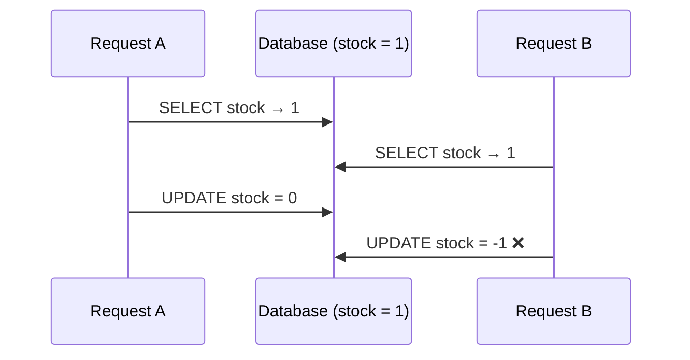

::part[Learn the Concept]{n="1"}

## 🎯 What you'll learn

- What a **transaction** is: `BEGIN`, `COMMIT`, `ROLLBACK`
- The **ACID** guarantees in plain language
- **Race conditions**: why "check, then update" breaks under concurrency
- Fixing races with **atomic updates**, **constraints** and **row locks** (`SELECT … FOR UPDATE`)
- **Isolation levels** and **deadlocks**, at a practical level
- Using transactions from Python with **psycopg**

## 🧠 The big idea

A :term[transaction]{bahasa="transaksi — sekelompok perintah database yang berhasil semua atau gagal semua"} is a **bank transfer**: taking money from account A and adding it to account B are two steps, but they must behave like **one**. If the power goes out between them, the money must not vanish.

> **All or nothing.** Either every step is saved (`COMMIT`), or none are (`ROLLBACK`).

## ❓ Why does this exist?

Real operations have several steps: create an order, decrease stock, record a payment, write an audit log. Failures happen **between** steps (bugs, timeouts, crashes). And thousands of users act **at the same time** — two people buying the last item, two tabs updating the same application.

## 💥 What happens if we DON'T use transactions?

```python
stock = db.execute("SELECT stock FROM products WHERE id = 5").fetchone()[0]   # both requests read 1
if stock >= 1:
    db.execute("UPDATE products SET stock = stock - 1 WHERE id = 5")            # both decrement
    db.execute("INSERT INTO orders ...")                                         # two orders, stock = -1
```

And without grouping: the stock decrement succeeds, the order insert fails on a constraint → an item disappears from inventory with no order. Customers get charged for things that don't exist, or warehouses ship phantom orders.

## 📖 How it works, step by step

### 1. BEGIN, COMMIT, ROLLBACK

```sql
BEGIN;
UPDATE products SET stock = stock - 1 WHERE id = 5;
INSERT INTO orders (user_id, total) VALUES (7, 60000);
COMMIT;        -- both changes become visible and permanent

BEGIN;
UPDATE products SET stock = stock - 1 WHERE id = 5;
ROLLBACK;      -- as if nothing happened
```

In PostgreSQL, **every** statement runs in a transaction; without `BEGIN` each statement commits on its own ("autocommit").

If any statement inside a transaction **fails**, PostgreSQL marks the transaction as aborted — you must `ROLLBACK`.

### 2. ACID in plain language

| Letter | Guarantee | Everyday meaning |
|---|---|---|
| **A**tomicity | all or nothing | no half-finished orders |
| **C**onsistency | constraints always hold | no negative stock if `CHECK (stock >= 0)` exists |
| **I**solation | concurrent transactions don't see each other's half-done work | other users never see an order without its items |
| **D**urability | committed data survives crashes | once "order confirmed", it's on disk |

### 3. Race conditions and three ways to prevent them

A :term[race condition]{bahasa="kondisi balapan — hasil salah karena dua proses berjalan bersamaan dan saling mendahului"} happens when the result depends on timing.



**Fix 1 — atomic conditional update** (simplest, often best):

```sql
UPDATE products SET stock = stock - 1
WHERE id = 5 AND stock >= 1
RETURNING stock;
-- 0 rows returned → out of stock
```

Check and change happen in **one** statement; the second request waits for the first, re-checks the condition, and updates nothing.

**Fix 2 — constraints as a safety net:**

```sql
ALTER TABLE products ADD CONSTRAINT stock_non_negative CHECK (stock >= 0);
```

Even buggy code can't push stock below zero. Unique constraints do the same for duplicates ("one application per role").

**Fix 3 — lock the row, then decide in application code:**

```sql
BEGIN;
SELECT stock, price FROM products WHERE id = 5 FOR UPDATE;   -- others wait here
-- application checks business rules…
UPDATE products SET stock = stock - 1 WHERE id = 5;
COMMIT;
```

`FOR UPDATE` locks the selected rows until the transaction ends. Use it when the decision needs more logic than a `WHERE` clause can express.

### 4. Isolation levels (practical view)

| Level (PostgreSQL) | Prevents | Notes |
|---|---|---|
| **Read Committed** (default) | reading uncommitted data | each statement sees data committed before it started; good default with atomic updates/locks |
| **Repeatable Read** | data changing under you within the transaction | may fail with a serialization error you must retry |
| **Serializable** | all anomalies — behaves as if transactions ran one by one | safest, but the app must **retry** on serialization failures |

For most web apps: Read Committed + atomic updates + constraints + occasional `FOR UPDATE`.

### 5. Deadlocks

Transaction A locks product 1 then wants product 2; transaction B locks product 2 then wants product 1 → both wait forever. PostgreSQL detects this and **aborts one** with a deadlock error.

Prevent it by **locking rows in a consistent order** (e.g. sort item ids before updating) and keeping transactions **short**.

### 6. Transactions in Python (psycopg 3)

```python
import psycopg

with psycopg.connect(DATABASE_URL, autocommit=True) as conn:
    with conn.transaction():                 # BEGIN
        row = conn.execute(
            "UPDATE products SET stock = stock - %s WHERE id = %s AND stock >= %s RETURNING price",
            (qty, product_id, qty),
        ).fetchone()
        if row is None:
            raise OutOfStock(product_id)    # exception → ROLLBACK
        conn.execute("INSERT INTO orders (user_id, total) VALUES (%s, %s)", (user_id, row[0] * qty))
    # leaving the block normally → COMMIT
```

ORMs have the same idea: SQLAlchemy's `session.begin()` / commit-rollback (Week 4), with Flask typically committing once per request.

### 7. Keep transactions short

A transaction holds locks. Never do slow things inside one: calling a payment API, sending emails, waiting for user input, or calling an LLM. Do those **before** (prepare) or **after** (via an outbox table/queue — Module 5).

## ⚖️ Trade-offs

| Approach | ✅ | ❌ |
|---|---|---|
| Atomic conditional `UPDATE` | simple, fast, no explicit locks | only for rules expressible in `WHERE` |
| `SELECT … FOR UPDATE` | arbitrary logic under a lock | others wait; deadlock risk if order is inconsistent |
| Serializable isolation | strongest correctness | retries needed; more aborted transactions |
| Constraints | always enforced | errors must be handled nicely in the app |
| Long transactions | "simpler" code | locks, contention, timeouts, bloat |

## ✅ When to use it / 🚫 When NOT to use it

- ✅ Wrap every multi-step write that must be consistent in a transaction.
- ✅ Use atomic updates for counters, stock, balances, quotas.
- 🚫 Don't hold a transaction open across network calls or user interactions.
- 🚫 Don't rely on "check in Python, then write" for anything concurrent.

## 🏆 Best practices

- [ ] Group related writes in **one transaction**; commit once per unit of work (often once per request).
- [ ] Make check-and-change **atomic** (`UPDATE … WHERE condition RETURNING`) instead of read-then-write.
- [ ] Back critical invariants with **constraints** (`CHECK`, `UNIQUE`, FK) — they're your last line of defense.
- [ ] Keep transactions **short**; no external API calls, emails or LLM calls inside them.
- [ ] Lock rows in a **consistent order** to avoid deadlocks; handle deadlock/serialization errors with a **retry**.
- [ ] Use **idempotency keys** for operations clients may retry (payments, order submission) — Week 5.
- [ ] Test concurrency explicitly (two connections/threads) for money, stock and quotas.
- [ ] Snapshot prices and totals inside the same transaction as the order.

## 🏭 How it's used in industry

- Payments, e-commerce checkout, ticket booking and inventory systems live and die by these patterns.
- Payment webhooks (like Midtrans callbacks) are processed in transactions together with idempotency checks, so duplicates don't double-credit.
- The **outbox pattern** writes "event to publish" rows in the same transaction as business data, then a worker sends them — reliable messaging without distributed transactions (Module 5).

## ⚠️ Common mistakes

- Read-then-write logic without locks or atomic updates.
- Forgetting to roll back after an error, leaving a connection in an aborted transaction.
- Calling external services while holding row locks.
- Updating rows in different orders in different code paths → deadlocks.
- Swallowing constraint errors instead of turning them into clear API responses.

:::revoshop
RevoShop handles money and stock. In `app/services/order_service.py` and `app/services/payment_service.py`, find: (1) where an order is created and stock is reduced — are both in **one** commit? (2) Is the stock check atomic, or "read stock, then update"? What happens if two buyers checkout the last item at the same moment? (3) In the Midtrans webhook handling (`app/integrations/midtrans.py`), what prevents the **same notification** from being processed twice? Write down your findings and one fix you'd make.
:::

::part[Explain & Design]{n="2"}

## 🗣️ Explain it

Explain a race condition to a non-programmer using two people booking the last seat on a bus through two different apps. Then explain how "all or nothing" protects the booking.

## 📐 Design it

Design the transaction for CareerPilot's **"accept offer"** action: when a user accepts an offer, (1) that application becomes `offer_accepted`, (2) all their other **active** applications become `withdrawn`, (3) a status-history row is written for each change, and (4) a congratulation email is sent. Write the steps, what goes inside the transaction, what goes outside, and how you'd prevent accepting two offers at once from two browser tabs.

:::quiz
Show a possible design

**Inside one transaction:**
1. `SELECT id FROM applications WHERE user_id = :u FOR UPDATE` — lock the user's applications in id order (both tabs now run one after another).
2. Verify the target application is still `offer` (if not, roll back → 409 Conflict).
3. `UPDATE applications SET status = 'offer_accepted' WHERE id = :id AND status = 'offer'`.
4. `UPDATE applications SET status = 'withdrawn' WHERE user_id = :u AND id <> :id AND status IN ('applied','interview','offer') RETURNING id, …`.
5. Insert history rows for every changed application.
6. Insert an `outbox_events` row: `{"type": "offer_accepted", "application_id": …}`.

**After commit (outside):** a worker reads the outbox and sends the email. If the email service is down, it retries later — the database state is already correct.

**Extra safety:** a partial unique index `UNIQUE (user_id) WHERE status = 'offer_accepted'` makes "two accepted offers" impossible even if a code path forgets the lock.
:::

### 📝 Self-review checklist

- [ ] All database changes are in one transaction
- [ ] The email is sent after commit, not inside the transaction
- [ ] Concurrency is handled (lock, conditional update, or constraint)
- [ ] A constraint backs the key invariant

::ai-review{task="design"}

::part[Toy Exercise]{n="3"}

:::exercise{path="exercises/m2/w2/07-transactions" ai="no-ai" title="All-or-nothing checkout"}
Implement `place_order()` with psycopg: decrease stock, create the order and its items with price snapshots — all in one transaction. If any item fails, nothing changes. The tests also start **two threads** that try to buy the last unit at the same moment: exactly one may succeed.
:::

:::hints
- `with conn.transaction():` — raising an exception inside rolls everything back.
- `UPDATE … WHERE id = %s AND stock >= %s RETURNING price` → `None` means out of stock (or unknown product).
- Sort items by product id before updating to avoid deadlocks.
- Validate `items` before opening the transaction.
:::

### 🏆 Stretch goal

Add an `idempotency_key` parameter: store it in `orders` with a `UNIQUE` constraint, and if the same key is used again, return the **existing** order id instead of creating a second order.

## ✅ Quick check

:::quiz
What does atomicity guarantee?

A transaction's changes are applied completely or not at all — never partially.
:::

:::quiz
Why is `UPDATE … SET stock = stock - 1 WHERE id = 5 AND stock >= 1` safe under concurrency while "SELECT stock, then UPDATE" isn't?

The condition is checked and applied in one statement while holding the row lock; a concurrent update waits and re-evaluates the condition. Read-then-write lets both requests act on the same stale value.
:::

:::quiz
Why shouldn't you call a payment API inside a database transaction?

It can be slow or hang, keeping locks and connections busy; and if the transaction later rolls back, the external call can't be undone. Do external calls before/after, with idempotency and an outbox.
:::

## 📖 Kamus (glossary)

| Term | Bahasa Indonesia |
|---|---|
| Transaction | Transaksi — semua berhasil atau semua batal |
| Commit / Rollback | Simpan permanen / Batalkan |
| Race condition | Kondisi balapan |
| Lock | Kunci baris agar tidak diubah bersamaan |
| Deadlock | Saling tunggu tanpa akhir |
| Isolation level | Tingkat isolasi transaksi |

## 📚 Keep learning

- [PostgreSQL tutorial: Transactions](https://www.postgresql.org/docs/current/tutorial-transactions.html)
- [PostgreSQL docs: Transaction Isolation](https://www.postgresql.org/docs/current/transaction-iso.html)
- [psycopg 3: Transactions management](https://www.psycopg.org/psycopg3/docs/basic/transactions.html)

## 📣 End of Week 2 — share your progress

:::linkedin{type="weekly"}
🐘 Week 2: databases stopped being "a place to store stuff" for me.

What I learned:
- Designing schemas with normalization and constraints that protect data
- JOINs, CTEs and window functions (finally understood LEFT JOIN + COUNT!)
- Reading EXPLAIN plans and adding the right index — one composite index removed a full table scan
- Transactions: I wrote a checkout that stays correct even when two people buy the last item at the same moment

The bug that taught me the most: [your story].

Next week: Python core, deeper. 🐍

#PostgreSQL #SQL #LearningInPublic #BackendDevelopment
:::
