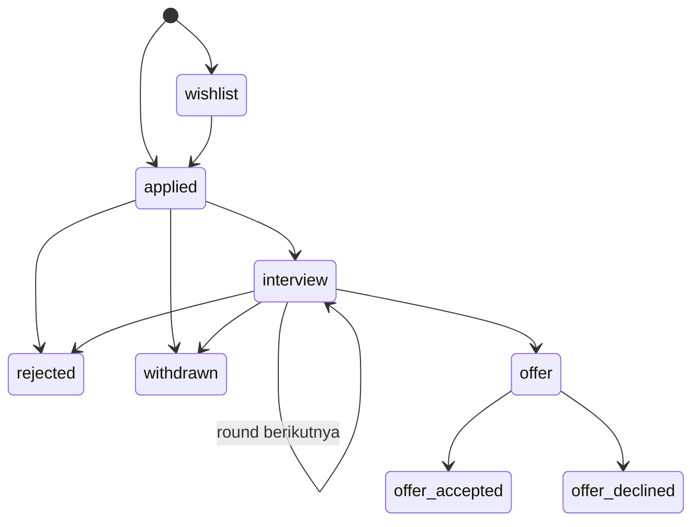

::part[Pelajari Konsepnya]{n="1"}

## 🎯 Yang akan kamu pelajari

- Kapan `if/elif` jadi masalah, dan tiga alat yang lebih baik
- **Structural pattern matching** (`match`/`case`) pada nilai, urutan, dan dictionary
- **Dispatch table**: pemetaan kunci ke fungsi
- Model aturan bisnis sebagai **mesin status** (transisi status yang diizinkan)
- Guard clause dan walrus operator, dipakai dengan bijak

## 🔤 Istilah penting

| Istilah | Artinya (sederhana) |
|---|---|
| **Control flow** | Urutan keputusan program — menentukan apa yang akan dilakukan selanjutnya |
| **Guard clause** | Menangani kasus buruk di awal dan kembali, untuk menghindari nesting dalam |
| **Pattern matching (`match`)** | Memilih cabang berdasarkan *bentuk* data, bukan hanya nilainya |
| **Dispatch table** | Dictionary yang memetakan kunci ke fungsi yang menanganinya |
| **State machine** | Daftar status dan transisi mana saja yang diizinkan di antara mereka |
| **Transition** | Satu gerakan yang diizinkan dari satu status ke status lain |
| **Walrus operator (`:=`)** | Menetapkan nilai di dalam sebuah kondisi |

## 🧠 Ide besarnya

Rantai `if/elif` yang panjang seperti resepsionis yang membaca daftar 40 item untuk setiap pengunjung. Tiga alat yang lebih baik:

- **Pattern matching** — mesin sortir yang mengenali *bentuk* apa yang tiba ("surat dengan stempel", "kotak dengan dua label").
- **Tabel dispatch** — papan informasi di mal: cari departemen, langsung ke sana.
- **Mesin status** — aturan permainan papan: dari kotak ini kamu hanya boleh pindah ke kotak-kotak tertentu.

## ❓ Kenapa ini penting

Kode backend penuh dengan keputusan: handler mana untuk event mana, perintah apa yang pengguna ketik, apakah perubahan status ini diizinkan. Ketika setiap kasus baru berarti mengedit satu rantai `if` raksasa, bug dan konflik merge menumpuk. Struktur keputusan yang jelas membuat aturan **terlihat**, **dapat diuji**, dan mudah diperluas.

Ini yang terjadi tanpa struktur keputusan:

```python
def change_status(application, new_status):
    if new_status == "interview":
        application["status"] = "interview"
    elif new_status == "offer":
        application["status"] = "offer"
    elif new_status == "rejected":
        application["status"] = "rejected"
    elif new_status == "applied":
        application["status"] = "applied"
```

Sebuah aplikasi yang **rejected** bisa melompat langsung ke **offer**, dan **offer** bisa kembali ke **applied**. Aturan sebenarnya — gerakan mana yang diizinkan — hanya ada di kepala orang, dan di bug report.

## 📖 Langkah demi langkah

### 1. Guard clause (recap) dan conditional expression

```python
def discount(user):
    if user is None:
        return 0
    if not user.is_member:
        return 0
    return 10 if user.years >= 3 else 5
```

### 2. Structural pattern matching

`match` membandingkan **bentuk** data, bukan hanya kesetaraan:

```python
def handle(event: dict) -> str:
    match event:
        case {"type": "application.created", "company": company}:
            return f"New application at {company}"
        case {"type": "status.changed", "to": "offer" | "offer_accepted"}:
            return "🎉 Offer!"
        case {"type": "status.changed", "to": status}:
            return f"Status changed to {status}"
        case {"type": str(kind)}:
            return f"Unhandled event {kind}"
        case _:
            raise ValueError("Invalid event")
```

| Pola | Cocok dengan |
|---|---|
| `case 404:` | nilai literal |
| `case "a" \| "b":` | salah satu dari beberapa nilai |
| `case [x, y]:` | urutan persis dua item, mengikat `x` dan `y` |
| `case [first, *rest]:` | satu atau lebih item |
| `case {"type": "x", "id": id_}:` | mapping dengan minimal kunci-kunci itu (kunci ekstra boleh) |
| `case str(name):` | nilai tipe itu, diikat ke `name` |
| `case Point(x=0):` | object dengan atribut yang cocok |
| `case _ if condition:` | guard |
| `case _:` | apa saja (default) |

Bagus untuk parsing **perintah**, **event**, dan data **seperti-JSON**. Untuk rentang sederhana (`score >= 90`), `if` masih lebih jelas.

### 3. Dispatch table

Menambah kasus baru berarti menambah satu entri ke tabel, bukan mengedit rantai yang juga sedang diedit orang lain.

Ketika setiap kasus hanya memanggil fungsi berbeda, petakan kunci ke fungsi:

```python
def export_csv(report): ...
def export_json(report): ...
def export_pdf(report): ...

EXPORTERS = {
    "csv": export_csv,
    "json": export_json,
    "pdf": export_pdf,
}

def export(report, fmt: str):
    try:
        exporter = EXPORTERS[fmt]
    except KeyError:
        raise ValueError(f"Unsupported format: {fmt}. Choose one of {sorted(EXPORTERS)}") from None
    return exporter(report)
```

Menambah format = menambah satu baris. Daftar format yang didukung adalah **data** yang bisa kamu tampilkan di pesan error atau doc API. (Routing URL Flask pada dasarnya adalah dispatch table besar dari path ke view function!)

### 4. Mesin status

Menulis gerakan yang diizinkan sebagai data mengubah "kami pikir itu seharusnya tidak terjadi" jadi "kode menolaknya" — dan tabel itu juga jadi dokumentasi untuk seluruh tim.

Sebuah :term[state machine]{bahasa="mesin status — model yang menentukan status apa saja yang boleh dituju dari status sekarang"} mencantumkan **transisi** yang diizinkan:



```python
TRANSITIONS: dict[str, set[str]] = {
    "wishlist": {"applied", "withdrawn"},
    "applied": {"interview", "rejected", "withdrawn"},
    "interview": {"interview", "offer", "rejected", "withdrawn"},
    "offer": {"offer_accepted", "offer_declined"},
    "rejected": set(),
    "withdrawn": set(),
    "offer_accepted": set(),
    "offer_declined": set(),
}

class InvalidTransition(Exception):
    pass

def next_status(current: str, target: str) -> str:
    if target not in TRANSITIONS.get(current, set()):
        raise InvalidTransition(f"Can't go from {current!r} to {target!r}")
    return target
```

Manfaatnya: aturan ada di satu tabel yang mudah dibaca; kamu bisa **menguji setiap sisi**; API bisa mengembalikan *"status berikutnya yang diizinkan"* ke frontend; dan status akhir jelas (set kosong).

### 5. Walrus operator `:=`

Tetapkan di dalam expression — berguna untuk menghindari menghitung sesuatu dua kali:

```python
if (match := EMAIL_RE.fullmatch(text)) is None:
    raise ValueError("invalid email")
domain = match.group("domain")
```

Gunakan di tempat ia menghilangkan duplikasi; hindari di tempat ia membuat baris padat.

### Memilih setup-mu

Setiap pilihan di sini adalah trade-off:

| Alat | ✅ | ❌ |
|---|---|---|
| `if/elif` | universal, bagus untuk rentang dan beberapa kasus | tumbuh berantakan; aturan tersebar |
| `match` | ekspresif untuk bentuk/struktur | Python 3.10+; berlebihan untuk 2-3 kasus sederhana |
| Dispatch table | dapat diperluas, kasus adalah data | hanya cocok "kunci → aksi"; alur kontrol kurang jelas saat debug |
| Tabel state machine | aturan eksplisit, sepenuhnya dapat diuji | harus tetap sinkron dengan `CHECK`/enum database |
| Walrus | menghilangkan duplikasi pemanggilan | mudah disalahgunakan |

- ✅ `match` untuk perintah, event, dan bentuk JSON bersarang.
- ✅ Dispatch table untuk perilaku yang dapat dipasang (exporter, handler, saluran notifikasi).
- ✅ Mesin status untuk apa pun dengan **lifecycle**: pesanan, pembayaran, aplikasi, ticket.
- 🚫 Jangan gunakan `match` hanya untuk mengganti if dua cabang.
- 🚫 Jangan sembunyikan aturan bisnis di kode UI — paksakan transisi di backend.

## ⚠️ Kesalahan umum

- Mengizinkan perubahan status apa pun karena "frontend hanya menampilkan tombol yang valid".
- Lupa status terminal (apa yang bisa mengikuti `rejected`?).
- `case x:` di mana `x` dimaksudkan sebagai konstanta — nama bare **menangkap** apa pun. Gunakan nama berdot (`Status.OFFER`) atau literal.
- Default diam yang menyembunyikan input tidak dikenal.

:::revoshop
README RevoShop punya bagian **Order Lifecycle**, dan database punya `CHECK (status IN ('waitingForPayment', 'processing', 'shipped', 'delivered', 'cancelled'))`. Buka `app/services/order_service.py`: di mana transisi yang diizinkan diterapkan? Apakah itu tabel transisi, serangkaian `if`, atau sebagian hilang? Bisakah order `delivered` menjadi `cancelled`? Gambar lifecycle sebagai Mermaid `stateDiagram` dan bandingkan dengan kode.
:::

## 🏆 Praktik terbaik

- [ ] Simpan aturan bisnis (transisi yang diizinkan, batas) di **satu tempat** sebagai data, bukan tersebar.
- [ ] Selalu sertakan **default** (`case _:` / penanganan kunci tidak dikenal) yang gagal dengan jelas.
- [ ] Naikkan **exception spesifik** (`InvalidTransition`) yang lapisan API ubah jadi respons `409`/`400`.
- [ ] Uji **setiap transisi yang diizinkan dan sampel yang tidak** (test parametrized membuat ini murah).
- [ ] Simpan database `CHECK` constraint dan daftar status Python tetap sinkron (satu sumber kebenaran jika mungkin, misalnya `Enum`).
- [ ] Gunakan guard clause untuk membuat fungsi datar.
- [ ] Lebih memilih kejelasan daripada kecanggihan untuk `match` dan `:=`.

::part[Jelaskan & Rancang]{n="2"}

## 🗣️ Jelaskan

Jelaskan mesin status kepada orang non-programmer menggunakan pesanan pengiriman makanan (dipesan → dimasak → di perjalanan → terkirim). Kenapa "delivered" seharusnya tidak kembali ke "cooking"?

## 📐 Rancang

Rancang mesin status untuk **ticket SupportDesk AI**: `open`, `ai_answering`, `waiting_customer`, `escalated_to_human`, `resolved`, `closed`. Tentukan transisi yang diizinkan, status mana yang terminal, siapa/apa yang memicu setiap transisi (customer, AI, human agent, timer), dan satu invariant yang database harus paksakan.

:::quiz
Lihat contoh rancangan

```text
open               → ai_answering (system), escalated_to_human (customer minta manusia)
ai_answering       → waiting_customer (AI jawab), escalated_to_human (keyakinan rendah / guardrail)
waiting_customer   → ai_answering (customer balas), resolved (customer konfirmasi), closed (timer: 7 hari diam)
escalated_to_human → waiting_customer (agent balas), resolved (agent)
resolved           → open (customer buka ulang dalam 7 hari), closed (timer)
closed             → (terminal)
```

Invariant: `escalated_to_human` memerlukan `assigned_agent_id IS NOT NULL` → `CHECK (status <> 'escalated_to_human' OR assigned_agent_id IS NOT NULL)`.
:::

### 📝 Checklist review mandiri

- [ ] Setiap status memiliki status berikutnya yang ditentukan (atau terminal)
- [ ] Setiap transisi punya trigger/actor
- [ ] Saya menambahkan minimal satu invariant level database

::ai-review{task="design"}

::part[Latihan Kecil]{n="3"}

:::exercise{path="exercises/m2/w3/02-control-flow" ai="no-ai" title="Status, perintah, dan event"}
Implementasikan di `flow.py`:

- `next_status(current, target)` menggunakan tabel transisi; naikkan `InvalidTransition` untuk gerakan yang tidak diizinkan atau status tidak dikenal
- `allowed_next(current)` → daftar terurut status berikutnya yang diizinkan
- `parse_command(text)` dengan `match` untuk CLI CareerPilot kecil: `add <company> <role…>`, `move <id> <status>`, `list [status]`, `help`
- `describe_event(event)` dengan pola mapping untuk event seperti webhook
:::

:::hints
- `text.split()` lalu `match parts:` dengan pola urutan seperti `["move", id_text, status]`.
- `case ["add", company, *role_words] if role_words:` menangani role multi-kata.
- Konversi `id_text` dengan `int()`; id yang bukan angka seharusnya naikkan `ValueError`.
:::

### 🏆 Tujuan stretch

Ganti string status dengan `enum.StrEnum` dan buat `next_status` terima dan kembalikan anggota enum.

## ✅ Cek cepat

:::quiz
Di `match`, kenapa `case offer:` berbahaya ketika kamu bermaksud membandingkan dengan variabel bernama `offer`?

Nama bare di pola adalah **capture pattern**: ia cocok dengan apa pun dan menetapkannya ke `offer`. Gunakan literal (`"offer"`) atau nama berdot (`Status.OFFER`).
:::

:::quiz
Manfaat utama menyimpan transisi di dictionary daripada statement `if`?

Aturan menjadi data yang terlihat: mudah di-review, diuji exhaustively, diperluas, dan diekspos ke API (misalnya "status berikutnya yang diizinkan").
:::


## 📚 Lanjut belajar

- [PEP 636 — Structural Pattern Matching: Tutorial](https://peps.python.org/pep-0636/)
- [Python docs: enum.StrEnum](https://docs.python.org/3/library/enum.html#enum.StrEnum)
