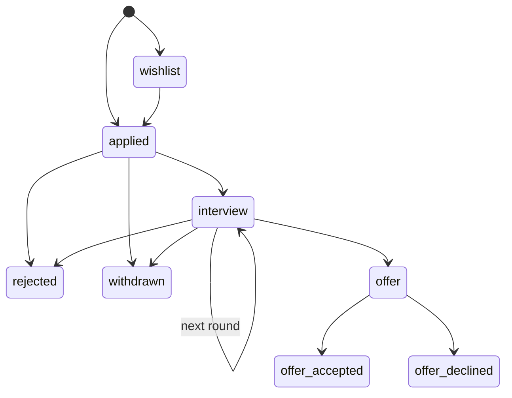

::part[Learn the Concept]{n="1"}

## 🎯 What you'll learn

- When `if/elif` becomes a problem, and three better tools
- **Structural pattern matching** (`match`/`case`) on values, sequences and dictionaries
- **Dispatch tables**: mapping keys to functions
- Modeling business rules as a **state machine** (allowed status transitions)
- Guard clauses and the walrus operator, used sparingly

## 🧠 The big idea

Long `if/elif` chains are like a receptionist reading a 40-item checklist for every visitor. Better options:

- **Pattern matching** — a sorting machine that recognizes the *shape* of what arrives ("a letter with a stamp", "a box with two labels").
- **A dispatch table** — a directory board: look up the department, go straight there.
- **A state machine** — the rules of a board game: from this square, you may only move to these squares.

## ❓ Why does this exist?

Backend code is full of decisions: which handler for which event, which command did the user type, is this status change allowed? When each new case means editing a giant `if` chain, bugs and merge conflicts pile up. Clear decision structures make rules **visible**, **testable** and **easy to extend**.

## 💥 What happens if we DON'T structure decisions?

```python
def change_status(application, new_status):
    if new_status == "interview":
        application["status"] = "interview"
    elif new_status == "offer":
        application["status"] = "offer"
    elif new_status == "rejected":
        application["status"] = "rejected"
    elif new_status == "applied":
        application["status"] = "applied"
```

This lets a **rejected** application jump straight to **offer**, or an **offer** go back to **applied**. The real rule ("which moves are allowed?") exists only in people's heads — and in bug reports.

## 📖 How it works, step by step

### 1. Guard clauses (recap) and conditional expressions

```python
def discount(user):
    if user is None:
        return 0
    if not user.is_member:
        return 0
    return 10 if user.years >= 3 else 5
```

### 2. Structural pattern matching

`match` compares the **shape** of data, not only equality:

```python
def handle(event: dict) -> str:
    match event:
        case {"type": "application.created", "company": company}:
            return f"New application at {company}"
        case {"type": "status.changed", "to": "offer" | "offer_accepted"}:
            return "🎉 Offer!"
        case {"type": "status.changed", "to": status}:
            return f"Status changed to {status}"
        case {"type": str(kind)}:
            return f"Unhandled event {kind}"
        case _:
            raise ValueError("Invalid event")
```

| Pattern | Matches |
|---|---|
| `case 404:` | a literal value |
| `case "a" \| "b":` | any of several values |
| `case [x, y]:` | a sequence of exactly two items, binding `x` and `y` |
| `case [first, *rest]:` | one or more items |
| `case {"type": "x", "id": id_}:` | a mapping with at least those keys (extra keys allowed) |
| `case str(name):` | a value of that type, bound to `name` |
| `case Point(x=0):` | an object with matching attributes |
| `case _ if condition:` | a guard |
| `case _:` | anything (the default) |

Great for parsing **commands**, **events**, and **JSON-like** data. For simple ranges (`score >= 90`), `if` is still clearer.

### 3. Dispatch tables

When each case just calls a different function, map keys to functions:

```python
def export_csv(report): ...
def export_json(report): ...
def export_pdf(report): ...

EXPORTERS = {
    "csv": export_csv,
    "json": export_json,
    "pdf": export_pdf,
}

def export(report, fmt: str):
    try:
        exporter = EXPORTERS[fmt]
    except KeyError:
        raise ValueError(f"Unsupported format: {fmt}. Choose one of {sorted(EXPORTERS)}") from None
    return exporter(report)
```

Adding a format = adding one line. The list of supported formats is **data** you can show in an error message or API docs. (Flask's URL routing is essentially a big dispatch table from paths to view functions!)

### 4. State machines

A :term[state machine]{bahasa="mesin status — model yang menentukan status apa saja yang boleh dituju dari status sekarang"} lists the allowed **transitions**:



```python
TRANSITIONS: dict[str, set[str]] = {
    "wishlist": {"applied", "withdrawn"},
    "applied": {"interview", "rejected", "withdrawn"},
    "interview": {"interview", "offer", "rejected", "withdrawn"},
    "offer": {"offer_accepted", "offer_declined"},
    "rejected": set(),
    "withdrawn": set(),
    "offer_accepted": set(),
    "offer_declined": set(),
}

class InvalidTransition(Exception):
    pass

def next_status(current: str, target: str) -> str:
    if target not in TRANSITIONS.get(current, set()):
        raise InvalidTransition(f"Can't go from {current!r} to {target!r}")
    return target
```

Benefits: the rules are one readable table; you can **test every edge**; the API can return *"allowed next statuses"* to the frontend; and final states are explicit (empty sets).

### 5. The walrus operator `:=`

Assign inside an expression — useful to avoid computing something twice:

```python
if (match := EMAIL_RE.fullmatch(text)) is None:
    raise ValueError("invalid email")
domain = match.group("domain")
```

Use it where it removes duplication; avoid it where it makes lines dense.

## ⚖️ Trade-offs

| Tool | ✅ | ❌ |
|---|---|---|
| `if/elif` | universal, great for ranges and a few cases | grows messy; rules scattered |
| `match` | expressive for shapes/structures | Python 3.10+; overkill for 2–3 simple cases |
| Dispatch table | extensible, cases are data | only fits "key → action"; less obvious control flow when debugging |
| State machine table | rules explicit, fully testable | must be kept in sync with the database `CHECK`/enum |
| Walrus | removes duplicate calls | easy to overuse |

## ✅ When to use it / 🚫 When NOT to use it

- ✅ `match` for commands, events, and nested JSON shapes.
- ✅ Dispatch tables for pluggable behaviors (exporters, handlers, notification channels).
- ✅ State machines for anything with a **lifecycle**: orders, payments, applications, tickets.
- 🚫 Don't use `match` just to replace a two-branch `if`.
- 🚫 Don't hide business rules in UI code — enforce transitions in the backend.

## 🏆 Best practices

- [ ] Keep business rules (allowed transitions, limits) in **one place** as data, not scattered across endpoints.
- [ ] Always include a **default** (`case _:` / unknown key handling) that fails clearly.
- [ ] Raise **specific exceptions** (`InvalidTransition`) that the API layer turns into `409`/`400` responses.
- [ ] Test **every allowed and a sample of disallowed** transitions (parametrized tests make this cheap).
- [ ] Keep the database `CHECK` constraint and the Python status list in sync (one source of truth where possible, e.g. an `Enum`).
- [ ] Use guard clauses to keep functions flat.
- [ ] Prefer readability over cleverness for `match` and `:=`.

## 🏭 How it's used in industry

- Order, payment and shipping lifecycles are implemented as state machines (sometimes with libraries or workflow engines).
- Webhook handlers and message consumers dispatch on `event["type"]`.
- CLIs and chatbots parse commands with pattern matching; AI agents dispatch **tool calls** by name — a dispatch table (Module 7).

## ⚠️ Common mistakes

- Allowing any status change because "the frontend only shows valid buttons".
- Forgetting terminal states (what can follow `rejected`?).
- `case x:` where `x` was meant as a constant — a bare name **captures** anything. Use dotted names (`Status.OFFER`) or literals.
- Silent defaults that hide unknown inputs.

:::revoshop
RevoShop's README has an **Order Lifecycle** section, and the database has `CHECK (status IN ('waitingForPayment', 'processing', 'shipped', 'delivered', 'cancelled'))`. Open `app/services/order_service.py`: where are allowed transitions enforced? Is it a table of transitions, a series of `if`s, or partly missing? Can a `delivered` order become `cancelled`? Draw the lifecycle as a Mermaid `stateDiagram` and compare it with the code.
:::

::part[Explain & Design]{n="2"}

## 🗣️ Explain it

Explain a state machine to a non-programmer using a food delivery order (placed → cooking → on the way → delivered). Why shouldn't "delivered" go back to "cooking"?

## 📐 Design it

Design the state machine for **SupportDesk AI tickets**: `open`, `ai_answering`, `waiting_customer`, `escalated_to_human`, `resolved`, `closed`. Define the allowed transitions, which states are terminal, who/what triggers each transition (customer, AI, human agent, timer), and one invariant the database should enforce.

:::quiz
Show a possible design

```text
open               → ai_answering (system), escalated_to_human (customer asks for a human)
ai_answering       → waiting_customer (AI answered), escalated_to_human (low confidence / guardrail)
waiting_customer   → ai_answering (customer replies), resolved (customer confirms), closed (timer: 7 days silence)
escalated_to_human → waiting_customer (agent replied), resolved (agent)
resolved           → open (customer reopens within 7 days), closed (timer)
closed             → (terminal)
```

Invariant: `escalated_to_human` requires `assigned_agent_id IS NOT NULL` → `CHECK (status <> 'escalated_to_human' OR assigned_agent_id IS NOT NULL)`.
:::

### 📝 Self-review checklist

- [ ] Every state has defined next states (or is terminal)
- [ ] Each transition has a trigger/actor
- [ ] I added at least one database-level invariant

::ai-review{task="design"}

::part[Toy Exercise]{n="3"}

:::exercise{path="exercises/m2/w3/02-control-flow" ai="no-ai" title="Statuses, commands and events"}
Implement in `flow.py`:

- `next_status(current, target)` using a transitions table; raise `InvalidTransition` for disallowed moves or unknown statuses
- `allowed_next(current)` → sorted list of allowed next statuses
- `parse_command(text)` with `match` for a tiny CareerPilot CLI: `add <company> <role…>`, `move <id> <status>`, `list [status]`, `help`
- `describe_event(event)` with mapping patterns for webhook-like events
:::

:::hints
- `text.split()` then `match parts:` with sequence patterns like `["move", id_text, status]`.
- `case ["add", company, *role_words] if role_words:` handles multi-word roles.
- Convert `id_text` with `int()`; a non-numeric id should raise `ValueError`.
:::

### 🏆 Stretch goal

Replace the status strings with an `enum.StrEnum` and make `next_status` accept and return enum members.

## ✅ Quick check

:::quiz
In `match`, why is `case offer:` dangerous when you meant to compare with a variable named `offer`?

A bare name in a pattern is a **capture pattern**: it matches anything and assigns it to `offer`. Use a literal (`"offer"`) or a dotted name (`Status.OFFER`).
:::

:::quiz
What's the main benefit of storing transitions in a dictionary instead of `if` statements?

The rules become visible data: easy to review, test exhaustively, extend, and expose to the API (e.g. "allowed next statuses").
:::

## 📖 Kamus (glossary)

| Term | Bahasa Indonesia |
|---|---|
| Pattern matching | Pencocokan pola/bentuk data |
| Dispatch table | Tabel pemetaan kunci ke fungsi |
| State machine | Mesin status |
| Transition | Transisi — perpindahan status |
| Terminal state | Status akhir |
| Guard | Syarat tambahan pada sebuah case |

## 📚 Keep learning

- [PEP 636 — Structural Pattern Matching: Tutorial](https://peps.python.org/pep-0636/)
- [Python docs: enum.StrEnum](https://docs.python.org/3/library/enum.html#enum.StrEnum)
