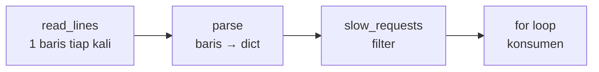

::part[Pelajari Konsepnya]{n="1"}

## 🎯 Yang akan kamu pelajari

- **Iterator protocol**: apa yang benar-benar dilakukan `for`
- **Generator** (`yield`) dan **generator expression** — hemat memori, lazy (dihitung saat diminta)
- Membangun **pipeline** dari langkah generator kecil
- Essensial `itertools`: `islice`, `batched`, `chain`, `groupby`, `accumulate`
- Ekstra `for`/`while`: `else` di loop, sentinel loop, dan kapan stop iterasi

## 🔤 Istilah penting

| Istilah | Artinya (sederhana) |
|---|---|
| **Iterable** | Apa pun yang bisa dilalui loop (list, file, baris database) |
| **Iterator** | Sesuatu yang memberikan satu item satu per satu |
| **Generator** | Fungsi yang hasilkan nilai bertahap dengan `yield` |
| **`yield`** | Berikan satu nilai lalu jeda di sini sampai diminta lagi |
| **Lazy** | Dihitung cuma saat diminta, bukan diawal |
| **Generator expression** | Comprehension dalam kurung bulat — hemat memori, bukan disimpan |
| **Pipeline** | Rangkaian langkah generator yang terhubung |
| **`itertools`** | Kotak alat standar untuk slice, batch, dan group iterable |
| **Streaming** | Proses data saat tiba, bukan muat semuanya duluan |

## 🧠 Ide besarnya

List itu seperti **satu kotak jeruk sejuta buah** dikirim ke pintumu: berat, perlu tempat buat semuanya. Generator adalah **ban berjalan** dari kebun: satu jeruk tiba saat kamu siap menerima, dan kamu tidak perlu ruang buat seluruh panen.

## ❓ Kenapa ini penting

Pekerjaan backend terus-terusan tangani data lebih besar dari memori, atau data yang tidak pernah habis: file log 5 GB, ekspor CSV setiap order, baris dari database, antrean event, atau token dari LLM. Muat semua ke list duluan itu lambat dan bisa bikin proses mati.

```python
lines = open("access.log").readlines()          # loads the whole 5 GB file into RAM 💥
errors = [line for line in lines if " 500 " in line]
print(len(errors))
```

```python
rows = db.execute("SELECT * FROM applications").fetchall()   # 20 million rows in memory
for row in rows:
    export(row)
```

Server kehabisan memori, atau semuanya freeze saat user menunggu.

## 📖 Langkah demi langkah

### 1. Apa yang sebenarnya dilakukan `for`

Loop `for` cuma bertanya sopan "sebelum tidur, ada lagi?" sampai iterator bilang habis.

```python
for skill in ["python", "sql"]:
    print(skill)
```

kira-kiranya:

```python
iterator = iter(["python", "sql"])   # ask the object for an iterator
while True:
    try:
        skill = next(iterator)        # get the next item
    except StopIteration:             # no more items
        break
    print(skill)
```

- **Iterable** bisa hasilkan iterator (`list`, `dict`, `str`, file, `range`…).
- **Iterator** ingat posisinya dan kasih item berikutnya pakai `next()`.
- Iterator **dikonsumsi**: sekali habis, dia kosong.

```python
it = iter([1, 2, 3])
list(it)   # [1, 2, 3]
list(it)   # []  ← already consumed!
```

### 2. Fungsi generator

Fungsi apa pun dengan `yield` adalah generator:

```python
def read_errors(path):
    with open(path, encoding="utf-8") as file:
        for line in file:              # files are iterated line by line, lazily
            if " 500 " in line:
                yield line.rstrip("\n")

for error in read_errors("access.log"):   # nothing is read until the loop asks
    print(error)
```

Setiap `yield` jeda fungsi dan kasih nilai; `next()` berikutnya mulai lagi setelah itu. Pakai memori tetap kecil apapun ukuran file-nya.

### 3. Generator expression

Seperti list comprehension, pakai kurung bulat — lazy:

```python
total = sum(order["total"] for order in orders)          # no intermediate list
has_remote = any(job["remote"] for job in jobs)          # stops at the first True
```

### 4. Pipeline

Setiap langkah adalah satu mesin di ban: baca, filter, transform, batch. Tidak ada yang bergerak sampai ujung ban ditarik — jadi memori tetap flat apapun ukuran file-nya.

Rantai generator kecil — setiap langkah satu tugas:

```python
def read_lines(path):
    with open(path, encoding="utf-8") as file:
        yield from file

def parse(lines):
    for line in lines:
        timestamp, level, method, path, status, duration = line.split()
        yield {"level": level, "path": path, "status": int(status), "ms": int(duration.rstrip("ms"))}

def slow_requests(records, threshold_ms):
    return (r for r in records if r["ms"] > threshold_ms)

for record in slow_requests(parse(read_lines("app.log")), threshold_ms=500):
    print(record["path"], record["ms"])
```

`yield from iterable` kasih setiap item dari iterable lain.



### 5. Essensial itertools

```python
from itertools import islice, batched, chain, groupby, accumulate, count

first_10 = list(islice(read_errors("access.log"), 10))    # take only what you need

for batch in batched(user_ids, 500):                        # Python 3.12+: tuples of up to 500
    send_newsletter(batch)                                   # e.g. bulk API calls or DB inserts

all_skills = chain(job_a["skills"], job_b["skills"])        # iterate several iterables as one

sorted_jobs = sorted(jobs, key=lambda j: j["city"])
for city, city_jobs in groupby(sorted_jobs, key=lambda j: j["city"]):   # input must be sorted by the key!
    print(city, len(list(city_jobs)))

running_totals = list(accumulate([100, 250, 50]))           # [100, 350, 400]

for attempt in count(1):                                     # 1, 2, 3, … forever (break yourself)
    if try_connect():
        break
```

### 6. `else` di loop dan sentinel loop

```python
for server in servers:
    if server.is_healthy():
        chosen = server
        break
else:                         # runs only if the loop did NOT break
    raise RuntimeError("No healthy servers")
```

```python
while (chunk := file.read(8192)):     # read a binary file in chunks until empty
    process(chunk)
```

### 7. Generator di stack sungguhan

- Database driver support **server-side cursor** / `yield_per` stream baris (SQLAlchemy di Week 4).
- Flask bisa stream response dari generator; FastAPI `StreamingResponse` juga.
- LLM API stream token — kamu loop mereka di Module 7.

### Pilih setup mana

Setiap pilihan di sini ada trade-off:

| Pilihan | ✅ | ❌ |
|---|---|---|
| List | akses random, `len()`, bisa dipakai ulang | semuanya di memori |
| Generator | memori kecil, mulai instant, stream infinite | cuma sekali jalan, tidak ada `len()`/indexing, susah debug |
| Pipeline generator | bisa dikomposisi, langkah testable | error muncul lambat (saat dikonsumsi) |
| `batched` processing | lebih sedikit round trip, memori terbatas | perlu tangani batch terakhir yang tidak lengkap |

- ✅ Generator buat file besar, ekspor database, API streaming, dan data pipeline.
- ✅ Generator expression di dalam `sum`, `any`, `all`, `max`, `"".join`.
- 🚫 Pakai list saat perlu loop **beberapa kali**, index, atau tahu panjangnya.
- 🚫 Jangan `groupby` di data yang belum sort (cuma group item **bersebelahan** yang key-nya sama).

## ⚠️ Kesalahan umum

- Loop generator dua kali, dapat tidak ada yang kedua kalinya.
- `groupby` tanpa sort duluan.
- Ubah generator besar jadi list "buat debug" dan kehabisan memori.
- Lupa batch terakhir yang tidak lengkap.

:::revoshop
Lihat bagaimana RevoShop seeders atau list endpoint muat data (`seeders/seeders.py`, list functions di `app/repositories/`). Ada yang panggil `.all()` di table yang mungkin besar? Buat fitur admin "ekspor semua order ke CSV", sketch bagaimana kamu stream baris dalam batch pakai generator daripada muat semuanya.
:::

## 🏆 Praktik terbaik

- [ ] Loop file baris per baris (`for line in file`), jangan `readlines()` di file besar.
- [ ] Stream hasil database dalam batch buat ekspor/background job daripada `fetchall()`.
- [ ] Tiap langkah generator kecil dan satu tujuan; test langkah-langkah pakai list kecil.
- [ ] Pakai `itertools.batched` (3.12+) buat bulk insert dan API call.
- [ ] Generator adalah one-shot — ubah ke list kalau perlu pakai data lagi.
- [ ] Tutup resource dengan benar: buka file di dalam generator pakai `with`, dan konsumsi penuh atau tutup generator.
- [ ] Suka `enumerate`, `zip`, `itertools` daripada counter dan index manual.

::part[Jelaskan & Rancang]{n="2"}

## 🗣️ Jelaskan

Jelaskan ke orang yang bukan programmer bedanya unduh film lengkap sebelum tonton vs streaming — dan hubungkan ke list vs generator.

## 📐 Rancang

Rancang **pipeline generator** buat CareerPilot job importer: baca file JSON Lines 2 GB (satu listing per baris) → parse → skip baris tidak valid (hitung) → normal skill → deduplikasi berdasar `source_url` → masuk database dalam batch 1000. Kasih nama setiap langkah, bilang apa yang di-yield, dan tempat mana memori masih bisa tumbuh.

:::quiz
Lihat contoh rancangan

```text
read_lines(path)                  → str                (satu baris tiap kali)
parse_json(lines, errors)         → dict               (json.loads; gagal errors["invalid"] += 1 dan skip)
normalize(listings)               → dict               (bersihkan judul, skill lowercase/dedupe)
dedupe(listings, seen_urls)       → dict               (skip kalau source_url sudah ada; tambah dia)
batched(listings, 1000)           → tuple[dict, ...]
insert_batch(conn, batch)         → int                (executemany / COPY; commit per batch)
```

Risiko memori: `seen_urls` tumbuh dengan setiap URL unik (juta string). Alternatif: andalkan constraint `UNIQUE (source_url)` dengan `ON CONFLICT DO NOTHING` di database, atau pertahankan cache terbatas.
:::

### 📝 Checklist review mandiri

- [ ] Tidak ada yang muat seluruh file atau semua baris sekaligus
- [ ] Baris tidak valid dihitung, bukan hilang diam-diam
- [ ] Saya tahu risiko memori yang masih ada
- [ ] Insert di-batch

::ai-review{task="design"}

::part[Latihan Kecil]{n="3"}

:::exercise{path="exercises/m2/w3/03-iterators-generators" ai="no-ai" title="Streaming log analytics"}
Bangun pipeline generator kecil di `stream.py` yang analisa log file tanpa pernah muat semua: baca baris lazy, parse record, filter request lambat, ambil N pertama, batch item, dan group total. Satu test kasih **file virtual 10 juta baris** — hanya pass kalau kode kamu benar-benar lazy.
:::

:::hints
- `yield` di dalam `with open(...)` buat file tetap terbuka saat consumer loop.
- `parse_records` skip baris rusak dan **hitung** mereka di dict yang dilewatkan.
- `take(iterable, n)` satu baris dengan `itertools.islice`.
- Implementasi `batched_items` sendiri (jangan `itertools.batched`) — pakai `islice` di loop.
:::

### 🏆 Stretch goal

Tulis `tail_follow(path)` yang yield baris baru yang ditambah ke file (seperti `tail -f`), pakai `time.sleep` di loop. Bagaimana kamu test-nya?

## ✅ Cek cepat

:::quiz
Kenapa loop generator kedua kali tidak hasilkan apa pun?

Generator adalah iterator: dia ingat posisi dan habis setelah pass pertama lengkap. Buat generator baru (panggil fungsi lagi) atau simpan hasil di list.
:::

:::quiz
Kenapa `sum(x * 2 for x in numbers)` lebih baik daripada `sum([x * 2 for x in numbers])` buat data besar?

Generator expression hasilkan nilai satu per satu tanpa bangun list antara di memori.
:::

:::quiz
Apa yang `groupby` butuh buat group dengan benar?

Input harus sudah sort (atau paling tidak di-group) sama key yang dipakai; cuma group item bersebelahan.
:::


## 📚 Lanjut belajar

- [Python docs: Iterator](https://docs.python.org/3/tutorial/classes.html#iterators)
- [Python docs: Generator](https://docs.python.org/3/tutorial/classes.html#generators)
- [Python docs: itertools](https://docs.python.org/3/library/itertools.html)
