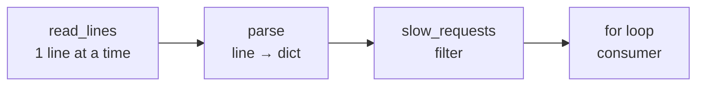

::part[Learn the Concept]{n="1"}

## 🎯 What you'll learn

- The **iterator protocol**: what `for` actually does
- **Generators** (`yield`) and **generator expressions** — lazy, memory-friendly sequences
- Building **pipelines** of small generator steps
- `itertools` essentials: `islice`, `batched`, `chain`, `groupby`, `accumulate`
- `for`/`while` extras: `else` on loops, sentinel loops, and when to stop iterating

## 🔤 Key words

| Word | In simple words | Bahasa Indonesia |
|---|---|---|
| **Iterable** | Anything you can loop over (list, file, database rows) | Bisa dilalui loop |
| **Iterator** | The thing that hands you one item at a time | Pemberi nilai satu per satu |
| **Generator** | A function that produces values one by one with `yield` | Fungsi penghasil nilai bertahap |
| **`yield`** | Hand back one value and pause here until asked again | Berikan satu nilai lalu jeda |
| **Lazy** | Nothing is computed until you ask for the next item | Dihitung saat diminta |
| **Generator expression** | A comprehension in round brackets — lazy, not stored | Comprehension yang hemat memori |
| **Pipeline** | Small generator steps chained together | Rangkaian langkah pengolahan |
| **`itertools`** | The standard toolbox for slicing, batching and grouping iterables | Kotak alat untuk iterasi |
| **Streaming** | Processing data as it arrives instead of loading it all | Mengolah sambil mengalir |

## 🧠 The big idea

A list is a **box of one million oranges** delivered to your door: heavy, and you must find space for all of them. A :term[generator]{bahasa="generator — fungsi yang menghasilkan nilai satu per satu saat diminta, bukan sekaligus"} is a **conveyor belt** from the orchard: one orange arrives whenever you're ready for the next, and you never need room for the whole harvest.

## ❓ Why it matters

Backend work constantly handles data bigger than memory, or data that never ends: a 5 GB log file, a CSV export of every order, rows streamed from a database, a queue of events, or tokens streaming from an LLM. Loading it all into a list first is slow and can kill the process.

```python
lines = open("access.log").readlines()          # loads the whole 5 GB file into RAM 💥
errors = [line for line in lines if " 500 " in line]
print(len(errors))
```

```python
rows = db.execute("SELECT * FROM applications").fetchall()   # 20 million rows in memory
for row in rows:
    export(row)
```

The server runs out of memory, or everything freezes while users wait.

## 📖 Step by step

### 1. What `for` really does

A `for` loop is just politely asking "next, please" until the iterator says there's nothing left.

```python
for skill in ["python", "sql"]:
    print(skill)
```

is roughly:

```python
iterator = iter(["python", "sql"])   # ask the object for an iterator
while True:
    try:
        skill = next(iterator)        # get the next item
    except StopIteration:             # no more items
        break
    print(skill)
```

- An **iterable** can produce an iterator (`list`, `dict`, `str`, files, `range`…).
- An **iterator** remembers its position and gives the next item with `next()`.
- Iterators are **consumed**: once exhausted, they're empty.

```python
it = iter([1, 2, 3])
list(it)   # [1, 2, 3]
list(it)   # []  ← already consumed!
```

### 2. Generator functions

Any function with `yield` returns a generator:

```python
def read_errors(path):
    with open(path, encoding="utf-8") as file:
        for line in file:              # files are iterated line by line, lazily
            if " 500 " in line:
                yield line.rstrip("\n")

for error in read_errors("access.log"):   # nothing is read until the loop asks
    print(error)
```

Each `yield` pauses the function and hands out a value; the next `next()` resumes right after it. Memory use stays tiny no matter the file size.

### 3. Generator expressions

Like a list comprehension, with parentheses — lazy:

```python
total = sum(order["total"] for order in orders)          # no intermediate list
has_remote = any(job["remote"] for job in jobs)          # stops at the first True
```

### 4. Pipelines

Each step is one machine on the belt: read, filter, transform, batch. Nothing moves until the end of the belt pulls — so memory stays flat no matter how big the file is.

Chain small generators — each step does one job:

```python
def read_lines(path):
    with open(path, encoding="utf-8") as file:
        yield from file

def parse(lines):
    for line in lines:
        timestamp, level, method, path, status, duration = line.split()
        yield {"level": level, "path": path, "status": int(status), "ms": int(duration.rstrip("ms"))}

def slow_requests(records, threshold_ms):
    return (r for r in records if r["ms"] > threshold_ms)

for record in slow_requests(parse(read_lines("app.log")), threshold_ms=500):
    print(record["path"], record["ms"])
```

`yield from iterable` yields every item from another iterable.



### 5. itertools essentials

```python
from itertools import islice, batched, chain, groupby, accumulate, count

first_10 = list(islice(read_errors("access.log"), 10))    # take only what you need

for batch in batched(user_ids, 500):                        # Python 3.12+: tuples of up to 500
    send_newsletter(batch)                                   # e.g. bulk API calls or DB inserts

all_skills = chain(job_a["skills"], job_b["skills"])        # iterate several iterables as one

sorted_jobs = sorted(jobs, key=lambda j: j["city"])
for city, city_jobs in groupby(sorted_jobs, key=lambda j: j["city"]):   # input must be sorted by the key!
    print(city, len(list(city_jobs)))

running_totals = list(accumulate([100, 250, 50]))           # [100, 350, 400]

for attempt in count(1):                                     # 1, 2, 3, … forever (break yourself)
    if try_connect():
        break
```

### 6. Loop `else` and sentinel loops

```python
for server in servers:
    if server.is_healthy():
        chosen = server
        break
else:                         # runs only if the loop did NOT break
    raise RuntimeError("No healthy servers")
```

```python
while (chunk := file.read(8192)):     # read a binary file in chunks until empty
    process(chunk)
```

### 7. Generators in the real stack

- Database drivers support **server-side cursors** / `yield_per` to stream rows (SQLAlchemy in Week 4).
- Flask can stream responses from a generator; FastAPI's `StreamingResponse` too.
- LLM APIs stream tokens — you'll iterate over them in Module 7.

### Choosing your setup

Every option here is a trade-off:

| Choice | ✅ | ❌ |
|---|---|---|
| List | random access, `len()`, reusable | all in memory |
| Generator | tiny memory, starts instantly, infinite streams | single pass, no `len()`/indexing, harder to debug |
| Pipeline of generators | composable, testable steps | errors surface late (when consumed) |
| `batched` processing | fewer round trips, bounded memory | need to handle partial final batch |

- ✅ Generators for large files, database exports, streaming APIs, and data pipelines.
- ✅ Generator expressions inside `sum`, `any`, `all`, `max`, `"".join`.
- 🚫 Use a list when you need to iterate **several times**, index, or know the length.
- 🚫 Don't use `groupby` on unsorted data (it only groups **consecutive** equal keys).

## ⚠️ Common mistakes

- Iterating a generator twice and getting nothing the second time.
- `groupby` without sorting first.
- Converting a huge generator back to a list "to debug" and running out of memory.
- Forgetting the last partial batch.

:::revoshop
Look at how RevoShop's seeders or list endpoints load data (`seeders/seeders.py`, list functions in `app/repositories/`). Do any of them call `.all()` on potentially large tables? For an "export all orders to CSV" admin feature, sketch how you'd stream rows in batches with a generator instead of loading everything.
:::

## 🏆 Best practices

- [ ] Iterate files line by line (`for line in file`), never `readlines()` on big files.
- [ ] Stream database results in batches for exports/background jobs instead of `fetchall()`.
- [ ] Keep each generator step small and single-purpose; test steps with small lists.
- [ ] Use `itertools.batched` (3.12+) for bulk inserts and API calls.
- [ ] Remember iterators are one-shot — convert to a list if you need to reuse the data.
- [ ] Close resources properly: open files inside the generator with `with`, and fully consume or close generators.
- [ ] Prefer `enumerate`, `zip`, `itertools` over manual counters and indexes.

::part[Explain & Design]{n="2"}

## 🗣️ Explain it

Explain to a non-programmer the difference between downloading a whole movie before watching it and streaming it — and connect it to lists vs generators.

## 📐 Design it

Design a **generator pipeline** for CareerPilot's job importer: read a 2 GB JSON Lines file (one listing per line) → parse → skip invalid rows (count them) → normalize skills → deduplicate by `source_url` → insert into the database in batches of 1,000. Name each step, say what it yields, and where memory could still grow.

:::quiz
Show a possible design

```text
read_lines(path)                  → str                (one line at a time)
parse_json(lines, errors)         → dict               (json.loads; on failure errors["invalid"] += 1 and skip)
normalize(listings)               → dict               (clean title, lowercase/dedupe skills)
dedupe(listings, seen_urls)       → dict               (skip if source_url in seen_urls; add it)
batched(listings, 1000)           → tuple[dict, ...]
insert_batch(conn, batch)         → int                (executemany / COPY; commit per batch)
```

Memory risk: `seen_urls` grows with every unique URL (millions of strings). Alternatives: rely on a `UNIQUE (source_url)` constraint with `ON CONFLICT DO NOTHING` in the database, or keep a bounded cache.
:::

### 📝 Self-review checklist

- [ ] Nothing loads the whole file or all rows at once
- [ ] Invalid rows are counted, not silently lost
- [ ] I identified remaining memory growth
- [ ] Inserts are batched

::ai-review{task="design"}

::part[Toy Exercise]{n="3"}

:::exercise{path="exercises/m2/w3/03-iterators-generators" ai="no-ai" title="Streaming log analytics"}
Build a small generator pipeline in `stream.py` that analyzes a log file without ever loading it all: read lines lazily, parse records, filter slow requests, take the first N, batch items, and group totals. One test feeds a **10-million-line virtual file** — it only passes if your code is truly lazy.
:::

:::hints
- `yield` inside `with open(...)` keeps the file open while the consumer iterates.
- `parse_records` should skip malformed lines and **count** them in a dict passed in.
- `take(iterable, n)` is one line with `itertools.islice`.
- Implement `batched_items` yourself (don't use `itertools.batched`) — use `islice` in a loop.
:::

### 🏆 Stretch goal

Write `tail_follow(path)` that yields new lines appended to a file (like `tail -f`), using `time.sleep` in a loop. How would you test it?

## ✅ Quick check

:::quiz
Why does iterating a generator a second time produce nothing?

A generator is an iterator: it keeps its position and is exhausted after the first full pass. Create a new generator (call the function again) or store results in a list.
:::

:::quiz
Why is `sum(x * 2 for x in numbers)` better than `sum([x * 2 for x in numbers])` for large data?

The generator expression produces values one at a time without building an intermediate list in memory.
:::

:::quiz
What does `groupby` require to group correctly?

The input must be sorted (or at least grouped) by the same key; it only groups consecutive items.
:::


## 📚 Keep learning

- [Python docs: Iterators](https://docs.python.org/3/tutorial/classes.html#iterators)
- [Python docs: Generators](https://docs.python.org/3/tutorial/classes.html#generators)
- [Python docs: itertools](https://docs.python.org/3/library/itertools.html)
