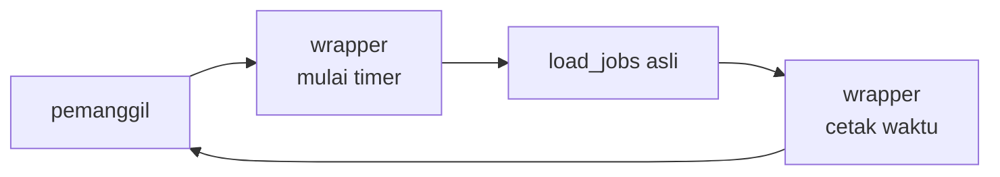

::part[Pelajari Konsepnya]{n="1"}

## 🎯 Yang akan kamu pelajari

- Parameter positional, keyword, default, **keyword-only**, dan **positional-only**
- `*args` dan `**kwargs` — menerima dan meneruskan argument apa saja
- Function sebagai **nilai**: dikirim, dikembalikan, dan disimpan
- **Closure**: function yang mengingat lingkungannya
- **Decorator**: membungkus function untuk menambah perilaku — dengan atau tanpa argument, memakai `functools.wraps`

## 🔤 Istilah penting

| Istilah | Artinya (sederhana) |
|---|---|
| **Parameter / argument** | Nama di definisi / nilai yang dikirim saat dipanggil |
| **Default value** | Nilai yang dipakai kalau pemanggil tidak memberikan nilai |
| **Keyword-only** | Argument yang harus dikirim dengan menyebutkan namanya |
| **`*args` / `**kwargs`** | Menampung argument positional / bernama bebas banyaknya |
| **First-class function** | Function yang bisa disimpan, dikirim, dan dikembalikan seperti nilai apa saja |
| **Closure** | Function yang mengingat nilai-nilai dari tempat ia dibuat |
| **Decorator** | Function yang membungkus function lain untuk menambah perilaku |
| **`functools.wraps`** | Menjaga nama dan dokumentasi function asli tetap utuh |
| **Registration decorator** | Decorator yang mencatat function di suatu tempat (seperti `@app.route`) |

## 🧠 Ide besarnya

Di Python, function adalah **benda**, seperti angka dan daftar: kamu bisa memberikan satu ke function lain, menyimpannya di dict (tabel pencarian), atau membuat function baru saat program berjalan.

Sebuah :term[decorator]{bahasa="decorator — function yang membungkus function lain untuk menambah perilaku"} itu seperti **membungkus kado**: kadonya (function-mu) tetap persis sama, tapi bungkusannya menambah sesuatu — pita, kartu ucapan, stiker "hati-hati". `@app.route("/jobs")`, `@login_required`, dan `@pytest.fixture` semuanya pembungkus.

## ❓ Kenapa ini penting

Ada kekhawatiran yang **melintasi** banyak function: logging, timing, retry, autentikasi, caching, pendaftaran route. Menyalin kode itu ke setiap function berulang dan mudah salah. Decorator membiarkan kamu menulis kekhawatiran itu **sekali** dan menerapkannya dengan satu baris.

Tanpa decorator:

```python
def get_jobs(request):
    if not request.user:                       # auth check copy #1
        return 401
    start = time.perf_counter()                # timing copy #1
    result = ...
    log(f"get_jobs took {time.perf_counter() - start}")
    return result

def create_application(request):
    if not request.user:                       # copy #2 — someone forgot it in #14 😬
        return 401
    ...
```

Satu salinan yang ketinggalan adalah satu endpoint yang tidak terlindungi.

## 📖 Langkah demi langkah

### 1. Jenis-jenis parameter

```python
def search_jobs(
    query: str,                  # positional or keyword
    /,                           # everything before "/" is positional-only
    city: str | None = None,     # default value
    *,                           # everything after "*" must be passed by keyword
    remote: bool = False,
    limit: int = 20,
) -> list[dict]:
    ...

search_jobs("python", "Jakarta", remote=True, limit=10)   # ✅
search_jobs("python", "Jakarta", True)                     # ❌ TypeError: remote is keyword-only
```

Parameter **keyword-only** membuat pemanggilan mudah dibaca dan mencegah membingungkan boolean: `send(email, retry=True)` lebih baik dari `send(email, True)`.

### 2. `*args` dan `**kwargs`

```python
def log_call(name, *args, **kwargs):
    print(name, args, kwargs)

log_call("create", 1, 2, status="open")    # create (1, 2) {'status': 'open'}

# Unpacking when calling
params = {"remote": True, "limit": 5}
search_jobs("python", **params)
```

- `*args` mengumpulkan argument positional tambahan menjadi **tuple**.
- `**kwargs` mengumpulkan argument keyword tambahan menjadi **dict**.
- Kegunaan utamanya: **meneruskan** argument yang tidak kamu ketahui di awal — persis yang dibutuhkan decorator.

### 3. Function sebagai nilai

```python
def by_salary(job):
    return job["salary_max"] or 0

sorted(jobs, key=by_salary)               # pass a function
HANDLERS = {"csv": export_csv, "json": export_json}   # store functions
handler = HANDLERS["csv"]; handler(report)            # call later
```

`lambda` membuat function kecil tanpa nama — cocok untuk function pendek di `key=`; pakai `def` untuk apa pun yang layak diberi nama.

### 4. Closure

Closure adalah **catatan di kantongmu**: inner function mengingat nilai yang dibuat saat ia lahir, bahkan setelah outer function sudah selesai.

Function yang didefinisikan dalam function lain bisa memakai variabel outer function — bahkan setelah outer function sudah kembali:

```python
def make_counter():
    count = 0
    def increment():
        nonlocal count            # modify the enclosed variable
        count += 1
        return count
    return increment

next_id = make_counter()
next_id(), next_id()   # 1, 2
```

Inner function "menutup" atas `count`. Closure adalah cara decorator mengingat function yang ia bungkus.

### 5. Menulis decorator

```python
import functools
import time

def timed(func):
    @functools.wraps(func)                   # keep func's name, docstring, etc.
    def wrapper(*args, **kwargs):            # accept ANY arguments…
        start = time.perf_counter()
        try:
            return func(*args, **kwargs)     # …and forward them
        finally:
            elapsed_ms = (time.perf_counter() - start) * 1000
            print(f"{func.__name__} took {elapsed_ms:.1f} ms")
    return wrapper

@timed
def load_jobs(path):
    ...
```

`@timed` di atas `def load_jobs` hanya shorthand untuk `load_jobs = timed(load_jobs)`.



Tanpa `functools.wraps`, setiap function yang di-decorate akan bernama `wrapper` — merusak debugging, logging, dan framework yang melihat nama function (Flask menggunakannya untuk nama endpoint!).

### 6. Decorator dengan argument

Butuh `@retry(times=3)`? Tambah satu lapisan lagi: function yang **mengembalikan** decorator.

```python
def retry(times: int, exceptions: tuple[type[Exception], ...] = (Exception,)):
    def decorator(func):
        @functools.wraps(func)
        def wrapper(*args, **kwargs):
            for attempt in range(1, times + 1):
                try:
                    return func(*args, **kwargs)
                except exceptions:
                    if attempt == times:
                        raise
        return wrapper
    return decorator

@retry(times=3, exceptions=(ConnectionError,))
def fetch_company_profile(url): ...
```

Tiga lapisan: `retry(...)` → `decorator(func)` → `wrapper(*args, **kwargs)`.

### 7. Registration decorator (cara Flask route bekerja)

Ini trik utama di balik `@app.route`: decorator menulis nama function-mu di direktori (URL → function), lalu mengembalikan function tanpa berubah.

Decorator tidak harus membungkus — ia bisa **mendaftar** function dan mengembalikannya tanpa berubah:

```python
ROUTES: dict[str, callable] = {}

def route(path):
    def decorator(func):
        ROUTES[path] = func
        return func
    return decorator

@route("/health")
def health():
    return {"status": "ok"}

ROUTES["/health"]()   # {'status': 'ok'}
```

Itu ide inti di balik `@app.route` — tabel dispatch yang diisi oleh decorator.

### Memilih setupaanmu

Setiap pilihan di sini adalah trade-off:

| Pilihan | ✅ | ❌ |
|---|---|---|
| Parameter keyword-only | pemanggilan mudah dibaca, aman menambah parameter nanti | sedikit lebih banyak ketik |
| `*args/**kwargs` di function biasa | fleksibel | menyembunyikan signature asli dari pembaca dan tools |
| Decorator | kekhawatiran lintas fungsi ditulis sekali | perilaku tersembunyi; stack trace ada wrappers |
| Closure | status ringan | mutable state bersama bisa mengejutkan |
| Class daripada closure | state dan method jelas | kode lebih banyak |

- ✅ Decorator untuk logging, timing, retry, caching (`functools.cache`), cek auth, pendaftaran.
- ✅ Keyword-only argument untuk opsi dan flag.
- 🚫 Jangan sembunyikan logika bisnis di decorator — pembaca harus lihat *apa* yang dilakukan function di tubuhnya.
- 🚫 Jangan pakai `*args, **kwargs` hanya untuk hindari menamai parameter.

## ⚠️ Kesalahan umum

- Lupa `return func(*args, **kwargs)` → setiap function yang di-decorate mengembalikan `None`.
- Lupa `functools.wraps`.
- Pakai `@retry` daripada `@retry()` untuk decorator yang perlu argument (atau sebaliknya).
- Retry operasi non-idempotent (menagih kartu dua kali).
- Catch `Exception` terlalu luas di dalam retry dan sembunyikan bug asli.

:::revoshop
Cari decorator di RevoShop: `grep -rn "^\s*@" app/routes | sort | uniq -c | sort -rn | head`. Kamu mungkin lihat `@blp.route`, `@blp.arguments`, `@blp.response`, `@jwt_required()`. Buka `app/auth.py` atau `app/utils/auth_context.py`: apakah kamu punya decorator **custom** (misalnya cek role)? Jelaskan baris demi baris cara ia membungkus view, dan apakah ia pakai `functools.wraps`. Kalau belum ada, sketsa `@require_role("seller")`.
:::

## 🏆 Praktik terbaik

- [ ] Selalu pakai **`functools.wraps`** di decorator.
- [ ] Teruskan `*args, **kwargs` tanpa ubah dan **kembalikan** hasil function yang dibungkus.
- [ ] Pakai `try/finally` di wrapper yang harus jalankan cleanup/timing bahkan saat function error.
- [ ] Buat flag boolean dan setting opsional **keyword-only** (`*`).
- [ ] Jangan pernah pakai mutable default argument; pakai `None` dan buat di dalam.
- [ ] Jaga decorator kecil, umum, dan bernama baik (`@require_role("admin")`, bukan `@check`).
- [ ] Retry hanya operasi **aman, idempotent**, dan hanya untuk exception spesifik — dengan batas (dan backoff di sistem asli).
- [ ] Pakai yang standar kalau tersedia: `functools.cache`/`lru_cache`, `contextlib.contextmanager`.

::part[Jelaskan & Rancang]{n="2"}

## 🗣️ Jelaskan

Jelaskan decorator ke orang yang bukan programmer memakai analogi membungkus kado atau satpam di pintu setiap ruangan. Lalu jelaskan kenapa `@timed` ditulis sekali tapi bekerja untuk banyak function.

## 📐 Rancang

Rancang decorator `@require_role(*roles)` untuk aplikasi mirip Flask. User saat ini tersedia via `get_current_user()` (kembalikan `None` kalau belum login, atau object dengan `.role`). Perilaku: belum login → kembalikan `({"error": "unauthorized"}, 401)`; role salah → `({"error": "forbidden"}, 403)`; sebaliknya panggil view. Tulis kodenya di kertas.

:::quiz
Lihat contoh desain

```python
import functools

def require_role(*roles: str):
    allowed = set(roles)

    def decorator(view):
        @functools.wraps(view)
        def wrapper(*args, **kwargs):
            user = get_current_user()
            if user is None:
                return {"error": "unauthorized"}, 401
            if user.role not in allowed:
                return {"error": "forbidden"}, 403
            return view(*args, **kwargs)
        return wrapper

    return decorator

@require_role("seller", "admin")
def update_product(product_id): ...
```

Perhatikan perbedaannya: **401** = "kami tidak tahu siapa kamu", **403** = "kami tahu, dan kamu tidak boleh".
:::

### 📝 Checklist review mandiri

- [ ] Tiga lapisan: factory → decorator → wrapper
- [ ] `functools.wraps` dan argument forwarding
- [ ] 401 vs 403 dipakai dengan benar
- [ ] User saat ini dicari pada **saat dipanggil**, bukan saat decoration

::ai-review{task="design"}

::part[Latihan Kecil]{n="3"}

:::exercise{path="exercises/m2/w3/04-functions-decorators" ai="no-ai" title="Buat decorator-mu sendiri"}
Implementasikan di `decorators.py`: decorator `timed` yang catat durasi, decorator factory `retry(times, exceptions)`, `make_rate_limiter` berbasis closure, dan mini `Router` yang decorator `route`-nya daftar handler (ide di balik Flask). Test cek perilaku, `functools.wraps`, dan exception serta return value melewati dengan benar.
:::

:::hints
- `timed` menerima daftar `records` via factory: `@timed(records)` menambah `(name, seconds)`.
- Untuk `retry`, re-raise exception **terakhir** setelah usaha terakhir.
- Clock rate limiter di-inject (seperti TTL cache) jadi test tidak perlu sleep.
- `Router.route(method, path)` mengembalikan decorator yang simpan `(method, path) → func` dan kembalikan `func` tanpa ubah.
:::

### 🏆 Stretch goal

Tambah exponential backoff ke `retry` dengan injected `sleep` function: tunggu `base * 2 ** (attempt - 1)` detik antara usaha.

## ✅ Cek cepat

:::quiz
Apa yang dilakukan `@decorator` di atas definisi function, tepatnya?

Ia memanggil `decorator(function)` dan rebind nama function ke apa pun yang dikembalikan.
:::

:::quiz
Kenapa pakai `functools.wraps` di wrapper?

Ia copy metadata function asli (`__name__`, `__doc__`, `__wrapped__`…) jadi debugging, introspection, dan framework lihat function asli, bukan `wrapper`.
:::

:::quiz
Kapan decorator perlu tiga function bersarang?

Saat ia ambil argument sendiri (`@retry(times=3)`): function luar terima pilihan dan kembalikan decorator asli.
:::


## 📚 Lanjut belajar

- [Python docs: functools.wraps](https://docs.python.org/3/library/functools.html#functools.wraps)
- [Python tutorial: More on defining functions](https://docs.python.org/3/tutorial/controlflow.html#more-on-defining-functions)
- [Flask docs: View decorators](https://flask.palletsprojects.com/en/stable/patterns/viewdecorators/)
