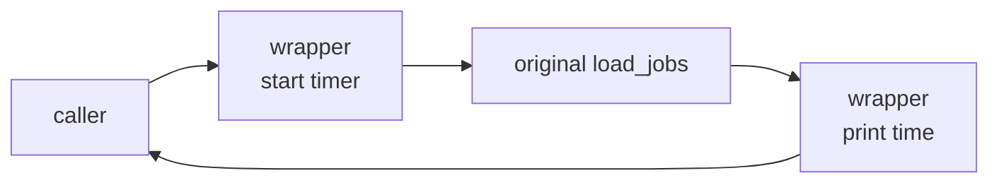

::part[Learn the Concept]{n="1"}

## 🎯 What you'll learn

- Positional, keyword, default, **keyword-only** and **positional-only** parameters
- `*args` and `**kwargs` — accepting and forwarding any arguments
- Functions as **values**: passing, returning and storing them
- **Closures**: functions that remember their surroundings
- **Decorators**: wrapping functions to add behavior — with and without arguments, using `functools.wraps`

## 🔤 Key words

| Word | In simple words | Bahasa Indonesia |
|---|---|---|
| **Parameter / argument** | The name in the definition / the value you pass in | Nama di definisi / nilai dikirim |
| **Default value** | A value used when the caller doesn't pass one | Nilai bawaan |
| **Keyword-only** | An argument that must be passed by name | Wajib disebut namanya |
| **`*args` / `**kwargs`** | Catch any number of positional / named arguments | Tampung argumen bebas |
| **First-class function** | A function you can store, pass and return like any value | Fungsi sebagai nilai |
| **Closure** | A function that remembers values from where it was created | Fungsi yang mengingat lingkungannya |
| **Decorator** | A function that wraps another to add behaviour | Pembungkus fungsi |
| **`functools.wraps`** | Keeps the wrapped function's name and docs | Menjaga identitas fungsi asli |
| **Registration decorator** | A decorator that records the function somewhere (like `@app.route`) | Pendaftar fungsi |

## 🧠 The big idea

In Python, functions are **objects**, just like numbers and lists: you can hand one to another function, store it in a dict (a dispatch table), or build a new one while the program runs.

A :term[decorator]{bahasa="decorator — fungsi yang membungkus fungsi lain untuk menambah perilaku tanpa mengubah isinya"} is **gift wrapping**: the gift (your function) stays exactly the same, but the wrapping adds something — a ribbon, a card, a "handle with care" sticker. `@app.route("/jobs")`, `@login_required` and `@pytest.fixture` are all wrappings.

## ❓ Why it matters

Some concerns cut **across** many functions: logging, timing, retries, authentication, caching, registering routes. Copy-pasting that code into every function is repetitive and easy to get wrong. A decorator lets you write the concern **once** and apply it with one line.

Without them:

```python
def get_jobs(request):
    if not request.user:                       # auth check copy #1
        return 401
    start = time.perf_counter()                # timing copy #1
    result = ...
    log(f"get_jobs took {time.perf_counter() - start}")
    return result

def create_application(request):
    if not request.user:                       # copy #2 — someone forgot it in #14 😬
        return 401
    ...
```

One forgotten copy is one unprotected endpoint.

## 📖 Step by step

### 1. Parameter kinds

```python
def search_jobs(
    query: str,                  # positional or keyword
    /,                           # everything before "/" is positional-only
    city: str | None = None,     # default value
    *,                           # everything after "*" must be passed by keyword
    remote: bool = False,
    limit: int = 20,
) -> list[dict]:
    ...

search_jobs("python", "Jakarta", remote=True, limit=10)   # ✅
search_jobs("python", "Jakarta", True)                     # ❌ TypeError: remote is keyword-only
```

**Keyword-only** parameters make calls readable and prevent mixing up booleans: `send(email, retry=True)` beats `send(email, True)`.

### 2. `*args` and `**kwargs`

```python
def log_call(name, *args, **kwargs):
    print(name, args, kwargs)

log_call("create", 1, 2, status="open")    # create (1, 2) {'status': 'open'}

# Unpacking when calling
params = {"remote": True, "limit": 5}
search_jobs("python", **params)
```

- `*args` collects extra positional arguments into a **tuple**.
- `**kwargs` collects extra keyword arguments into a **dict**.
- Their main use: **forwarding** arguments you don't know in advance — exactly what decorators need.

### 3. Functions as values

```python
def by_salary(job):
    return job["salary_max"] or 0

sorted(jobs, key=by_salary)               # pass a function
HANDLERS = {"csv": export_csv, "json": export_json}   # store functions
handler = HANDLERS["csv"]; handler(report)            # call later
```

`lambda` creates a small anonymous function — fine for short `key=` functions; use `def` for anything with a name worth giving.

### 4. Closures

A closure is a **note in your pocket**: the inner function keeps the value it was created with, even after the outer function has finished.

A function defined inside another function can use the outer function's variables — even after the outer function has returned:

```python
def make_counter():
    count = 0
    def increment():
        nonlocal count            # modify the enclosed variable
        count += 1
        return count
    return increment

next_id = make_counter()
next_id(), next_id()   # 1, 2
```

The inner function "closes over" `count`. Closures are how decorators remember the function they wrap.

### 5. Writing a decorator

```python
import functools
import time

def timed(func):
    @functools.wraps(func)                   # keep func's name, docstring, etc.
    def wrapper(*args, **kwargs):            # accept ANY arguments…
        start = time.perf_counter()
        try:
            return func(*args, **kwargs)     # …and forward them
        finally:
            elapsed_ms = (time.perf_counter() - start) * 1000
            print(f"{func.__name__} took {elapsed_ms:.1f} ms")
    return wrapper

@timed
def load_jobs(path):
    ...
```

`@timed` above `def load_jobs` is just shorthand for `load_jobs = timed(load_jobs)`.



Without `functools.wraps`, every decorated function would be named `wrapper` — breaking debugging, logging and frameworks that look at function names (Flask uses them for endpoint names!).

### 6. Decorators with arguments

Need `@retry(times=3)`? Add one more layer: a function that **returns** a decorator.

```python
def retry(times: int, exceptions: tuple[type[Exception], ...] = (Exception,)):
    def decorator(func):
        @functools.wraps(func)
        def wrapper(*args, **kwargs):
            for attempt in range(1, times + 1):
                try:
                    return func(*args, **kwargs)
                except exceptions:
                    if attempt == times:
                        raise
        return wrapper
    return decorator

@retry(times=3, exceptions=(ConnectionError,))
def fetch_company_profile(url): ...
```

Three layers: `retry(...)` → `decorator(func)` → `wrapper(*args, **kwargs)`.

### 7. Registration decorators (how Flask routes work)

This is the whole trick behind `@app.route`: the decorator writes your function's name in a directory (URL → function), then hands the function back unchanged.

A decorator doesn't have to wrap — it can **register** the function and return it unchanged:

```python
ROUTES: dict[str, callable] = {}

def route(path):
    def decorator(func):
        ROUTES[path] = func
        return func
    return decorator

@route("/health")
def health():
    return {"status": "ok"}

ROUTES["/health"]()   # {'status': 'ok'}
```

That's the core idea behind `@app.route` — a dispatch table filled by decorators.

### Choosing your setup

Every option here is a trade-off:

| Choice | ✅ | ❌ |
|---|---|---|
| Keyword-only params | readable calls, safe to add params later | slightly more typing |
| `*args/**kwargs` in normal functions | flexible | hides the real signature from readers and tools |
| Decorators | cross-cutting concerns written once | hidden behavior; stack traces include wrappers |
| Closures | lightweight state | shared mutable state can surprise |
| Classes instead of closures | explicit state and methods | more code |

- ✅ Decorators for logging, timing, retries, caching (`functools.cache`), auth checks, registration.
- ✅ Keyword-only arguments for options and flags.
- 🚫 Don't hide business logic in decorators — readers should see *what* a function does in its body.
- 🚫 Don't use `*args, **kwargs` just to avoid naming parameters.

## ⚠️ Common mistakes

- Forgetting `return func(*args, **kwargs)` → every decorated function returns `None`.
- Forgetting `functools.wraps`.
- Using `@retry` instead of `@retry()` for a decorator that expects arguments (or vice versa).
- Retrying non-idempotent operations (charging a card twice).
- Catching `Exception` broadly inside retries and hiding real bugs.

:::revoshop
Search RevoShop for decorators: `grep -rn "^\s*@" app/routes | sort | uniq -c | sort -rn | head`. You'll likely see `@blp.route`, `@blp.arguments`, `@blp.response`, `@jwt_required()`. Open `app/auth.py` or `app/utils/auth_context.py`: do you have a **custom** decorator (e.g. checking roles)? Explain line by line how it wraps the view, and whether it uses `functools.wraps`. If you don't have one, sketch `@require_role("seller")`.
:::

## 🏆 Best practices

- [ ] Always use **`functools.wraps`** in decorators.
- [ ] Forward `*args, **kwargs` untouched and **return** the wrapped function's result.
- [ ] Use `try/finally` in wrappers that must run cleanup/timing even when the function raises.
- [ ] Make boolean flags and optional settings **keyword-only** (`*`).
- [ ] Never use mutable default arguments; use `None` and create inside.
- [ ] Keep decorators small, generic and well-named (`@require_role("admin")`, not `@check`).
- [ ] Retry only **safe, idempotent** operations and only for specific exceptions — with a limit (and backoff in real systems).
- [ ] Use standard ones when they exist: `functools.cache`/`lru_cache`, `contextlib.contextmanager`.

::part[Explain & Design]{n="2"}

## 🗣️ Explain it

Explain decorators to a non-programmer using gift wrapping or a security guard at the door of every room. Then explain why `@timed` is written once but works for many functions.

## 📐 Design it

Design a `@require_role(*roles)` decorator for a Flask-like app. The current user is available via `get_current_user()` (returns `None` if not logged in, else an object with `.role`). Behavior: not logged in → return `({"error": "unauthorized"}, 401)`; wrong role → `({"error": "forbidden"}, 403)`; otherwise call the view. Write the code on paper.

:::quiz
Show a possible design

```python
import functools

def require_role(*roles: str):
    allowed = set(roles)

    def decorator(view):
        @functools.wraps(view)
        def wrapper(*args, **kwargs):
            user = get_current_user()
            if user is None:
                return {"error": "unauthorized"}, 401
            if user.role not in allowed:
                return {"error": "forbidden"}, 403
            return view(*args, **kwargs)
        return wrapper

    return decorator

@require_role("seller", "admin")
def update_product(product_id): ...
```

Note the difference: **401** = "we don't know who you are", **403** = "we know, and you're not allowed".
:::

### 📝 Self-review checklist

- [ ] Three layers: factory → decorator → wrapper
- [ ] `functools.wraps` and argument forwarding
- [ ] 401 vs 403 used correctly
- [ ] The current user is looked up at **call** time, not at decoration time

::ai-review{task="design"}

::part[Toy Exercise]{n="3"}

:::exercise{path="exercises/m2/w3/04-functions-decorators" ai="no-ai" title="Build your own decorators"}
Implement in `decorators.py`: a `timed` decorator that records durations, a `retry(times, exceptions)` decorator factory, a closure-based `make_rate_limiter`, and a mini `Router` whose `route` decorator registers handlers (the idea behind Flask). Tests check behavior, `functools.wraps`, and that exceptions and return values pass through correctly.
:::

:::hints
- `timed` receives a `records` list via a factory: `@timed(records)` appends `(name, seconds)`.
- For `retry`, re-raise the **last** exception after the final attempt.
- The rate limiter's clock is injected (like the TTL cache) so tests don't sleep.
- `Router.route(method, path)` returns a decorator that stores `(method, path) → func` and returns `func` unchanged.
:::

### 🏆 Stretch goal

Add exponential backoff to `retry` with an injected `sleep` function: wait `base * 2 ** (attempt - 1)` seconds between attempts.

## ✅ Quick check

:::quiz
What does `@decorator` above a function definition do, exactly?

It calls `decorator(function)` and rebinds the function's name to whatever that returns.
:::

:::quiz
Why use `functools.wraps` in a wrapper?

It copies the original function's metadata (`__name__`, `__doc__`, `__wrapped__`…) so debugging, introspection and frameworks see the real function, not `wrapper`.
:::

:::quiz
When does a decorator need three nested functions?

When it takes its own arguments (`@retry(times=3)`): the outer function receives the options and returns the actual decorator.
:::


## 📚 Keep learning

- [Python docs: functools.wraps](https://docs.python.org/3/library/functools.html#functools.wraps)
- [Python tutorial: More on defining functions](https://docs.python.org/3/tutorial/controlflow.html#more-on-defining-functions)
- [Flask docs: View decorators](https://flask.palletsprojects.com/en/stable/patterns/viewdecorators/)
