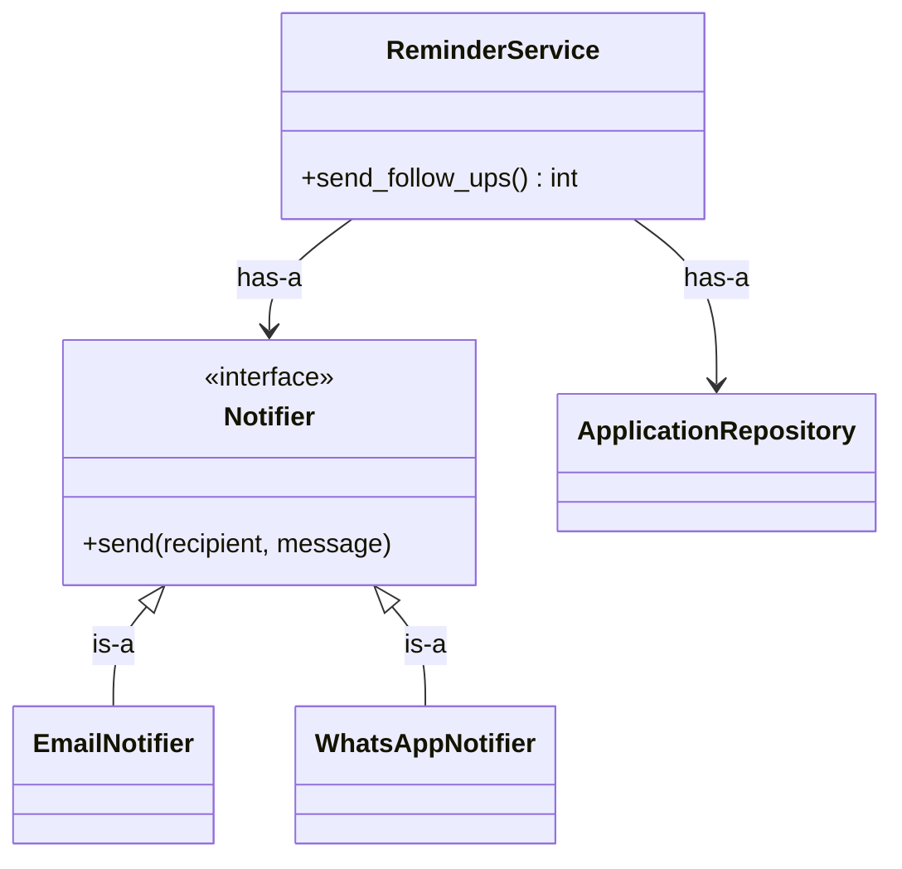

::part[Pelajari Konsepnya]{n="1"}

## 🎯 Yang akan kamu pelajari

- Class dan objek: **state** (attribute) + **behavior** (method)
- `__init__`, `self`, instance attribute vs class attribute
- **Encapsulation**: melindungi aturan dengan method dan `@property`
- Method khusus ("dunder"): `__repr__`, `__eq__`, `__lt__`, `__len__`
- `@classmethod` dan `@staticmethod`
- **Inheritance** vs **composition**, dan kenapa composition biasanya lebih aman
- Bagaimana OOP muncul di backend: model, service, repository, exception

## 🔤 Istilah penting

| Istilah | Artinya (sederhana) |
|---|---|
| **Class** | Cetak biru untuk membuat objek |
| **Object (instance)** | Satu objek hasil cetakan dari class |
| **Attribute** | Data yang disimpan di objek (state-nya) |
| **Method** | Fungsi yang milik objek (perilakunya) |
| **`self`** | Objek itu sendiri saat method dipanggil |
| **Encapsulation** | Menyatukan aturan dan data yang dilindunginya |
| **Invariant** | Aturan yang harus selalu benar (status selalu valid) |
| **`@property`** | Method yang dibaca seperti attribute |
| **Dunder method** | Nama khusus seperti `__repr__`, `__eq__` yang Python panggil |
| **Inheritance vs composition** | "Adalah jenis dari" vs "dibangun dari" |

## 🧠 Ide besarnya

:term[Class]{bahasa="class — cetak biru untuk membuat objek yang punya data dan perilaku sendiri"} itu seperti **cetak biru rumah**; **objek** adalah rumah sungguhan yang dibangun dari cetak biru itu. Setiap rumah punya furniture sendiri (state), tapi setiap rumah punya desain pintu dan lampu yang sama (method).

Kekuatan sebenarnya bukan sekadar mengelompokkan data — dict sudah bisa itu. Kekuatannya adalah **menyatukan aturan dan data**, sehingga data tidak bisa jadi tidak valid:

> Aplikasi tidak bisa lompat dari "rejected" ke "offer" — bukan karena setiap orang ingat aturannya, tapi karena objek `Application` menolaknya.

## ❓ Kenapa ini penting

Saat program berkembang, data yang sama bepergian melalui banyak fungsi. Jika setiap fungsi harus ingat setiap aturan ("status tidak boleh lompat", "gaji tidak boleh negatif", "selalu update `updated_at`"), seseorang pasti lupa. Class **menggabungkan** data dengan operasi yang boleh dilakukan, jadi ada satu tempat untuk menerapkan dan menguji aturan.

Tanpa itu, data tidak bisa membela diri:

```python
application = {"status": "applied", "history": []}

# route A
application["status"] = "interview"
application["history"].append("interview")

# route B — forgot the history
application["status"] = "offer"

# a script — invalid status, no validation at all
application["status"] = "hired!!"
```

Aturan hanya hidup sebagai kebiasaan, dan kebiasaan sering pecah jam 2 pagi.

## 📖 Langkah demi langkah

### 1. Class pertama

```python
from datetime import datetime, UTC

class Application:
    def __init__(self, company: str, role: str):
        self.company = company               # instance attributes
        self.role = role
        self._status = "applied"             # "_" = internal, please don't touch directly
        self.history: list[tuple[str, datetime]] = [("applied", datetime.now(UTC))]

    def move_to(self, status: str) -> None:  # method: behavior that keeps the rules
        allowed = TRANSITIONS[self._status]
        if status not in allowed:
            raise InvalidTransition(f"{self._status} → {status}")
        self._status = status
        self.history.append((status, datetime.now(UTC)))

    @property
    def status(self) -> str:                 # read-only from outside
        return self._status

app = Application("Kopi Data", "Data Analyst")   # create an object (instance)
app.move_to("interview")
app.status          # "interview"
app.status = "x"    # ❌ AttributeError: property has no setter
```

- `__init__` menyiapkan objek baru; `self` adalah objek itu sendiri.
- Method menerima `self` otomatis: `app.move_to("interview")` → `Application.move_to(app, "interview")`.

### 2. Class attribute vs instance attribute

```python
class Application:
    VALID_STATUSES = frozenset({"applied", "interview", "offer", "rejected"})   # shared by all instances

    def __init__(self, company):
        self.company = company                                                   # per instance
```

:::warning
Class attribute yang bisa berubah (`tags = []`) dibagi **semua instance** — jebakan yang sama dengan argument default yang bisa berubah. Buat state yang bisa berubah di `__init__`.
:::

### 3. Property: attribute yang dihitung atau dilindungi

Property adalah **satpam untuk satu attribute**: pembaca melihat nilai sederhana, tapi setiap perubahan harus melewati cek terlebih dahulu.

```python
class SalaryRange:
    def __init__(self, minimum: int, maximum: int):
        if minimum < 0 or maximum < minimum:
            raise ValueError("invalid salary range")
        self._minimum = minimum
        self._maximum = maximum

    @property
    def midpoint(self) -> int:              # computed, looks like an attribute
        return (self._minimum + self._maximum) // 2
```

Validasi di `__init__` jadi **objek tidak valid tidak bisa pernah ada**.

### 4. Method khusus

| Method | Mengaktifkan |
|---|---|
| `__repr__` | representasi debug yang berguna: `Application('Kopi Data', status='interview')` |
| `__str__` | teks ramah pengguna untuk `print()` / `str()` |
| `__eq__` | `a == b` berdasarkan nilai |
| `__lt__` (+ `functools.total_ordering`) | sorting dengan `<` |
| `__len__`, `__iter__`, `__contains__` | `len(obj)`, `for x in obj`, `x in obj` |
| `__enter__` / `__exit__` | `with obj:` (Materi 08) |

`@dataclass` bikin `__init__`, `__repr__` dan `__eq__` otomatis — pakai saat class kebanyakan data.

### 5. `@classmethod` dan `@staticmethod`

```python
class JobListing:
    def __init__(self, title: str, skills: frozenset[str]):
        self.title = title
        self.skills = skills

    @classmethod
    def from_csv_row(cls, row: dict) -> "JobListing":      # alternative constructor
        return cls(row["title"].strip(), frozenset(s.strip().lower() for s in row["skills"].split(",")))

    @staticmethod
    def normalize_title(title: str) -> str:                 # related helper, no self/cls needed
        return " ".join(title.split()).title()
```

### 6. Inheritance

```python
class Notifier:
    def send(self, recipient: str, message: str) -> None:
        raise NotImplementedError

class EmailNotifier(Notifier):
    def send(self, recipient: str, message: str) -> None:
        ...  # SMTP / email API

class WhatsAppNotifier(Notifier):
    def send(self, recipient: str, message: str) -> None:
        ...
```

Inheritance berarti **"adalah jenis dari"**: `EmailNotifier` *adalah* `Notifier`. `super().__init__(...)` panggil initializer parent. Pakai untuk **spesialisasi sungguhan** yang berbagi interface — seperti hierarchy exception khusus (`class NotFound(AppError)`).

### 7. Composition lebih baik dari inheritance

Inheritance bilang "penjual *adalah* pengguna"; composition bilang "pesanan *punya* pembayaran". Inheritance adalah ikatan keluarga yang ketat — mudah dimulai, susah diubah nanti — jadi lebih baik bangun dari bagian-bagian.

Composition berarti **"punya"**: bangun objek dari objek lain.

```python
class ReminderService:
    def __init__(self, repository, notifier: Notifier, clock):
        self._repository = repository      # has a repository
        self._notifier = notifier          # has a notifier
        self._clock = clock

    def send_follow_ups(self) -> int:
        today = self._clock()
        due = [a for a in self._repository.waiting() if a.needs_follow_up(today)]
        for application in due:
            self._notifier.send(application.email, application.follow_up_message(today))
        return len(due)
```

Ini adalah **dependency injection** dari Architecture Stage A — dengan class. Ganti `EmailNotifier` dengan `FakeNotifier` di test, atau dengan `WhatsAppNotifier` di production, tanpa ubah `ReminderService`.



Inheritance tree yang dalam (`BaseModel → TimestampedModel → SoftDeleteModel → UserOwnedModel → Application`) membuat perilaku susah dilacak dan diubah. Lebih baik hierarchy dangkal dan composition.

### Pilihan setup

Setiap pilihan punya trade-off:

| Pilihan | ✅ | ❌ |
|---|---|---|
| Function biasa + dict | sederhana, bagus untuk data pipeline | aturan berserakan; tidak ada invariant |
| Class dengan method | invariant di satu tempat; API jelas | lebih banyak struktur; bisa berlebihan |
| `@dataclass` | ringkas class data | tetap perlu method untuk aturan |
| Inheritance | interface dan reuse bersama | coupling ketat; fragile base class |
| Composition | fleksibel, testable, bagian bisa ditukar | lebih banyak objek untuk disatukan |

- ✅ Class untuk hal dengan **state + aturan** (lifecycle aplikasi, shopping cart), untuk **service** dengan dependency disuntik, dan untuk **custom exception**.
- ✅ Dataclass untuk record.
- 🚫 Jangan buat class dengan satu method dan tidak ada state — function lebih sederhana.
- 🚫 Jangan bangun inheritance hierarchy hanya untuk reuse beberapa helper function.

## ⚠️ Kesalahan umum

- Lupa `self` di definisi method.
- Attribute publik yang biar orang bypass aturan (`app.status = "offer"`).
- Class attribute yang bisa berubah, dibagi semua instance.
- "God class" yang buat segalanya (`ApplicationManager` dengan 40 method).
- Inherit hanya untuk reuse code daripada model hubungan "adalah jenis dari".

:::revoshop
Buka satu service di RevoShop, misal `app/services/cart_service.py`, dan repository-nya `app/repositories/cart_repository.py`. Jawab: Mereka class atau function module? Bagaimana service dapat repository — ia **buat** di dalam atau terima (composition + injection)? Di mana aturan "quantity item cart harus positif" dipastikan: model, schema, service, atau database? Jika jawabannya "di beberapa tempat", mana yang sumber kebenaran?
:::

## 🏆 Praktik terbaik

- [ ] Validasi di `__init__` jadi objek tidak valid tidak bisa ada; expose perubahan lewat **method** yang jaga invariant.
- [ ] Prefix attribute internal dengan `_`; gunakan `@property` untuk nilai yang hanya dibaca atau dihitung.
- [ ] Selalu beri domain class `__repr__` yang membantu (atau pakai `@dataclass`).
- [ ] Jaga class **kecil dan kohesif** (Single Responsibility — kamu akan ketemu SOLID di Architecture Stage C).
- [ ] **Lebih baik composition**; suntik dependency (repository, client, clock) lewat `__init__`.
- [ ] Pakai inheritance untuk hubungan "adalah jenis dari" sungguhan dan interface bersama (atau `typing.Protocol` untuk duck typing).
- [ ] Jangan pernah pakai class attribute yang bisa berubah untuk state per-instance.
- [ ] Type-hint attribute dan signature method.

::part[Jelaskan & Rancang]{n="2"}

## 🗣️ Jelaskan

Jelaskan encapsulation ke orang non-programmer pakai analogi ATM: kamu bisa ambil uang lewat tombol mesin, tapi tidak bisa buka dan ubah saldo langsung. Lalu jelaskan composition vs inheritance dengan mobil yang *punya* mesin versus mobil sport yang *adalah* mobil.

## 📐 Rancang

Rancang class (nama, attribute, method, dan hubungan — tanpa kode penuh) untuk **CareerPilot interview scheduler**: aplikasi bisa punya beberapa ronde interview; ronde tidak boleh overlap untuk pengguna yang sama; ronde punya tipe, time window dan hasil; scheduler kirim calendar invite lewat Google Calendar atau Outlook.

:::quiz
Lihat contoh desain

- `TimeWindow` (frozen dataclass): `start`, `end` — validasi `start < end`; method `overlaps(other) -> bool`.
- `InterviewRound`: `type`, `window: TimeWindow`, `_outcome` (property), method `record_outcome(outcome)` dengan nilai yang diizinkan.
- `Application`: `company`, `role`, `rounds: list[InterviewRound]`, method `add_round(round)`.
- `CalendarClient` (Protocol): `create_invite(email, title, window)`; implementasi `GoogleCalendarClient`, `OutlookCalendarClient`.
- `InterviewScheduler` (composition): `__init__(repository, calendar: CalendarClient, clock)`; method `schedule(user, application, round)` cek overlap terhadap semua ronde pengguna (lewat repository), simpan, lalu panggil calendar client.

Kenapa: aturan hidup dengan data yang dilindunginya (`TimeWindow.overlaps`, outcome validation); service eksternal di balik interface dan disuntik; tidak ada inheritance kecuali implementasi interface calendar.
:::

### 📝 Checklist review mandiri

- [ ] Setiap invariant hidup di tepat satu class
- [ ] Service eksternal di balik interface dan disuntik
- [ ] Tidak ada inheritance mendalam
- [ ] Value object (seperti time window) tidak bisa berubah

::ai-review{task="design"}

::part[Latihan Kecil]{n="3"}

:::exercise{path="exercises/m2/w3/06-oop" ai="no-ai" title="Application yang melindungi aturannya"}
Implementasi di `pipeline.py`: `SalaryRange` value object yang divalidasi, class `Application` yang hanya izinkan transisi status valid dan catat history, dan `ReminderService` yang terima dependency-nya (composition). Test cek invariant, `__repr__`/`__eq__`, sorting, dan service bekerja dengan fake.
:::

:::hints
- Jaga tabel transisi sebagai class attribute (tidak bisa berubah: `frozenset` value).
- `status` harus `@property` yang hanya dibaca.
- Untuk sorting aplikasi berdasarkan `applied_on`, implementasi `__lt__`.
- `ReminderService` dapat `applications`, `notifier` dan `today` dari luar — tidak ada `date.today()` di dalam.
:::

### 🏆 Tantangan lebih

Buat `Application` iterable atas history-nya (`for status, when in application:`) dengan implementasi `__iter__`, dan tambah `__len__` yang return jumlah status change.

## ✅ Cek cepat

:::quiz
Apa bedanya class attribute dan instance attribute?

Class attribute didefinisikan di class dan dibagi semua instance; instance attribute diset di `self` (biasanya di `__init__`) dan milik satu objek.
:::

:::quiz
Kenapa buat `status` property yang hanya dibaca dengan method `move_to()` terpisah?

Jadi setiap perubahan lewat method yang validasi transisi dan catat history — pemanggil tidak bisa bypass aturan dengan assign langsung.
:::

:::quiz
Kapan inheritance adalah alat yang tepat?

Untuk hubungan "adalah jenis dari" sungguhan yang berbagi interface atau perilaku — misal `NotFoundError(AppError)`, atau beberapa implementasi notifier. Untuk reuse bagian, lebih baik composition.
:::


## 📚 Lanjut belajar

- [Python tutorial: Classes](https://docs.python.org/3/tutorial/classes.html)
- [Python docs: Data model (special methods)](https://docs.python.org/3/reference/datamodel.html)
- [Python docs: typing.Protocol](https://docs.python.org/3/library/typing.html#typing.Protocol)
