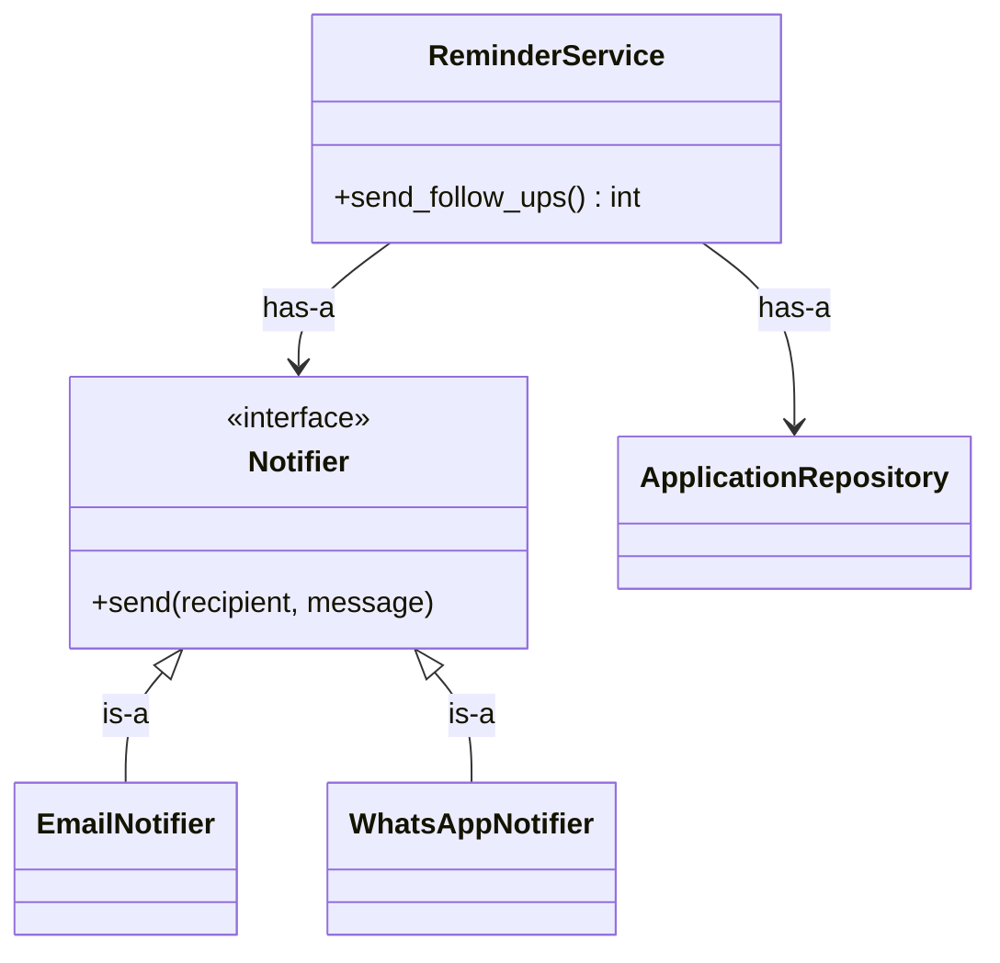

::part[Learn the Concept]{n="1"}

## 🎯 What you'll learn

- Classes and objects: **state** (attributes) + **behavior** (methods)
- `__init__`, `self`, instance vs class attributes
- **Encapsulation**: protecting invariants with methods and `@property`
- Special ("dunder") methods: `__repr__`, `__eq__`, `__lt__`, `__len__`
- `@classmethod` and `@staticmethod`
- **Inheritance** vs **composition**, and why composition is usually safer
- How OOP shows up in backend code: models, services, repositories, exceptions

## 🔤 Key words

| Word | In simple words | Bahasa Indonesia |
|---|---|---|
| **Class** | A blueprint for making objects | Cetak biru objek |
| **Object (instance)** | One thing built from that blueprint | Satu objek hasil cetakan |
| **Attribute** | A value stored on the object (its state) | Data pada objek |
| **Method** | A function that belongs to the object (its behaviour) | Fungsi milik objek |
| **`self`** | The object the method was called on | Objek itu sendiri |
| **Encapsulation** | Keeping the rules next to the data they protect | Menyatukan aturan dan data |
| **Invariant** | Something that must always stay true (status is always valid) | Aturan yang selalu benar |
| **`@property`** | A method you read like an attribute | Nilai terhitung seperti atribut |
| **Dunder method** | Special names like `__repr__`, `__eq__` that Python calls for you | Metode khusus Python |
| **Inheritance vs composition** | "Is a kind of" vs "is built from" | Mewarisi vs menyusun |

## 🧠 The big idea

A :term[class]{bahasa="class — cetak biru untuk membuat objek yang punya data dan perilaku sendiri"} is a **blueprint**; an **object** is a house built from it. Each house has its own furniture (state), and every house shares the same design for doors and lights (methods).

The real power isn't grouping data — a dict already does that. It's putting the **rules next to the data**, so the data can't reach an invalid state:

> An application can't jump from "rejected" to "offer" — not because every caller remembers the rule, but because the `Application` object refuses.

## ❓ Why it matters

As a program grows, the same data travels through many functions. If every function must remember every rule ("status changes must be valid", "salary can't be negative", "always update `updated_at`"), somebody will forget. A class **bundles** the data with the operations allowed on it, so there is one place to enforce and test the rules.

Without that, the data can't defend itself:

```python
application = {"status": "applied", "history": []}

# route A
application["status"] = "interview"
application["history"].append("interview")

# route B — forgot the history
application["status"] = "offer"

# a script — invalid status, no validation at all
application["status"] = "hired!!"
```

The rules exist only as habits, and habits break at 2 a.m.

## 📖 Step by step

### 1. A first class

```python
from datetime import datetime, UTC

class Application:
    def __init__(self, company: str, role: str):
        self.company = company               # instance attributes
        self.role = role
        self._status = "applied"             # "_" = internal, please don't touch directly
        self.history: list[tuple[str, datetime]] = [("applied", datetime.now(UTC))]

    def move_to(self, status: str) -> None:  # method: behavior that keeps the rules
        allowed = TRANSITIONS[self._status]
        if status not in allowed:
            raise InvalidTransition(f"{self._status} → {status}")
        self._status = status
        self.history.append((status, datetime.now(UTC)))

    @property
    def status(self) -> str:                 # read-only from outside
        return self._status

app = Application("Kopi Data", "Data Analyst")   # create an object (instance)
app.move_to("interview")
app.status          # "interview"
app.status = "x"    # ❌ AttributeError: property has no setter
```

- `__init__` sets up a new object; `self` is the object itself.
- Methods receive `self` automatically: `app.move_to("interview")` → `Application.move_to(app, "interview")`.

### 2. Class attributes vs instance attributes

```python
class Application:
    VALID_STATUSES = frozenset({"applied", "interview", "offer", "rejected"})   # shared by all instances

    def __init__(self, company):
        self.company = company                                                   # per instance
```

:::warning
A mutable **class** attribute (`tags = []`) is shared by **all** instances — the same trap as mutable default arguments. Create mutable state in `__init__`.
:::

### 3. Properties: computed or protected attributes

A property is a **doorman for one attribute**: readers see a simple value, but every change goes through your check first.

```python
class SalaryRange:
    def __init__(self, minimum: int, maximum: int):
        if minimum < 0 or maximum < minimum:
            raise ValueError("invalid salary range")
        self._minimum = minimum
        self._maximum = maximum

    @property
    def midpoint(self) -> int:              # computed, looks like an attribute
        return (self._minimum + self._maximum) // 2
```

Validate in `__init__` so **an invalid object can never exist**.

### 4. Special methods

| Method | Enables |
|---|---|
| `__repr__` | a useful debug representation: `Application('Kopi Data', status='interview')` |
| `__str__` | user-friendly text for `print()` / `str()` |
| `__eq__` | `a == b` by value |
| `__lt__` (+ `functools.total_ordering`) | sorting with `<` |
| `__len__`, `__iter__`, `__contains__` | `len(obj)`, `for x in obj`, `x in obj` |
| `__enter__` / `__exit__` | `with obj:` (Lesson 08) |

`@dataclass` generates `__init__`, `__repr__` and `__eq__` for you — use it when a class is mostly data.

### 5. `@classmethod` and `@staticmethod`

```python
class JobListing:
    def __init__(self, title: str, skills: frozenset[str]):
        self.title = title
        self.skills = skills

    @classmethod
    def from_csv_row(cls, row: dict) -> "JobListing":      # alternative constructor
        return cls(row["title"].strip(), frozenset(s.strip().lower() for s in row["skills"].split(",")))

    @staticmethod
    def normalize_title(title: str) -> str:                 # related helper, no self/cls needed
        return " ".join(title.split()).title()
```

### 6. Inheritance

```python
class Notifier:
    def send(self, recipient: str, message: str) -> None:
        raise NotImplementedError

class EmailNotifier(Notifier):
    def send(self, recipient: str, message: str) -> None:
        ...  # SMTP / email API

class WhatsAppNotifier(Notifier):
    def send(self, recipient: str, message: str) -> None:
        ...
```

Inheritance means **"is-a"**: an `EmailNotifier` *is a* `Notifier`. `super().__init__(...)` calls the parent's initializer. Use it for **true** specializations sharing an interface — like custom exception hierarchies (`class NotFound(AppError)`).

### 7. Composition over inheritance

Inheritance says "a seller *is* a user"; composition says "an order *has* a payment". Inheritance is a tight family tie — easy to start, hard to change later — so prefer building from parts.

Composition means **"has-a"**: build objects out of other objects.

```python
class ReminderService:
    def __init__(self, repository, notifier: Notifier, clock):
        self._repository = repository      # has a repository
        self._notifier = notifier          # has a notifier
        self._clock = clock

    def send_follow_ups(self) -> int:
        today = self._clock()
        due = [a for a in self._repository.waiting() if a.needs_follow_up(today)]
        for application in due:
            self._notifier.send(application.email, application.follow_up_message(today))
        return len(due)
```

This is **dependency injection** from Architecture Stage A — with classes. Swap `EmailNotifier` for a `FakeNotifier` in tests, or for `WhatsAppNotifier` in production, without touching `ReminderService`.



Deep inheritance trees (`BaseModel → TimestampedModel → SoftDeleteModel → UserOwnedModel → Application`) make behavior hard to trace and change. Prefer shallow hierarchies and composition.

### Choosing your setup

Every option here is a trade-off:

| Choice | ✅ | ❌ |
|---|---|---|
| Plain functions + dicts | simple, great for data pipelines | rules scattered; no invariants |
| Classes with methods | invariants enforced in one place; clear API | more structure; can be overused |
| `@dataclass` | concise data classes | still need methods for rules |
| Inheritance | shared interface, reuse | tight coupling; fragile base class problems |
| Composition | flexible, testable, swappable parts | more objects to wire together |

- ✅ Classes for things with **state + rules** (an application's lifecycle, a shopping cart), for **services** with injected dependencies, and for **custom exceptions**.
- ✅ Dataclasses for records.
- 🚫 Don't create classes with one method and no state — a function is simpler.
- 🚫 Don't build inheritance hierarchies to reuse a couple of helper functions.

## ⚠️ Common mistakes

- Forgetting `self` in method definitions.
- Public attributes that let callers bypass rules (`app.status = "offer"`).
- Mutable class attributes shared across instances.
- "God classes" that do everything (`ApplicationManager` with 40 methods).
- Inheriting just to reuse code instead of modeling an "is-a" relationship.

:::revoshop
Open one service in RevoShop, e.g. `app/services/cart_service.py`, and its repository `app/repositories/cart_repository.py`. Answer: Are they classes or module functions? How does the service get the repository — does it **create** it inside or receive it (composition + injection)? Where is the rule "a cart item's quantity must be positive" enforced: model, schema, service, or database? If the answer is "in several places", which one is the source of truth?
:::

## 🏆 Best practices

- [ ] Validate in `__init__` so invalid objects can't exist; expose changes through **methods** that keep invariants.
- [ ] Prefix internal attributes with `_`; use `@property` for read-only or computed values.
- [ ] Always give domain classes a helpful `__repr__` (or use `@dataclass`).
- [ ] Keep classes **small and cohesive** (Single Responsibility — you'll meet SOLID in Architecture Stage C).
- [ ] **Prefer composition**; inject dependencies (repositories, clients, clocks) through `__init__`.
- [ ] Use inheritance for real "is-a" relationships and shared interfaces (or `typing.Protocol` for duck typing).
- [ ] Never use mutable class attributes for per-instance state.
- [ ] Type-hint attributes and method signatures.

::part[Explain & Design]{n="2"}

## 🗣️ Explain it

Explain encapsulation to a non-programmer using an ATM: you can withdraw money through the machine's buttons, but you can't open it and change your balance directly. Then explain composition vs inheritance with a car that *has* an engine versus a sports car that *is a* car.

## 📐 Design it

Design classes (names, attributes, methods, and relationships — no full code) for a **CareerPilot interview scheduler**: an application can have interview rounds; rounds can't overlap for the same user; a round has a type, time window and outcome; the scheduler sends calendar invites through either Google Calendar or Outlook.

:::quiz
Show a possible design

- `TimeWindow` (frozen dataclass): `start`, `end` — validates `start < end`; method `overlaps(other) -> bool`.
- `InterviewRound`: `type`, `window: TimeWindow`, `_outcome` (property), methods `record_outcome(outcome)` with allowed values.
- `Application`: `company`, `role`, `rounds: list[InterviewRound]`, method `add_round(round)`.
- `CalendarClient` (Protocol): `create_invite(email, title, window)`; implementations `GoogleCalendarClient`, `OutlookCalendarClient`.
- `InterviewScheduler` (composition): `__init__(repository, calendar: CalendarClient, clock)`; method `schedule(user, application, round)` checks overlaps against all of the user's rounds (via repository), saves, then calls the calendar client.

Why: rules live with the data they protect (`TimeWindow.overlaps`, outcome validation); external services are injected; no inheritance except implementing the calendar interface.
:::

### 📝 Self-review checklist

- [ ] Each invariant lives in exactly one class
- [ ] External services are behind an interface and injected
- [ ] No deep inheritance
- [ ] Value objects (like a time window) are immutable

::ai-review{task="design"}

::part[Toy Exercise]{n="3"}

:::exercise{path="exercises/m2/w3/06-oop" ai="no-ai" title="An Application that protects its rules"}
Implement in `pipeline.py`: a validated `SalaryRange` value object, an `Application` class that only allows valid status transitions and records history, and a `ReminderService` that receives its dependencies (composition). Tests check invariants, `__repr__`/`__eq__`, sorting, and that the service works with fakes.
:::

:::hints
- Keep the transitions table as a class attribute (immutable: `frozenset` values).
- `status` should be a read-only `@property`.
- For sorting applications by `applied_on`, implement `__lt__`.
- `ReminderService` gets `applications`, `notifier` and `today` from outside — no `date.today()` inside.
:::

### 🏆 Stretch goal

Make `Application` iterable over its history (`for status, when in application:`) by implementing `__iter__`, and add `__len__` returning the number of status changes.

## ✅ Quick check

:::quiz
What's the difference between a class attribute and an instance attribute?

A class attribute is defined on the class and shared by all instances; an instance attribute is set on `self` (usually in `__init__`) and belongs to one object.
:::

:::quiz
Why make `status` a read-only property with a separate `move_to()` method?

So every change goes through the method that validates the transition and records history — callers can't bypass the rules by assigning directly.
:::

:::quiz
When is inheritance the right tool?

For genuine "is-a" relationships sharing an interface or behavior — e.g. `NotFoundError(AppError)`, or several notifier implementations. For reusing parts, prefer composition.
:::


## 📚 Keep learning

- [Python tutorial: Classes](https://docs.python.org/3/tutorial/classes.html)
- [Python docs: Data model (special methods)](https://docs.python.org/3/reference/datamodel.html)
- [Python docs: typing.Protocol](https://docs.python.org/3/library/typing.html#typing.Protocol)
