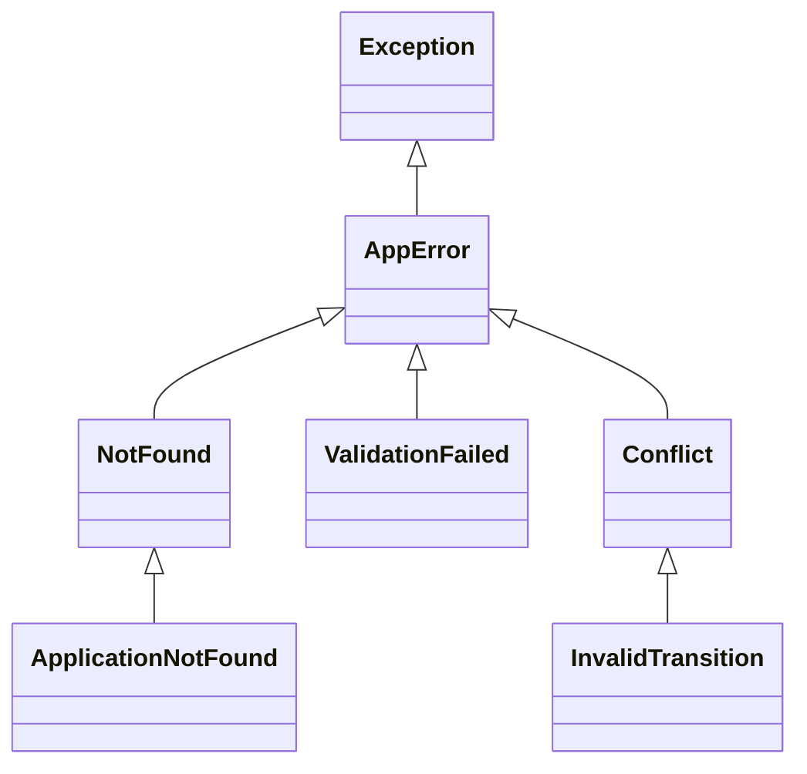
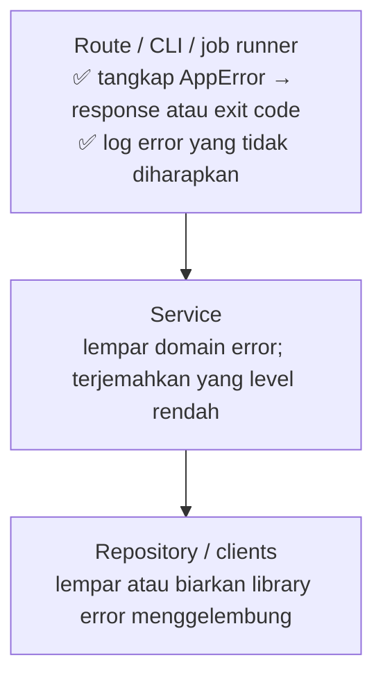

::part[Pelajari Konsepnya]{n="1"}

## 🎯 Yang akan kamu pelajari

- `try` / `except` / `else` / `finally` — fungsi masing-masing bagian
- Menangkap exception yang **spesifik**; kenapa bare `except` berbahaya
- Melempar exception dengan pesan yang berguna; **chaining** dengan `raise … from`
- Merancang **custom exception hierarchy** untuk aplikasi
- **Context manager** (`with`) untuk pembersihan yang terjamin, termasuk membuat sendiri
- Di mana menangani error: di **boundary** (API, CLI, job runner), dengan logging

## 🔤 Istilah penting

| Istilah | Artinya (sederhana) |
|---|---|
| **Exception** | Sinyal bahwa terjadi kesalahan dan alur normal tidak bisa dilanjutkan |
| **Raise** | Melempar/mengirim sinyal kesalahan |
| **Catch (`except`)** | Menangkap kesalahan dan memutuskan apa yang dilakukan |
| **Bare `except`** | Menangkap semua kesalahan, bahkan bug sendiri — berbahaya |
| **`finally`** | Kode yang selalu dijalankan, baik gagal atau tidak (pembersihan) |
| **Exception chaining (`from`)** | Menyimpan penyebab asli kesalahan yang tertanam |
| **Exception hierarchy** | Kelas error buatan sendiri, dikelompokkan berdasarkan makna |
| **Context manager (`with`)** | Blok yang selalu membersihkan diri setelahnya |
| **Boundary** | Lapisan luar (API, CLI, job) yang mengubah error menjadi response |

## 🧠 Ide besarnya

Sebuah :term[exception]{bahasa="exception — sinyal bahwa terjadi kesalahan dan alur normal tidak bisa dilanjutkan"} itu seperti **alarm kebakaran**. Ketika ada yang salah di dalam gedung, alarm merambat dari lantai ke lantai sampai ada yang **memenuhi syarat** untuk merespons.

Ada dua hal yang tidak kamu inginkan: setiap ruangan mematikan alarm (menelan error), atau alarm yang begitu samar hanya mengatakan "ada sesuatu terjadi di suatu tempat".

## ❓ Kenapa ini penting

Kegagalan adalah hal biasa: database mati, pengguna mengirim data tidak valid, file hilang, API eksternal timeout. Kode perlu cara untuk

- **berhenti** dari alur normal seketika,
- **jelaskan** apa yang salah,
- dan biarkan lapisan yang tepat **putuskan** apa yang dilakukan (retry, tampilkan 404, log dan alert).

Jika ditangani dengan buruk, error bersembunyi dari kamu:

```python
def get_application(app_id):
    try:
        return db.fetch(app_id)
    except:
        return None          # database down? typo in the SQL? bad id? all look like "not found" 😱
```

- Pemadaman database terlihat seperti "aplikasi tidak ditemukan" → pengguna lihat 404 dan tidak ada alert.
- Bug sungguhan (`NameError`) terabaikan.
- Atau sebaliknya: tidak ada yang ditangani, dan pengguna dapat stack trace penuh dengan rincian internal.

## 📖 Langkah demi langkah

### 1. Pernyataan `try` lengkap

```python
try:
    data = json.loads(path.read_text(encoding="utf-8"))   # only the risky part
except FileNotFoundError:
    data = {}                                               # expected: use defaults
except json.JSONDecodeError as error:
    raise ConfigError(f"Invalid JSON in {path}: {error}") from error
else:
    log.info("config loaded")                               # runs only if no exception
finally:
    log.debug("config step finished")                       # ALWAYS runs (cleanup)
```

Simpan blok `try` **kecil** — bungkus hanya baris yang bisa melempar exception yang kamu tangani.

### 2. Tangkap exception spesifik

```python
try:
    amount = int(text)
except ValueError:                 # ✅ exactly what int() raises for bad text
    raise InvalidInput("amount must be a whole number") from None
```

| Pola | Hasil |
|---|---|
| `except:` | ❌ menangkap segalanya, bahkan Ctrl+C (`KeyboardInterrupt`) |
| `except Exception: pass` | ❌ menyembunyikan bug |
| `except Exception as e: log.exception(...); raise` | ✅ di boundary, untuk log lalu re-raise |
| `except (ValueError, KeyError):` | ✅ spesifik |

### 3. Raise dengan konteks

```python
raise ApplicationNotFound(application_id)          # a specific type + data
raise ValueError(f"salary must be ≥ 0, got {salary}")   # a message that helps debugging
```

**Chaining**: saat menerjemahkan error level rendah ke domain error, simpan penyebabnya:

```python
try:
    row = repository.get(application_id)
except psycopg.OperationalError as error:
    raise ServiceUnavailable("database unavailable") from error   # traceback shows both
```

Pakai `from None` hanya saat error asli tidak menambah apa pun (mis. `KeyError` → `NotFound`).

### 4. Custom exception hierarchy

Kelas error sendiri adalah seperti **tipe alarm berlabel**: "tidak ditemukan", "tidak diizinkan", "input tidak valid". Boundary kemudian bisa memetakan setiap label ke HTTP status yang tepat tanpa menebak.

```python
class AppError(Exception):
    """Base class for errors our app knows how to report."""
    status_code = 500
    code = "internal_error"

class NotFound(AppError):
    status_code = 404
    code = "not_found"

class ValidationFailed(AppError):
    status_code = 422
    code = "validation_failed"
    def __init__(self, errors: dict[str, str]):
        super().__init__("validation failed")
        self.errors = errors

class Conflict(AppError):
    status_code = 409
    code = "conflict"

class ApplicationNotFound(NotFound):
    def __init__(self, application_id: int):
        super().__init__(f"application {application_id} not found")
        self.application_id = application_id
```



Service melempar exception **domain** (`ApplicationNotFound`, `InvalidTransition`). Mereka tidak tahu tentang HTTP. Lapisan API memetakannya ke response **di satu tempat**:

```python
def to_response(error: Exception) -> tuple[dict, int]:
    if isinstance(error, AppError):
        body = {"error": {"code": error.code, "message": str(error)}}
        if isinstance(error, ValidationFailed):
            body["error"]["fields"] = error.errors
        return body, error.status_code
    log.exception("unexpected error")                      # full traceback in logs
    return {"error": {"code": "internal_error", "message": "Something went wrong"}}, 500   # no internals to users
```

(Flask's `@app.errorhandler(AppError)` melakukan persis ini — Week 5.)

### 5. Context manager: pembersihan terjamin

```python
with open(path, encoding="utf-8") as file:     # file closed even if an exception happens
    ...
with conn.transaction():                        # commit or rollback (Week 2!)
    ...
```

Tulis sendiri dengan `contextlib`:

```python
from contextlib import contextmanager
import time

@contextmanager
def timer(name: str, records: list):
    start = time.perf_counter()
    try:
        yield                                   # the body of the `with` block runs here
    finally:
        records.append((name, time.perf_counter() - start))

with timer("import", records):
    import_jobs()
```

### 6. Di mana menangani error

Tangani error di tempat kamu bisa benar-benar putuskan sesuatu. Jauh di dalam, kamu biasanya hanya tambahkan konteks dan re-raise; di boundary, kamu ubah error menjadi response dan log line.



Tangani exception di tempat kamu bisa **lakukan sesuatu yang bermakna**: retry, fallback, terjemahkan, atau report. Kalau tidak, biarkan merambat.

### Memilih setup-mu

Setiap pilihan di sini adalah trade-off:

| Pilihan | ✅ | ❌ |
|---|---|---|
| Exception untuk kegagalan | alur bahagia bersih; tidak bisa diabaikan diam-diam | control flow tidak terlihat jika berlebihan |
| Mengembalikan `None` / error code | jelas di call site | mudah lupa untuk check; kehilangan alasan |
| Banyak custom exception type | penanganan presisi | terlalu banyak type jadi bising |
| Satu global handler di boundary | response konsisten, satu tempat log | harus dirancang dengan hati-hati |
| Catch-and-continue | ketahanan untuk batch job | risiko menyembunyikan kegagalan sistematis — hitung dan report |

- ✅ Lempar exception spesifik untuk kegagalan yang caller tidak bisa abaikan.
- ✅ Tangkap exception di boundary dan di mana pemulihan mungkin.
- ✅ Pakai `with` untuk apa pun yang harus dirilis.
- 🚫 Jangan pakai exception untuk branching normal yang diharapkan di hot loop (mis. cek setiap dict key dengan try/except saat `.get` lebih jelas).
- 🚫 Jangan kembalikan raw traceback atau pesan internal ke pengguna API.

## ⚠️ Kesalahan umum

- `except Exception: pass`.
- Logging error **dan** re-raise di setiap layer → error yang sama di-log lima kali.
- Tangkap exception hanya untuk lempar yang lebih samar tanpa `from`.
- Kebocoran `str(error)` dari database driver ke pengguna.
- Bungkus seluruh badan fungsi dalam `try`.

:::revoshop
Buka `app/errors.py` di RevoShop. Bagaimana error didefinisikan dan diubah menjadi response? Apakah ada base class, error code, dan satu tempat yang memetakan exception ke HTTP status? Lalu lihat bagian *Response Format* di README. Cari satu service yang melempar error dan lacak: service → route → error handler → JSON response. Apakah pemadaman database menghasilkan 500/503 bersih tanpa kebocoran rincian?
:::

## 🏆 Praktik terbaik

- [ ] Tangkap exception yang **paling spesifik**; tidak pernah bare `except:`.
- [ ] Simpan blok `try` **kecil**.
- [ ] Tentukan **`AppError` hierarchy** dengan code; service lempar domain error, API memetakannya ke HTTP **di satu** tempat.
- [ ] Pakai `raise … from error` untuk simpan penyebab saat menerjemahkan.
- [ ] Log error yang tidak diharapkan dengan **`logger.exception(...)`** (termasuk traceback) — sekali, di boundary.
- [ ] Kembalikan **error body yang aman dan konsisten** ke client (`{"error": {"code", "message"}}`); jangan kebocoran stack trace, SQL, atau secret.
- [ ] Pakai context manager untuk file, transaksi, lock, state sementara.
- [ ] Test error path seteliti happy path (`pytest.raises`).

::part[Jelaskan & Rancang]{n="2"}

## 🗣️ Jelaskan

Jelaskan ke non-programmer kenapa "kembalikan tidak ada saat sesuatu gagal" itu berbahaya, pakai contoh seperti aplikasi delivery yang tampilkan "tidak ada restoran di dekat sini" saat servernya sebenarnya mati.

## 📐 Rancang

Rancang exception hierarchy dan format error API untuk CareerPilot. Untuk setiap situasi, beri nama exception, HTTP status-nya, dan error `code`-nya:

1. Application id tidak ada (atau milik pengguna lain)
2. Invalid status transition
3. Request body tidak punya `role_title`
4. Duplikat aplikasi untuk perusahaan dan peran yang sama
5. Tidak login / token expired
6. Login, tapi coba endpoint admin-only
7. Layanan AI match timeout
8. Bug yang tidak diharapkan

:::quiz
Lihat contoh rancangan

| # | Exception | HTTP | code |
|---|---|---|---|
| 1 | `ApplicationNotFound(NotFound)` | 404 | `application_not_found` |
| 2 | `InvalidTransition(Conflict)` | 409 | `invalid_transition` |
| 3 | `ValidationFailed` (dengan field error) | 422 (atau 400) | `validation_failed` |
| 4 | `DuplicateApplication(Conflict)` — diterjemahkan dari `UniqueViolation` database | 409 | `duplicate_application` |
| 5 | `Unauthorized(AppError)` | 401 | `unauthorized` |
| 6 | `Forbidden(AppError)` | 403 | `forbidden` |
| 7 | `UpstreamTimeout(AppError)` | 503 (atau 504) | `ai_service_unavailable` |
| 8 | exception lain → di-log dengan traceback | 500 | `internal_error` |

Body: `{"error": {"code": "...", "message": "...", "fields": {...}, "request_id": "..."}}`. Untuk #1, return 404 untuk aplikasi pengguna lain menghindari keterbukaan bahwa aplikasi itu ada.
:::

### 📝 Checklist review mandiri

- [ ] Setiap error yang menghadap client punya `code` yang stabil
- [ ] Error database diterjemahkan ke domain error
- [ ] Error yang tidak diharapkan tidak kebocoran detail tapi di-log
- [ ] 401 vs 403 dan 404-untuk-ownership ditangani dengan benar

::ai-review{task="design"}

::part[Latihan Kecil]{n="3"}

:::exercise{path="exercises/m2/w3/08-exceptions" ai="no-ai" title="Error hierarchy dan safe boundary"}
Implementasikan di `errors.py`: `AppError` hierarchy dengan status code dan error code, fungsi `parse_application` yang kumpulkan **semua** field error dalam satu `ValidationFailed`, fungsi boundary `to_response` yang jangan pernah kebocoran detail internal, dan context manager `timer`. Test cek tipe exception, chaining (`__cause__`), response body dan pembersihan.
:::

:::hints
- Kumpulkan error di dict, lalu lempar **sekali** di akhir jika tidak kosong.
- `to_response` untuk exception yang tidak dikenal jangan include `str(error)`.
- Untuk chaining, test `error.__cause__` — `raise X from original`.
- `@contextmanager` + `try/finally` sekitar `yield`.
:::

### 🏆 Stretch goal

Tambahkan `retry_on(exceptions, attempts)` sebagai helper **context manager**-friendly… lalu putuskan apakah decorator (Lesson 04) yang lebih baik, dan jelaskan kenapa di catatan.

## ✅ Cek cepat

:::quiz
Kapan blok `else` dari pernyataan `try` dijalankan?

Hanya jika blok `try` selesai tanpa melempar exception (dan sebelum `finally`).
:::

:::quiz
Kenapa lempar `ServiceUnavailable(...) from error` daripada hanya `ServiceUnavailable(...)`?

Chaining menyimpan exception asli sebagai `__cause__`, jadi log dan traceback tampilkan akar penyebab sebenarnya.
:::

:::quiz
Di mana sebagian besar exception harus ditangkap di web app?

Di boundary — handler error pusat yang ubah error yang dikenal menjadi response konsisten dan log yang tidak diharapkan — plus tempat spesifik di mana pemulihan nyata (retry, fallback) mungkin.
:::


## 📚 Lanjut belajar

- [Python tutorial: Errors and Exceptions](https://docs.python.org/3/tutorial/errors.html)
- [Python docs: contextlib](https://docs.python.org/3/library/contextlib.html)
- [Python docs: Exception hierarchy](https://docs.python.org/3/library/exceptions.html#exception-hierarchy)
