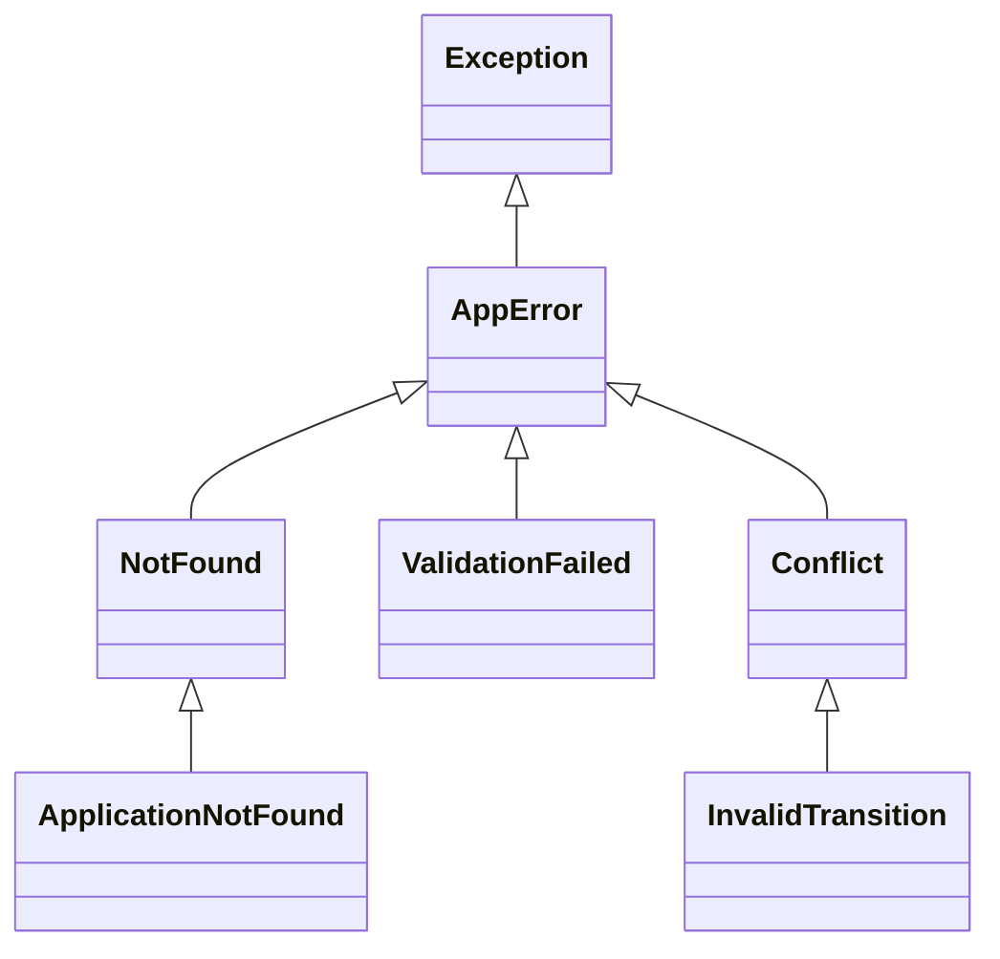
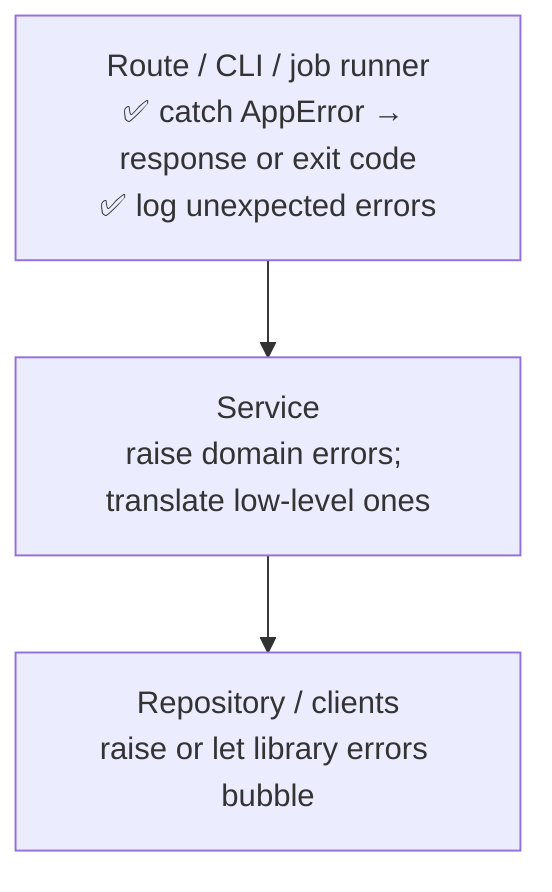

::part[Learn the Concept]{n="1"}

## 🎯 What you'll learn

- `try` / `except` / `else` / `finally` — what each part is for
- Catching **specific** exceptions; why bare `except` is dangerous
- Raising exceptions with useful messages; **chaining** with `raise … from`
- Designing a **custom exception hierarchy** for an application
- **Context managers** (`with`) for guaranteed cleanup, including writing your own
- Where to handle errors: at the **boundary** (API, CLI, job runner), with logging

## 🧠 The big idea

An :term[exception]{bahasa="exception — sinyal bahwa sesuatu yang tidak normal terjadi dan alur biasa tidak bisa dilanjutkan"} is a **fire alarm**. When something goes wrong deep inside a building, the alarm travels up floor by floor until someone **qualified** responds. You don't want every room to silence the alarm (swallowing errors), and you don't want the alarm to be vague ("something happened somewhere").

## ❓ Why does this exist?

Failures are normal: the database is down, the user sent invalid data, a file is missing, an external API times out. Code needs a way to:
- **stop** the normal path immediately,
- **describe** what went wrong,
- let the right layer **decide** what to do (retry, show a 404, log and alert).

## 💥 What happens if we DON'T handle errors well?

```python
def get_application(app_id):
    try:
        return db.fetch(app_id)
    except:
        return None          # database down? typo in the SQL? bad id? all look like "not found" 😱
```

- A database outage looks like "application not found" → users see 404s, no alert fires.
- A bug (`NameError`) is silently hidden.
- Or the opposite: nothing is handled, and users see a raw stack trace with internal details.

## 📖 How it works, step by step

### 1. The full `try` statement

```python
try:
    data = json.loads(path.read_text(encoding="utf-8"))   # only the risky part
except FileNotFoundError:
    data = {}                                               # expected: use defaults
except json.JSONDecodeError as error:
    raise ConfigError(f"Invalid JSON in {path}: {error}") from error
else:
    log.info("config loaded")                               # runs only if no exception
finally:
    log.debug("config step finished")                       # ALWAYS runs (cleanup)
```

Keep `try` blocks **small** — wrap only the lines that can raise the exceptions you're handling.

### 2. Catch specific exceptions

```python
try:
    amount = int(text)
except ValueError:                 # ✅ exactly what int() raises for bad text
    raise InvalidInput("amount must be a whole number") from None
```

| Pattern | Verdict |
|---|---|
| `except:` | ❌ catches everything, even Ctrl+C (`KeyboardInterrupt`) |
| `except Exception: pass` | ❌ hides bugs |
| `except Exception as e: log.exception(...); raise` | ✅ at a boundary, to log then re-raise |
| `except (ValueError, KeyError):` | ✅ specific |

### 3. Raise with context

```python
raise ApplicationNotFound(application_id)          # a specific type + data
raise ValueError(f"salary must be ≥ 0, got {salary}")   # a message that helps debugging
```

**Chaining**: when translating a low-level error into a domain error, keep the cause:

```python
try:
    row = repository.get(application_id)
except psycopg.OperationalError as error:
    raise ServiceUnavailable("database unavailable") from error   # traceback shows both
```

Use `from None` only when the original error adds nothing (e.g. `KeyError` → `NotFound`).

### 4. A custom exception hierarchy

```python
class AppError(Exception):
    """Base class for errors our app knows how to report."""
    status_code = 500
    code = "internal_error"

class NotFound(AppError):
    status_code = 404
    code = "not_found"

class ValidationFailed(AppError):
    status_code = 422
    code = "validation_failed"
    def __init__(self, errors: dict[str, str]):
        super().__init__("validation failed")
        self.errors = errors

class Conflict(AppError):
    status_code = 409
    code = "conflict"

class ApplicationNotFound(NotFound):
    def __init__(self, application_id: int):
        super().__init__(f"application {application_id} not found")
        self.application_id = application_id
```



Services raise **domain** exceptions (`ApplicationNotFound`, `InvalidTransition`). They don't know about HTTP. The API layer maps them to responses **in one place**:

```python
def to_response(error: Exception) -> tuple[dict, int]:
    if isinstance(error, AppError):
        body = {"error": {"code": error.code, "message": str(error)}}
        if isinstance(error, ValidationFailed):
            body["error"]["fields"] = error.errors
        return body, error.status_code
    log.exception("unexpected error")                      # full traceback in logs
    return {"error": {"code": "internal_error", "message": "Something went wrong"}}, 500   # no internals to users
```

(Flask's `@app.errorhandler(AppError)` does exactly this — Week 5.)

### 5. Context managers: guaranteed cleanup

```python
with open(path, encoding="utf-8") as file:     # file closed even if an exception happens
    ...
with conn.transaction():                        # commit or rollback (Week 2!)
    ...
```

Write your own with `contextlib`:

```python
from contextlib import contextmanager
import time

@contextmanager
def timer(name: str, records: list):
    start = time.perf_counter()
    try:
        yield                                   # the body of the `with` block runs here
    finally:
        records.append((name, time.perf_counter() - start))

with timer("import", records):
    import_jobs()
```

### 6. Where to handle errors



Handle an exception where you can **do something meaningful**: retry, fall back, translate, or report. Otherwise, let it propagate.

## ⚖️ Trade-offs

| Choice | ✅ | ❌ |
|---|---|---|
| Exceptions for failures | clean happy path; can't be ignored silently | invisible control flow if overused |
| Returning `None` / error codes | explicit at call site | easy to forget to check; loses the reason |
| Many custom exception types | precise handling | too many types become noise |
| One global handler at the boundary | consistent responses, one place to log | must be carefully designed |
| Catch-and-continue | resilience for batch jobs | risk of hiding systematic failures — count and report them |

## ✅ When to use it / 🚫 When NOT to use it

- ✅ Raise specific exceptions for failures the caller can't ignore.
- ✅ Catch exceptions at boundaries and where recovery is possible.
- ✅ Use `with` for anything that must be released.
- 🚫 Don't use exceptions for normal, expected branching in hot loops (e.g. checking every dict key with try/except when `.get` is clearer).
- 🚫 Don't return raw tracebacks or internal messages to API users.

## 🏆 Best practices

- [ ] Catch the **most specific** exception possible; never bare `except:`.
- [ ] Keep `try` blocks **small**.
- [ ] Define an **`AppError` hierarchy** with codes; services raise domain errors, the API maps them to HTTP in **one** place.
- [ ] Use `raise … from error` to preserve causes when translating.
- [ ] Log unexpected errors with **`logger.exception(...)`** (includes the traceback) — once, at the boundary.
- [ ] Return **safe, consistent error bodies** to clients (`{"error": {"code", "message"}}`); never leak stack traces, SQL or secrets.
- [ ] Use context managers for files, transactions, locks, temporary state.
- [ ] Test error paths as carefully as happy paths (`pytest.raises`).

## 🏭 How it's used in industry

- API frameworks register global error handlers that turn exceptions into JSON error responses with a stable format and a request id.
- Error-tracking tools (Sentry) collect unhandled exceptions with context; teams set alerts on new error types.
- AI features need careful handling of timeouts, rate limits and malformed model output — with retries and fallbacks (Module 7).

## ⚠️ Common mistakes

- `except Exception: pass`.
- Logging an error **and** re-raising it at every layer → the same error logged five times.
- Catching an exception just to raise a vaguer one without `from`.
- Leaking `str(error)` from database drivers to users.
- Wrapping a whole function body in `try`.

:::revoshop
Open `app/errors.py` in RevoShop. How are errors defined and turned into responses? Is there a base class, error codes, and one place that maps exceptions to HTTP status codes? Then look at the *Response Format* section in the README. Find one service that raises an error and trace it: service → route → error handler → JSON response. Would a database outage produce a clean 500/503 without leaking details?
:::

::part[Explain & Design]{n="2"}

## 🗣️ Explain it

Explain to a non-programmer why "return nothing when something fails" is dangerous, using an example like a delivery app that shows "no restaurants nearby" when its server is actually down.

## 📐 Design it

Design the error hierarchy and API error format for CareerPilot. For each situation, name the exception, its HTTP status, and its error `code`:

1. Application id doesn't exist (or belongs to another user)
2. Invalid status transition
3. Request body missing `role_title`
4. Duplicate application for the same company and role
5. Not logged in / token expired
6. Logged in, but trying an admin-only endpoint
7. The AI match service timed out
8. An unexpected bug

:::quiz
Show a possible design

| # | Exception | HTTP | code |
|---|---|---|---|
| 1 | `ApplicationNotFound(NotFound)` | 404 | `application_not_found` |
| 2 | `InvalidTransition(Conflict)` | 409 | `invalid_transition` |
| 3 | `ValidationFailed` (with field errors) | 422 (or 400) | `validation_failed` |
| 4 | `DuplicateApplication(Conflict)` — translated from the database `UniqueViolation` | 409 | `duplicate_application` |
| 5 | `Unauthorized(AppError)` | 401 | `unauthorized` |
| 6 | `Forbidden(AppError)` | 403 | `forbidden` |
| 7 | `UpstreamTimeout(AppError)` | 503 (or 504) | `ai_service_unavailable` |
| 8 | any other exception → logged with traceback | 500 | `internal_error` |

Body: `{"error": {"code": "...", "message": "...", "fields": {...}, "request_id": "..."}}`. For #1, returning 404 for another user's application avoids revealing that it exists.
:::

### 📝 Self-review checklist

- [ ] Every client-facing error has a stable `code`
- [ ] Database errors are translated into domain errors
- [ ] Unexpected errors don't leak details but are logged
- [ ] 401 vs 403 and 404-for-ownership are handled correctly

::ai-review{task="design"}

::part[Toy Exercise]{n="3"}

:::exercise{path="exercises/m2/w3/08-exceptions" ai="no-ai" title="Error hierarchy and a safe boundary"}
Implement in `errors.py`: an `AppError` hierarchy with status codes and error codes, a `parse_application` function that collects **all** field errors into one `ValidationFailed`, a `to_response` boundary function that never leaks internal details, and a `timer` context manager. Tests check exception types, chaining (`__cause__`), response bodies and cleanup.
:::

:::hints
- Collect errors in a dict, then raise **once** at the end if it isn't empty.
- `to_response` for unknown exceptions must not include `str(error)`.
- For chaining, test `error.__cause__` — `raise X from original`.
- `@contextmanager` + `try/finally` around `yield`.
:::

### 🏆 Stretch goal

Add `retry_on(exceptions, attempts)` as a **context manager**-friendly helper… then decide whether a decorator (Lesson 04) is the better fit, and explain why in your notes.

## ✅ Quick check

:::quiz
When does the `else` block of a `try` statement run?

Only if the `try` block finished without raising an exception (and before `finally`).
:::

:::quiz
Why raise `ServiceUnavailable(...) from error` instead of just `ServiceUnavailable(...)`?

Chaining keeps the original exception as `__cause__`, so logs and tracebacks show the real root cause.
:::

:::quiz
Where should most exceptions be caught in a web app?

At the boundary — a central error handler that converts known errors into consistent responses and logs unexpected ones — plus specific places where real recovery (retry, fallback) is possible.
:::

## 📖 Kamus (glossary)

| Term | Bahasa Indonesia |
|---|---|
| Exception | Pengecualian — sinyal kesalahan saat program berjalan |
| Raise / Catch | Melempar / Menangkap exception |
| Traceback | Jejak pemanggilan saat error |
| Exception chaining | Menyambungkan error baru dengan penyebab aslinya |
| Context manager | Pengelola konteks (`with`) untuk pembersihan otomatis |
| Boundary | Batas sistem (API, CLI) tempat error diterjemahkan |

## 📚 Keep learning

- [Python tutorial: Errors and Exceptions](https://docs.python.org/3/tutorial/errors.html)
- [Python docs: contextlib](https://docs.python.org/3/library/contextlib.html)
- [Python docs: Exception hierarchy](https://docs.python.org/3/library/exceptions.html#exception-hierarchy)
