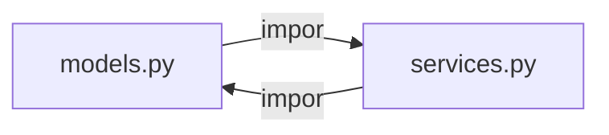
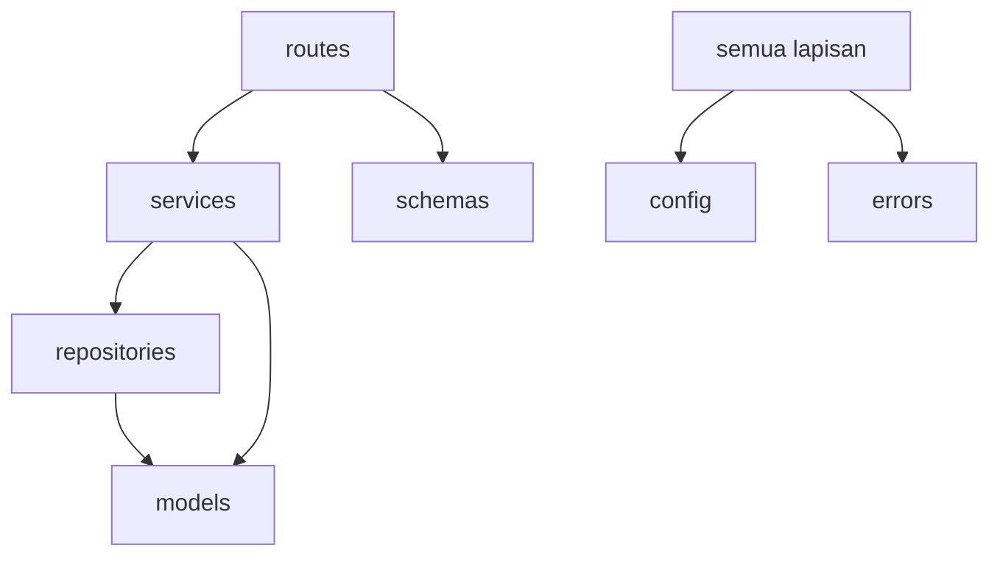

::part[Pelajari Konsepnya]{n="1"}

## 🎯 Yang akan kamu pelajari

- Apa itu **modul** dan **paket**, dan bagaimana `import` menemukannya
- Import absolut vs relatif; apa kegunaan `__init__.py`
- `if __name__ == "__main__":` dan menjalankan paket dengan `python -m`
- Kenapa **saling impor** terjadi dan cara menghindarinya
- Tata letak profesional untuk proyek Flask/FastAPI (tata letak `src/`, test, config)

## 🔤 Istilah penting

| Istilah | Artinya (sederhana) |
|---|---|
| **Modul** | Satu file `.py` yang bisa diimpor |
| **Paket** | Folder berisi modul-modul yang bisa diimpor |
| **`import`** | Mengambil kode dari modul lain ke modul ini |
| **Import absolut / relatif** | Dari akar proyek / dari file ini |
| **`__init__.py`** | File yang menandai folder sebagai paket dan menjadi "pintu depan" |
| **`python -m`** | Menjalankan modul atau paket dengan benar, dari mana saja |
| **Saling impor** | Dua modul saling membutuhkan → import gagal |
| **Shadowing** | Membuat file `email.py` dan menyembunyikan library asli |
| **Tata letak `src/`** | Paket di folder `src` agar test impor kode yang terinstall |

## 🧠 Ide besarnya

Script satu file itu seperti **studio kecil**: cukup untuk satu orang. Proyek sungguhan adalah **gedung dengan lantai dan ruangan**: setiap ruangan (modul) punya tugas, lantai (paket) mengelompokkan ruangan terkait, dan arus harus ke satu arah — kamu tidak mau pintu dari setiap ruangan ke setiap ruangan lain.

Inilah alasan saling impor terjadi.

## ❓ Kenapa ini penting

Proyek tumbuh dari 200 baris menjadi 20.000. Tanpa struktur, semua bercampur di satu file: nama bentrok, test impor setengah app untuk uji satu fungsi, dan perubahan di satu tempat bisa merusak fitur lain yang tidak terkait. Modul dan paket memberimu **namespace**, **kode yang bisa dipakai ulang**, dan **batas-batas jelas**.

Tanpa struktur yang baik terlihat seperti ini:

- `app.py` dengan 3.000 baris: route, SQL, pengiriman email, dan pembuatan PDF semua tercampur.
- `models.py` impor `services.py`, yang impor `models.py` → `ImportError: cannot import name ...`.
- File bernama `email.py` atau `json.py` di proyekmu **menyembunyikan** modul library standar, jadi muncul error aneh di mana-mana.
- "Jalan kalau aku jalankan dari folder ini" — tapi tidak di tempat lain.

## 📖 Langkah demi langkah

### 1. Modul dan paket

- **Modul** adalah file `.py`: `analysis.py` → `import analysis`.
- **Paket** adalah folder berisi modul, biasanya dengan `__init__.py`: `careerpilot/analysis.py` → `import careerpilot.analysis`.

```text
careerpilot/
├── __init__.py          # berjalan saat "import careerpilot"; bisa menunjukkan API publik
├── models.py
├── analysis.py
└── __main__.py          # berjalan saat "python -m careerpilot"
```

### 2. Bagaimana `import` menemukan kode

Python cari `sys.path` berturut-turut: folder script (atau folder sekarang kalau pakai `-m`), paket yang terinstall (virtual environment), dan library standar. Itulah mengapa:
- jalankan dari folder berbeda bisa rusak import,
- file lokal `random.py` menyembunyikan `random` asli.

### 3. Gaya impor

```python
import careerpilot.analysis                        # full name
from careerpilot.analysis import top_skills        # specific names ✅ common
from careerpilot import analysis                   # the module
from . import models                               # relative: inside the package only
from .models import JobListing
from careerpilot.analysis import *                 # ❌ unclear where names come from
```

Pilih **import absolut** agar jelas; import relatif baik-baik saja di dalam paket. Kelompokkan import: library standar, pihak ketiga, lokal (aturan Ruff `I` mengurutkan).

### 4. `__init__.py` sebagai pintu depan publik

```python
# careerpilot/__init__.py
from .models import JobListing
from .analysis import top_skills

__all__ = ["JobListing", "top_skills"]
__version__ = "0.1.0"
```

User tulis `from careerpilot import top_skills` tanpa tahu tata letak file internal — kamu bisa reorganisasi file nanti tanpa rusak kode mereka.

### 5. `__name__` dan `python -m`

```python
# careerpilot/cli.py
def main() -> int:
    ...
    return 0

if __name__ == "__main__":        # only when run directly, NOT when imported
    raise SystemExit(main())
```

- `python careerpilot/cli.py` → import di dalamnya bisa rusak (folder script jadi jalur cari).
- `python -m careerpilot.cli` → jalankan modul **sebagai bagian paket** ✅.
- `python -m careerpilot` jalankan `careerpilot/__main__.py`.

### 6. Saling impor

Saling impor adalah dua ruangan yang hanya punya pintu ke satu sama lain. Perbaikan hampir tidak pernah trik impor yang pintar — itu keputusan ruangan mana yang "lebih bawah" dan pindahkan kode bersama ke sana.



Kalau `models` mulai load, dia impor `services`, yang impor `models` — yang belum selesai load → error. Perbaikan, terbaik dulu:

1. **Perbaiki arah tergantung.** Lapisan lebih bawah (model) tidak boleh impor lapisan lebih atas (service, route).
2. **Pindahkan kode bersama** ke modul ketiga yang dua-duanya impor (`types.py`, `errors.py`).
3. **Berikan tergantung** (injection) bukan impor.
4. Impor di dalam fungsi (pilihan terakhir, tanda kode buruk).
5. Hanya untuk tipe: `from typing import TYPE_CHECKING` + `if TYPE_CHECKING: import …`.

Arah sehat untuk backend web:



### 7. Tata letak proyek profesional

Lihat arah panah: route boleh panggil service, service boleh panggil repository, dan tidak ada yang panggil balik ke atas. Satu aturan ini menjaga proyek yang tumbuh tetap mudah dinavigasi.

```text
careerpilot-api/
├── pyproject.toml
├── uv.lock
├── README.md
├── .env.example
├── src/
│   └── careerpilot/
│       ├── __init__.py
│       ├── app.py              # factory create_app() (Minggu 4)
│       ├── config.py
│       ├── errors.py
│       ├── models/             # database model
│       ├── repositories/       # akses data
│       ├── services/           # aturan bisnis
│       ├── schemas/            # validasi request/response
│       └── routes/             # lapisan HTTP
├── migrations/
└── tests/
    ├── conftest.py
    ├── unit/
    └── integration/
```

**Tata letak `src/`** mencegah test impor kode dari folder kerja bukan dari paket terinstall — jadi bug import "jalan di mesinku" muncul lebih cepat. Proyek uv yang dibuat dengan `uv init --package` pakai ini.

### Pilih pengaturan kamu

Setiap pilihan adalah trade-off:

| Pilihan | ✅ | ❌ |
|---|---|---|
| Modul datar | sederhana untuk proyek kecil | cepat jadi ramai |
| Paket per **lapisan** (models/, services/, routes/) | familiar, cocok framework | satu fitur sentuh banyak folder |
| Paket per **fitur** (applications/, companies/, auth/) | perubahan tetap lokal | kode bersama butuh rumah; kurang konvensional untuk pemula |
| Tata letak `src/` | tangkap kesalahan paket/impor | satu level folder lagi |
| Re-export di `__init__.py` | API publik stabil | bisa sembunyikan di mana hidup; biaya impor |

- ✅ Pecah file kalau punya beberapa tanggung jawab atau tumbuh lebih dari beberapa ratus baris.
- ✅ Jaga tergantung mengalir satu arah (route → service → repository → model).
- ✅ Jalankan entry point dengan `python -m package.module`.
- 🚫 Jangan beri nama modul sama dengan library standar (`email.py`, `logging.py`, `json.py`, `test.py`).
- 🚫 Jangan buat pohon paket dalam untuk proyek 300 baris.

## ⚠️ Kesalahan umum

- Saling impor antara model dan service.
- Jalankan `python src/careerpilot/app.py` daripada `python -m careerpilot.app`.
- File lokal menyembunyikan modul library standar atau pihak ketiga.
- Buat objek dengan efek samping saat impor (misalnya koneksi database saat modul diimpor).
- Test yang hanya lulus kalau dijalankan dari folder tertentu.

:::revoshop
RevoShop diatur per **lapisan**: `app/routes`, `app/schemas`, `app/services`, `app/repositories`, `app/models`, plus `app/errors.py`, `app/extensions.py`, `config/`. Gambar arah impor antara paket ini (pakai `grep -rn "^from app" app/services | head` untuk cek). Ada **model** yang impor service, atau **repository** yang impor route? Di mana `create_app()` hidup (`app/__init__.py`), dan mengapa `run.py` impor darinya bukan define app sendiri?
:::

## 🏆 Praktik terbaik

- [ ] Satu tanggung jawab per modul; kelompokkan modul ke paket per lapisan atau fitur.
- [ ] **Import absolut**, diurutkan dan dikelompok (Ruff `I`); tidak ada impor wildcard.
- [ ] Jaga **arah tergantung satu arah**; lapisan lebih bawah tidak boleh impor lapisan lebih atas.
- [ ] Pakai `__init__.py` untuk tunjukkan API publik kecil (`__all__`), dan `__version__` kalau relevan.
- [ ] Lindungi kode script dengan `if __name__ == "__main__":`; jalankan dengan `python -m`.
- [ ] Pakai **tata letak `src/`** dan `pyproject.toml` untuk aplikasi yang akan kamu paket atau deploy.
- [ ] Hindari efek samping saat impor (jangan koneksi database atau panggilan jaringan saat modul diimpor).
- [ ] Cerminkan struktur sumber di `tests/`.

::part[Jelaskan & Rancang]{n="2"}

## 🗣️ Jelaskan

Jelaskan saling impor ke orang yang bukan programmer pakai dua orang yang masing-masing menolak kerja sampai yang lain selesai. Lalu jelaskan mengapa arah tergantung satu arah mencegahnya.

## 📐 Rancang

CareerPilot Fase 2 akan berisi: Flask app factory, config, database setup, model `User`/`Company`/`Application`, repository, service (application, auth), schema validasi, route (auth, application, company), error handler, CLI command untuk seed data, dan test. Sarankan struktur folder dan daftar **paket mana yang boleh impor mana**.

:::quiz
Tunjukkan rancangan mungkin

```text
src/careerpilot/
├── __init__.py            # __version__
├── app.py                 # create_app(); daftar blueprint & error handler
├── config.py
├── extensions.py          # object db, migrate, jwt (jangan impor app!)
├── errors.py              # hirarki AppError (jangan impor modul app lain)
├── models/                # impor: extensions
├── repositories/          # impor: models, extensions
├── services/              # impor: repositories, models, errors
├── schemas/               # impor: tidak ada app spesifik (atau errors)
├── routes/                # impor: services, schemas, errors
└── cli.py                 # impor: services
tests/unit/ · tests/integration/
```

Arah diizinkan: `app → routes → services → repositories → models → extensions`; `errors`, `config` boleh diimpor semua orang dan impor tidak ada dari app. Hanya `app.py` tahu semuanya, karena dia sambungkan potongan.
:::

### 📝 Daftar self-review

- [ ] Lapisan lebih bawah tidak boleh impor lapisan lebih atas
- [ ] Potongan bersama (errors, config, extensions) impor tidak ada app spesifik
- [ ] Hanya factory sambungkan semuanya
- [ ] Test cerminkan struktur

::ai-review{task="design"}

::part[Latihan Kecil]{n="3"}

:::exercise{path="exercises/m2/w3/09-modules-packages" ai="no-ai" title="Dari satu file jadi paket"}
`monolith.py` berisi model, logika analisis, format, dan CLI dalam satu file. Organisir ulang jadi paket `careerpilot_core/` dengan `models.py`, `analysis.py`, `formatting.py`, `__init__.py` (API publik + `__version__`) dan `__main__.py` (agar `python -m careerpilot_core …` jalan). Test cek perilaku, API publik, CLI via `python -m`, dan **arah impor** antara modul.
:::

:::hints
- Pindahkan kode dulu, baru perbaiki impor: `from .models import JobListing`.
- `models.py` tidak boleh impor apa pun dari paket.
- `__main__.py` pegang kode `argparse` dan panggil modul lain.
- Jalankan `uv run python -m careerpilot_core --version` dari dalam folder latihan untuk coba.
:::

## ✅ Cek cepat

:::quiz
Apa perbedaan `python path/to/cli.py` dan `python -m package.cli`?

`-m` jalankan modul sebagai bagian paketnya dengan folder sekarang di jalur impor, jadi impor absolut/relatif paket jalan; jalankan file langsung perlakukan sebagai script standalone, sering rusak impor paket.
:::

:::quiz
Sebut dua cara perbaiki saling impor antara `models` dan `services`.

Buat tergantung satu arah (model jangan impor service), atau pindahkan kode bersama ke modul ketiga yang dua-duanya impor. Dependency injection atau impor `TYPE_CHECKING` juga bisa bantu.
:::


## 📚 Lanjut belajar

- [Python tutorial: Modules and packages](https://docs.python.org/3/tutorial/modules.html)
- [Python Packaging Guide: src layout vs flat layout](https://packaging.python.org/en/latest/discussions/src-layout-vs-flat-layout/)
- [uv: Creating projects (packaged applications)](https://docs.astral.sh/uv/concepts/projects/init/)

## 📣 Akhir Minggu 3 — bagikan progresmu

:::linkedin{type="weekly"}
🐍 Minggu 3: Python beyond the basics — hal yang bikin kode production-ready.

- Decorator (sekarang aku paham apa @app.route itu!)
- Generator yang proses file besar dengan memori kecil
- Class yang jaga aturan sendiri + composition over inheritance
- Type hint dengan mypy --strict tangkap bug None sebelum jangkau user
- Hirarki error bersih dan tata letak proyek dengan impor satu arah

Konsep yang ubah cara aku kode: [jawab kamu].

Minggu depan: Flask, SQLAlchemy dan migrasi. 🌶️

#Python #LearningInPublic #BackendDevelopment #SoftwareEngineering
:::
