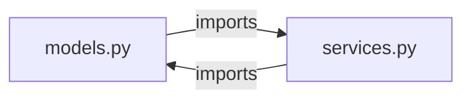
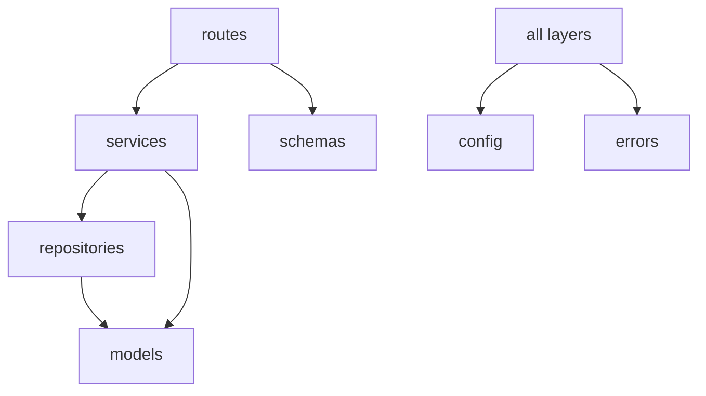

::part[Learn the Concept]{n="1"}

## 🎯 What you'll learn

- What a **module** and a **package** are, and how `import` finds them
- Absolute vs relative imports; what `__init__.py` is for
- `if __name__ == "__main__":` and running packages with `python -m`
- Why **circular imports** happen and how to design them away
- A professional layout for a Flask/FastAPI project (the `src/` layout, tests, config)

## 🧠 The big idea

A one-file script is a **studio apartment**: fine for one person. A real project is a **building with floors and rooms**: each room (module) has a purpose, floors (packages) group related rooms, and there's a clear direction of movement — you don't want every room to have a door into every other room.

## ❓ Why does this exist?

Projects grow from 200 lines to 20,000. Without structure: everything is in one file, names collide, tests import half the app just to test one function, and changes in one place break unrelated features. Modules and packages give **namespaces**, **reuse**, and **boundaries**.

## 💥 What happens if we DON'T organize?

- `app.py` with 3,000 lines: routes, SQL, email sending and PDF generation mixed together.
- `models.py` imports `services.py`, which imports `models.py` → `ImportError: cannot import name … (most likely due to a circular import)`.
- A file named `email.py` or `json.py` in your project **shadows** the standard library module — mysterious errors everywhere.
- "It works when I run it from this folder" — but not from anywhere else.

## 📖 How it works, step by step

### 1. Modules and packages

- A **module** is a `.py` file: `analysis.py` → `import analysis`.
- A **package** is a folder of modules, usually with an `__init__.py`: `careerpilot/analysis.py` → `import careerpilot.analysis`.

```text
careerpilot/
├── __init__.py          # runs on "import careerpilot"; can expose the public API
├── models.py
├── analysis.py
└── __main__.py          # runs on "python -m careerpilot"
```

### 2. How `import` finds code

Python searches `sys.path` in order: the directory of the script (or current directory with `-m`), installed packages (your virtual environment), and the standard library. That's why:
- running from a different folder can break imports,
- a local `random.py` hides the real `random`.

### 3. Import styles

```python
import careerpilot.analysis                        # full name
from careerpilot.analysis import top_skills        # specific names ✅ common
from careerpilot import analysis                   # the module
from . import models                               # relative: inside the package only
from .models import JobListing
from careerpilot.analysis import *                 # ❌ unclear where names come from
```

Prefer **absolute imports** for clarity; relative imports are fine inside a package. Group imports: standard library, third-party, local (Ruff's `I` rules sort them).

### 4. `__init__.py` as the public front door

```python
# careerpilot/__init__.py
from .models import JobListing
from .analysis import top_skills

__all__ = ["JobListing", "top_skills"]
__version__ = "0.1.0"
```

Users write `from careerpilot import top_skills` without knowing your internal file layout — you can reorganize files later without breaking them.

### 5. `__name__` and `python -m`

```python
# careerpilot/cli.py
def main() -> int:
    ...
    return 0

if __name__ == "__main__":        # only when run directly, NOT when imported
    raise SystemExit(main())
```

- `python careerpilot/cli.py` → imports inside may break (the script's folder becomes the search path).
- `python -m careerpilot.cli` → runs the module **as part of the package** ✅.
- `python -m careerpilot` runs `careerpilot/__main__.py`.

### 6. Circular imports



When `models` starts loading, it imports `services`, which imports `models` — which is only half-loaded → error. Fixes, best first:

1. **Fix the dependency direction.** Lower layers (models) should never import higher layers (services, routes).
2. **Move shared code** into a third module both can import (`types.py`, `errors.py`).
3. **Pass dependencies in** (injection) instead of importing them.
4. Import inside a function (a last resort, and a code smell).
5. For type hints only: `from typing import TYPE_CHECKING` + `if TYPE_CHECKING: import …`.

Healthy direction for a web backend:



### 7. A professional project layout

```text
careerpilot-api/
├── pyproject.toml
├── uv.lock
├── README.md
├── .env.example
├── src/
│   └── careerpilot/
│       ├── __init__.py
│       ├── app.py              # create_app() factory (Week 4)
│       ├── config.py
│       ├── errors.py
│       ├── models/             # database models
│       ├── repositories/       # data access
│       ├── services/           # business rules
│       ├── schemas/            # request/response validation
│       └── routes/             # HTTP layer
├── migrations/
└── tests/
    ├── conftest.py
    ├── unit/
    └── integration/
```

The **`src/` layout** prevents tests from accidentally importing your code from the working directory instead of the installed package — so "works on my machine" import bugs show up early. uv projects created with `uv init --package` use it.

## ⚖️ Trade-offs

| Choice | ✅ | ❌ |
|---|---|---|
| Flat modules | simple for small projects | gets crowded fast |
| Packages by **layer** (models/, services/, routes/) | familiar, matches frameworks | a feature touches many folders |
| Packages by **feature** (applications/, companies/, auth/) | changes stay local | shared code needs a home; less conventional for beginners |
| `src/` layout | catches packaging/import mistakes | one more folder level |
| Re-exporting in `__init__.py` | stable public API | can hide where things live; import cost |

## ✅ When to use it / 🚫 When NOT to use it

- ✅ Split a file when it has several responsibilities or grows beyond a few hundred lines.
- ✅ Keep dependencies flowing one direction (routes → services → repositories → models).
- ✅ Run entry points with `python -m package.module`.
- 🚫 Don't name modules after standard library modules (`email.py`, `logging.py`, `json.py`, `test.py`).
- 🚫 Don't create deep package trees for a 300-line project.

## 🏆 Best practices

- [ ] One responsibility per module; group modules into packages by layer or feature.
- [ ] **Absolute imports**, sorted and grouped (Ruff `I`); no wildcard imports.
- [ ] Keep a **one-way dependency direction**; lower layers never import higher ones.
- [ ] Use `__init__.py` to expose a small public API (`__all__`), and `__version__` if relevant.
- [ ] Guard script code with `if __name__ == "__main__":`; run with `python -m`.
- [ ] Use the **`src/` layout** and `pyproject.toml` for applications you'll package or deploy.
- [ ] Avoid import-time side effects (no database connections or network calls at module import).
- [ ] Mirror the source structure in `tests/`.

## 🏭 How it's used in industry

- Flask apps use an **application factory** and **blueprints** per feature (Week 4) — packages + import discipline in practice.
- Large codebases enforce import boundaries with tools (e.g. `import-linter`) so layers can't depend the wrong way.
- Monorepos (like your future CareerPilot repo) contain several packages with their own `pyproject.toml`.

## ⚠️ Common mistakes

- Circular imports between models and services.
- Running `python src/careerpilot/app.py` instead of `python -m careerpilot.app`.
- Local files shadowing standard library or third-party modules.
- Creating objects with side effects at import time (e.g. connecting to the database when a module is imported).
- Tests that only pass when run from a specific directory.

:::revoshop
RevoShop is organized by **layer**: `app/routes`, `app/schemas`, `app/services`, `app/repositories`, `app/models`, plus `app/errors.py`, `app/extensions.py`, `config/`. Draw the import direction between these packages (use `grep -rn "^from app" app/services | head` to check). Does any **model** import a service, or any **repository** import a route? Where does `create_app()` live (`app/__init__.py`), and why does `run.py` import from it instead of defining the app itself?
:::

::part[Explain & Design]{n="2"}

## 🗣️ Explain it

Explain circular imports to a non-programmer using two people who each refuse to start working until the other one has finished. Then explain why a one-way dependency direction prevents it.

## 📐 Design it

CareerPilot Phase 2 will contain: Flask app factory, config, database setup, `User`/`Company`/`Application` models, repositories, services (applications, auth), validation schemas, routes (auth, applications, companies), error handlers, a CLI command to seed data, and tests. Propose the folder structure and list **which packages may import which**.

:::quiz
Show a possible design

```text
src/careerpilot/
├── __init__.py            # __version__
├── app.py                 # create_app(); registers blueprints & error handlers
├── config.py
├── extensions.py          # db, migrate, jwt objects (no app import!)
├── errors.py              # AppError hierarchy (no imports from other app modules)
├── models/                # imports: extensions
├── repositories/          # imports: models, extensions
├── services/              # imports: repositories, models, errors
├── schemas/               # imports: nothing app-specific (or errors)
├── routes/                # imports: services, schemas, errors
└── cli.py                 # imports: services
tests/unit/ · tests/integration/
```

Allowed direction: `app → routes → services → repositories → models → extensions`; `errors`, `config` can be imported by everyone and import nothing from the app. Only `app.py` knows about everything, because it wires the pieces together.
:::

### 📝 Self-review checklist

- [ ] Lower layers never import higher layers
- [ ] Shared pieces (errors, config, extensions) import nothing app-specific
- [ ] Only the factory wires everything together
- [ ] Tests mirror the structure

::ai-review{task="design"}

::part[Toy Exercise]{n="3"}

:::exercise{path="exercises/m2/w3/09-modules-packages" ai="no-ai" title="From one file to a package"}
`monolith.py` contains a model, analysis logic, formatting and a CLI in one file. Restructure it into a package `careerpilot_core/` with `models.py`, `analysis.py`, `formatting.py`, `__init__.py` (public API + `__version__`) and `__main__.py` (so `python -m careerpilot_core …` works). Tests check behavior, the public API, the CLI via `python -m`, and the **import direction** between modules.
:::

:::hints
- Move code first, then fix imports: `from .models import JobListing`.
- `models.py` must not import anything from the package.
- `__main__.py` holds the `argparse` code and calls the other modules.
- Run `uv run python -m careerpilot_core --version` from inside the exercise folder to try it.
:::

## ✅ Quick check

:::quiz
What's the difference between `python path/to/cli.py` and `python -m package.cli`?

`-m` runs the module as part of its package with the current directory on the import path, so absolute/relative package imports work; running the file directly treats it as a standalone script, often breaking package imports.
:::

:::quiz
Name two ways to fix a circular import between `models` and `services`.

Make the dependency one-way (models must not import services), or move the shared code into a third module both import. Dependency injection or `TYPE_CHECKING` imports can also help.
:::

## 📖 Kamus (glossary)

| Term | Bahasa Indonesia |
|---|---|
| Module / Package | Modul (satu file) / Paket (folder berisi modul) |
| Import path | Jalur pencarian modul |
| Circular import | Impor melingkar |
| Public API | Bagian yang sengaja disediakan untuk dipakai pihak lain |
| Entry point | Titik awal program dijalankan |

## 📚 Keep learning

- [Python tutorial: Modules and packages](https://docs.python.org/3/tutorial/modules.html)
- [Python Packaging Guide: src layout vs flat layout](https://packaging.python.org/en/latest/discussions/src-layout-vs-flat-layout/)
- [uv: Creating projects (packaged applications)](https://docs.astral.sh/uv/concepts/projects/init/)

## 📣 End of Week 3 — share your progress

:::linkedin{type="weekly"}
🐍 Week 3: Python beyond the basics — the stuff that makes code production-ready.

- Decorators (now I understand what @app.route really does!)
- Generators that process huge files with tiny memory
- Classes that protect their own rules + composition over inheritance
- Type hints with mypy --strict catching None bugs before they reach users
- A clean error hierarchy and a project layout with one-way imports

The concept that changed how I write code: [your answer].

Next week: Flask, SQLAlchemy and migrations. 🌶️

#Python #LearningInPublic #BackendDevelopment #SoftwareEngineering
:::
