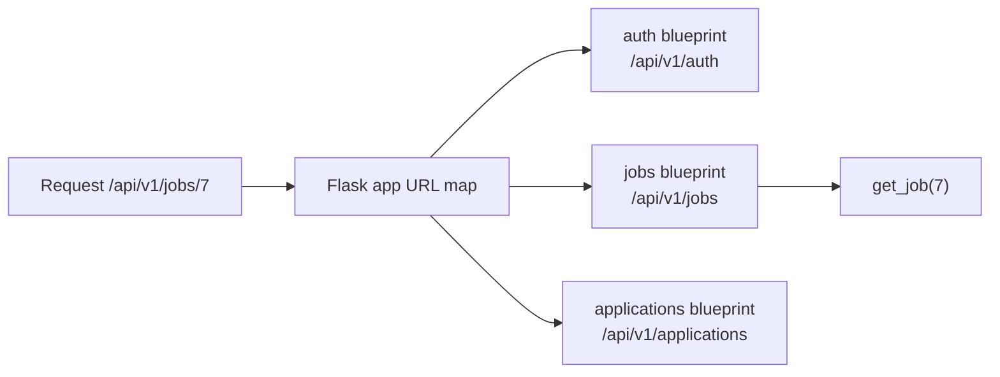

::part[Pelajari Konsepnya]{n="1"}

## 🎯 Yang akan kamu pelajari

- Apa yang dilakukan web framework, dan di mana Flask cocok
- Route, variabel URL, dan HTTP method
- Membaca request (`request.args`, `request.get_json()`) dan mengembalikan JSON dengan status code
- Pola **application factory** dan **kelas konfigurasi**
- **Blueprint** untuk membagi API menjadi modul fitur
- **Error handler** JSON yang konsisten dan health check

## 🔤 Istilah penting

| Istilah | Artinya (sederhana) |
|---|---|
| **Web framework** | Kode yang mengubah HTTP request masuk menjadi pemanggilan fungsimu |
| **Route** | Aturan "URL dan method ini → panggil fungsi ini" |
| **URL variable** | Bagian path yang berubah-ubah, seperti `/jobs/<int:job_id>` |
| **Request** | Apa yang dikirim klien: path, method, query, header, body |
| **Response** | Apa yang kamu kirim kembali: body, status code, header |
| **Status code** | Angka tiga digit untuk hasil: 200 ok, 404 tidak ditemukan, 422 tidak valid |
| **Configuration class** | Pengaturan dikelompokkan per lingkungan (development, production) |
| **Application factory** | Fungsi yang membangun aplikasi, sehingga test bisa membangun punya mereka |
| **Blueprint** | Kelompok route yang terkait dalam file terpisah |
| **Error handler** | Satu tempat yang mengubah exception menjadi JSON response |

## 🧠 Ide besarnya

Web framework adalah **resepsionis untuk kodemu**. Request tiba di meja depan; resepsionis membaca path dan method (`GET /api/v1/jobs`), mencari orang yang tepat (fungsimu), memberikan mereka request, dan mengirim balasan kembali sebagai HTTP response.

:term[Flask]{bahasa="Flask — framework web Python yang ringan: menghubungkan URL ke fungsi Python"} adalah *micro*-framework: inti kecil yang jelas (routing, request, response) plus extension yang kamu tambahkan saat perlu (database, auth, validasi).

## ❓ Kenapa ini penting

Tanpa framework kamu harus membaca teks HTTP mentah, cocokkan URL dengan tangan, atur header, dan tangani error dan encoding sendiri. Framework memberimu semua itu, sudah diuji oleh ribuan proyek, sehingga kamu bisa fokus pada apa yang benar-benar dilakukan aplikasimu.

Tapi framework tidak akan mengatur struktur aplikasi untukmu:

```python
# app.py — 2,000 lines
app = Flask(__name__)
app.config["SECRET_KEY"] = "abc123"                 # secret in code
db = connect("postgres://prod-server/...")          # connects on import, even in tests

@app.route("/jobs")
def jobs(): ...
# 80 more routes, all here…
```

Test mengenai production database, setiap route hidup di satu file, pengaturan tidak bisa berubah antara development dan production, dan error mengembalikan halaman HTML ke klien yang mengharapkan JSON.

## 📖 Langkah demi langkah

### 1. Aplikasi Flask yang paling kecil

```python
from flask import Flask

app = Flask(__name__)

@app.get("/health")
def health():
    return {"status": "ok"}          # dicts become JSON automatically
```

```bash
uv run flask --app app run --port 5091 --debug
curl http://localhost:5091/health
```

`@app.get` mendaftarkan fungsi di URL map Flask (tabel dispatch — Minggu 3!).

### 2. Route, variabel, dan method

```python
@app.get("/api/v1/jobs/<int:job_id>")                 # converter: only integers match
def get_job(job_id: int):
    ...

@app.route("/api/v1/jobs", methods=["GET", "POST"])   # or @app.post(...)
def jobs():
    ...
```

Converter: `<int:id>`, `<string:slug>` (default), `<path:rest>`, `<uuid:id>`. Request ke `/api/v1/jobs/abc` tidak cocok dengan `<int:job_id>` → **404** otomatis.

### 3. Membaca request

```python
from flask import request

@app.get("/api/v1/jobs")
def list_jobs():
    city = request.args.get("city")                        # query string ?city=Jakarta
    page = request.args.get("page", default=1, type=int)   # converted, with a default
    ...

@app.post("/api/v1/jobs")
def create_job():
    data = request.get_json(silent=True)                   # None if the body isn't valid JSON
    if not isinstance(data, dict):
        return {"error": {"code": "invalid_json", "message": "Body must be a JSON object"}}, 400
    ...
```

Bagian lain yang berguna: `request.headers`, `request.method`, `request.path`, `request.files`.

### 4. Response dan status code

```python
return {"id": 42, "title": "Backend Dev"}, 201                     # body + status
return {"error": {"code": "not_found"}}, 404
return "", 204                                                       # no content
return {"id": 42}, 201, {"Location": "/api/v1/jobs/42"}              # + headers
```

Kembalikan list dengan `jsonify([...])` atau bungkus: `{"data": [...], "meta": {...}}` (amplop yang konsisten membantu klien).

### 5. Kelas konfigurasi

```python
# config.py
import os

class Config:
    SECRET_KEY = os.environ.get("SECRET_KEY")
    SQLALCHEMY_DATABASE_URI = os.environ.get("DATABASE_URL")
    JSON_SORT_KEYS = False

class DevelopmentConfig(Config):
    DEBUG = True

class TestingConfig(Config):
    TESTING = True
    SECRET_KEY = "test-only"

class ProductionConfig(Config):
    DEBUG = False
```

Pengaturan berasal dari **environment variable**; kelas hanya memilih default yang masuk akal per lingkungan. Production harus **gagal cepat** saat secret yang diperlukan hilang (Minggu 6).

### 6. Application factory

Factory adalah perbedaan antara **satu bangunan tetap** dan **blueprint yang bisa dibangun dari**nya: test membangun aplikasi kecil dengan database test, production membangun yang sungguhan, dari kode yang sama.

```python
# jobboard/__init__.py
from flask import Flask
from .config import DevelopmentConfig

def create_app(config_object=DevelopmentConfig) -> Flask:
    app = Flask(__name__)
    app.config.from_object(config_object)

    from .routes.jobs import jobs_bp          # imported inside → no circular imports
    app.register_blueprint(jobs_bp)

    from .errors import register_error_handlers
    register_error_handlers(app)

    return app
```

```bash
uv run flask --app "jobboard:create_app()" run --port 5091
```

Kenapa factory:
- **test** membuat aplikasi baru dengan `TestingConfig` setiap kali,
- extension terpasang dengan `ext.init_app(app)` bukannya saat import,
- kamu bisa menjalankan beberapa aplikasi dengan konfigurasi berbeda (misalnya worker).

### 7. Blueprint

```python
# jobboard/routes/jobs.py
from flask import Blueprint

jobs_bp = Blueprint("jobs", __name__, url_prefix="/api/v1/jobs")

@jobs_bp.get("")
def list_jobs(): ...

@jobs_bp.get("/<int:job_id>")
def get_job(job_id: int): ...
```



Satu blueprint per fitur; setiap file tetap kecil.

### 8. Error handler JSON

Satu handler adalah meja keluhan tunggal toko: apa pun yang salah di dalamnya, pelanggan selalu mendapat bentuk jawaban yang sama.

Secara default Flask mengembalikan halaman error **HTML**. API harus mengembalikan JSON dengan konsisten:

```python
from werkzeug.exceptions import HTTPException

def register_error_handlers(app):
    @app.errorhandler(HTTPException)
    def handle_http_error(error: HTTPException):
        return {"error": {"code": error.name.lower().replace(" ", "_"), "message": error.description}}, error.code

    @app.errorhandler(Exception)
    def handle_unexpected(error: Exception):
        app.logger.exception("Unhandled error")
        return {"error": {"code": "internal_error", "message": "Something went wrong"}}, 500
```

Gabungkan ini dengan hirarki `AppError` milikmu dari Minggu 3: daftarkan handler untuk `AppError` yang menggunakan `status_code` dan `code`-nya.

### 9. Tes dengan test client

```python
def test_health():
    app = create_app(TestingConfig)
    client = app.test_client()
    response = client.get("/health")
    assert response.status_code == 200
    assert response.get_json() == {"status": "ok"}
```

Tidak perlu server — test client memanggil aplikasi langsung.

### Memilih setup-mu

Setiap pilihan di sini adalah trade-off:

| Pilihan | ✅ | ❌ |
|---|---|---|
| Flask | kecil, fleksibel, ekosistem besar, mudah dipelajari | kamu memilih dan menghubungkan banyak bagian (validasi, docs, auth) |
| FastAPI (Module 3) | validasi berbasis typing, auto docs, async | pola lebih baru; ekosistem berbeda |
| Django | batteries included (ORM, admin, auth) | lebih berat, lebih banyak convention |
| Global `app` | paling cepat dimulai | sulit ditest dan dikonfigurasi |
| Factory + blueprint | bisa ditest, modular | sedikit lebih banyak struktur di awal |
| Plain function view | sederhana | method handling tersebar di fungsi-fungsi |
| `MethodView` class | satu class per resource, method sebagai `get/post` | sedikit lebih banyak boilerplate |

- ✅ Flask untuk REST API, layanan internal, dan proyek di mana kamu ingin kontrol atas setiap komponen.
- ✅ Factory + blueprint + kelas konfigurasi dari hari pertama proyek sungguhan.
- 🚫 Jangan gunakan `flask run --debug` atau `app.run()` di production — pakai WSGI server seperti Gunicorn (Minggu 6).
- 🚫 Jangan terhubung ke database atau baca secret saat import.

## ⚠️ Kesalahan umum

- Mengembalikan error HTML dari API JSON.
- `request.json` raise pada body tidak valid tanpa `400` yang bersih.
- Business logic dan SQL ditulis langsung di dalam fungsi route.
- Circular import dari mengimport `app` di modul blueprint (pakai `current_app` sebaliknya).
- Hard-coded `DEBUG = True` dan secret di `config.py`.

:::revoshop
Buka `app/__init__.py` di RevoShop: `create_app(config_name=None)` memuat `config_by_name[config_name]`, mengonfigurasi logging, memanggil `init_app` pada `db`, `jwt`, `migrate`, dan `api`, menambahkan skema auth Bearer ke OpenAPI spec, lalu **mengimport dan mendaftarkan 11 blueprint di dalam fungsi**. Jelaskan kenapa import itu ada di dalam fungsi. Lalu buka `config/base.py`: `JWT_SECRET_KEY` mundur ke default hard-coded saat environment variable hilang — apa yang bisa terjadi di production, dan bagaimana kamu buat aplikasi menolak untuk mulai sebagai gantinya? Terakhir, bandingkan `app/routes/health.py` dengan health check di materi ini: kenapa punya kamu mengembalikan `503` saat database down?
:::

## 🏆 Praktik terbaik

- [ ] Pakai **application factory** dan daftarkan blueprint/extension di dalamnya.
- [ ] Satu **blueprint per fitur**, dengan URL prefix berversi (`/api/v1/...`).
- [ ] Muat pengaturan dari **environment variable**; kelas konfigurasi per lingkungan; jangan pernah commit secret.
- [ ] Kembalikan **JSON untuk setiap response**, termasuk error, dengan bentuk konsisten (`{"data": …}` / `{"error": {"code", "message"}}`).
- [ ] Gunakan **status code** yang benar (`201` + `Location` saat buat, `204` saat hapus, `404`, `409`, `422`).
- [ ] Jaga fungsi route **tipis**: parse input → panggil service → format output (materi 06).
- [ ] Tambah endpoint **health check** yang juga cek dependency penting.
- [ ] Tes setiap endpoint dengan **test client** dan testing config.
- [ ] Jangan jalankan debug server di production.

::part[Jelaskan & Rancang]{n="2"}

## 🗣️ Jelaskan

Jelaskan ke orang yang tidak programmer apa yang terjadi saat aplikasi ponsel memanggil `GET /api/v1/jobs/7` di server Flask — dari URL tiba sampai JSON kembali. Sebutkan routing dan status code.

## 📐 Rancang

Rancang blueprint dan route map untuk **CareerPilot Phase 2**: autentikasi, perusahaan, lamaran (termasuk perubahan status dan catatan), dan endpoint stat. Untuk setiap route: method, path, status sukses, status error utama, dan blueprint mana yang memilikinya.

:::quiz
Lihat contoh rancangan

| Blueprint | Method & path | Sukses | Error |
|---|---|---|---|
| `auth` | `POST /api/v1/auth/register` | 201 | 409 email terpakai, 422 |
| `auth` | `POST /api/v1/auth/login` | 200 | 401 |
| `auth` | `GET /api/v1/auth/me` | 200 | 401 |
| `companies` | `GET /api/v1/companies?search=` | 200 | 401 |
| `companies` | `POST /api/v1/companies` | 201 | 409 duplikat, 422 |
| `applications` | `GET /api/v1/applications?status=&page=` | 200 | 401, 422 filter jelek |
| `applications` | `POST /api/v1/applications` | 201 + Location | 404 perusahaan, 409 duplikat, 422 |
| `applications` | `GET /api/v1/applications/<id>` | 200 | 404 (juga untuk id user lain) |
| `applications` | `PATCH /api/v1/applications/<id>` | 200 | 404, 422 |
| `applications` | `POST /api/v1/applications/<id>/status` | 200 | 404, 409 transisi tidak valid, 422 |
| `applications` | `DELETE /api/v1/applications/<id>` | 204 | 404 |
| `stats` | `GET /api/v1/stats/pipeline` | 200 | 401 |
| `health` | `GET /api/v1/health` | 200 | 503 |

Perubahan status dimodel sebagai action tersendiri (`POST …/status`) karena punya aturan khusus dan side effect (history row), tidak seperti edit field normal.
:::

### 📝 Checklist review mandiri

- [ ] Route dikelompokkan per fitur menjadi blueprint
- [ ] Setiap route punya status code sukses dan error yang benar
- [ ] Resource pengguna lain mengembalikan 404
- [ ] Action khusus dengan aturan punya endpoint tersendiri

::ai-review{task="design"}

::part[Latihan Kecil]{n="3"}

:::exercise{path="exercises/m2/w4/01-flask-app-factory" ai="no-ai" title="Job board API dengan factory dan blueprint"}
Bangun paket `jobboard`: `create_app(config)`, kelas konfigurasi, blueprint `jobs` dengan list (filter), detail, dan buat (dengan validasi), endpoint health, dan error handler JSON untuk 404, 405, dan error tidak terduga. Data disimpan di memory untuk sekarang — database tiba di materi 02. Test pakai Flask test client.
:::

:::hints
- Simpan job di aplikasi, misalnya `app.extensions["jobs_store"] = [...]`, dan baca dengan `current_app` di dalam blueprint.
- `request.args.get("remote")` adalah string — putuskan bagaimana `"true"`/`"false"` convert.
- Untuk 405 dan 404 JSON, daftarkan handler untuk `werkzeug.exceptions.HTTPException`.
- Tes handler unexpected-error: tes tambah route yang raise dengan tujuan.
:::

### 🏆 Tujuan stretch

Tulis ulang blueprint job menggunakan `flask.views.MethodView` (seperti yang dilakukan RevoShop) dan bandingkan keterbacaannya.

## ✅ Cek cepat

:::quiz
Kenapa import blueprint **di dalam** `create_app()`?

Untuk hindari circular import dan side effect saat import: modul blueprint mungkin mengimport extension atau service yang mereka sendiri butuh paket untuk diinisialisasi dulu.
:::

:::quiz
Apa yang dikembalikan `request.get_json(silent=True)` untuk request dengan body JSON tidak valid?

`None` — sehingga kamu bisa respond dengan `400` yang bersih daripada exception yang tidak tertangani.
:::

:::quiz
Kenapa kamu tidak boleh pakai built-in server Flask di production?

Dirancang untuk development: tidak dioptimalkan untuk performa, concurrency, atau keamanan. Production pakai WSGI server seperti Gunicorn di belakang reverse proxy/load balancer.
:::


## 📚 Lanjut belajar

- [Dokumentasi Flask: Quickstart](https://flask.palletsprojects.com/en/stable/quickstart/)
- [Dokumentasi Flask: Application factories](https://flask.palletsprojects.com/en/stable/patterns/appfactories/)
- [Dokumentasi Flask: Modular applications with blueprints](https://flask.palletsprojects.com/en/stable/blueprints/)
- [Dokumentasi Flask: Handling application errors](https://flask.palletsprojects.com/en/stable/errorhandling/)
