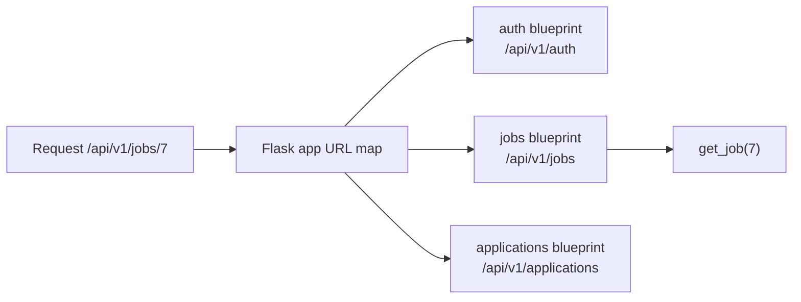

::part[Learn the Concept]{n="1"}

## 🎯 What you'll learn

- What a web framework does for you, and where Flask fits
- Routes, URL variables and HTTP methods
- Reading requests (`request.args`, `request.get_json()`) and returning JSON with status codes
- The **application factory** pattern and **configuration classes**
- **Blueprints** to split an API into feature modules
- Consistent **JSON error handlers** and a health check

## 🔤 Key words

| Word | In simple words | Bahasa Indonesia |
|---|---|---|
| **Web framework** | Code that turns incoming HTTP requests into calls to your functions | Kerangka kerja web |
| **Route** | The rule "this URL and method → this function" | Aturan URL ke fungsi |
| **URL variable** | A changing part of the path, like `/jobs/<int:job_id>` | Bagian URL yang berubah |
| **Request** | What the client sent: path, method, query, headers, body | Permintaan dari klien |
| **Response** | What you send back: body, status code, headers | Balasan ke klien |
| **Status code** | The three-digit result: 200 ok, 404 not found, 422 invalid | Kode hasil HTTP |
| **Configuration class** | Settings grouped per environment (development, production) | Kelas pengaturan |
| **Application factory** | A function that builds the app, so tests can build their own | Fungsi pembuat aplikasi |
| **Blueprint** | A group of related routes in its own file | Kelompok route |
| **Error handler** | One place that turns an exception into a JSON response | Penangan kesalahan terpusat |

## 🧠 The big idea

A web framework is a **receptionist for your code**. Requests arrive at the front desk; the receptionist reads the path and method (`GET /api/v1/jobs`), finds the right person (your function), hands them the request, and delivers the answer back as an HTTP response.

:term[Flask]{bahasa="Flask — framework web Python yang ringan: menghubungkan URL ke fungsi Python"} is a *micro*-framework: a small, clear core (routing, requests, responses) plus extensions you add when you need them (database, auth, validation).

## ❓ Why it matters

Without a framework you would read raw HTTP text, match URLs by hand, set headers, and handle errors and encodings yourself. A framework gives you all of that, already tested by thousands of projects, so you can spend your time on what your app actually does.

But the framework won't organise the app for you:

```python
# app.py — 2,000 lines
app = Flask(__name__)
app.config["SECRET_KEY"] = "abc123"                 # secret in code
db = connect("postgres://prod-server/...")          # connects on import, even in tests

@app.route("/jobs")
def jobs(): ...
# 80 more routes, all here…
```

Tests hit the production database, every route lives in one file, settings can't change between development and production, and errors return HTML pages to a client expecting JSON.

## 📖 Step by step

### 1. The smallest Flask app

```python
from flask import Flask

app = Flask(__name__)

@app.get("/health")
def health():
    return {"status": "ok"}          # dicts become JSON automatically
```

```bash
uv run flask --app app run --port 5091 --debug
curl http://localhost:5091/health
```

`@app.get` registers the function in Flask's URL map (a dispatch table — Week 3!).

### 2. Routes, variables and methods

```python
@app.get("/api/v1/jobs/<int:job_id>")                 # converter: only integers match
def get_job(job_id: int):
    ...

@app.route("/api/v1/jobs", methods=["GET", "POST"])   # or @app.post(...)
def jobs():
    ...
```

Converters: `<int:id>`, `<string:slug>` (default), `<path:rest>`, `<uuid:id>`. A request to `/api/v1/jobs/abc` doesn't match `<int:job_id>` → automatic **404**.

### 3. Reading the request

```python
from flask import request

@app.get("/api/v1/jobs")
def list_jobs():
    city = request.args.get("city")                        # query string ?city=Jakarta
    page = request.args.get("page", default=1, type=int)   # converted, with a default
    ...

@app.post("/api/v1/jobs")
def create_job():
    data = request.get_json(silent=True)                   # None if the body isn't valid JSON
    if not isinstance(data, dict):
        return {"error": {"code": "invalid_json", "message": "Body must be a JSON object"}}, 400
    ...
```

Other useful parts: `request.headers`, `request.method`, `request.path`, `request.files`.

### 4. Responses and status codes

```python
return {"id": 42, "title": "Backend Dev"}, 201                     # body + status
return {"error": {"code": "not_found"}}, 404
return "", 204                                                       # no content
return {"id": 42}, 201, {"Location": "/api/v1/jobs/42"}              # + headers
```

Return lists with `jsonify([...])` or wrap them: `{"data": [...], "meta": {...}}` (a consistent envelope helps clients).

### 5. Configuration classes

```python
# config.py
import os

class Config:
    SECRET_KEY = os.environ.get("SECRET_KEY")
    SQLALCHEMY_DATABASE_URI = os.environ.get("DATABASE_URL")
    JSON_SORT_KEYS = False

class DevelopmentConfig(Config):
    DEBUG = True

class TestingConfig(Config):
    TESTING = True
    SECRET_KEY = "test-only"

class ProductionConfig(Config):
    DEBUG = False
```

Settings come from **environment variables**; classes only choose sensible per-environment defaults. Production must **fail fast** when a required secret is missing (Week 6).

### 6. The application factory

A factory is the difference between **one fixed building** and a **blueprint you can build from**: tests build a small app with a test database, production builds the real one, from the same code.

```python
# jobboard/__init__.py
from flask import Flask
from .config import DevelopmentConfig

def create_app(config_object=DevelopmentConfig) -> Flask:
    app = Flask(__name__)
    app.config.from_object(config_object)

    from .routes.jobs import jobs_bp          # imported inside → no circular imports
    app.register_blueprint(jobs_bp)

    from .errors import register_error_handlers
    register_error_handlers(app)

    return app
```

```bash
uv run flask --app "jobboard:create_app()" run --port 5091
```

Why a factory:
- **tests** create a fresh app with `TestingConfig` each time,
- extensions attach with `ext.init_app(app)` instead of at import time,
- you can run several differently-configured apps (e.g. workers).

### 7. Blueprints

```python
# jobboard/routes/jobs.py
from flask import Blueprint

jobs_bp = Blueprint("jobs", __name__, url_prefix="/api/v1/jobs")

@jobs_bp.get("")
def list_jobs(): ...

@jobs_bp.get("/<int:job_id>")
def get_job(job_id: int): ...
```



One blueprint per feature; each file stays small.

### 8. JSON error handlers

One handler is the shop's single complaints desk: whatever goes wrong inside, the customer always gets the same shape of answer.

By default Flask returns **HTML** error pages. APIs should return JSON consistently:

```python
from werkzeug.exceptions import HTTPException

def register_error_handlers(app):
    @app.errorhandler(HTTPException)
    def handle_http_error(error: HTTPException):
        return {"error": {"code": error.name.lower().replace(" ", "_"), "message": error.description}}, error.code

    @app.errorhandler(Exception)
    def handle_unexpected(error: Exception):
        app.logger.exception("Unhandled error")
        return {"error": {"code": "internal_error", "message": "Something went wrong"}}, 500
```

Combine this with your `AppError` hierarchy from Week 3: register a handler for `AppError` that uses its `status_code` and `code`.

### 9. Testing with the test client

```python
def test_health():
    app = create_app(TestingConfig)
    client = app.test_client()
    response = client.get("/health")
    assert response.status_code == 200
    assert response.get_json() == {"status": "ok"}
```

No server needed — the test client calls the app directly.

### Choosing your setup

Every option here is a trade-off:

| Choice | ✅ | ❌ |
|---|---|---|
| Flask | small, flexible, huge ecosystem, easy to learn | you choose and wire many pieces (validation, docs, auth) |
| FastAPI (Module 3) | typing-based validation, auto docs, async | newer patterns; different ecosystem |
| Django | batteries included (ORM, admin, auth) | heavier, more conventions |
| Global `app` | fastest to start | hard to test and configure |
| Factory + blueprints | testable, modular | a bit more structure up front |
| Plain function views | simple | method handling spread across functions |
| `MethodView` classes | one class per resource, methods as `get/post` | a little more boilerplate |

- ✅ Flask for REST APIs, internal services and projects where you want control over each component.
- ✅ Factory + blueprints + config classes from the first day of a real project.
- 🚫 Don't use `flask run --debug` or `app.run()` in production — use a WSGI server like Gunicorn (Week 6).
- 🚫 Don't connect to databases or read secrets at import time.

## ⚠️ Common mistakes

- Returning HTML errors from a JSON API.
- `request.json` raising on invalid bodies without a clean `400`.
- Business logic and SQL written directly inside route functions.
- Circular imports from importing `app` inside blueprint modules (use `current_app` instead).
- Hard-coded `DEBUG = True` and secrets in `config.py`.

:::revoshop
Open `app/__init__.py` in RevoShop: `create_app(config_name=None)` loads `config_by_name[config_name]`, configures logging, calls `init_app` on `db`, `jwt`, `migrate` and `api`, adds a Bearer auth scheme to the OpenAPI spec, then **imports and registers 11 blueprints inside the function**. Explain why those imports are inside the function. Then open `config/base.py`: `JWT_SECRET_KEY` falls back to a hard-coded default when the environment variable is missing — what could happen in production, and how would you make the app refuse to start instead? Finally, compare `app/routes/health.py` with the health check in this lesson: why does yours return `503` when the database is down?
:::

## 🏆 Best practices

- [ ] Use an **application factory** and register blueprints/extensions inside it.
- [ ] One **blueprint per feature**, with a versioned URL prefix (`/api/v1/...`).
- [ ] Load settings from **environment variables**; keep config classes per environment; never commit secrets.
- [ ] Return **JSON for every response**, including errors, with a consistent shape (`{"data": …}` / `{"error": {"code", "message"}}`).
- [ ] Use correct **status codes** (`201` + `Location` on create, `204` on delete, `404`, `409`, `422`).
- [ ] Keep route functions **thin**: parse input → call a service → format output (lesson 06).
- [ ] Add a **health check** endpoint that also checks critical dependencies.
- [ ] Test every endpoint with the **test client** and a testing config.
- [ ] Never run the debug server in production.

::part[Explain & Design]{n="2"}

## 🗣️ Explain it

Explain to a non-programmer what happens when a phone app calls `GET /api/v1/jobs/7` on a Flask server — from the URL arriving to the JSON coming back. Mention routing and status codes.

## 📐 Design it

Design the blueprint and route map for **CareerPilot Phase 2**: authentication, companies, applications (including status changes and notes), and a stats endpoint. For each route: method, path, success status, main error statuses, and which blueprint it belongs to.

:::quiz
Show a possible design

| Blueprint | Method & path | Success | Errors |
|---|---|---|---|
| `auth` | `POST /api/v1/auth/register` | 201 | 409 email taken, 422 |
| `auth` | `POST /api/v1/auth/login` | 200 | 401 |
| `auth` | `GET /api/v1/auth/me` | 200 | 401 |
| `companies` | `GET /api/v1/companies?search=` | 200 | 401 |
| `companies` | `POST /api/v1/companies` | 201 | 409 duplicate, 422 |
| `applications` | `GET /api/v1/applications?status=&page=` | 200 | 401, 422 bad filter |
| `applications` | `POST /api/v1/applications` | 201 + Location | 404 company, 409 duplicate, 422 |
| `applications` | `GET /api/v1/applications/<id>` | 200 | 404 (also for other users' ids) |
| `applications` | `PATCH /api/v1/applications/<id>` | 200 | 404, 422 |
| `applications` | `POST /api/v1/applications/<id>/status` | 200 | 404, 409 invalid transition, 422 |
| `applications` | `DELETE /api/v1/applications/<id>` | 204 | 404 |
| `stats` | `GET /api/v1/stats/pipeline` | 200 | 401 |
| `health` | `GET /api/v1/health` | 200 | 503 |

A status change is modeled as its own action (`POST …/status`) because it has special rules and side effects (history rows), unlike a normal field edit.
:::

### 📝 Self-review checklist

- [ ] Routes are grouped by feature into blueprints
- [ ] Every route has correct success and error codes
- [ ] Other users' resources return 404
- [ ] Special actions with rules have dedicated endpoints

::ai-review{task="design"}

::part[Toy Exercise]{n="3"}

:::exercise{path="exercises/m2/w4/01-flask-app-factory" ai="no-ai" title="A job board API with a factory and blueprints"}
Build the `jobboard` package: `create_app(config)`, config classes, a `jobs` blueprint with list (filters), detail, and create (with validation), a health endpoint, and JSON error handlers for 404, 405 and unexpected errors. Data is kept in memory for now — the database arrives in lesson 02. Tests use the Flask test client.
:::

:::hints
- Store jobs on the app, e.g. `app.extensions["jobs_store"] = [...]`, and read them with `current_app` inside the blueprint.
- `request.args.get("remote")` is a string — decide how `"true"`/`"false"` convert.
- For 405 and 404 JSON, register a handler for `werkzeug.exceptions.HTTPException`.
- Test the unexpected-error handler: the tests add a route that raises on purpose.
:::

### 🏆 Stretch goal

Rewrite the jobs blueprint using `flask.views.MethodView` (as RevoShop does) and compare readability.

## ✅ Quick check

:::quiz
Why import blueprints **inside** `create_app()`?

To avoid circular imports and import-time side effects: blueprint modules may import extensions or services that themselves need the package to be initialized first.
:::

:::quiz
What does `request.get_json(silent=True)` return for a request with an invalid JSON body?

`None` — so you can respond with a clean `400` instead of an unhandled exception.
:::

:::quiz
Why shouldn't you use Flask's built-in server in production?

It's designed for development: not tuned for performance, concurrency or security. Production uses a WSGI server such as Gunicorn behind a reverse proxy/load balancer.
:::


## 📚 Keep learning

- [Flask docs: Quickstart](https://flask.palletsprojects.com/en/stable/quickstart/)
- [Flask docs: Application factories](https://flask.palletsprojects.com/en/stable/patterns/appfactories/)
- [Flask docs: Modular applications with blueprints](https://flask.palletsprojects.com/en/stable/blueprints/)
- [Flask docs: Handling application errors](https://flask.palletsprojects.com/en/stable/errorhandling/)
