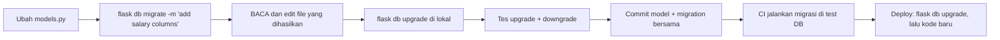
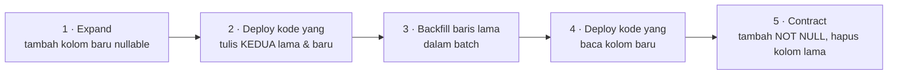

::part[Pelajari Konsepnya]{n="1"}

## 🎯 Yang akan kamu pelajari

- Kenapa perubahan skema (struktur) database butuh **migrasi bernomor** (bukan `db.create_all()`)
- Workflow Flask-Migrate / Alembic: `init`, `migrate`, `upgrade`, `downgrade`, `history`
- Bagian-bagian revisi: `revision`, `down_revision`, `upgrade()`, `downgrade()`
- **Membaca migrasi yang dihasilkan otomatis** — apa yang autogenerate tidak tangkap
- **Data migration** dan pengisian ulang tanpa mengimpor model aplikasi
- **Expand/contract** untuk perubahan tanpa downtime, dan bagaimana **penguncian tabel** bisa menurunkan production
- Penamaan constraint dengan konvensi dan `op.f()`

## 🔤 Istilah penting

| Istilah | Artinya (sederhana) |
|---|---|
| **Migration** | Skrip bernomor yang mengubah struktur database |
| **Alembic / Flask-Migrate** | Alat untuk membuat dan menjalankan skrip perubahan database |
| **Revision** | Satu berkas migrasi, dengan ID dan ID sebelumnya |
| **`upgrade` / `downgrade`** | Terapkan perubahan / batalkan |
| **Autogenerate** | Alembic membandingkan model dengan database lalu membuat draf migrasi |
| **Data migration** | Migrasi yang memindahkan atau memperbaiki isi data, bukan hanya struktur |
| **Backfill** | Mengisi kolom baru untuk baris yang sudah ada |
| **Expand / contract** | Tambah yang baru dulu, beralih, lalu hapus yang lama |
| **Lock** | Database memblokir penulisan sambil mengubah tabel |

## 🧠 Ide besarnya

Bayangkan sebuah rumah yang sudah ditinggali orang — kamu mau renovasi tapi tidak bisa kosongkan sementara semua penghuni pergi. Jadi kamu buat rencana langkah-langkah ("buka jendela ruang 3", "tambah pintu"), dan tiap tahap harus bisa dibatalkan. :term[Migrasi]{bahasa="migrasi — skrip bernomor yang mengubah struktur database selangkah demi selangkah"} itu rencana renovasi itu. Setiap salinan database — laptopmu, teman, staging, production — ikuti **rencana yang sama dalam urutan yang sama**, jadi semuanya jadi identik.

Git memversi kodemu; migrasi memversi **struktur databasemu**.

## ❓ Kenapa ini penting

- Database production menyimpan data asli, jadi kamu tidak bisa asal drop dan buat ulang tabel.
- Setiap lingkungan (lokal, test, staging, production) harus sampai ke struktur yang sama dengan cara yang terpercaya.
- Perubahan struktur harus **direview**, **ditest**, dan di-deploy bersama kode yang membutuhkannya.
- Kadang kamu harus **mundur ke belakang**.

Apa yang salah tanpa migrasi yang hati-hati:

- Seseorang menambah kolom manual di production pakai GUI; staging dan test tidak punya kolom itu → deploy berikutnya gagal.
- `db.create_all()` tidak pernah **mengubah** tabel yang sudah ada, jadi kolom baru diam-diam tidak muncul.
- Migrasi autogenerate **drop dan tambah ulang** kolom yang diubah nama → semua datanya hilang.
- `ALTER TABLE … ADD CONSTRAINT` di tabel dengan 50 juta baris memblokir setiap penulisan selama beberapa menit → aplikasi down.

## 📖 Langkah demi langkah

### 1. Setup

```python
# extensions.py
from flask_migrate import Migrate
migrate = Migrate()

# create_app()
db.init_app(app)
migrate.init_app(app, db)
```

```bash
uv run flask --app "careerpilot:create_app()" db init        # once: creates migrations/
```

`migrations/` berisi `env.py` (bagaimana Alembic terhubung dan metadata mana untuk dibandingkan), `alembic.ini`, template, dan `versions/` — commit semuanya.

### 2. Workflow sehari-hari



| Perintah | Apa yang dilakukan |
|---|---|
| `flask db migrate -m "msg"` | bandingkan model dengan database → **hasilkan** file revisi |
| `flask db revision -m "msg"` | buat revisi **kosong** (untuk data migration) |
| `flask db upgrade [rev]` | terapkan revisi sampai head (atau revisi tertentu) |
| `flask db downgrade [rev]` | batalkan revisi |
| `flask db current` / `history` | database sekarang di mana / daftar revisi |
| `flask db heads` / `merge` | deteksi dan gabung cabang dari kerja paralel |

Database menyimpan revisi sekarangnya di tabel `alembic_version`.

### 3. Bagian-bagian revisi

```python
"""add salary columns

Revision ID: 3f2a9c1b7d10
Revises: 8e41d0a6c2f5
"""
import sqlalchemy as sa
from alembic import op

revision = "3f2a9c1b7d10"
down_revision = "8e41d0a6c2f5"      # the previous step — this forms a chain

def upgrade():
    op.add_column("applications", sa.Column("salary_min", sa.BigInteger(), nullable=True))

def downgrade():
    op.drop_column("applications", "salary_min")
```

### 4. Autogenerate itu draf, bukan keputusan

Perlakukan seperti draf ditulis asisten yang tidak tahu tujuanmu: dia lihat "kolom hilang, kolom baru" dan tidak tahu kamu bermaksud *ubah nama*. Baca setiap file yang dihasilkan sebelum commit.

Autogenerate membandingkan model dan database. Ia **bisa** deteksi tabel dan kolom yang ditambah/dihapus, kebanyakan perubahan tipe dan nullable, index dan foreign key. Ia **tidak bisa** reliabel deteksi:

| Terlewat atau salah | Kenapa penting |
|---|---|
| **Ubah nama kolom/tabel** | dihasilkan sebagai *drop + tambah* → hilang data |
| Beberapa constraint `CHECK`, perubahan server default | aturan diam-diam tidak diterapkan |
| Perubahan nilai enum, sequence, tipe custom | error runtime nanti |
| **Perubahan isi data** (backfill) | kolom NOT NULL baru gagal di baris yang sudah ada |

Selalu baca file. Untuk ubah nama, ganti drop+add dengan:

```python
op.alter_column("applications", "notes", new_column_name="private_notes")
```

### 5. Data migration

Kalau perubahan struktur butuh ubah baris yang sudah ada, isi ulang **di dalam** migrasi pakai SQL:

```python
def upgrade():
    op.add_column("applications", sa.Column("salary_min", sa.BigInteger()))
    op.execute(r"""
        UPDATE applications
        SET salary_min = split_part(salary_range, '-', 1)::bigint
        WHERE salary_range ~ '^\d+-\d+$'
    """)
```

:::warning[Jangan impor model aplikasi di migrasi]
Migrasi harus tetap jalan selamanya, tapi `models.py` terus berubah. Migrasi yang impor `Application` hari ini akan rusak tahun depan pas model dapat kolom baru atau kehilangan kolom. Pakai `op.execute(...)` / definisi `sa.table()` lokal di migrasi.
:::

### 6. Expand / contract: ubah sistem yang hidup

Deploy tidak instan: versi lama dan baru jalan berdampingan sebentar, dan migrasi jalankan **sebelum** kode baru mulai. Buat tiap tahap kompatibel dengan kedua versi:



Untuk tabel kecil (seperti latihan) beberapa tahap bisa satu migrasi. Untuk tabel besar dan sibuk, pisah di deploy berlain.

### 7. Lock: pembunuh production yang senyap

Lock itu renovasi yang tutup satu-satunya koridor: tidak ada yang bisa lewat sampai selesai. Baik untuk dua detik jam 3 malam, bencana untuk dua menit saat sale.

Kebanyakan pernyataan `ALTER TABLE` pakai lock kuat. Sambil menunggu, ia juga blokir **setiap query** yang antri di belakangnya.

| Operasi (PostgreSQL) | Risiko di tabel besar | Cara yang lebih aman |
|---|---|---|
| `ADD COLUMN` nullable / dengan constant default | ✅ cepat (metadata saja, PG 11+) | — |
| `SET NOT NULL` | scan seluruh tabel dengan lock | tambah `CHECK (col IS NOT NULL) NOT VALID`, `VALIDATE CONSTRAINT`, lalu `SET NOT NULL` |
| `ADD CONSTRAINT … CHECK/FOREIGN KEY` | scan dengan lock | tambah `NOT VALID`, lalu `VALIDATE CONSTRAINT` terpisah |
| `CREATE INDEX` | blokir penulisan | `CREATE INDEX CONCURRENTLY` (di luar transaksi: `with op.get_context().autocommit_block():`) |
| Ubah tipe kolom | mungkin tulis ulang tabel | tambah kolom baru + backfill + pindah |

Juga atur **`lock_timeout`** (misalnya `SET lock_timeout = '5s'`) supaya migrasi gagal cepat daripada beku dan blokir traffic.

:::note[Kamu lihat ini di test latihan]
Transaksi terbuka (bahkan `SELECT`) pegang lock yang bikin `ALTER TABLE` tunggu. Di production, query lama jalan atau koneksi "idle in transaction" bisa blokir migrasimu — yang lalu blokir semua orang.
:::

### 8. Nama constraint dan `op.f()`

Dengan konvensi penamaan metadata seperti `"ck": "ck_%(table_name)s_%(constraint_name)s"`:

```python
op.create_check_constraint("salary_range_valid", "applications", "salary_min <= salary_max")
# → ck_applications_salary_range_valid

op.drop_constraint(op.f("ck_applications_salary_range_valid"), "applications", type_="check")
# op.f() = "this name is already final, don't apply the convention again"
```

Lewatkan nama lengkap ke `create_check_constraint` hasilnya `ck_applications_ck_applications_…` — kejutan klasik.

### 9. Migrasi saat deployment

- Jalankan `flask db upgrade` sebagai **langkah release terpisah** (one-off job / pre-deploy command), bukan di setiap web worker saat startup (beberapa worker saling balapan).
- Backup (atau punya point-in-time recovery) sebelum migrasi berisiko.
- Lebih suka **roll-forward** perbaikan di production; jaga `downgrade()` benar untuk development dan emergency.

### Pilih setup-mu

Tiap opsi di sini adalah trade-off:

| Pilihan | ✅ | ❌ |
|---|---|---|
| Autogenerate | draf cepat, tangkap perubahan yang terlupa | miss ubah nama/data; harus direview |
| Revisi tulis tangan | kontrol penuh | lambat; mudah lupa sesuatu |
| Satu migrasi besar | sederhana | lock lama, susah rollback |
| Expand/contract di banyak deploy | tanpa downtime | koordinasi lebih banyak dan kode sebentar |
| Selalu tulis `downgrade()` | fleksibel lokal, jalan emergency | beberapa perubahan tidak bisa dibatalkan tanpa hilang data |
| Squashing migrasi lama | setup baru lebih cepat | harus hati-hati lintas lingkungan |

- ✅ Migrasi untuk **setiap** perubahan skema di setiap lingkungan, kecuali prototype sekali pakai.
- ✅ Data migration untuk backfill yang terikat perubahan skema.
- 🚫 Jangan edit migrasi yang sudah jalan di lingkungan bersama — tulis yang baru.
- 🚫 Jangan pakai `db.create_all()` atau perubahan GUI manual untuk skema production.
- 🚫 Jangan jalankan backfill berat jutaan baris dalam satu transaksi; batch (mungkin sebagai skrip/job terpisah).

## ⚠️ Kesalahan umum

- Percaya autogenerate untuk ubah nama kolom → hilang data.
- Tambah kolom `NOT NULL` tanpa default atau backfill → migrasi gagal di baris yang ada.
- Impor model di dalam migrasi.
- Edit migrasi lama setelah teman sudah jalankan.
- Dua branch sama-sama bikin revisi dari parent yang sama → error "multiple heads".
- Migrasi menunggu lock dipegang transaksi idle.

:::revoshop
RevoShop punya **19 migrasi** di `migrations/versions/`. Buka `d4e5f6a7b8c9_add_slug_to_products.py`: ia tambah `slug` sebagai **nullable**, **backfill** slug unik dari nama produk yang ada pakai Python dengan `op.get_bind()`, dan (lihat sisa file) lalu ketat kolom — itu expand → backfill → contract. Ia definisikan `_slugify` sendiri daripada impor kode aplikasi: kenapa itu penting? Lalu lihat `7f3c9a2b1d84_restore_check_constraints.py`: apa yang salah sebelumnya yang butuh "restore" constraint — dan aturan mana dari pelajaran ini yang bisa cegah?
:::

## 🏆 Praktik terbaik

- [ ] Commit **perubahan model dan migrasi mereka bersama** di PR yang sama.
- [ ] **Baca dan edit** setiap migrasi autogenerate; perbaiki ubah nama dan tambah data step.
- [ ] Berikan revisi **pesan deskriptif**; satu perubahan logis per migrasi.
- [ ] Jangan impor model aplikasi di migrasi; pakai SQL / definisi tabel lokal.
- [ ] Tes **upgrade dan downgrade** di salinan data yang realistis (CI bisa jalankan `upgrade` di DB kosong setiap build).
- [ ] Pakai **expand/contract** untuk perubahan tabel sibuk; `NOT VALID` + `VALIDATE`; `CREATE INDEX CONCURRENTLY`.
- [ ] Atur **`lock_timeout`** / `statement_timeout` untuk migrasi di production.
- [ ] Konfigurasi **naming convention** sebelum migrasi pertama; pakai `op.f()` untuk nama eksplisit.
- [ ] Jalankan migrasi sebagai **satu langkah release**, bukan dari setiap app instance.
- [ ] Jangan ubah migrasi yang sudah terapkan; selesaikan cabang paralel dengan `flask db merge`.

::part[Jelaskan & Rancang]{n="2"}

## 🗣️ Jelaskan

Jelaskan ke orang non-programmer kenapa kamu tidak bisa asal "delete dan buat ulang tabel" saat ubah database di production, dan bagaimana migrasi bernomor jaga setiap salinan database tetap sama.

## 📐 Rancang

Tabel `applications` CareerPilot punya **3 juta baris** dan traffic konstan. Kamu perlu ubah nama `notes` jadi `private_notes` **dan** buat `company_id` wajib (hari ini beberapa baris punya `NULL`, harusnya tunjuk ke baris "Unknown company" spesial). Rancang migrasi dan deploy langkah demi langkah supaya aplikasi tidak pernah down dan kode lama maupun baru tetap jalan saat rollout.

:::quiz
Lihat contoh rancangan

**Ubah nama `notes` → `private_notes` (expand/contract):**
1. Migrasi A: tambah `private_notes` (nullable). Deploy kode yang **tulis kedua** kolom dan baca `notes`.
2. Backfill job: `UPDATE … SET private_notes = notes WHERE private_notes IS NULL` dalam batch ~10k baris.
3. Deploy kode yang **baca** `private_notes` (masih tulis kedua).
4. Deploy kode yang berhenti tulis `notes`. Migrasi B: hapus `notes`.

**Buat `company_id` wajib:**
1. Migrasi C: insert baris "Unknown company" (idempoten).
2. Backfill job: atur `company_id` ke baris itu di mana `NULL`, dalam batch.
3. Migrasi D: `ADD CONSTRAINT company_id_not_null CHECK (company_id IS NOT NULL) NOT VALID` (cepat), lalu langkah terpisah `VALIDATE CONSTRAINT` (tidak blokir penulisan), lalu `ALTER COLUMN company_id SET NOT NULL` (PostgreSQL pakai check yang divalidasi untuk skip scan penuh), lalu hapus check pembantu.
4. Setiap migrasi pakai `SET lock_timeout = '5s'` dan jalankan sebagai langkah release.
:::

### 📝 Checklist review mandiri

- [ ] Tidak ada tahap yang rusak versi aplikasi yang jalan sekarang
- [ ] Backfill dibatch dan terpisah dari DDL yang lock
- [ ] NOT NULL ditambah tanpa lock eksklusif lama
- [ ] Tiap migrasi kecil dan punya tujuan jelas

::ai-review{task="design"}

::part[Latihan Kecil]{n="3"}

:::exercise{path="exercises/m2/w4/04-migrations" ai="no-ai" title="Data migration yang aman"}
Tabel production menyimpan gaji sebagai text (`"9000000-14000000"`) dan izin `NULL` status. Tulis revisi Alembic `0002` yang pisah text jadi dua kolom `BigInteger` dengan **backfill**, buat `status` wajib dengan default, tambah named check constraint, hapus kolom lama — dan `downgrade()` yang restore bentuk lama **dengan datanya**. Test jalankan upgrade dan downgrade nyata di PostgreSQL.
:::

:::hints
- Scaffold file dengan `flask db revision -m "split salary range"`, lalu atur `revision = "0002"`.
- Helper PostgreSQL: `split_part(text, '-', 1)::bigint` dan regex match `salary_range ~ '^\d+-\d+$'`.
- Urutan penting: backfill `status` **sebelum** `alter_column(..., nullable=False)`.
- Baca README warning tentang nama constraint dan `op.f()`.
:::

### 🏆 Tantangan stretch

Tulis ulang langkah NOT NULL dengan pola `CHECK … NOT VALID` → `VALIDATE CONSTRAINT` → `SET NOT NULL`, dan tambah `op.execute("SET lock_timeout = '5s'")` di awal `upgrade()`.

## ✅ Cek cepat

:::quiz
Kenapa kamu harus review migrasi autogenerate untuk ubah nama kolom?

Autogenerate tidak bisa bedakan ubah nama dari "drop kolom lama + tambah kolom baru", jadi ia buat persis itu — yang hapus data. Ganti dengan `op.alter_column(..., new_column_name=...)`.
:::

:::quiz
Kenapa migrasi tidak boleh impor model aplikasi?

Model berubah seiring waktu; migrasi harus tetap jalan persis seperti ditulis kalau dimainkan lagi di masa depan. Impor model ikat ke kode hari ini dan rusak nanti.
:::

:::quiz
Apa yang dijaga expand/contract?

Downtime dan error saat deploy, pas versi lama dan baru jalan bersamaan: setiap tahap jaga skema kompatibel kedua-duanya.
:::


## 📚 Lanjut belajar

- [Flask-Migrate documentation](https://flask-migrate.readthedocs.io/)
- [Alembic tutorial](https://alembic.sqlalchemy.org/en/latest/tutorial.html)
- [Alembic: What does autogenerate detect (and what doesn't it)?](https://alembic.sqlalchemy.org/en/latest/autogenerate.html#what-does-autogenerate-detect-and-what-does-it-not-detect)
- [PostgreSQL docs: ALTER TABLE (locks and NOT VALID)](https://www.postgresql.org/docs/current/sql-altertable.html)
