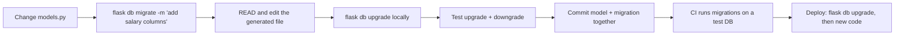
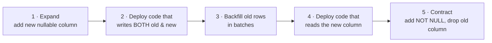

::part[Learn the Concept]{n="1"}

## 🎯 What you'll learn

- Why schema changes need **versioned migrations** (not `db.create_all()`)
- The Flask-Migrate / Alembic workflow: `init`, `migrate`, `upgrade`, `downgrade`, `history`
- Anatomy of a revision: `revision`, `down_revision`, `upgrade()`, `downgrade()`
- **Reviewing autogenerated** migrations — what autogenerate misses
- **Data migrations** and backfills without importing app models
- **Expand/contract** for zero-downtime changes, and how table **locks** can take production down
- Constraint naming with conventions and `op.f()`

## 🔤 Key words

| Word | In simple words | Bahasa Indonesia |
|---|---|---|
| **Migration** | A numbered script that changes the database structure | Skrip pengubah struktur |
| **Alembic / Flask-Migrate** | The tools that create and run those scripts | Alat migrasi database |
| **Revision** | One migration file, with an id and the id before it | Satu berkas migrasi |
| **`upgrade` / `downgrade`** | Apply the change / undo it | Terapkan / batalkan |
| **Autogenerate** | Alembic comparing models with the database and drafting a migration | Draf otomatis dari model |
| **Data migration** | A migration that moves or fixes data, not just structure | Migrasi isi data |
| **Backfill** | Filling a new column for rows that already exist | Mengisi data lama |
| **Expand / contract** | Add the new thing first, switch, then remove the old thing | Tambah dulu, hapus belakangan |
| **Lock** | The database blocking writes while it changes a table | Penguncian tabel |

## 🧠 The big idea

A :term[migration]{bahasa="migrasi — skrip bernomor yang mengubah struktur database selangkah demi selangkah"} is a **numbered renovation plan** for a building people already live in. Each step says exactly what to change ("add a window in room 3") and how to undo it. Every copy of the building — your laptop, a teammate's, staging, production — follows the **same plan in the same order**, so they all end up identical.

Git versions your code; migrations version your **database structure**.

## ❓ Why it matters

- Production databases hold real data, so you can't just drop and recreate tables.
- Every environment must reach the same structure reliably.
- Structure changes must be **reviewed**, **tested** and deployed together with the code that needs them.
- Sometimes you have to **go back**.

What goes wrong without careful migrations:

- Someone adds a column by hand in production with a GUI; staging and tests don't have it → the next deploy fails.
- `db.create_all()` never **changes** existing tables, so a new column silently doesn't exist.
- An autogenerated migration **drops and re-adds** a renamed column → all its data is gone.
- `ALTER TABLE … ADD CONSTRAINT` on a 50-million-row table blocks every write for minutes → checkout is down.

## 📖 Step by step

### 1. Setup

```python
# extensions.py
from flask_migrate import Migrate
migrate = Migrate()

# create_app()
db.init_app(app)
migrate.init_app(app, db)
```

```bash
uv run flask --app "careerpilot:create_app()" db init        # once: creates migrations/
```

`migrations/` contains `env.py` (how Alembic connects and which metadata to compare), `alembic.ini`, a template, and `versions/` — commit all of it.

### 2. The everyday workflow



| Command | Does |
|---|---|
| `flask db migrate -m "msg"` | compare models with the database → **generate** a revision file |
| `flask db revision -m "msg"` | create an **empty** revision (for data migrations) |
| `flask db upgrade [rev]` | apply revisions up to head (or a specific revision) |
| `flask db downgrade [rev]` | undo revisions |
| `flask db current` / `history` | where the database is / the list of revisions |
| `flask db heads` / `merge` | detect and merge branches created by parallel work |

The database stores its current revision in an `alembic_version` table.

### 3. Anatomy of a revision

```python
"""add salary columns

Revision ID: 3f2a9c1b7d10
Revises: 8e41d0a6c2f5
"""
import sqlalchemy as sa
from alembic import op

revision = "3f2a9c1b7d10"
down_revision = "8e41d0a6c2f5"      # the previous step — this forms a chain

def upgrade():
    op.add_column("applications", sa.Column("salary_min", sa.BigInteger(), nullable=True))

def downgrade():
    op.drop_column("applications", "salary_min")
```

### 4. Autogenerate is a draft, not a decision

Treat it like a draft written by an assistant who can't see your intent: it notices "column gone, column added" and cannot know you meant *rename*. Read every generated file before committing it.

Autogenerate compares models and the database. It **does** detect added/removed tables and columns, most type and nullability changes, indexes and foreign keys. It **does not** reliably detect:

| Missed or wrong | Why it matters |
|---|---|
| **Column/table renames** | generated as *drop + add* → data loss |
| Some `CHECK` constraints, server default changes | rules silently not applied |
| Changes to enum values, sequences, custom types | runtime errors later |
| **Data** changes (backfills) | new NOT NULL columns fail on existing rows |

Always read the file. For a rename, replace drop+add with:

```python
op.alter_column("applications", "notes", new_column_name="private_notes")
```

### 5. Data migrations

When changing structure requires changing existing rows, backfill **inside** the migration using SQL:

```python
def upgrade():
    op.add_column("applications", sa.Column("salary_min", sa.BigInteger()))
    op.execute(r"""
        UPDATE applications
        SET salary_min = split_part(salary_range, '-', 1)::bigint
        WHERE salary_range ~ '^\d+-\d+$'
    """)
```

:::warning[Don't import your app models in migrations]
Migrations must work forever, but `models.py` keeps changing. A migration that imports `Application` today will break when the model gains or loses columns next year. Use `op.execute(...)` / `sa.table()` definitions local to the migration.
:::

### 6. Expand / contract: changing a live system

Deployments aren't instant: old and new app versions run side by side for a while, and migrations run **before** new code starts. Make every step compatible with both versions:



For small tables (like the exercise) several steps can live in one migration. For big, busy tables, split them across deploys.

### 7. Locks: the silent production killer

A lock is a renovation that blocks the only corridor: nobody can pass until it finishes. That's fine for two seconds at 3 a.m., and a disaster for two minutes during a sale.

Most `ALTER TABLE` statements take a strong lock. While waiting for it, they also block **every other query** queued behind them.

| Operation (PostgreSQL) | Risk on a big table | Safer approach |
|---|---|---|
| `ADD COLUMN` nullable / with a constant default | ✅ fast (metadata only, PG 11+) | — |
| `SET NOT NULL` | scans the whole table under lock | add `CHECK (col IS NOT NULL) NOT VALID`, `VALIDATE CONSTRAINT`, then `SET NOT NULL` |
| `ADD CONSTRAINT … CHECK/FOREIGN KEY` | scans under lock | add `NOT VALID`, then `VALIDATE CONSTRAINT` separately |
| `CREATE INDEX` | blocks writes | `CREATE INDEX CONCURRENTLY` (outside a transaction: `with op.get_context().autocommit_block():`) |
| Changing a column type | may rewrite the table | add new column + backfill + switch |

Also set a **`lock_timeout`** (e.g. `SET lock_timeout = '5s'`) so a migration fails fast instead of freezing traffic.

:::note[You just saw this in the exercise tests]
An open transaction (even a `SELECT`) holds a lock that makes `ALTER TABLE` wait. In production, a long-running query or an "idle in transaction" connection can block your migration — which then blocks everyone else.
:::

### 8. Constraint names and `op.f()`

With a metadata naming convention like `"ck": "ck_%(table_name)s_%(constraint_name)s"`:

```python
op.create_check_constraint("salary_range_valid", "applications", "salary_min <= salary_max")
# → ck_applications_salary_range_valid

op.drop_constraint(op.f("ck_applications_salary_range_valid"), "applications", type_="check")
# op.f() = "this name is already final, don't apply the convention again"
```

Passing the full name to `create_check_constraint` produces `ck_applications_ck_applications_…` — a classic surprise.

### 9. Migrations in deployment

- Run `flask db upgrade` as a **separate release step** (a one-off job / pre-deploy command), not inside every web worker at startup (several workers would race).
- Back up (or have point-in-time recovery) before risky migrations.
- Prefer **roll-forward** fixes in production; keep `downgrade()` correct for development and emergencies.

### Choosing your setup

Every option here is a trade-off:

| Choice | ✅ | ❌ |
|---|---|---|
| Autogenerate | fast drafts, catches forgotten changes | misses renames/data; must be reviewed |
| Hand-written revision | full control | slower; easy to forget something |
| One big migration | simple | long locks, hard to roll back |
| Expand/contract over several deploys | zero downtime | more coordination and code for a while |
| Always writing `downgrade()` | local flexibility, emergency path | some changes can't be undone without data loss |
| Squashing old migrations | faster fresh setups | must be done carefully across environments |

- ✅ Migrations for **every** schema change in every environment beyond a throwaway prototype.
- ✅ Data migrations for backfills tied to a schema change.
- 🚫 Don't edit a migration that has already run in shared environments — write a new one.
- 🚫 Don't use `db.create_all()` or manual GUI changes for production schemas.
- 🚫 Don't run heavy backfills of millions of rows in one transaction; batch them (possibly as a separate script/job).

## ⚠️ Common mistakes

- Trusting autogenerate for a column rename → data loss.
- Adding a `NOT NULL` column without a default or backfill → migration fails on existing rows.
- Importing models inside migrations.
- Editing old migrations after teammates already ran them.
- Two branches both creating a revision from the same parent → "multiple heads" error.
- Migration waiting on a lock held by an idle transaction.

:::revoshop
RevoShop has **19 migrations** in `migrations/versions/`. Open `d4e5f6a7b8c9_add_slug_to_products.py`: it adds `slug` as **nullable**, **backfills** unique slugs from existing product names in Python using `op.get_bind()`, and (check the rest of the file) then tightens the column — that's expand → backfill → contract. It defines its own `_slugify` instead of importing app code: why is that important? Then look at `7f3c9a2b1d84_restore_check_constraints.py`: what went wrong earlier that required "restoring" constraints — and which rule from this lesson would have prevented it?
:::

## 🏆 Best practices

- [ ] Commit **model changes and their migration together** in the same PR.
- [ ] **Read and edit** every autogenerated migration; fix renames and add data steps.
- [ ] Give revisions **descriptive messages**; keep one logical change per migration.
- [ ] Never import application models in migrations; use SQL / local table definitions.
- [ ] Test **upgrade and downgrade** on a copy of realistic data (CI can run `upgrade` on an empty DB every build).
- [ ] Use **expand/contract** for changes on busy tables; `NOT VALID` + `VALIDATE`; `CREATE INDEX CONCURRENTLY`.
- [ ] Set **`lock_timeout`** / `statement_timeout` for migrations in production.
- [ ] Configure a **naming convention** before the first migration; use `op.f()` for explicit names.
- [ ] Run migrations as a **single release step**, not from every app instance.
- [ ] Never modify already-applied migrations; resolve parallel branches with `flask db merge`.

::part[Explain & Design]{n="2"}

## 🗣️ Explain it

Explain to a non-programmer why you can't just "delete and recreate the table" when you change a database in production, and how numbered migrations keep every copy of the database in sync.

## 📐 Design it

CareerPilot's `applications` table has **3 million rows** and constant traffic. You need to rename `notes` to `private_notes` **and** make `company_id` required (today some rows have `NULL`, which should point to a special "Unknown company" row). Plan the migrations and deploys step by step so that the app never goes down and old and new code versions both keep working during rollout.

:::quiz
Show a possible plan

**Rename `notes` → `private_notes` (expand/contract):**
1. Migration A: add `private_notes` (nullable). Deploy code that **writes both** columns and reads `notes`.
2. Backfill job: `UPDATE … SET private_notes = notes WHERE private_notes IS NULL` in batches of ~10k rows.
3. Deploy code that **reads** `private_notes` (still writes both).
4. Deploy code that stops writing `notes`. Migration B: drop `notes`.

**Make `company_id` required:**
1. Migration C: insert the "Unknown company" row (idempotently).
2. Backfill job: set `company_id` to that row where it's `NULL`, in batches.
3. Migration D: `ADD CONSTRAINT company_id_not_null CHECK (company_id IS NOT NULL) NOT VALID` (fast), then in a separate step `VALIDATE CONSTRAINT` (doesn't block writes), then `ALTER COLUMN company_id SET NOT NULL` (PostgreSQL uses the validated check to skip the full scan), then drop the helper check.
4. Every migration uses `SET lock_timeout = '5s'` and runs as a release step.
:::

### 📝 Self-review checklist

- [ ] No step breaks the currently running app version
- [ ] Backfills are batched and separate from locking DDL
- [ ] NOT NULL is added without a long exclusive lock
- [ ] Each migration is small and has a clear purpose

::ai-review{task="design"}

::part[Toy Exercise]{n="3"}

:::exercise{path="exercises/m2/w4/04-migrations" ai="no-ai" title="A safe data migration"}
A production table stores salaries as text (`"9000000-14000000"`) and allows `NULL` statuses. Write Alembic revision `0002` that splits the text into two `BigInteger` columns with a **backfill**, makes `status` required with a default, adds a named check constraint, drops the old column — and a `downgrade()` that restores the old shape **with its data**. The tests run real upgrades and downgrades on PostgreSQL.
:::

:::hints
- Scaffold the file with `flask db revision -m "split salary range"`, then set `revision = "0002"`.
- PostgreSQL helpers: `split_part(text, '-', 1)::bigint` and the regex match `salary_range ~ '^\d+-\d+$'`.
- Order matters: backfill `status` **before** `alter_column(..., nullable=False)`.
- Read the README warning about the constraint name and `op.f()`.
:::

### 🏆 Stretch goal

Rewrite the NOT NULL step with the `CHECK … NOT VALID` → `VALIDATE CONSTRAINT` → `SET NOT NULL` pattern, and add `op.execute("SET lock_timeout = '5s'")` at the start of `upgrade()`.

## ✅ Quick check

:::quiz
Why must you review autogenerated migrations for renamed columns?

Autogenerate can't tell a rename from "drop old column + add new column", so it generates exactly that — which deletes the data. Replace it with `op.alter_column(..., new_column_name=...)`.
:::

:::quiz
Why shouldn't a migration import your application's models?

Models change over time; the migration must keep working exactly as written when replayed in the future. Importing models ties it to today's code and breaks it later.
:::

:::quiz
What does expand/contract protect against?

Downtime and errors during deployment, when old and new app versions run at the same time: each step keeps the schema compatible with both.
:::


## 📚 Keep learning

- [Flask-Migrate documentation](https://flask-migrate.readthedocs.io/)
- [Alembic tutorial](https://alembic.sqlalchemy.org/en/latest/tutorial.html)
- [Alembic: What does autogenerate detect (and what doesn't it)?](https://alembic.sqlalchemy.org/en/latest/autogenerate.html#what-does-autogenerate-detect-and-what-does-it-not-detect)
- [PostgreSQL docs: ALTER TABLE (locks and NOT VALID)](https://www.postgresql.org/docs/current/sql-altertable.html)
