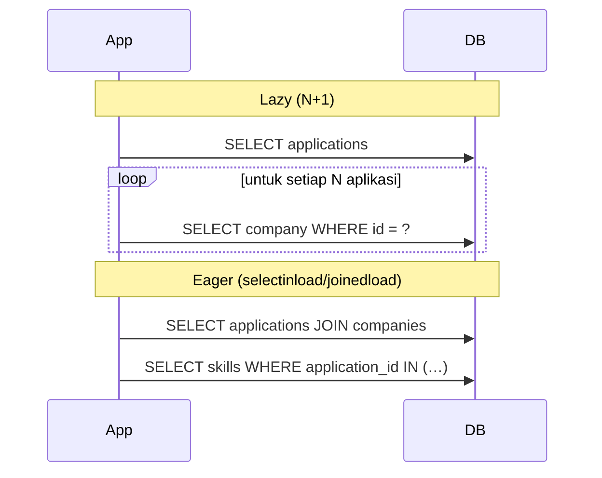

::part[Pelajari Konsepnya]{n="1"}

## 🎯 Yang akan kamu pelajari

- `ForeignKey` vs `relationship()`: link database vs navigasi Python
- One-to-many dengan `back_populates`, diketik sebagai `Mapped[list[...]]`
- Many-to-many dengan **association table** dan dengan **association object** (kolom ekstra)
- ORM **cascade** (`all, delete-orphan`) vs database `ON DELETE`
- **Lazy loading**, **masalah N+1**, dan memperbaikinya dengan `selectinload` / `joinedload`
- Menghitung query untuk membuktikan perbaikanmu berfungsi

## 🔤 Istilah penting

| Istilah | Artinya (sederhana) |
|---|---|
| **`ForeignKey`** | Kolom di database yang menunjuk ke tabel lain |
| **`relationship()`** | Atribut Python yang membawa data relasi dari tabel lain |
| **`back_populates`** | Menghubungkan dua sisi agar tetap sinkron |
| **Association table** | Tabel perantara yang sederhana untuk many-to-many |
| **Association object** | Tabel perantara tapi sebagai model, karena linknya punya data ekstra |
| **Cascade** | Apa yang terjadi pada data anak saat parent dihapus |
| **Lazy loading** | Data relasi diambil nanti, saat kamu butuh |
| **Eager loading** | Data relasi diambil langsung, dalam satu kali |
| **Masalah N+1** | Satu query untuk daftar, lalu satu query lagi per baris |

## 🧠 Ide besarnya

Foreign key itu seperti **alamat yang ditulis di amplop** — database tahu ke mana ia menunjuk. `relationship()` itu seperti **kurir yang membawakan rumahnya untukmu**: `application.company` memberikan object `Company` tanpa kamu perlu menulis query.

Itu mudah, tapi kurir yang melakukan **satu perjalanan per amplop** lambat kalau ada 500 amplop. Tahu *kapan* kurir melakukan perjalanan membuat perbedaan antara halaman 30ms dan halaman 3 detik.

## ❓ Kenapa ini penting

Logika bisnis sering berpindah antar object: aplikasi milik perusahaan, interview-nya, skill yang dibutuhkan; aplikasi milik user. Menulis join untuk setiap langkah itu berulang. Relasi membuat itu alami — **dan** memungkinkanmu memilih bagaimana data relasi dimuat.

Kalau tidak dikontrol:

```python
applications = db.session.scalars(select(Application).where(Application.user_id == 7)).all()  # 1 query
for application in applications:
    print(application.company.name)          # +1 query per application
    print([s.name for s in application.skills])   # +1 more query per application
```

Dengan 100 aplikasi itu **1 + 100 + 100 = 201 query** untuk satu halaman. Terasa baik saat development dengan tiga baris, dan lambat di production. Ini namanya :term[masalah N+1]{bahasa="1 query untuk daftar, lalu N query tambahan untuk setiap item"}.

## 📖 Langkah demi langkah

### 1. One-to-many

```python
class Company(db.Model):
    __tablename__ = "companies"
    id: Mapped[int] = mapped_column(primary_key=True)
    name: Mapped[str] = mapped_column(String(200), unique=True)

    applications: Mapped[list["Application"]] = relationship(back_populates="company")


class Application(db.Model):
    __tablename__ = "applications"
    id: Mapped[int] = mapped_column(primary_key=True)
    company_id: Mapped[int] = mapped_column(ForeignKey("companies.id", ondelete="RESTRICT"), index=True)

    company: Mapped["Company"] = relationship(back_populates="applications")
```

- `ForeignKey(...)` membuat constraint **database**.
- `relationship(...)` membuat atribut **Python** di kedua sisi; `back_populates` menjaganya tetap sinkron di memory.
- `Mapped[list[...]]` = "banyak"; `Mapped["Company"]` = "satu".

```python
kopi = Company(name="Kopi Data")
kopi.applications.append(Application(role_title="Analyst", user_id=7))
db.session.add(kopi)       # the application is saved too (save-update cascade)
db.session.commit()
```

### 2. Many-to-many dengan association table

Saat link **tidak ada** data ekstra:

```python
application_skills = Table(
    "application_skills",
    Base.metadata,
    Column("application_id", ForeignKey("applications.id", ondelete="CASCADE"), primary_key=True),
    Column("skill_id", ForeignKey("skills.id", ondelete="RESTRICT"), primary_key=True),
)

class Application(db.Model):
    skills: Mapped[list["Skill"]] = relationship(secondary=application_skills, back_populates="applications")

class Skill(db.Model):
    applications: Mapped[list["Application"]] = relationship(secondary=application_skills, back_populates="skills")
```

```python
application.skills.append(python_skill)   # inserts a row into application_skills on commit
```

### 3. Many-to-many dengan association object

Saat link **punya data** (`level`, `added_at`), jadikan itu model:

```python
class ApplicationSkill(db.Model):
    __tablename__ = "application_skills"
    application_id: Mapped[int] = mapped_column(ForeignKey("applications.id", ondelete="CASCADE"), primary_key=True)
    skill_id: Mapped[int] = mapped_column(ForeignKey("skills.id", ondelete="RESTRICT"), primary_key=True)
    level: Mapped[str] = mapped_column(String(20))

    application: Mapped["Application"] = relationship(back_populates="skill_links")
    skill: Mapped["Skill"] = relationship()
```

Mulai dengan tabel sederhana; ubah ke association object segera saat relasi butuh datanya sendiri.

### 4. Cascade: ORM vs database

Ada dua pembuat aturan di sini: SQLAlchemy (saat object dihapus lewat session) dan PostgreSQL (`ON DELETE`, yang berlaku juga untuk script atau alat admin). Atur keduanya, dan atur ke maksud yang sama.

| Pengaturan | Di mana | Efek |
|---|---|---|
| `ForeignKey(..., ondelete="CASCADE")` | database | menghapus baris parent menghapus baris child — untuk **setiap** penulis, bahkan raw SQL |
| `relationship(cascade="all, delete-orphan")` | ORM | menghapus parent object lewat session menghapus child yang sudah dimuat; menghapus child dari daftar menghapusnya |
| `passive_deletes=True` | ORM | "biarkan database yang hapus" — jangan muat child hanya untuk menghapusnya |

Untuk child yang dimiliki (interview dari aplikasi):

```python
interviews: Mapped[list["Interview"]] = relationship(
    back_populates="application", cascade="all, delete-orphan", passive_deletes=True
)
```

Pakai kedua lapisan secara konsisten: `ON DELETE CASCADE` di database, `delete-orphan` + `passive_deletes` di ORM. Untuk data terbagi (perusahaan, skill), **jangan** delete cascade.

### 5. Strategi loading

Satu perjalanan kurir untuk semuanya (`selectinload`) lebih cepat dari 200 perjalanan terpisah. Pilih strategi di **query** yang membutuhkannya, bukan membuat setiap relasi eager selamanya.

| Strategi | SQL | Terbaik untuk |
|---|---|---|
| `lazy="select"` (default) | satu query **saat** kamu akses atributnya | relasi jarang dipakai |
| `selectinload(...)` | 1 query ekstra: `WHERE parent_id IN (…)` | **koleksi** (one-to-many, many-to-many) |
| `joinedload(...)` | satu `JOIN` di query yang sama | **many-to-one** (aplikasi → perusahaan) |
| `raiseload("*")` | naik error kalau ada lazy-load | menangkap N+1 kebetulan di tes/path kritis |

Pilih per **query**, bukan global:

```python
from sqlalchemy.orm import joinedload, selectinload

stmt = (
    select(Application)
    .where(Application.user_id == 7)
    .options(
        joinedload(Application.company),          # many-to-one: join
        selectinload(Application.skills),          # collection: one IN query
    )
    .order_by(Application.created_at.desc())
)
applications = db.session.scalars(stmt).unique().all()
```

**Paling 3 query**, tidak peduli berapa banyak aplikasi. (`.unique()` dibutuhkan saat `joinedload` menarget koleksi; tidak merugikan sebaliknya.)



### 6. Mendeteksi N+1

- Development: `SQLALCHEMY_ECHO=True` dan **hitung** pernyataan untuk satu request.
- Test: dengarkan `before_cursor_execute` dan pastikan maksimal (latihan lakukan ini).
- Production: alat APM menunjukkan "endpoint ini menjalankan 240 query".

### 7. Menyerialisasi data relasi

Saat mengembalikan JSON, buat strategi loading cocok dengan field yang kamu serialisasi. Kalau response termasuk `company.name` dan `skills`, muat mereka eager **di query repository** — jangan biarkan serializer memicu lazy load.

### Memilih setup-mu

Setiap pilihan di sini adalah trade-off:

| Pilihan | ✅ | ❌ |
|---|---|---|
| Lazy loading | hanya muat yang dipakai | N+1 di loop |
| `joinedload` | satu perjalanan pulang-pergi | baris parent duplikat untuk koleksi, set hasil besar |
| `selectinload` | efisien untuk koleksi | satu query ekstra per relasi |
| Association table | sederhana | tidak bisa simpan data link |
| Association object | data link, model eksplisit | lebih banyak kode |
| ORM cascade saja | jalan tanpa constraint DB | raw SQL membypass-nya |
| DB `ON DELETE` saja | ditegakkan di mana-mana | session mungkin pegang object lama kecuali `passive_deletes` dikonfigurasi |

- ✅ `relationship()` + `back_populates` untuk navigasi yang benar-benar kamu pakai.
- ✅ Opsi eager loading di query yang isi daftar dan respons API.
- ✅ `delete-orphan` hanya untuk child yang dimiliki.
- 🚫 Jangan akses relasi di loop tanpa eager loading.
- 🚫 Jangan atur `lazy="joined"` global di koleksi besar — itu memperlambat setiap query model itu.

## ⚠️ Kesalahan umum

- Mengakses `application.company` di loop atas ratusan aplikasi.
- `cascade="all, delete-orphan"` pada data terbagi.
- Lupa `back_populates` → satu sisi relasi tidak sinkron di memory.
- Pakai `joinedload` di koleksi besar dan kalikan baris.
- Serialisasi object setelah session tutup → `DetachedInstanceError` dari lazy load.

:::revoshop
Buka `app/models/products.py`: `images = db.relationship('ProductImage', backref='product', lazy=True, cascade='all, delete-orphan', order_by=...)`, dan `to_dict()` baca `self.primary_image` → `self.images`. Sekarang pikirkan endpoint **daftar** produk yang mengembalikan 20 produk dengan gambar utama mereka: berapa banyak query berjalan? Cek `app/repositories/product_repository.py` untuk `selectinload`/`joinedload`. Nyalakan `SQLALCHEMY_ECHO` lokal, panggil `GET /api/v1/products`, dan hitung. Kalau itu N+1, tulis perbaikan satu baris-nya.
:::

## 🏆 Praktik terbaik

- [ ] Deklarasikan relasi di **kedua sisi** dengan `back_populates` dan `Mapped[...]` yang diketik.
- [ ] Cerminkan aturan `ON DELETE` database di ORM (`cascade="all, delete-orphan"`, `passive_deletes=True`) untuk child yang dimiliki.
- [ ] Default ke relasi lazy, dan **pilih eager loading per query**: `joinedload` untuk many-to-one, `selectinload` untuk koleksi.
- [ ] **Hitung query** untuk endpoint daftar di tes; pikirkan `raiseload` untuk larang lazy load kebetulan.
- [ ] Muat semua yang dibutuhkan serializer di dalam query repository/service.
- [ ] Pakai association object segera saat link many-to-many butuh kolom ekstra.
- [ ] Indeks kolom foreign key (Minggu 2 masih berlaku!).

::part[Jelaskan & Rancang]{n="2"}

## 🗣️ Jelaskan

Jelaskan masalah N+1 pada non-programmer menggunakan guru yang butuh nomor telepon orang tua untuk 30 siswa: menelepon kantor 30 kali vs minta satu kali untuk daftar seluruhnya.

## 📐 Rancang

Endpoint dashboard CareerPilot mengembalikan, untuk user saat ini: setiap aplikasi dengan nama perusahaan, skill yang dibutuhkan, interview yang akan **datang selanjutnya**, dan jumlah catatan. Rancanglah relasi model-mu (dengan cascade) dan opsi query agar endpoint menjalankan **jumlah query tetap yang kecil** tidak peduli ada berapa banyak aplikasi.

:::quiz
Lihat contoh rancangan

**Relasi**
- `Application.company` (many-to-one, tidak cascade), `Company.applications`
- `Application.skills` lewat tabel `application_skills` (many-to-many, tidak delete cascade di skill)
- `Application.interviews` (one-to-many, `cascade="all, delete-orphan"`, `passive_deletes=True`, FK `ON DELETE CASCADE`)
- `Application.notes` (one-to-many, cascade sama seperti interview)

**Query**
```python
stmt = (
    select(Application, func.count(Note.id).label("note_count"))
    .outerjoin(Note, Note.application_id == Application.id)
    .where(Application.user_id == user_id)
    .group_by(Application.id)
    .options(
        joinedload(Application.company),
        selectinload(Application.skills),
        selectinload(Application.interviews.and_(Interview.starts_at >= now)),
    )
)
```

Tentang 3 query: aplikasi + perusahaan + hitungan catatan (satu), skill (satu), interview yang akan datang (satu). Interview "selanjutnya" adalah yang paling awal dari yang dimuat. Menghitung catatan dengan `GROUP BY` menghindari muat setiap catatan.
:::

### 📝 Checklist review mandiri

- [ ] Child yang dimiliki cascade; data terbagi tidak
- [ ] Koleksi pakai `selectinload`, many-to-one pakai `joinedload`
- [ ] Hitungan dihitung di SQL, bukan dengan muat koleksi seluruhnya
- [ ] Jumlah query tidak bertambah dengan jumlah aplikasi

::ai-review{task="design"}

::part[Latihan Kecil]{n="3"}

:::exercise{path="exercises/m2/w4/05-relationships" ai="no-ai" title="Relasi tanpa N+1"}
Lengkapi `models.py` dengan relasi yang diketik (one-to-many, many-to-many lewat association table, child yang dimiliki dengan cascade), dan implementasikan `dashboard(user_id)` di `queries.py`. Tes akan benih 30 aplikasi dan **gagal kalau dashboard-mu menjalankan lebih dari 3 pernyataan SQL** — loop lazy-loading tidak akan lulus.
:::

:::hints
- `relationship(back_populates="…")` di kedua sisi; `secondary=application_skills` untuk skill.
- `cascade="all, delete-orphan", passive_deletes=True` untuk interview.
- `joinedload(Application.company)` + `selectinload(Application.skills)` + `selectinload(Application.interviews)`.
- Bangun output dict **setelah** muat — tes menghitung pernyataan saat `dashboard()` berjalan.
:::

### 🏆 Tantangan lanjutan

Tambahkan `.options(raiseload("*"))` ke query (setelah loader eksplisit). Lalu sengaja akses relasi yang tidak kamu muat dan baca error-nya — ini bagaimana tim mencegah N+1 kembali menyusup.

## ✅ Cek cepat

:::quiz
Apa bedanya `ForeignKey` dan `relationship()`?

`ForeignKey` mendefinisikan constraint kolom database; `relationship()` mendefinisikan navigasi Python antar object (dan bagaimana mereka dimuat dan di-cascade). Kamu biasanya butuh keduanya.
:::

:::quiz
Kapan kamu pakai `selectinload` vs `joinedload`?

`selectinload` untuk koleksi (query `IN` ekstra, tidak kalikan baris); `joinedload` untuk referensi many-to-one/one-to-one (join di query yang sama).
:::

:::quiz
Apa yang `cascade="all, delete-orphan"` tambahkan di luar simpan child?

Menghapus parent menghapus child-nya, dan menghapus child dari koleksi parent menghapus child itu — hanya sesuai untuk child yang dimiliki parent.
:::


## 📚 Lanjut belajar

- [SQLAlchemy: Pola relasi dasar](https://docs.sqlalchemy.org/en/20/orm/basic_relationships.html)
- [SQLAlchemy: Teknik loading relasi](https://docs.sqlalchemy.org/en/20/orm/queryguide/relationships.html)
- [SQLAlchemy: Cascade](https://docs.sqlalchemy.org/en/20/orm/cascades.html)
